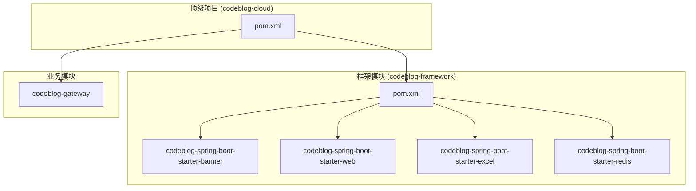
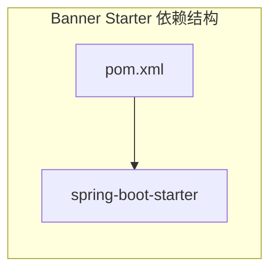
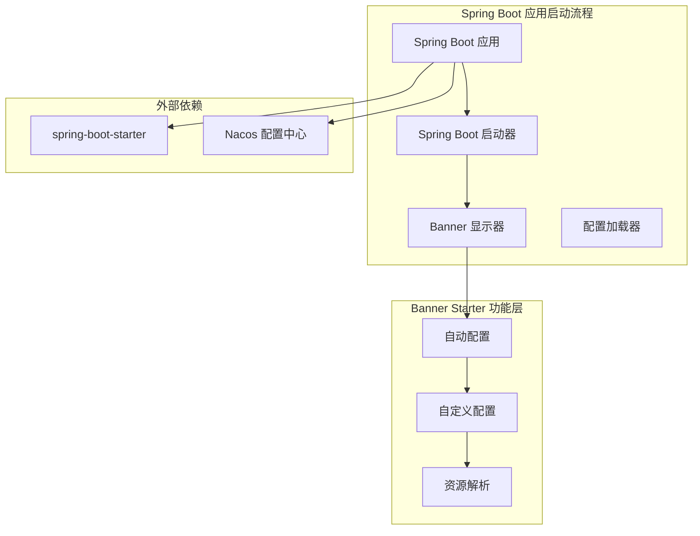
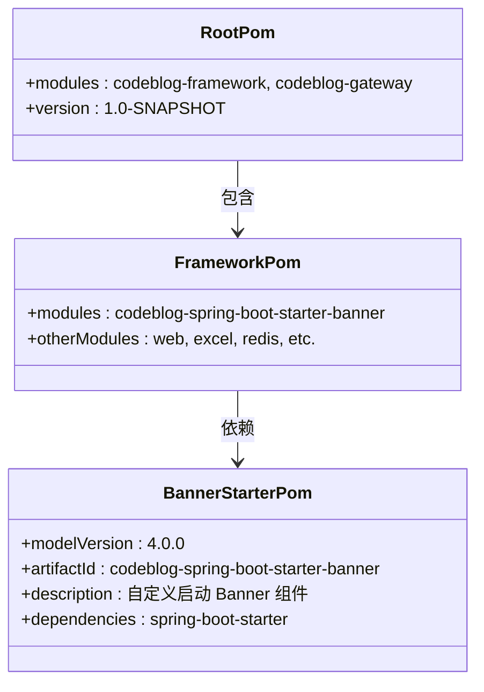
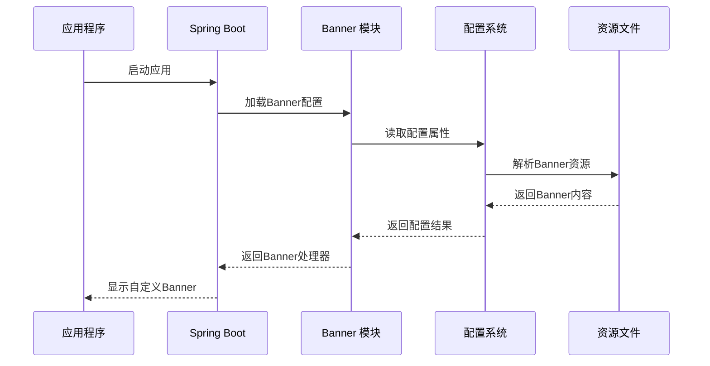
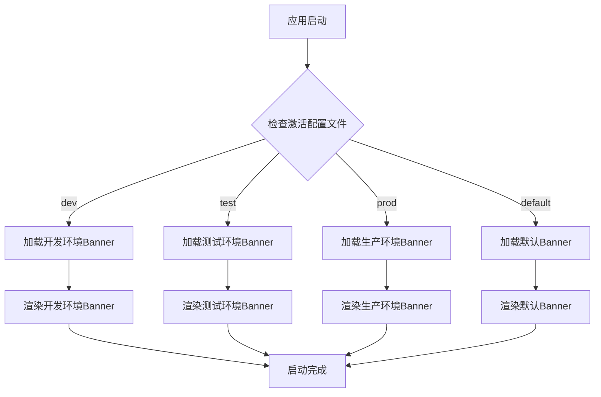

# Banner Starter 技术文档

<cite>
**本文档中引用的文件**
- [pom.xml](file://codeblog-framework/codeblog-spring-boot-starter-banner/pom.xml)
- [pom.xml](file://codeblog-framework/pom.xml)
- [pom.xml](file://pom.xml)
- [bootstrap.yml](file://codeblog-gateway/src/main/resources/bootstrap.yml)
</cite>

## 目录
1. [简介](#简介)
2. [项目结构](#项目结构)
3. [核心组件](#核心组件)
4. [架构概览](#架构概览)
5. [详细组件分析](#详细组件分析)
6. [配置与使用指南](#配置与使用指南)
7. [跨环境定制方案](#跨环境定制方案)
8. [性能考虑](#性能考虑)
9. [故障排除指南](#故障排除指南)
10. [结论](#结论)

## 简介

Banner Starter 是一个专门为Spring Boot应用提供自定义启动横幅功能的模块化组件。该模块通过Maven依赖的方式集成到Spring Boot项目中，为开发者提供了一个简单而强大的启动界面定制解决方案。

本模块的核心价值在于：
- **统一的启动界面体验**：为整个微服务架构提供一致的品牌展示
- **灵活的配置机制**：支持多环境差异化定制
- **轻量级设计**：最小化依赖，最大化实用性
- **易于集成**：遵循Spring Boot自动配置约定

## 项目结构

从整体项目架构来看，Banner Starter作为框架层的一个独立模块存在：



**图表来源**
- [pom.xml](file://pom.xml#L16-L20)
- [pom.xml](file://codeblog-framework/pom.xml#L1-L20)

**章节来源**
- [pom.xml](file://pom.xml#L16-L20)
- [pom.xml](file://codeblog-framework/pom.xml#L1-L20)

## 核心组件

### 模块依赖关系

Banner Starter模块采用极简的设计理念，仅包含必要的Spring Boot依赖：



**图表来源**
- [pom.xml](file://codeblog-framework/codeblog-spring-boot-starter-banner/pom.xml#L18-L23)

### 模块特性

该模块具备以下核心特性：
- **自动配置兼容性**：完全遵循Spring Boot的自动配置机制
- **零配置启动**：开箱即用，无需额外配置
- **可扩展性**：支持通过标准Spring Boot配置进行深度定制
- **版本统一管理**：通过依赖管理模块统一版本控制

**章节来源**
- [pom.xml](file://codeblog-framework/codeblog-spring-boot-starter-banner/pom.xml#L1-L25)

## 架构概览

### 整体架构设计



**图表来源**
- [pom.xml](file://codeblog-framework/codeblog-spring-boot-starter-banner/pom.xml#L18-L23)
- [bootstrap.yml](file://codeblog-gateway/src/main/resources/bootstrap.yml#L8-L13)

## 详细组件分析

### 模块配置分析

#### Maven配置结构



**图表来源**
- [pom.xml](file://codeblog-framework/codeblog-spring-boot-starter-banner/pom.xml#L1-L25)
- [pom.xml](file://codeblog-framework/pom.xml#L25)
- [pom.xml](file://pom.xml#L16-L20)

### 配置加载流程



**图表来源**
- [bootstrap.yml](file://codeblog-gateway/src/main/resources/bootstrap.yml#L1-L44)

**章节来源**
- [pom.xml](file://codeblog-framework/codeblog-spring-boot-starter-banner/pom.xml#L1-L25)

## 配置与使用指南

### 基础配置方法

#### Maven依赖添加

要在现有Spring Boot项目中启用Banner功能，需要在项目的`pom.xml`中添加相应的依赖声明。这通常通过在项目的依赖管理部分添加对`codeblog-spring-boot-starter-banner`模块的引用来实现。

#### 自定义Banner文件位置

根据Spring Boot的标准约定，自定义的Banner文件应该放置在以下位置之一：
- `src/main/resources/banner.txt` - 文本格式横幅
- `src/main/resources/banner.gif` - GIF格式Logo
- `src/main/resources/banner.jpg` - JPEG格式Logo
- `src/main/resources/banner.png` - PNG格式Logo

#### 字符集配置选项

为了确保Banner在不同环境下正确显示，可以配置字符集设置：

```yaml
# application.yml 中的配置示例
spring:
  main:
    banner-mode: "console"
  output:
    ansi:
    enabled: "always"
```

### 高级配置技巧

#### 版本信息动态注入

可以通过占位符机制在Banner中动态显示版本信息：

```
${application.version}
${spring-boot.version}
${application.name}
```

#### 多语言支持

对于国际化应用，可以准备多个版本的Banner文件：
- `banner_zh_CN.txt` - 中文版本
- `banner_en_US.txt` - 英文版本
- `banner_ja_JP.txt` - 日文版本

**章节来源**
- [bootstrap.yml](file://codeblog-gateway/src/main/resources/bootstrap.yml#L1-L44)

## 跨环境定制方案

### 开发环境配置

开发环境下的Banner应该突出团队协作和快速迭代的特点：

```yaml
# 开发环境配置
spring:
  application:
    name: ${application.name:codeblog-dev}
  output:
    ansi:
      enabled: "always"
logging:
  level:
    root: DEBUG
```

### 测试环境配置

测试环境的Banner需要体现质量保证和测试覆盖的理念：

```yaml
# 测试环境配置
spring:
  application:
    name: ${application.name:codeblog-test}
  profiles:
    active: test
```

### 生产环境配置

生产环境的Banner应该简洁专业，避免泄露敏感信息：

```yaml
# 生产环境配置
spring:
  application:
    name: ${application.name:codeblog-prod}
  output:
    ansi:
      enabled: "never"
management:
  endpoints:
    enabled-by-default: false
```

### 环境切换策略



**图表来源**
- [bootstrap.yml](file://codeblog-gateway/src/main/resources/bootstrap.yml#L18-L22)

## 性能考虑

### 启动性能影响

Banner显示对应用启动时间的影响极小，主要考虑因素包括：

- **文件I/O开销**：Banner文件读取通常在几毫秒内完成
- **内存占用**：Banner内容加载到内存后即可释放
- **ANSI颜色处理**：彩色输出会增加少量CPU开销

### 优化建议

1. **选择合适的文件格式**：优先使用文本格式以减少文件大小
2. **控制Banner复杂度**：避免过于复杂的ASCII艺术图案
3. **合理使用颜色**：过度的颜色渲染会影响启动速度
4. **缓存机制**：Spring Boot会自动缓存Banner内容

## 故障排除指南

### 常见问题及解决方案

#### Banner不显示问题

**问题描述**：应用启动时没有显示自定义Banner

**可能原因**：
1. Banner文件路径错误
2. 文件权限问题
3. 字符集编码不匹配
4. 配置文件语法错误

**解决步骤**：
1. 验证Banner文件位于正确的资源目录
2. 检查文件编码是否为UTF-8
3. 确认配置文件格式正确
4. 查看应用启动日志中的相关错误信息

#### 字符显示异常

**问题描述**：Banner中的特殊字符显示为乱码

**解决方案**：
1. 确保Banner文件保存为UTF-8编码
2. 在IDE中设置正确的文件编码
3. 检查终端或控制台的字符集设置

#### 性能问题

**问题描述**：应用启动变慢

**排查方法**：
1. 检查Banner文件大小
2. 减少Banner的复杂度
3. 关闭不必要的颜色输出
4. 使用简单的文本格式替代图片格式

**章节来源**
- [bootstrap.yml](file://codeblog-gateway/src/main/resources/bootstrap.yml#L1-L44)

## 结论

Banner Starter模块为Spring Boot应用提供了一个轻量级、可扩展的启动界面定制解决方案。通过合理的配置和最佳实践，开发者可以在保持应用性能的同时，为用户提供专业且具有品牌特色的启动体验。

### 主要优势

1. **简单易用**：遵循Spring Boot约定，零配置即可使用
2. **灵活定制**：支持多环境差异化配置
3. **性能友好**：对启动时间影响极小
4. **维护成本低**：基于标准Spring Boot机制

### 最佳实践建议

1. **版本控制**：将Banner文件纳入版本控制系统
2. **环境分离**：为不同环境准备专门的Banner配置
3. **性能监控**：定期检查Banner对启动性能的影响
4. **用户体验**：平衡美观性和实用性

通过合理利用Banner Starter模块，开发者可以显著提升应用的专业形象和用户体验，同时保持系统的简洁性和高性能特点。