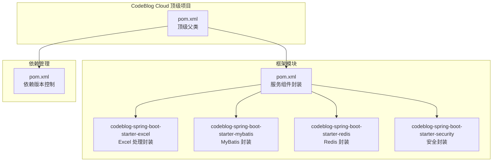
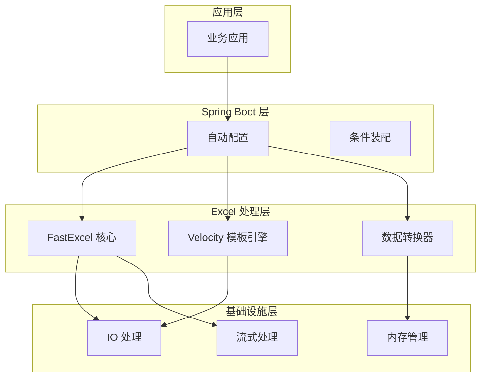
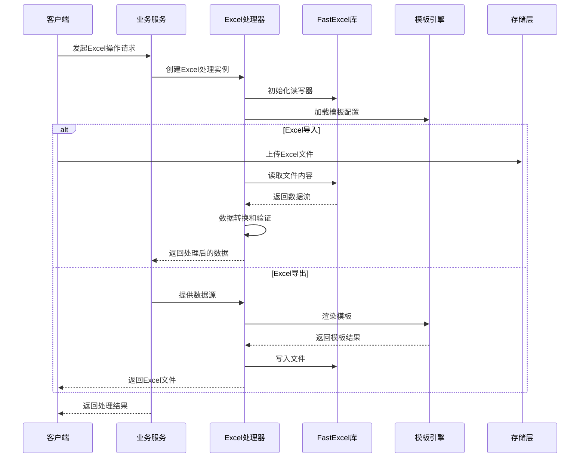
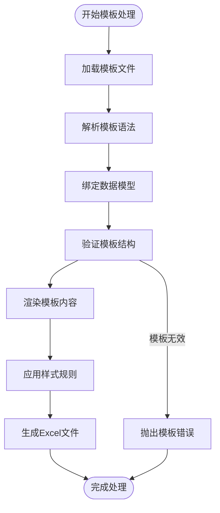
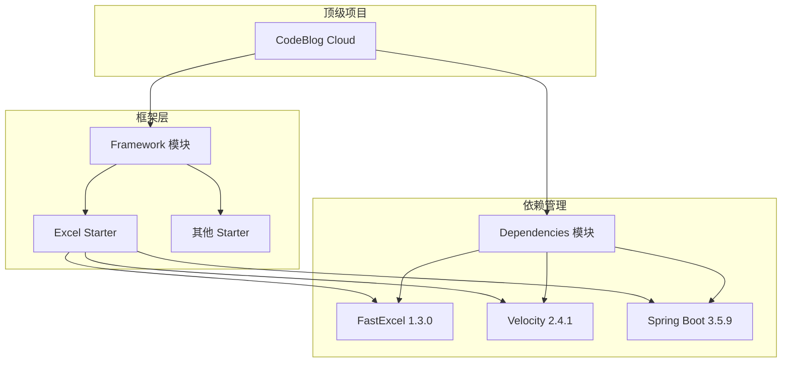

# Excel Starter

<cite>
**本文档引用的文件**
- [pom.xml](file://codeblog-framework/codeblog-spring-boot-starter-excel/pom.xml)
- [pom.xml](file://codeblog-framework/pom.xml)
- [pom.xml](file://codebolog-dependencies/pom.xml)
- [pom.xml](file://pom.xml)
</cite>

## 目录
1. [简介](#简介)
2. [项目结构](#项目结构)
3. [核心组件](#核心组件)
4. [架构概览](#架构概览)
5. [详细组件分析](#详细组件分析)
6. [依赖关系分析](#依赖关系分析)
7. [性能考虑](#性能考虑)
8. [故障排除指南](#故障排除指南)
9. [结论](#结论)

## 简介

Excel Starter 是 CodeBlog Cloud 微服务架构中的一个专用 Spring Boot Starter 模块，专门用于提供 Excel 文件导入导出功能。该模块基于 FastExcel 库构建，结合 Apache Velocity 模板引擎，为企业级应用提供高性能的 Excel 处理能力。

### 主要特性

- **高性能 Excel 处理**：基于 FastExcel 库，支持大文件的快速读写
- **灵活的数据转换**：支持多种数据类型的自动转换和格式化
- **模板驱动的导出**：利用 Velocity 模板引擎实现复杂的报表生成
- **批量化数据处理**：优化的大数据量处理策略
- **类型安全的配置**：通过 Spring Boot 自动配置提供类型安全的参数设置

## 项目结构

Excel Starter 模块位于 CodeBlog Cloud 项目的框架层中，作为独立的 Maven 模块存在：

**图表来源**
- [pom.xml](file://pom.xml#L16-L20)
- [pom.xml](file://codeblog-framework/pom.xml#L26-L37)
- [pom.xml](file://codebolog-dependencies/pom.xml#L1-L207)

**章节来源**
- [pom.xml](file://codeblog-framework/pom.xml#L14-L24)
- [pom.xml](file://codeblog-framework/codeblog-spring-boot-starter-excel/pom.xml#L1-L45)

## 核心组件

### 依赖管理

Excel Starter 模块的核心依赖包括：

#### FastExcel 库
- **版本**：1.3.0
- **用途**：高性能的 Excel 文件读写库
- **特性**：支持 XLSX 和 CSV 格式，内存友好的流式处理

#### Apache Velocity 模板引擎
- **版本**：2.4.1
- **用途**：提供强大的模板渲染能力
- **特性**：支持复杂的模板逻辑和数据绑定

#### Spring Boot 生态系统
- **Spring Boot Starter**：提供自动配置和条件装配
- **Spring Boot Configuration Processor**：支持配置元数据生成

**章节来源**
- [pom.xml](file://codeblog-framework/codeblog-spring-boot-starter-excel/pom.xml#L18-L43)
- [pom.xml](file://codebolog-dependencies/pom.xml#L67-L202)

## 架构概览

Excel Starter 模块采用分层架构设计，结合了现代微服务架构的最佳实践：

**图表来源**
- [pom.xml](file://codeblog-framework/codeblog-spring-boot-starter-excel/pom.xml#L18-L43)

### 数据流处理

Excel 处理的数据流遵循以下模式：

## 详细组件分析

### FastExcel 集成

FastExcel 是 Excel Starter 的核心组件，提供了高性能的 Excel 文件处理能力：

#### 主要功能特性
- **流式读取**：支持大文件的流式读取，避免内存溢出
- **批量写入**：优化的批量写入机制，提升处理效率
- **多格式支持**：同时支持 XLSX 和 CSV 格式
- **类型安全**：提供编译时类型检查和运行时类型验证

#### 性能优化策略
- **内存池管理**：智能的内存分配和回收机制
- **并发处理**：支持多线程并行处理
- **延迟加载**：按需加载数据，减少初始化开销

### Velocity 模板引擎集成

模板引擎为 Excel 导出提供了强大的模板渲染能力：

#### 模板处理流程

**图表来源**
- [pom.xml](file://codeblog-framework/codeblog-spring-boot-starter-excel/pom.xml#L25-L29)

### 数据转换与验证

Excel Starter 提供了完善的数据转换和验证机制：

#### 类型转换体系
- **基础类型转换**：String、Integer、Double、Boolean 等
- **日期时间转换**：支持多种日期格式
- **自定义类型转换**：可扩展的转换器接口

#### 数据验证策略
- **格式验证**：确保数据符合预期格式
- **范围验证**：检查数值范围的有效性
- **业务规则验证**：支持复杂的业务规则检查

## 依赖关系分析

### 依赖层次结构

**图表来源**
- [pom.xml](file://pom.xml#L16-L20)
- [pom.xml](file://codeblog-framework/pom.xml#L26-L37)
- [pom.xml](file://codebolog-dependencies/pom.xml#L19-L207)

### 版本管理策略

Excel Starter 模块的依赖版本通过集中管理的方式进行维护：

#### 版本属性定义
- **fastexcel.version**：1.3.0
- **velocity.version**：2.4.1
- **spring.boot.version**：3.5.9

#### 依赖管理最佳实践
- **统一版本控制**：通过父 POM 管理所有子模块的版本
- **可选依赖声明**：使用 `<optional>true</optional>` 标记可选依赖
- **条件装配**：利用 Spring Boot 的条件注解实现按需加载

**章节来源**
- [pom.xml](file://codebolog-dependencies/pom.xml#L16-L92)
- [pom.xml](file://codebolog-dependencies/pom.xml#L196-L202)

## 性能考虑

### 大数据量处理策略

Excel Starter 模块针对大数据量场景进行了专门优化：

#### 内存管理优化
- **流式处理**：避免将整个文件加载到内存中
- **分块读取**：支持按行或按块读取数据
- **垃圾回收优化**：及时释放临时对象和缓冲区

#### 并发处理能力
- **多线程支持**：支持并行处理多个 Excel 文件
- **异步处理**：提供异步 API 支持长时间运行的操作
- **连接池管理**：优化数据库连接和外部服务调用

#### 缓存策略
- **模板缓存**：缓存已解析的模板以提高重复渲染性能
- **元数据缓存**：缓存文件结构和列定义信息
- **转换器缓存**：缓存类型转换器实例

### 性能监控指标

建议监控以下关键性能指标：
- **处理速度**：每秒处理的记录数
- **内存使用**：峰值内存占用和 GC 次数
- **并发度**：同时处理的文件数量
- **错误率**：处理失败的比例

## 故障排除指南

### 常见问题及解决方案

#### Excel 文件格式问题
**问题描述**：Excel 文件无法正确读取或写入
**解决方案**：
1. 确认文件格式支持（XLSX、CSV）
2. 检查文件编码和字符集
3. 验证文件完整性

#### 内存溢出问题
**问题描述**：处理大文件时出现 OutOfMemoryError
**解决方案**：
1. 使用流式处理替代一次性加载
2. 调整 JVM 内存参数
3. 实施分批处理策略

#### 模板渲染错误
**问题描述**：模板渲染过程中出现异常
**解决方案**：
1. 检查模板语法和变量引用
2. 验证数据模型的完整性
3. 查看模板引擎的错误日志

### 错误处理最佳实践

#### 异常分类处理
- **输入验证异常**：参数校验失败时抛出
- **文件操作异常**：文件读写失败时处理
- **业务逻辑异常**：数据转换或验证失败时处理

#### 日志记录策略
- **详细日志**：记录操作步骤和中间状态
- **错误日志**：捕获异常详情和堆栈跟踪
- **性能日志**：记录关键操作的执行时间

## 结论

Excel Starter 模块为 CodeBlog Cloud 微服务架构提供了专业化的 Excel 处理能力。通过集成 FastExcel 和 Apache Velocity，该模块实现了高性能、可扩展的 Excel 导入导出功能。

### 技术优势

1. **高性能**：基于 FastExcel 的流式处理机制
2. **易用性**：Spring Boot 自动配置简化集成
3. **可扩展性**：模块化设计支持功能扩展
4. **稳定性**：完善的错误处理和性能监控

### 发展方向

随着企业对 Excel 处理需求的不断增长，Excel Starter 模块可以进一步增强：
- 支持更多 Excel 格式和功能
- 提供更丰富的模板定制选项
- 增强大数据量处理能力
- 优化移动端和云端部署体验

该模块为构建现代化的企业级应用提供了坚实的基础，特别是在需要复杂数据处理和报表生成功能的场景中。