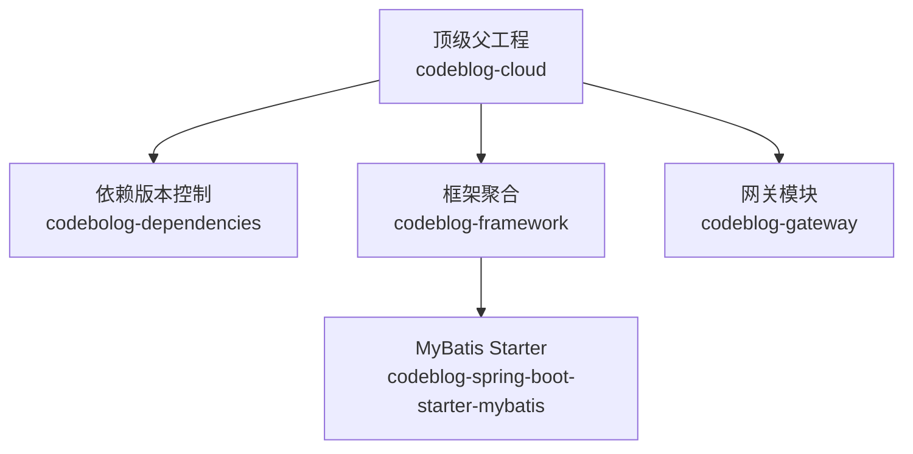
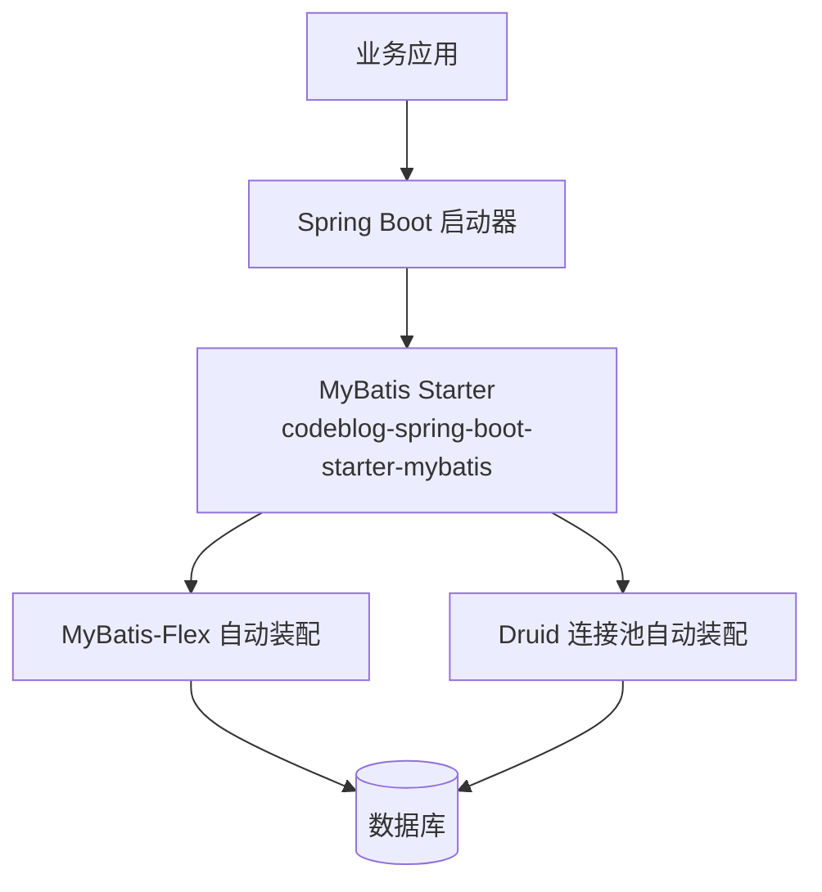
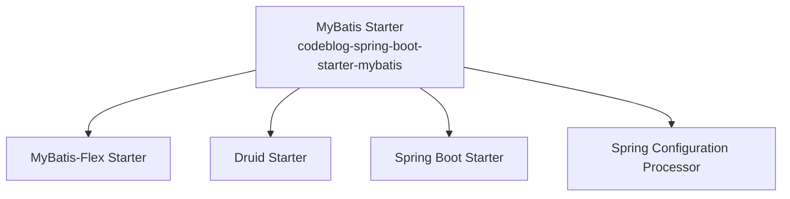

# MyBatis Starter

<cite>
**本文引用的文件**
- [codeblog-spring-boot-starter-mybatis/pom.xml](file://codeblog-framework/codeblog-spring-boot-starter-mybatis/pom.xml)
- [codebolog-dependencies/pom.xml](file://codebolog-dependencies/pom.xml)
- [codeblog-framework/pom.xml](file://codeblog-framework/pom.xml)
- [pom.xml](file://pom.xml)
- [codeblog-gateway/src/main/resources/bootstrap.yml](file://codeblog-gateway/src/main/resources/bootstrap.yml)
</cite>

## 目录
1. [简介](#简介)
2. [项目结构](#项目结构)
3. [核心组件](#核心组件)
4. [架构总览](#架构总览)
5. [组件详解](#组件详解)
6. [依赖关系分析](#依赖关系分析)
7. [性能与优化](#性能与优化)
8. [故障排查指南](#故障排查指南)
9. [结论](#结论)
10. [附录](#附录)

## 简介
本文件面向“MyBatis Starter”模块，聚焦于在本项目中通过 Spring Boot Starter 封装 MyBatis-Flex 的集成方式，以及配套的 Druid 连接池自动装配能力。文档从架构与组件入手，结合 Maven 依赖与版本管理，说明如何在应用中启用 MyBatis-Flex 的基础能力，并给出数据访问层开发的实践建议与常见问题排查思路。

## 项目结构
该模块位于框架聚合工程之下，采用多模块组织方式，顶层父工程统一版本与模块划分；MyBatis Starter 作为框架子模块之一，负责对外提供 ORM 访问能力的自动化装配。

图表来源
- [pom.xml](file://pom.xml#L1-L23)
- [codeblog-framework/pom.xml](file://codeblog-framework/pom.xml#L1-L20)
- [codebolog-dependencies/pom.xml](file://codebolog-dependencies/pom.xml#L1-L24)

章节来源
- [pom.xml](file://pom.xml#L16-L20)
- [codeblog-framework/pom.xml](file://codeblog-framework/pom.xml#L12-L20)
- [codebolog-dependencies/pom.xml](file://codebolog-dependencies/pom.xml#L16-L24)

## 核心组件
- MyBatis-Flex 自动装配
  - 通过引入 MyBatis-Flex 的 Spring Boot Starter，实现对 MyBatis-Flex 的自动装配与扫描，简化 Mapper 接口与实体映射的初始化流程。
- Druid 连接池自动装配
  - 引入 Druid 的 Spring Boot Starter，实现数据库连接池的自动配置与监控能力，便于在应用中直接使用。
- Spring Boot 基础能力
  - 通过 Spring Boot Starter 提供的基础环境，确保上述组件能够与 Spring 容器无缝集成。

章节来源
- [codeblog-spring-boot-starter-mybatis/pom.xml](file://codeblog-framework/codeblog-spring-boot-starter-mybatis/pom.xml#L18-L42)

## 架构总览
下图展示了 MyBatis Starter 在应用中的位置与依赖关系，以及与 Spring Boot、Druid 和 MyBatis-Flex 的交互：

图表来源
- [codeblog-spring-boot-starter-mybatis/pom.xml](file://codeblog-framework/codeblog-spring-boot-starter-mybatis/pom.xml#L18-L42)

## 组件详解

### MyBatis-Flex 集成配置
- 自动装配机制
  - 通过引入 MyBatis-Flex 的 Spring Boot Starter，应用启动时会自动注册必要的 Bean，包括但不限于 SQL 会话工厂、Mapper 扫描器等，从而降低手动配置成本。
- 实体映射与 Mapper
  - 在自动装配生效后，可通过标准的 Mapper 接口进行数据访问，无需额外的手工 XML 或注解配置即可完成基础 CRUD 与条件查询。
- 动态数据源支持
  - MyBatis-Flex 支持基于注解或配置的多数据源切换与路由策略。在本 Starter 中，若需要启用动态数据源，可在应用侧按 MyBatis-Flex 的官方文档进行扩展配置（例如通过注解标注数据源键并在运行时切换）。

章节来源
- [codeblog-spring-boot-starter-mybatis/pom.xml](file://codeblog-framework/codeblog-spring-boot-starter-mybatis/pom.xml#L18-L23)

### Druid 连接池配置
- 自动装配
  - 引入 Druid 的 Spring Boot Starter 后，应用启动时会自动注册 Druid 的数据源与监控 Bean，简化连接池的初始化与配置过程。
- 常见配置项
  - 应用侧通常需要提供数据库连接地址、用户名、密码等基础信息；Druid Starter 会在此基础上自动完成连接池参数的默认化与可选覆盖。
- 监控能力
  - Druid 提供内置监控页面与指标采集能力，便于在生产环境中观察连接池状态与慢查询情况。

章节来源
- [codeblog-spring-boot-starter-mybatis/pom.xml](file://codeblog-framework/codeblog-spring-boot-starter-mybatis/pom.xml#L25-L29)

### 版本与依赖管理
- 依赖版本由顶层依赖控制模块集中管理，确保各子模块在统一的 Spring Boot、Spring Cloud 及相关生态版本下协同工作。
- MyBatis Starter 仅承担“装配职责”，不直接引入具体驱动或业务实现，避免与上层应用产生不必要的耦合。

章节来源
- [codebolog-dependencies/pom.xml](file://codebolog-dependencies/pom.xml#L16-L24)
- [codeblog-framework/pom.xml](file://codeblog-framework/pom.xml#L12-L20)

### 配置文件与运行时要点
- 应用配置
  - 在应用侧的配置文件中，应提供数据库连接信息与 Druid 相关参数；Spring Boot 会根据 Starter 的约定自动装配。
- 网关模块示例
  - 网关模块的引导配置文件展示了如何通过 Spring Cloud Alibaba Nacos 进行服务发现与配置拉取，这与 MyBatis Starter 的装配无直接冲突，但体现了应用整体的配置风格。

章节来源
- [codeblog-gateway/src/main/resources/bootstrap.yml](file://codeblog-gateway/src/main/resources/bootstrap.yml#L1-L44)

## 依赖关系分析
MyBatis Starter 的依赖关系如下所示，体现了其在框架中的定位与职责边界：

图表来源
- [codeblog-spring-boot-starter-mybatis/pom.xml](file://codeblog-framework/codeblog-spring-boot-starter-mybatis/pom.xml#L18-L42)

章节来源
- [codeblog-spring-boot-starter-mybatis/pom.xml](file://codeblog-framework/codeblog-spring-boot-starter-mybatis/pom.xml#L18-L42)

## 性能与优化
- 连接池优化
  - 合理设置 Druid 连接池的初始大小、最大活跃数、空闲超时与获取超时等参数，避免连接争用与资源浪费。
- SQL 与缓存
  - 利用 MyBatis-Flex 的条件构造器与分页能力，减少手写复杂 SQL 的负担；结合 Redis 等缓存组件，对热点数据进行缓存以降低数据库压力。
- 监控与诊断
  - 开启 Druid 的监控页面与慢查询记录，定期巡检连接池健康度与 SQL 性能瓶颈。
- 分库分表与读写分离
  - 在业务增长后，可借助 MyBatis-Flex 的动态数据源能力进行分库分表与读写分离的渐进式演进。

## 故障排查指南
- 启动失败或无法发现 Mapper
  - 检查是否正确引入 MyBatis-Flex Starter；确认实体类与 Mapper 接口的包扫描路径已正确配置。
- 数据库连接异常
  - 检查应用配置文件中的数据库连接信息是否正确；确认 Druid Starter 已生效且连接池参数合理。
- 多数据源切换无效
  - 检查动态数据源的注解或路由配置是否正确；确保在执行前已设置正确的数据源键。
- 监控页面不可用
  - 确认 Druid Starter 的端点与页面配置已开启；检查安全策略是否拦截了监控访问。

## 结论
MyBatis Starter 通过引入 MyBatis-Flex 与 Druid 的 Spring Boot Starter，实现了数据访问层的快速集成与自动装配。它将复杂的初始化逻辑封装在 Starter 内部，使上层应用能够专注于业务 Mapper 与实体映射的开发。配合合理的连接池参数、监控与缓存策略，可进一步提升系统的稳定性与性能表现。

## 附录
- 使用建议
  - 在应用侧仅引入 Starter 依赖，避免重复引入底层实现；将数据库驱动与业务实现下沉到 Starter 或上层模块。
  - 对于复杂查询与批量操作，优先使用 MyBatis-Flex 的条件构造器与批处理能力，减少手写 SQL 的维护成本。
- 扩展方向
  - 动态数据源：在本 Starter 基础上，结合 MyBatis-Flex 的多数据源能力，按需扩展路由规则与切换策略。
  - 插件与拦截器：如需自定义 SQL 日志、审计或权限控制，可在应用侧注册相应的插件或拦截器，保持与 Starter 的解耦。