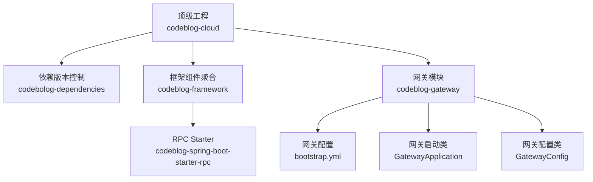
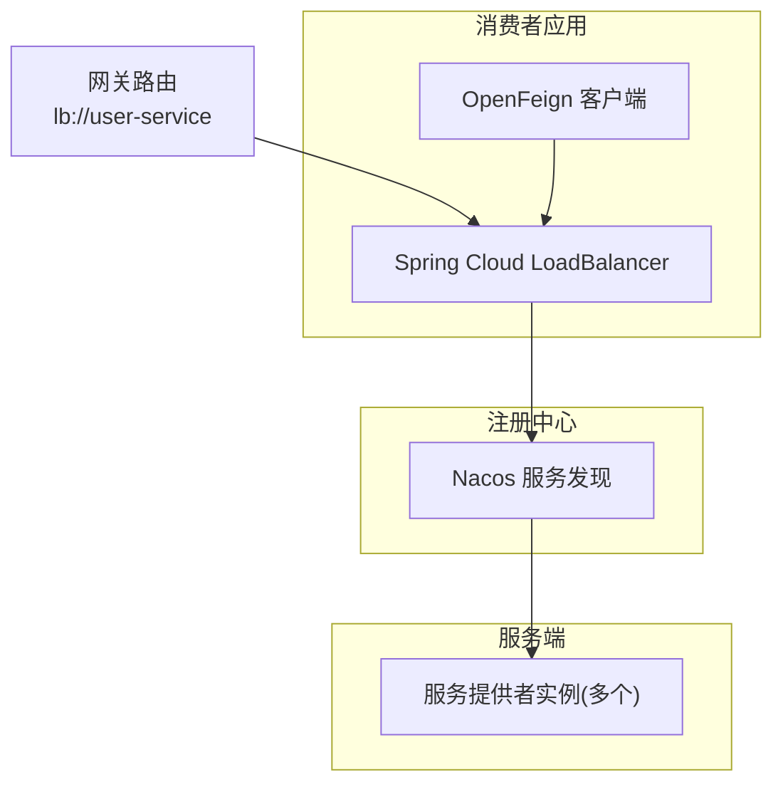
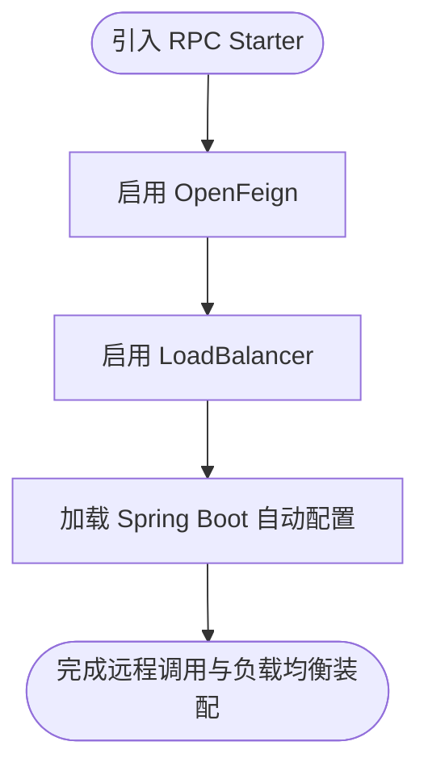
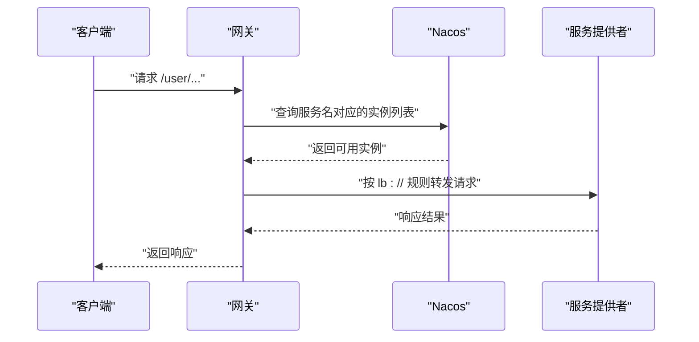
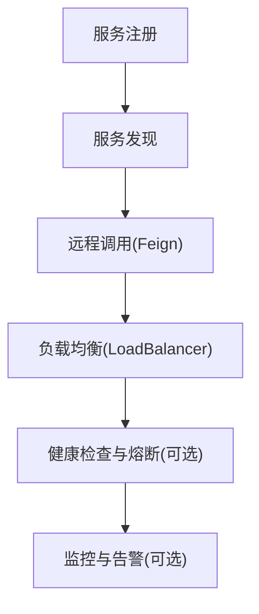
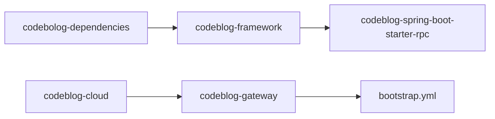

# RPC Starter

<cite>
**本文引用的文件**
- [codeblog-spring-boot-starter-rpc/pom.xml](file://codeblog-framework/codeblog-spring-boot-starter-rpc/pom.xml)
- [codeblog-framework/pom.xml](file://codeblog-framework/pom.xml)
- [codebolog-dependencies/pom.xml](file://codebolog-dependencies/pom.xml)
- [codeblog-gateway/pom.xml](file://codeblog-gateway/pom.xml)
- [codeblog-gateway/src/main/resources/bootstrap.yml](file://codeblog-gateway/src/main/resources/bootstrap.yml)
- [codeblog-gateway/src/main/java/site/codeblog/GatewayApplication.java](file://codeblog-gateway/src/main/java/site/codeblog/GatewayApplication.java)
- [codeblog-gateway/src/main/java/site/codeblog/gateway/config/GatewayConfig.java](file://codeblog-gateway/src/main/java/site/codeblog/gateway/config/GatewayConfig.java)
</cite>

## 目录
1. [简介](#简介)
2. [项目结构](#项目结构)
3. [核心组件](#核心组件)
4. [架构总览](#架构总览)
5. [详细组件分析](#详细组件分析)
6. [依赖分析](#依赖分析)
7. [性能考虑](#性能考虑)
8. [故障排除指南](#故障排除指南)
9. [结论](#结论)
10. [附录](#附录)

## 简介
本文件面向“RPC Starter”模块，聚焦基于 Spring Cloud OpenFeign 的远程调用能力与配套的负载均衡、服务发现、容错等微服务治理能力。当前仓库中 RPC Starter 以 Maven 模块形式提供依赖装配，核心依赖包括 OpenFeign 与 Spring Cloud LoadBalancer，用于简化声明式 HTTP 客户端与客户端侧负载均衡。结合网关模块对 Nacos 服务发现与路由规则的配置，可形成从消费者到服务端的服务治理闭环。

## 项目结构
- 顶层聚合工程负责模块划分与版本统一，其中 codeblog-framework 作为框架组件聚合模块，包含 RPC Starter 子模块；codeblog-gateway 提供网关与服务发现配置示例。
- RPC Starter 通过 Maven 依赖引入 OpenFeign 与 LoadBalancer，作为远程调用与负载均衡的基础能力。
- 网关模块演示了 Nacos 服务发现地址配置、路由规则与负载均衡 URI 协议的使用方式。

图表来源
- [codeblog-gateway/pom.xml](file://codeblog-gateway/pom.xml#L1-L20)
- [codeblog-framework/pom.xml](file://codeblog-framework/pom.xml#L1-L20)
- [codebolog-dependencies/pom.xml](file://codebolog-dependencies/pom.xml#L1-L24)

章节来源
- [codeblog-gateway/pom.xml](file://codeblog-gateway/pom.xml#L1-L20)
- [codeblog-framework/pom.xml](file://codeblog-framework/pom.xml#L1-L20)
- [codebolog-dependencies/pom.xml](file://codebolog-dependencies/pom.xml#L1-L24)

## 核心组件
- OpenFeign：声明式 HTTP 客户端，简化远程调用的接口定义与调用流程。
- Spring Cloud LoadBalancer：客户端侧负载均衡，配合服务名进行多实例间的选择。
- Nacos：服务注册与发现，为 OpenFeign 与 LoadBalancer 提供服务列表与健康状态。
- 网关路由：通过 lb:// 前缀将请求转发至服务名，由 LoadBalancer 实现本地负载均衡。

章节来源
- [codeblog-spring-boot-starter-rpc/pom.xml](file://codeblog-framework/codeblog-spring-boot-starter-rpc/pom.xml#L18-L42)
- [codeblog-gateway/src/main/resources/bootstrap.yml](file://codeblog-gateway/src/main/resources/bootstrap.yml#L14-L22)

## 架构总览
下图展示了 RPC Starter 在微服务体系中的位置与交互关系：消费者侧通过 OpenFeign 发起远程调用，LoadBalancer 基于服务名从 Nacos 获取实例列表并进行负载均衡；网关层可将请求路由到对应服务名，同样受益于客户端负载均衡。

图表来源
- [codeblog-spring-boot-starter-rpc/pom.xml](file://codeblog-framework/codeblog-spring-boot-starter-rpc/pom.xml#L18-L42)
- [codeblog-gateway/src/main/resources/bootstrap.yml](file://codeblog-gateway/src/main/resources/bootstrap.yml#L14-L22)

## 详细组件分析

### 组件A：RPC Starter 依赖装配
- 作用：为应用提供 OpenFeign 与 LoadBalancer 的自动装配与配置入口，降低远程调用与负载均衡的接入成本。
- 关键依赖：
  - spring-cloud-starter-openfeign：提供 Feign 客户端能力。
  - spring-cloud-starter-loadbalancer：提供客户端侧负载均衡。
  - spring-boot-starter：基础 Spring Boot 启动能力。
  - spring-boot-configuration-processor：支持配置元数据生成，便于 IDE 与配置提示。

图表来源
- [codeblog-spring-boot-starter-rpc/pom.xml](file://codeblog-framework/codeblog-spring-boot-starter-rpc/pom.xml#L18-L42)

章节来源
- [codeblog-spring-boot-starter-rpc/pom.xml](file://codeblog-framework/codeblog-spring-boot-starter-rpc/pom.xml#L1-L45)

### 组件B：网关与服务发现配置
- 网关通过 Nacos 进行服务发现与配置管理，路由规则示例中使用 lb:// 前缀指向服务名，从而触发客户端负载均衡。
- 关键点：
  - Nacos 服务发现地址配置。
  - 路由规则与过滤器组合，实现路径匹配与前缀剥离。
  - Redis 与 Sa-Token 配置片段（示例性）。

图表来源
- [codeblog-gateway/src/main/resources/bootstrap.yml](file://codeblog-gateway/src/main/resources/bootstrap.yml#L7-L22)

章节来源
- [codeblog-gateway/src/main/resources/bootstrap.yml](file://codeblog-gateway/src/main/resources/bootstrap.yml#L1-L44)
- [codeblog-gateway/src/main/java/site/codeblog/GatewayApplication.java](file://codeblog-gateway/src/main/java/site/codeblog/GatewayApplication.java#L1-L16)
- [codeblog-gateway/src/main/java/site/codeblog/gateway/config/GatewayConfig.java](file://codeblog-gateway/src/main/java/site/codeblog/gateway/config/GatewayConfig.java#L1-L28)

### 组件C：服务治理与监控（概念性）
- 服务治理：通过 Nacos 实现服务注册与发现，结合 OpenFeign 与 LoadBalancer 实现服务调用与负载均衡。
- 监控告警：可扩展接入链路追踪与指标采集（如 Zipkin/Sleuth、Micrometer+Prometheus），在本仓库中未直接体现具体实现，但具备扩展空间。

（本图为概念性说明，不对应具体源码）

## 依赖分析
- 版本统一：顶层依赖模块集中管理 Spring Boot、Spring Cloud、Spring Cloud Alibaba 等版本，确保 RPC Starter 与上层应用的兼容性。
- 模块关系：RPC Starter 位于框架聚合模块之下，网关模块独立于 RPC Starter，但可复用其依赖能力与服务发现配置。

图表来源
- [codebolog-dependencies/pom.xml](file://codebolog-dependencies/pom.xml#L16-L24)
- [codeblog-framework/pom.xml](file://codeblog-framework/pom.xml#L1-L20)
- [codeblog-gateway/pom.xml](file://codeblog-gateway/pom.xml#L1-L20)

章节来源
- [codebolog-dependencies/pom.xml](file://codebolog-dependencies/pom.xml#L1-L24)
- [codeblog-framework/pom.xml](file://codeblog-framework/pom.xml#L1-L20)
- [codeblog-gateway/pom.xml](file://codeblog-gateway/pom.xml#L1-L20)

## 性能考虑
- 客户端负载均衡策略：根据服务实例数量与权重选择合适的负载均衡算法，避免热点实例。
- 超时与重试：合理设置 OpenFeign 的连接与读取超时，必要时结合重试策略提升可用性。
- 序列化与压缩：在服务端与客户端协商一致的序列化方式与压缩策略，减少网络传输开销。
- 并发与线程池：控制并发请求数量与线程池大小，防止资源耗尽。
- 缓存与降级：对热点数据与非关键接口采用缓存与熔断降级，提升整体吞吐与稳定性。

（本节为通用性能建议，不直接分析具体文件）

## 故障排除指南
- 服务发现失败
  - 检查 Nacos 地址配置是否正确。
  - 确认服务是否成功注册且处于健康状态。
- 负载均衡异常
  - 核对 lb:// 前缀的路由规则是否正确指向服务名。
  - 检查 LoadBalancer 的实例列表是否为空。
- 调用超时或失败
  - 调整 OpenFeign 的超时与重试配置。
  - 排查网络连通性与防火墙策略。
- 网关路由问题
  - 确认路由断言与过滤器配置是否满足预期。
  - 检查服务名大小写与命名规范。

章节来源
- [codeblog-gateway/src/main/resources/bootstrap.yml](file://codeblog-gateway/src/main/resources/bootstrap.yml#L7-L22)

## 结论
RPC Starter 通过 OpenFeign 与 Spring Cloud LoadBalancer，为微服务场景提供了简洁的远程调用与客户端负载均衡能力。结合 Nacos 服务发现与网关路由配置，可快速构建从消费者到服务端的服务治理体系。实际项目中可根据业务需求进一步完善监控、限流、熔断与安全等高级特性。

## 附录
- 使用建议
  - 在消费者侧定义 Feign 接口，标注服务名与路径，即可发起远程调用。
  - 在网关层使用 lb:// 前缀进行路由转发，实现统一入口与负载均衡。
  - 结合 Nacos 进行服务注册与发现，确保服务上下线时的平滑切换。

（本节为通用使用建议，不直接分析具体文件）