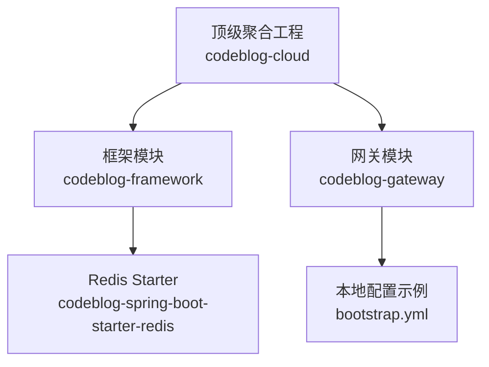
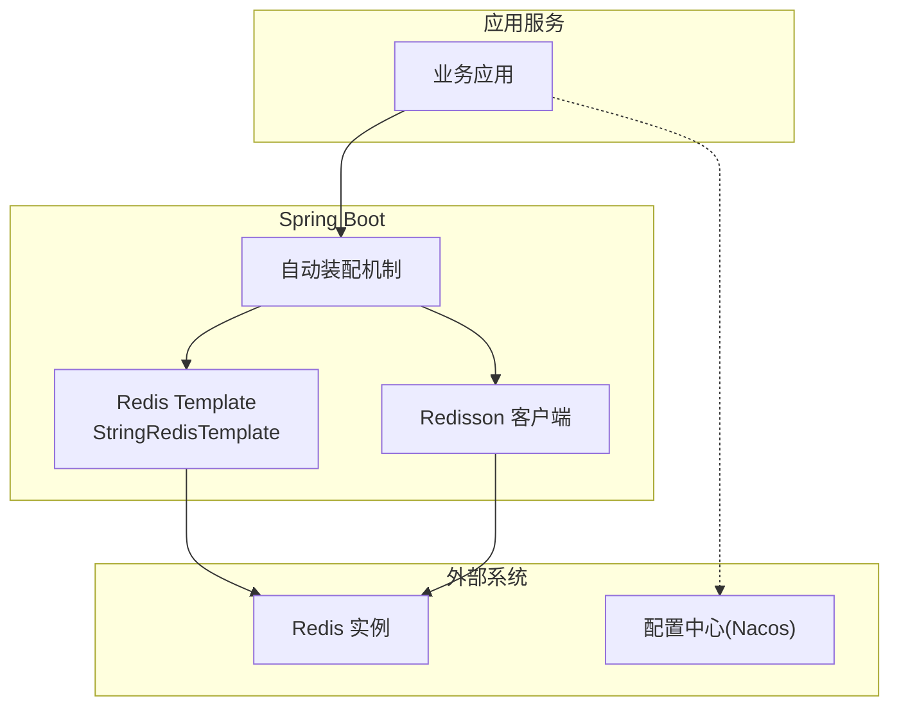
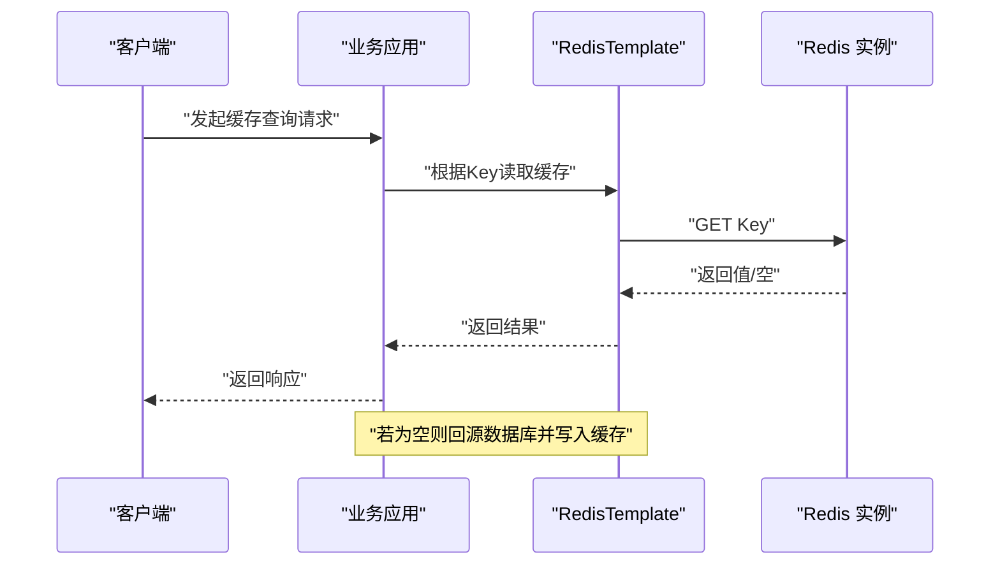
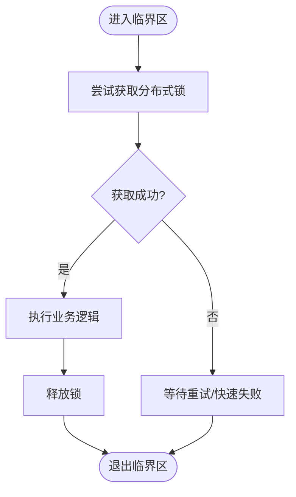
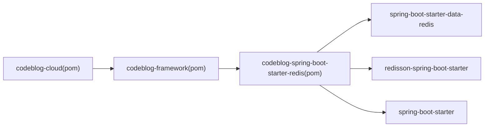

# Redis Starter

<cite>
**本文引用的文件**
- [codeblog-spring-boot-starter-redis/pom.xml](file://codeblog-framework/codeblog-spring-boot-starter-redis/pom.xml)
- [codeblog-framework/pom.xml](file://codeblog-framework/pom.xml)
- [codebolog-dependencies/pom.xml](file://codebolog-dependencies/pom.xml)
- [codeblog-cloud/pom.xml](file://pom.xml)
- [gateway/bootstrap.yml](file://codeblog-gateway/src/main/resources/bootstrap.yml)
</cite>

## 目录
1. [简介](#简介)
2. [项目结构](#项目结构)
3. [核心组件](#核心组件)
4. [架构总览](#架构总览)
5. [详细组件分析](#详细组件分析)
6. [依赖关系分析](#依赖关系分析)
7. [性能考虑](#性能考虑)
8. [故障排查指南](#故障排查指南)
9. [结论](#结论)
10. [附录](#附录)

## 简介
本文件面向“Redis Starter”模块，围绕Spring Boot与Redis的集成进行系统化技术说明。该模块通过引入Redisson与Spring Boot Data Redis Starter，为微服务提供统一的Redis客户端能力，覆盖分布式缓存、分布式锁、会话管理等典型场景。本文将从架构、组件、数据流、配置项、最佳实践到性能优化进行全面阐述，帮助开发者在微服务中正确、高效地使用Redis。

## 项目结构
- 顶层聚合工程负责版本与模块管理，框架层提供各类Starter封装，其中Redis Starter作为框架层的一个子模块存在。
- Redis Starter模块通过Maven依赖引入Redisson与Spring Data Redis，形成“Starter + 客户端库”的组合，简化应用接入成本。
- 网关模块在本地开发时提供了基础的Redis连接配置示例，便于验证连接与基本功能。

图示来源
- [codeblog-cloud/pom.xml](file://pom.xml#L16-L20)
- [codeblog-framework/pom.xml](file://codeblog-framework/pom.xml#L12-L20)
- [codeblog-spring-boot-starter-redis/pom.xml](file://codeblog-framework/codeblog-spring-boot-starter-redis/pom.xml#L1-L45)
- [gateway/bootstrap.yml](file://codeblog-gateway/src/main/resources/bootstrap.yml#L23-L28)

章节来源
- [codeblog-cloud/pom.xml](file://pom.xml#L16-L20)
- [codeblog-framework/pom.xml](file://codeblog-framework/pom.xml#L12-L20)
- [codeblog-spring-boot-starter-redis/pom.xml](file://codeblog-framework/codeblog-spring-boot-starter-redis/pom.xml#L1-L45)
- [gateway/bootstrap.yml](file://codeblog-gateway/src/main/resources/bootstrap.yml#L23-L28)

## 核心组件
- Redisson自动装配与客户端
  - 通过引入Redisson Spring Boot Starter，自动完成Redisson客户端的初始化与Bean注册，提供高级特性如分布式对象、分布式集合、分布式锁、限流器等。
- Spring Data Redis自动装配
  - 引入Spring Boot Data Redis Starter后，自动装配Redis连接工厂、RedisTemplate、StringRedisTemplate等常用组件，满足基础缓存读写需求。
- 配置处理器
  - 引入spring-boot-configuration-processor，用于生成配置元数据，提升IDE提示与配置校验体验。

章节来源
- [codeblog-spring-boot-starter-redis/pom.xml](file://codeblog-framework/codeblog-spring-boot-starter-redis/pom.xml#L18-L42)

## 架构总览
下图展示了Redis Starter在微服务中的位置与依赖关系，以及与应用、配置中心、外部Redis实例之间的交互路径。

图示来源
- [codeblog-spring-boot-starter-redis/pom.xml](file://codeblog-framework/codeblog-spring-boot-starter-redis/pom.xml#L18-L35)
- [gateway/bootstrap.yml](file://codeblog-gateway/src/main/resources/bootstrap.yml#L23-L28)

## 详细组件分析

### Redis连接配置与模式支持
- 基础连接参数
  - 网关模块示例展示了host、port、database等基础连接参数，这些参数通常来自配置中心或环境变量，启动时由Spring Boot加载。
- 集群模式
  - Redisson支持集群模式，可通过配置指定多个节点地址与密码认证信息，实现高可用与分片扩展。
- 哨兵模式
  - Redisson支持哨兵模式，可配置主从切换与故障转移，确保在主节点故障时自动切换至从节点。
- 认证与安全
  - 支持密码认证与TLS连接，建议在生产环境启用TLS以保障传输安全。
- 连接池与超时
  - 合理设置连接池大小、命令超时与连接超时，避免资源耗尽与请求堆积。

章节来源
- [gateway/bootstrap.yml](file://codeblog-gateway/src/main/resources/bootstrap.yml#L23-L28)

### 分布式缓存使用
- 缓存读写流程
  - 应用通过RedisTemplate/StringRedisTemplate进行键值读写；对于复杂对象，建议序列化策略与TTL策略统一规划。
- 缓存策略设计
  - LRU/LFU/TTL等策略结合业务热点选择；对热点数据可采用多级缓存（本地+Redis）降低延迟。
- 缓存一致性
  - 写多读少场景优先采用写后失效策略；读多写少场景可采用读后更新策略，并配合分布式锁保证并发安全。
- 缓存穿透与击穿
  - 对空值设置短TTL或布隆过滤器拦截；对热点Key设置互斥锁或双写策略，避免击穿。

图示来源
- [codeblog-spring-boot-starter-redis/pom.xml](file://codeblog-framework/codeblog-spring-boot-starter-redis/pom.xml#L25-L35)

### 分布式锁使用
- 锁的语义
  - 使用Redisson提供的分布式锁，确保跨进程/跨节点的互斥访问；推荐使用看门狗自动续期机制防止误释放。
- 典型场景
  - 幂等接口、库存扣减、订单状态变更等需要强一致性的关键流程。
- 注意事项
  - 锁粒度要小、持有时间要短；异常处理需确保最终释放；避免死锁与重入问题。

图示来源
- [codeblog-spring-boot-starter-redis/pom.xml](file://codeblog-framework/codeblog-spring-boot-starter-redis/pom.xml#L19-L23)

### 会话管理
- 会话共享
  - 在网关或下游服务中，可将用户会话存储于Redis，实现多实例间的会话共享与无状态扩展。
- 令牌与鉴权
  - 结合Sa-Token等方案，将令牌存储于Redis，实现跨服务的统一鉴权与会话生命周期管理。
- 会话清理
  - 设置合理的过期时间与清理策略，避免内存泄漏与脏数据积累。

章节来源
- [gateway/bootstrap.yml](file://codeblog-gateway/src/main/resources/bootstrap.yml#L29-L44)

### 消息队列（基于Redis）
- 发布订阅
  - 利用Redis发布/订阅机制实现轻量级事件通知，适合低延迟、低可靠要求的场景。
- 消息队列
  - 使用List或Stream实现简单的消息队列，注意ACK与重试策略，避免消息丢失或重复消费。
- 与异步任务结合
  - 将队列与异步任务线程池结合，实现削峰填谷与解耦。

## 依赖关系分析
- 模块依赖
  - Redis Starter依赖于Spring Boot Starter、Spring Boot Data Redis Starter与Redisson Starter，形成“自动装配 + 客户端库”的组合。
- 版本管理
  - 顶层聚合工程与依赖管理模块统一版本号，确保各组件兼容性与一致性。

图示来源
- [codeblog-cloud/pom.xml](file://pom.xml#L16-L20)
- [codeblog-framework/pom.xml](file://codeblog-framework/pom.xml#L12-L20)
- [codeblog-spring-boot-starter-redis/pom.xml](file://codeblog-framework/codeblog-spring-boot-starter-redis/pom.xml#L18-L42)

章节来源
- [codeblog-spring-boot-starter-redis/pom.xml](file://codeblog-framework/codeblog-spring-boot-starter-redis/pom.xml#L18-L42)
- [codeblog-framework/pom.xml](file://codeblog-framework/pom.xml#L12-L20)
- [codebolog-dependencies/pom.xml](file://codebolog-dependencies/pom.xml#L16-L24)

## 性能考虑
- 连接与序列化
  - 合理配置连接池大小，避免过多空闲连接；序列化采用二进制或高效序列化库，减少CPU与带宽开销。
- 命令与批量
  - 批量读写与管道化命令可显著降低RTT；避免大Key与阻塞命令。
- 缓存命中率
  - 通过热点识别与预热策略提升命中率；对冷数据及时淘汰，避免占用内存。
- 分布式锁
  - 锁粒度最小化、持有时间最短化；开启看门狗续期，避免超时释放。
- 监控与告警
  - 关注慢查询、内存使用、连接数与错误率指标，建立完善的监控与告警体系。

## 故障排查指南
- 连接失败
  - 检查host/port/database配置是否正确；确认网络连通性与防火墙策略；核对认证信息与TLS配置。
- 命令超时
  - 调整超时参数与重试策略；定位慢查询与热点Key；必要时拆分实例或启用集群。
- 缓存不一致
  - 校验TTL与更新策略；检查分布式锁使用是否正确；排查并发写入导致的数据竞争。
- 分布式锁异常
  - 确认锁释放逻辑与异常处理；避免跨线程/跨进程误释放；关注续期失败与死锁风险。
- 会话问题
  - 核对令牌存储与过期策略；检查会话共享配置与跨服务传递；清理过期会话避免内存膨胀。

## 结论
Redis Starter通过“自动装配 + 客户端库”的方式，为微服务提供了即插即用的Redis能力。结合合理的连接配置、缓存策略、分布式锁与会话管理，可在高并发与分布式环境下获得稳定、高效的性能表现。建议在生产环境中配套完善的监控、告警与容量规划，持续优化系统稳定性与吞吐能力。

## 附录
- 配置示例参考
  - 网关模块中的Redis基础连接参数可作为本地验证的基础模板。
- 推荐实践清单
  - 明确缓存策略与失效机制
  - 合理设置分布式锁的粒度与持有时间
  - 使用看门狗续期与异常释放保障
  - 建立监控与告警体系
  - 规划集群/哨兵部署与故障演练

章节来源
- [gateway/bootstrap.yml](file://codeblog-gateway/src/main/resources/bootstrap.yml#L23-L28)