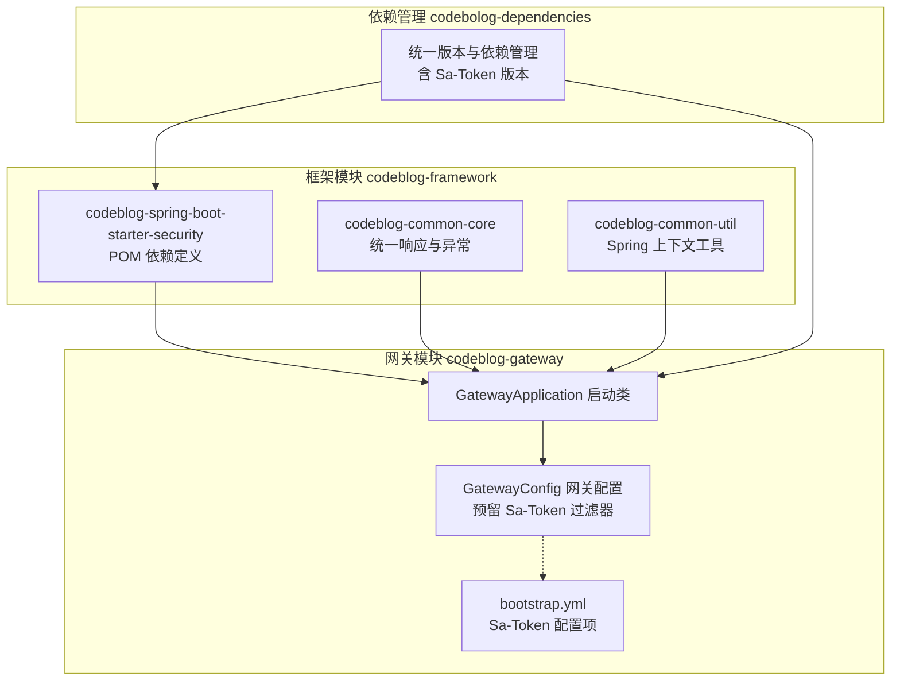
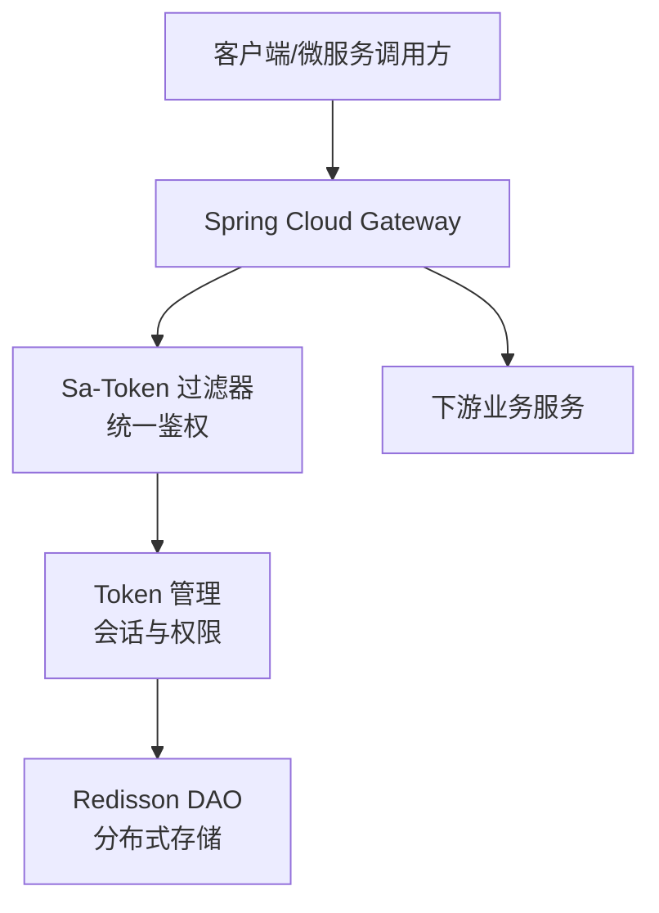
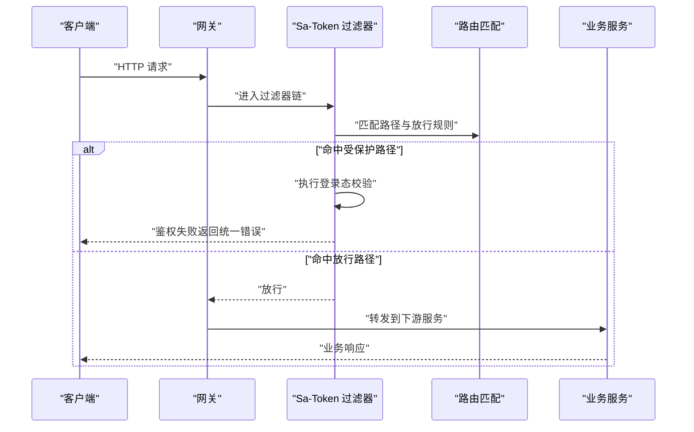
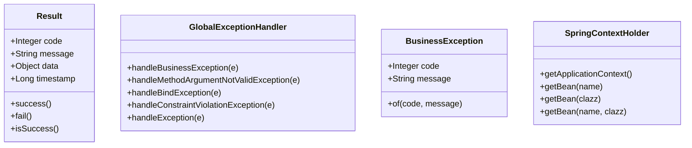
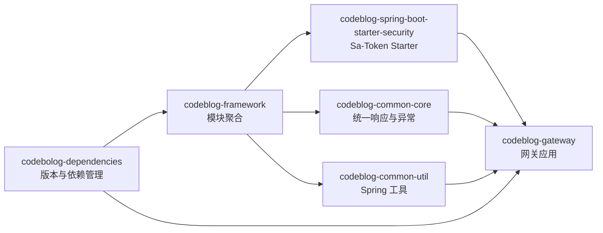

# Security Starter

<cite>
**本文引用的文件**
- [pom.xml](file://codeblog-framework/codeblog-spring-boot-starter-security/pom.xml)
- [GatewayConfig.java](file://codeblog-gateway/src/main/java/site/codeblog/gateway/config/GatewayConfig.java)
- [bootstrap.yml](file://codeblog-gateway/src/main/resources/bootstrap.yml)
- [pom.xml](file://codeblog-framework/pom.xml)
- [pom.xml](file://codebolog-dependencies/pom.xml)
- [GatewayApplication.java](file://codeblog-gateway/src/main/java/site/Codeblog/GatewayApplication.java)
- [GlobalExceptionHandler.java](file://codeblog-framework/codeblog-common/codeblog-common-core/src/main/java/site/codeblog/common/core/exception/GlobalExceptionHandler.java)
- [Result.java](file://codeblog-framework/codeblog-common/codeblog-common-core/src/main/java/site/codeblog/common/core/result/Result.java)
- [BusinessException.java](file://codeblog-framework/codeblog-common/codeblog-common-core/src/main/java/site/codeblog/common/core/exception/BusinessException.java)
- [SpringContextHolder.java](file://codeblog-framework/codeblog-common/codeblog-common-util/src/main/java/site/codeblog/common/util/SpringContextHolder.java)
</cite>

## 目录
1. [简介](#简介)
2. [项目结构](#项目结构)
3. [核心组件](#核心组件)
4. [架构总览](#架构总览)
5. [详细组件分析](#详细组件分析)
6. [依赖分析](#依赖分析)
7. [性能考虑](#性能考虑)
8. [故障排查指南](#故障排查指南)
9. [结论](#结论)
10. [附录](#附录)

## 简介
本文件为 Security Starter 模块的技术文档，围绕基于 Sa-Token 的权限认证系统进行系统化说明。该模块通过引入 Sa-Token Spring Boot Starter 及其 Redisson Jackson DAO 实现，提供 Token 管理、多端登录支持、权限控制、会话管理等能力，并在网关层预留了基于 Reactor 的过滤器接入点，便于在微服务架构中统一鉴权。

文档重点涵盖：
- Sa-Token 集成方式与关键配置项
- 认证策略与会话管理
- 网关层鉴权过滤器设计思路
- 与 Spring Security 的差异与优势
- 微服务场景下的使用模式与最佳实践
- 常见问题与排障建议

## 项目结构
Security Starter 位于框架模块 codeblog-framework 下，作为独立的 Spring Boot Starter 提供 Sa-Token 权限认证能力；网关模块 codeblog-gateway 引入该 Starter 并预留 Sa-Token 过滤器配置位置，统一在网关层进行认证拦截。

图表来源
- [pom.xml](file://codeblog-framework/codeblog-spring-boot-starter-security/pom.xml#L1-L45)
- [GatewayConfig.java](file://codeblog-gateway/src/main/java/site/codeblog/gateway/config/GatewayConfig.java#L1-L28)
- [bootstrap.yml](file://codeblog-gateway/src/main/resources/bootstrap.yml#L29-L44)
- [pom.xml](file://codeblog-framework/pom.xml#L26-L35)
- [pom.xml](file://codebolog-dependencies/pom.xml#L116-L131)
- [GatewayApplication.java](file://codeblog-gateway/src/main/java/site/Codeblog/GatewayApplication.java#L1-L16)

章节来源
- [pom.xml](file://codeblog-framework/codeblog-spring-boot-starter-security/pom.xml#L1-L45)
- [GatewayConfig.java](file://codeblog-gateway/src/main/java/site/codeblog/gateway/config/GatewayConfig.java#L1-L28)
- [bootstrap.yml](file://codeblog-gateway/src/main/resources/bootstrap.yml#L29-L44)
- [pom.xml](file://codeblog-framework/pom.xml#L26-L35)
- [pom.xml](file://codebolog-dependencies/pom.xml#L116-L131)
- [GatewayApplication.java](file://codeblog-gateway/src/main/java/site/Codeblog/GatewayApplication.java#L1-L16)

## 核心组件
- Sa-Token Starter 与 DAO
  - 引入 sa-token-spring-boot3-starter 作为核心认证能力
  - 引入 sa-token-dao-redisson-jackson 以支持基于 Redisson 的会话持久化与分布式共享
- 网关层过滤器
  - 在 GatewayConfig 中预留 Sa-Token 过滤器接入点，用于统一鉴权与错误处理
- 统一响应与异常
  - Result 统一返回结构
  - GlobalExceptionHandler 全局异常处理
  - BusinessException 业务异常封装
  - SpringContextHolder 提供 Spring 上下文访问

章节来源
- [pom.xml](file://codeblog-framework/codeblog-spring-boot-starter-security/pom.xml#L18-L42)
- [GatewayConfig.java](file://codeblog-gateway/src/main/java/site/codeblog/gateway/config/GatewayConfig.java#L12-L27)
- [Result.java](file://codeblog-framework/codeblog-common/codeblog-common-core/src/main/java/site/codeblog/common/core/result/Result.java#L1-L101)
- [GlobalExceptionHandler.java](file://codeblog-framework/codeblog-common/codeblog-common-core/src/main/java/site/codeblog/common/core/exception/GlobalExceptionHandler.java#L1-L107)
- [BusinessException.java](file://codeblog-framework/codeblog-common/codeblog-common-core/src/main/java/site/codeblog/common/core/exception/BusinessException.java#L1-L68)
- [SpringContextHolder.java](file://codeblog-framework/codeblog-common/codeblog-common-util/src/main/java/site/codeblog/common/util/SpringContextHolder.java#L1-L67)

## 架构总览
下图展示了 Security Starter 在整体架构中的定位与交互关系：

图表来源
- [GatewayConfig.java](file://codeblog-gateway/src/main/java/site/codeblog/gateway/config/GatewayConfig.java#L12-L27)
- [pom.xml](file://codeblog-framework/codeblog-spring-boot-starter-security/pom.xml#L18-L42)

## 详细组件分析

### Sa-Token 配置与参数说明
- 关键配置项（来自 bootstrap.yml）
  - token 名称：Authorization
  - token 有效期：单位秒，默认约 30 天
  - 最低活跃频率：单位秒，-1 表示不限制
  - 多端登录策略：允许同时登录
  - Token 共享策略：多个登录共用一个 Token
  - Token 风格：UUID
  - 是否输出操作日志：开启

这些参数直接影响 Token 生命周期、并发登录行为与日志可观测性，建议结合业务安全策略调整。

章节来源
- [bootstrap.yml](file://codeblog-gateway/src/main/resources/bootstrap.yml#L29-L44)

### 网关层鉴权过滤器设计
- 设计要点
  - 使用 Sa-Token Reactor 过滤器对请求进行统一拦截
  - 放行静态资源与特定路径（如登录接口）
  - 对匹配到的路由执行登录态校验
  - 统一错误返回格式
- 当前状态
  - 过滤器配置处于待启用状态，注释保留以便后续按需启用

图表来源
- [GatewayConfig.java](file://codeblog-gateway/src/main/java/site/codeblog/gateway/config/GatewayConfig.java#L12-L27)

章节来源
- [GatewayConfig.java](file://codeblog-gateway/src/main/java/site/codeblog/gateway/config/GatewayConfig.java#L12-L27)

### 统一响应与异常处理
- 统一响应结构
  - Result 提供成功/失败模板与字段：code、message、data、timestamp
- 全局异常处理
  - GlobalExceptionHandler 将各类异常转换为统一响应
  - BusinessException 用于业务断言与错误码传递
- Spring 上下文工具
  - SpringContextHolder 提供静态方法获取 ApplicationContext 与 Bean

图表来源
- [Result.java](file://codeblog-framework/codeblog-common/codeblog-common-core/src/main/java/site/codeblog/common/core/result/Result.java#L14-L101)
- [GlobalExceptionHandler.java](file://codeblog-framework/codeblog-common/codeblog-common-core/src/main/java/site/codeblog/common/core/exception/GlobalExceptionHandler.java#L22-L107)
- [BusinessException.java](file://codeblog-framework/codeblog-common/codeblog-common-core/src/main/java/site/codeblog/common/core/exception/BusinessException.java#L13-L68)
- [SpringContextHolder.java](file://codeblog-framework/codeblog-common/codeblog-common-util/src/main/java/site/codeblog/common/util/SpringContextHolder.java#L16-L67)

章节来源
- [Result.java](file://codeblog-framework/codeblog-common/codeblog-common-core/src/main/java/site/codeblog/common/core/result/Result.java#L1-L101)
- [GlobalExceptionHandler.java](file://codeblog-framework/codeblog-common/codeblog-common-core/src/main/java/site/codeblog/common/core/exception/GlobalExceptionHandler.java#L1-L107)
- [BusinessException.java](file://codeblog-framework/codeblog-common/codeblog-common-core/src/main/java/site/codeblog/common/core/exception/BusinessException.java#L1-L68)
- [SpringContextHolder.java](file://codeblog-framework/codeblog-common/codeblog-common-util/src/main/java/site/codeblog/common/util/SpringContextHolder.java#L1-L67)

### 与 Spring Security 的区别与优势
- 简洁性
  - Sa-Token 以“极简”理念提供认证与权限能力，起步成本低
- 易用性
  - 注解式权限、多端登录、Token 共享等开箱即用
- 分布式友好
  - 内置 Redisson DAO，天然支持分布式共享与高可用
- 网关集成
  - 提供 Reactor Starter，便于在 Spring Cloud Gateway 中统一鉴权

章节来源
- [pom.xml](file://codeblog-framework/codeblog-spring-boot-starter-security/pom.xml#L18-L42)
- [pom.xml](file://codebolog-dependencies/pom.xml#L116-L131)

### 微服务架构使用模式
- 网关层统一鉴权
  - 在 GatewayConfig 中启用 Sa-Token 过滤器，集中处理登录态与权限
- 服务间信任
  - 通过 Token 或上下文传递用户标识，避免重复登录
- 会话共享
  - 借助 Redisson DAO 实现跨服务会话一致性

章节来源
- [GatewayConfig.java](file://codeblog-gateway/src/main/java/site/codeblog/gateway/config/GatewayConfig.java#L12-L27)
- [pom.xml](file://codeblog-framework/codeblog-spring-boot-starter-security/pom.xml#L25-L29)

## 依赖分析
- 模块依赖
  - codeblog-framework 模块聚合 Security Starter
  - codeblog-gateway 引入 Security Starter 与统一异常处理
- 版本管理
  - codebolog-dependencies 统一管理 Sa-Token 版本与相关依赖
- 启动入口
  - GatewayApplication 作为网关启动类，加载 Starter 与配置

图表来源
- [pom.xml](file://codeblog-framework/pom.xml#L26-L35)
- [pom.xml](file://codebolog-dependencies/pom.xml#L116-L131)
- [GatewayApplication.java](file://codeblog-gateway/src/main/java/site/Codeblog/GatewayApplication.java#L11-L16)

章节来源
- [pom.xml](file://codeblog-framework/pom.xml#L26-L35)
- [pom.xml](file://codebolog-dependencies/pom.xml#L116-L131)
- [GatewayApplication.java](file://codeblog-gateway/src/main/java/site/Codeblog/GatewayApplication.java#L1-L16)

## 性能考虑
- Token 生命周期
  - 通过有效期与活跃频率参数平衡安全性与性能
- Redis 访问
  - 使用 Redisson DAO 时注意连接池与序列化策略，避免热点 Key
- 网关过滤器
  - 合理设置放行路径与匹配规则，减少不必要的鉴权开销

[本节为通用指导，不直接分析具体文件]

## 故障排查指南
- 鉴权失败
  - 检查 token 名称与携带方式是否一致
  - 核对网关过滤器是否启用及放行规则
- 会话异常
  - 确认 Redis 连接正常与 DAO 序列化配置
- 统一响应
  - 利用 GlobalExceptionHandler 查看异常栈与业务错误码
- 上下文访问
  - 使用 SpringContextHolder 获取 Bean 时确保 Spring 环境已初始化

章节来源
- [GatewayConfig.java](file://codeblog-gateway/src/main/java/site/codeblog/gateway/config/GatewayConfig.java#L12-L27)
- [bootstrap.yml](file://codeblog-gateway/src/main/resources/bootstrap.yml#L29-L44)
- [GlobalExceptionHandler.java](file://codeblog-framework/codeblog-common/codeblog-common-core/src/main/java/site/codeblog/common/core/exception/GlobalExceptionHandler.java#L22-L107)
- [SpringContextHolder.java](file://codeblog-framework/codeblog-common/codeblog-common-util/src/main/java/site/codeblog/common/util/SpringContextHolder.java#L62-L66)

## 结论
Security Starter 通过 Sa-Token 与 Redisson DAO 的组合，提供了轻量、易用且分布式友好的认证与权限能力。结合网关层统一鉴权与统一响应体系，可在微服务架构中快速落地安全方案。建议根据业务安全需求合理配置 Token 参数与登录策略，并持续优化 Redis 访问与过滤器匹配规则以提升性能与稳定性。

[本节为总结性内容，不直接分析具体文件]

## 附录

### 常见应用场景与操作指引
- 用户登录
  - 在受保护接口前先完成登录，生成并保存 Token
- 权限验证
  - 在网关或服务层使用 Sa-Token 注解或 API 进行权限校验
- Token 刷新
  - 根据有效期策略在前端或客户端侧实现刷新逻辑

[本节为概念性说明，不直接分析具体文件]