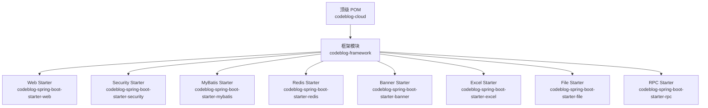
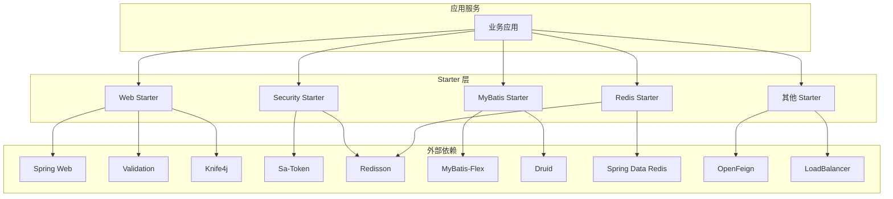
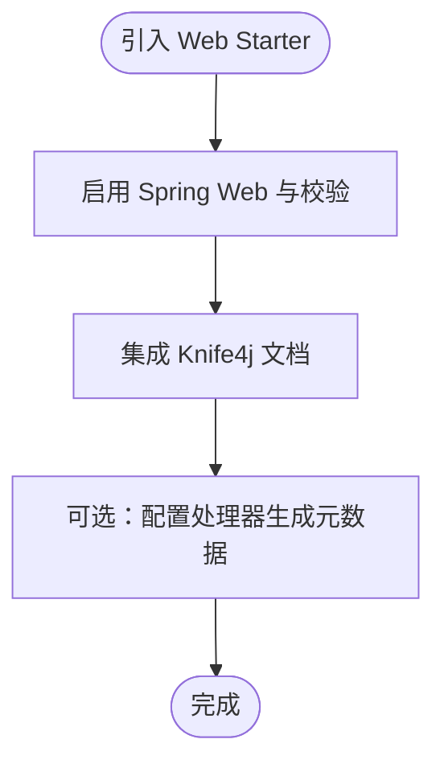
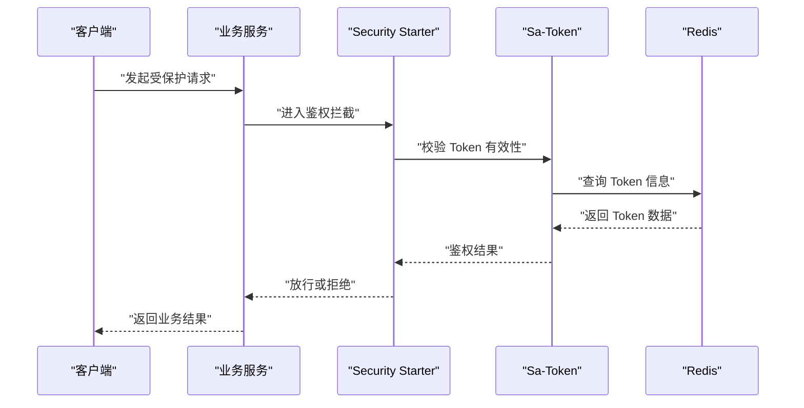
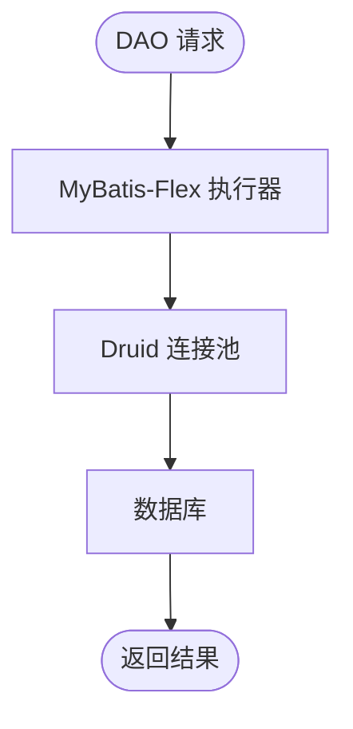
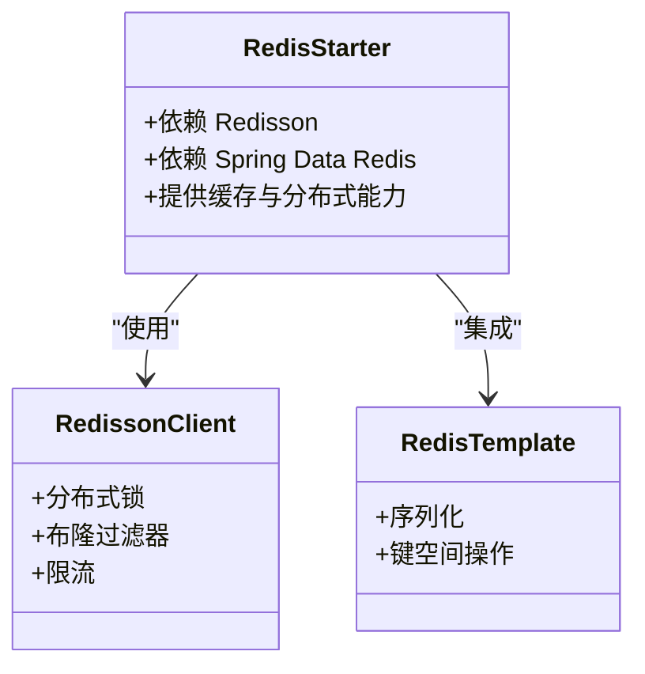
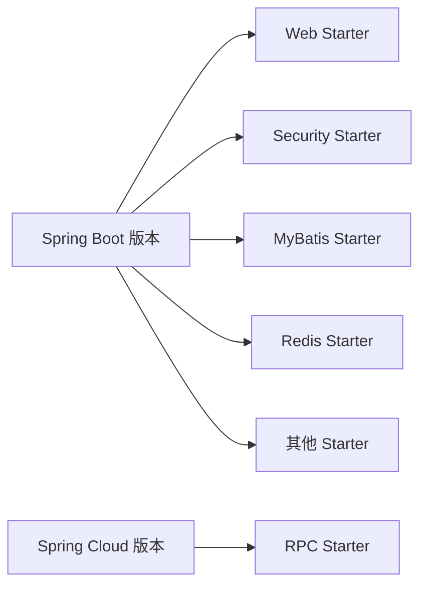

# Starter模块详解

<cite>
**本文引用的文件**
- [pom.xml](file://pom.xml)
- [codeblog-framework/pom.xml](file://codeblog-framework/pom.xml)
- [codeblog-spring-boot-starter-web/pom.xml](file://codeblog-framework/codeblog-spring-boot-starter-web/pom.xml)
- [codeblog-spring-boot-starter-security/pom.xml](file://codeblog-framework/codeblog-spring-boot-starter-security/pom.xml)
- [codeblog-spring-boot-starter-mybatis/pom.xml](file://codeblog-framework/codeblog-spring-boot-starter-mybatis/pom.xml)
- [codeblog-spring-boot-starter-redis/pom.xml](file://codeblog-framework/codeblog-spring-boot-starter-redis/pom.xml)
- [codeblog-spring-boot-starter-banner/pom.xml](file://codeblog-framework/codeblog-spring-boot-starter-banner/pom.xml)
- [codeblog-spring-boot-starter-excel/pom.xml](file://codeblog-framework/codeblog-spring-boot-starter-excel/pom.xml)
- [codeblog-spring-boot-starter-file/pom.xml](file://codeblog-framework/codeblog-spring-boot-starter-file/pom.xml)
- [codeblog-spring-boot-starter-rpc/pom.xml](file://codeblog-framework/codeblog-spring-boot-starter-rpc/pom.xml)
</cite>

## 目录
1. [简介](#简介)
2. [项目结构](#项目结构)
3. [核心组件](#核心组件)
4. [架构总览](#架构总览)
5. [详细组件分析](#详细组件分析)
6. [依赖分析](#依赖分析)
7. [性能考虑](#性能考虑)
8. [故障排查指南](#故障排查指南)
9. [结论](#结论)
10. [附录](#附录)

## 简介
本文件面向 codeblog-cloud 的 Spring Boot Starter 模块，系统性梳理各 Starter 的功能定位、依赖与配置要点，并结合自动配置与扩展机制给出组合使用建议。重点覆盖以下模块：
- Web Starter：提供 RESTful Web 能力与 Knife4j 文档能力
- Security Starter：集成 Sa-Token 权限认证与 Redisson 持久化
- MyBatis Starter：基于 MyBatis-Flex 的数据访问层抽象与 Druid 连接池
- Redis Starter：基于 Redisson 的缓存与分布式能力
- 其他配套 Starter：Banner、Excel、File、RPC 等

## 项目结构
顶层采用多模块聚合结构，框架模块 codeblog-framework 下承载所有 Starter 与通用组件。各 Starter 以独立模块存在，统一由父 POM 管理版本与插件。

图表来源
- [pom.xml](file://pom.xml#L16-L20)
- [codeblog-framework/pom.xml](file://codeblog-framework/pom.xml#L32-L42)

章节来源
- [pom.xml](file://pom.xml#L1-L150)
- [codeblog-framework/pom.xml](file://codeblog-framework/pom.xml#L1-L45)

## 核心组件
本节概述各 Starter 的职责边界与典型应用场景：
- Web Starter：快速启用 Spring Web 与校验、Knife4j 文档，适合对外提供 RESTful API 的服务
- Security Starter：集成 Sa-Token 与 Redisson，实现会话、权限、踢人、单端互斥等能力
- MyBatis Starter：提供 MyBatis-Flex ORM 能力与 Druid 连接池，简化数据库访问
- Redis Starter：提供 Redisson 客户端与 Spring Data Redis 集成，支撑缓存与分布式能力
- 其他 Starter：Banner 提升启动体验；Excel/File 提供导入导出与文件处理；RPC 提供 OpenFeign 与负载均衡

章节来源
- [codeblog-spring-boot-starter-web/pom.xml](file://codeblog-framework/codeblog-spring-boot-starter-web/pom.xml#L14-L43)
- [codeblog-spring-boot-starter-security/pom.xml](file://codeblog-framework/codeblog-spring-boot-starter-security/pom.xml#L14-L43)
- [codeblog-spring-boot-starter-mybatis/pom.xml](file://codeblog-framework/codeblog-spring-boot-starter-mybatis/pom.xml#L14-L43)
- [codeblog-spring-boot-starter-redis/pom.xml](file://codeblog-framework/codeblog-spring-boot-starter-redis/pom.xml#L14-L43)
- [codeblog-spring-boot-starter-banner/pom.xml](file://codeblog-framework/codeblog-spring-boot-starter-banner/pom.xml#L14-L23)
- [codeblog-spring-boot-starter-excel/pom.xml](file://codeblog-framework/codeblog-spring-boot-starter-excel/pom.xml#L14-L43)
- [codeblog-spring-boot-starter-file/pom.xml](file://codeblog-framework/codeblog-spring-boot-starter-file/pom.xml#L14-L43)
- [codeblog-spring-boot-starter-rpc/pom.xml](file://codeblog-framework/codeblog-spring-boot-starter-rpc/pom.xml#L14-L43)

## 架构总览
下图展示 Starter 间与外部依赖的关系，体现“Web/Security/MyBatis/Redis”等模块的耦合与协作方式。

图表来源
- [codeblog-spring-boot-starter-web/pom.xml](file://codeblog-framework/codeblog-spring-boot-starter-web/pom.xml#L18-L35)
- [codeblog-spring-boot-starter-security/pom.xml](file://codeblog-framework/codeblog-spring-boot-starter-security/pom.xml#L18-L35)
- [codeblog-spring-boot-starter-mybatis/pom.xml](file://codeblog-framework/codeblog-spring-boot-starter-mybatis/pom.xml#L18-L35)
- [codeblog-spring-boot-starter-redis/pom.xml](file://codeblog-framework/codeblog-spring-boot-starter-redis/pom.xml#L18-L35)
- [codeblog-spring-boot-starter-rpc/pom.xml](file://codeblog-framework/codeblog-spring-boot-starter-rpc/pom.xml#L18-L35)

## 详细组件分析

### Web Starter 分析
- 功能特性
  - 快速启用 Spring Web 与 Bean 校验
  - 集成 Knife4j 开放接口文档，便于 API 文档管理
  - 提供配置处理器，增强自动配置元数据
- 典型使用场景
  - 对外提供 RESTful 接口的服务
  - 需要在线 API 文档与调试能力
- 依赖与配置要点
  - 依赖 spring-boot-starter-web、spring-boot-starter-validation、knife4j 开源文档
  - 建议在应用中引入该 Starter 后，按需开启 Knife4j 配置项
- 最佳实践
  - 将 Knife4j 的开关与环境变量解耦，避免在生产暴露文档
  - 结合全局响应包装与异常处理，统一返回格式

图表来源
- [codeblog-spring-boot-starter-web/pom.xml](file://codeblog-framework/codeblog-spring-boot-starter-web/pom.xml#L18-L42)

章节来源
- [codeblog-spring-boot-starter-web/pom.xml](file://codeblog-framework/codeblog-spring-boot-starter-web/pom.xml#L14-L43)

### Security Starter 分析
- 功能特性
  - 集成 Sa-Token 核心能力与 Redisson 持久化
  - 支持会话、权限、单点登录、单端互斥、踢人等
- 典型使用场景
  - 需要细粒度权限控制与会话管理的后台系统
- 依赖与配置要点
  - 依赖 sa-token-spring-boot3-starter 与 sa-token-dao-redisson-jackson
  - 需要配合 Redis 服务与合适的 Redisson 配置
- 最佳实践
  - 明确区分“账号体系”与“权限模型”，合理设计登录与鉴权流程
  - 使用 Redisson 存储 Token，确保跨节点一致性
  - 对敏感接口使用注解式鉴权，避免硬编码判断

图表来源
- [codeblog-spring-boot-starter-security/pom.xml](file://codeblog-framework/codeblog-spring-boot-starter-security/pom.xml#L18-L35)

章节来源
- [codeblog-spring-boot-starter-security/pom.xml](file://codeblog-framework/codeblog-spring-boot-starter-security/pom.xml#L14-L43)

### MyBatis Starter 分析
- 功能特性
  - 基于 MyBatis-Flex 的 ORM 能力，提供更简洁的数据访问抽象
  - 集成 Druid 连接池，便于监控与性能调优
- 典型使用场景
  - 需要快速搭建数据访问层、对 SQL 有较高可控性的项目
- 依赖与配置要点
  - 依赖 mybatis-flex-spring-boot3-starter 与 druid-spring-boot-3-starter
  - 需要数据库驱动与 Datasource 配置
- 最佳实践
  - 使用 MyBatis-Flex 的代码生成器减少样板代码
  - 通过 Druid 控制台观察连接池与慢 SQL
  - 合理拆分 Mapper 与 Service，保持关注点分离

图表来源
- [codeblog-spring-boot-starter-mybatis/pom.xml](file://codeblog-framework/codeblog-spring-boot-starter-mybatis/pom.xml#L18-L35)

章节来源
- [codeblog-spring-boot-starter-mybatis/pom.xml](file://codeblog-framework/codeblog-spring-boot-starter-mybatis/pom.xml#L14-L43)

### Redis Starter 分析
- 功能特性
  - 基于 Redisson 的客户端与 Spring Data Redis 集成
  - 支持分布式锁、布隆过滤器、限流、对象序列化等高级能力
- 典型使用场景
  - 需要缓存、分布式锁、限流与高并发场景
- 依赖与配置要点
  - 依赖 redisson-spring-boot-starter 与 spring-boot-starter-data-redis
  - 需要 Redis 服务器与连接配置
- 最佳实践
  - 使用 Redisson 的命名空间隔离不同业务
  - 对热点键设置合理的过期策略与内存淘汰
  - 在分布式锁与限流场景中，注意超时与幂等

图表来源
- [codeblog-spring-boot-starter-redis/pom.xml](file://codeblog-framework/codeblog-spring-boot-starter-redis/pom.xml#L18-L35)

章节来源
- [codeblog-spring-boot-starter-redis/pom.xml](file://codeblog-framework/codeblog-spring-boot-starter-redis/pom.xml#L14-L43)

### 其他 Starter 概览
- Banner Starter：提供自定义启动横幅，改善启动体验
- Excel Starter：基于 FastExcel 与 Velocity 模板，实现高性能导入导出
- File Starter：集成文件上传下载与常用工具类，简化文件处理
- RPC Starter：基于 OpenFeign 与 LoadBalancer，提供声明式远程调用与负载均衡

章节来源
- [codeblog-spring-boot-starter-banner/pom.xml](file://codeblog-framework/codeblog-spring-boot-starter-banner/pom.xml#L14-L23)
- [codeblog-spring-boot-starter-excel/pom.xml](file://codeblog-framework/codeblog-spring-boot-starter-excel/pom.xml#L14-L43)
- [codeblog-spring-boot-starter-file/pom.xml](file://codeblog-framework/codeblog-spring-boot-starter-file/pom.xml#L14-L43)
- [codeblog-spring-boot-starter-rpc/pom.xml](file://codeblog-framework/codeblog-spring-boot-starter-rpc/pom.xml#L14-L43)

## 依赖分析
- 版本与插件管理
  - 顶层 POM 统一管理 Java 版本、Spring Boot 版本、MapStruct、Lombok 等
  - Maven 编译插件配置包含 Spring Boot 配置处理器、Lombok、MapStruct 绑定
- Starter 间依赖关系
  - Web Starter 依赖 Web 与校验；Security/MyBatis/Redis Starter 依赖各自生态组件
  - RPC Starter 依赖 Spring Cloud 生态（OpenFeign、LoadBalancer）
- 组合使用注意事项
  - 引入多个 Starter 时，注意避免重复依赖与版本冲突
  - Security 与 Redis Starter 需要 Redis 服务；MyBatis Starter 需要数据库与驱动
  - Web Starter 与 Security Starter 可并用，但需协调 Knife4j 与鉴权路径

图表来源
- [pom.xml](file://pom.xml#L22-L36)
- [codeblog-spring-boot-starter-rpc/pom.xml](file://codeblog-framework/codeblog-spring-boot-starter-rpc/pom.xml#L18-L35)

章节来源
- [pom.xml](file://pom.xml#L22-L85)
- [codeblog-framework/pom.xml](file://codeblog-framework/pom.xml#L26-L42)

## 性能考虑
- Web Starter
  - 合理配置 Knife4j 文档开关，避免在生产暴露
  - 使用校验分组与 DTO，降低无效序列化开销
- Security Starter
  - 使用 Redisson 存储 Token，避免本地内存碎片
  - 对高频鉴权接口进行缓存与降级
- MyBatis Starter
  - 利用 Druid 观察慢 SQL 与连接池状态
  - 合理使用二级缓存与批量操作
- Redis Starter
  - 使用合适的数据结构与过期策略
  - 对热点键进行分片与副本

## 故障排查指南
- Web Starter
  - 若 Knife4j 文档不可见，检查是否正确引入 Starter 并开启相应开关
  - 校验失败导致 400，检查请求体与校验注解使用
- Security Starter
  - Token 无效或过期：确认 Redis 是否可用、Token 是否被清理
  - 单点登录异常：核对 Sa-Token 配置与单端互斥策略
- MyBatis Starter
  - SQL 报错：检查 Mapper XML 与实体映射
  - 连接池异常：查看 Druid 监控面板与连接泄漏
- Redis Starter
  - 连接失败：确认 Redis 地址、密码与网络连通
  - 锁竞争严重：优化锁粒度与超时时间

## 结论
codeblog-cloud 的 Starter 模块围绕 Web、安全、数据访问与缓存等关键领域提供即插即用的能力。通过统一的版本与插件管理，开发者可以快速组合出满足微服务需求的最小可行栈。建议在实际项目中：
- 先引入 Web 与 Security，再叠加 MyBatis 与 Redis
- 对 RPC 与网关进行统一治理
- 借助 Knife4j 与 Druid 提升可观测性与运维效率

## 附录
- 模块选择指导
  - 需要对外提供 API：优先引入 Web Starter
  - 需要权限控制：引入 Security Starter
  - 需要 ORM 与连接池：引入 MyBatis Starter
  - 需要缓存与分布式：引入 Redis Starter
  - 需要远程调用：引入 RPC Starter
- 组合使用示例（描述性）
  - 微服务应用：Web + Security + MyBatis + Redis + RPC
  - 管理后台：Web + Security + MyBatis + Redis + Excel/File
  - 数据服务：MyBatis + Redis + RPC（无 Web）