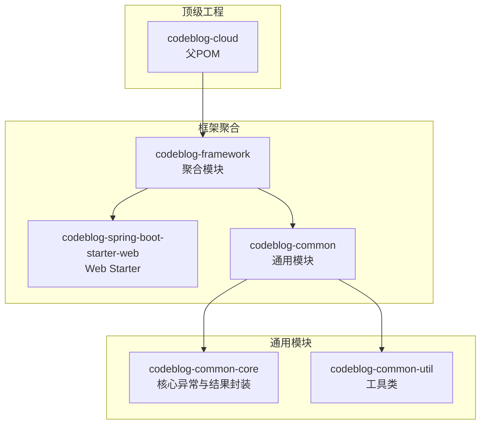
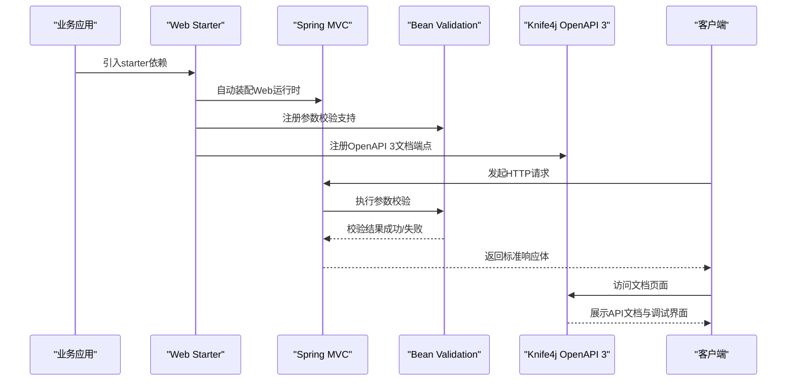
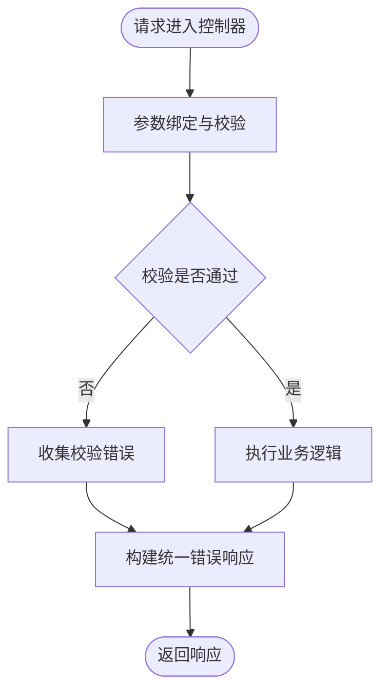
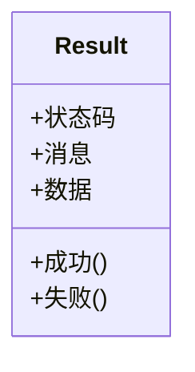
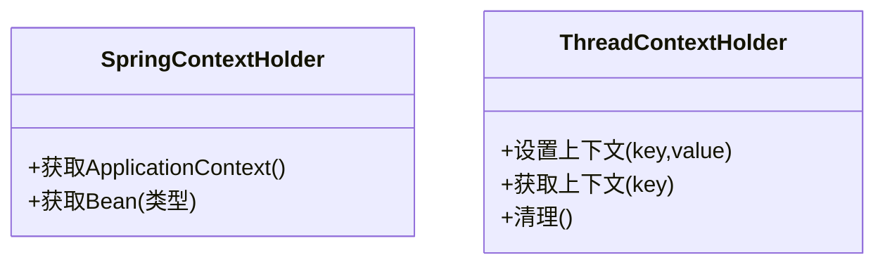
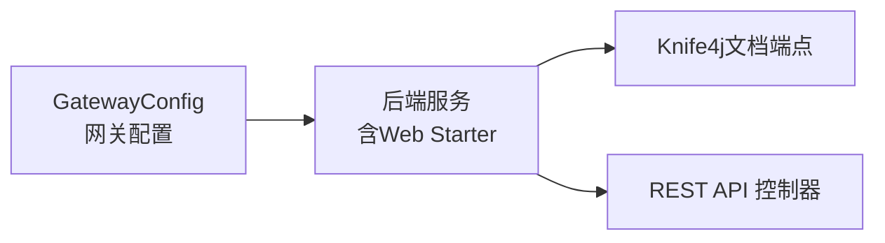
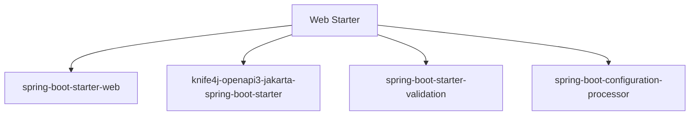

# Web Starter

<cite>
**本文引用的文件**
- [codeblog-spring-boot-starter-web/pom.xml](file://codeblog-framework/codeblog-spring-boot-starter-web/pom.xml)
- [GlobalExceptionHandler.java](file://codeblog-framework/codeblog-common/codeblog-common-core/src/main/java/site/codeblog/common/core/exception/GlobalExceptionHandler.java)
- [BusinessException.java](file://codeblog-framework/codeblog-common/codeblog-common-core/src/main/java/site/codeblog/common/core/exception/BusinessException.java)
- [Result.java](file://codeblog-framework/codeblog-common/codeblog-common-core/src/main/java/site/codeblog/common/core/result/Result.java)
- [SpringContextHolder.java](file://codeblog-framework/codeblog-common/codeblog-common-util/src/main/java/site/codeblog/common/util/SpringContextHolder.java)
- [ThreadContextHolder.java](file://codeblog-framework/codeblog-common/codeblog-common-util/src/main/java/site/codeblog/common/util/ThreadContextHolder.java)
- [GatewayConfig.java](file://codeblog-gateway/src/main/java/site/codeblog/gateway/config/GatewayConfig.java)
- [pom.xml（顶级父工程）](file://pom.xml)
- [pom.xml（框架聚合模块）](file://codeblog-framework/pom.xml)
- [pom.xml（依赖版本控制模块）](file://codebolog-dependencies/pom.xml)
</cite>

## 目录
1. [简介](#简介)
2. [项目结构](#项目结构)
3. [核心组件](#核心组件)
4. [架构总览](#架构总览)
5. [详细组件分析](#详细组件分析)
6. [依赖分析](#依赖分析)
7. [性能考虑](#性能考虑)
8. [故障排查指南](#故障排查指南)
9. [结论](#结论)
10. [附录](#附录)

## 简介
本文件面向“Web Starter”模块，系统性阐述其在Spring Boot生态中的定位与能力边界：基于Spring Boot Web的基础运行时、Knife4j OpenAPI 3文档集成以及参数校验支持。同时给出引入方式、自动配置机制与配置属性说明，并总结RESTful API开发最佳实践、异常处理策略与Knife4j集成要点，帮助开发者快速上手。

## 项目结构
Web Starter位于“codeblog-framework”聚合模块下，作为可复用的Starter，对外提供Web基础能力与文档能力。其核心依赖包括：
- Spring Boot Web
- Knife4j OpenAPI 3（Jakarta）
- Spring Boot Validation
- Spring Configuration Processor（用于生成元数据）

图表来源
- [pom.xml（顶级父工程）](file://pom.xml#L16-L20)
- [pom.xml（框架聚合模块）](file://codeblog-framework/pom.xml#L1-L20)
- [codeblog-spring-boot-starter-web/pom.xml](file://codeblog-framework/codeblog-spring-boot-starter-web/pom.xml#L18-L43)

章节来源
- [codeblog-spring-boot-starter-web/pom.xml](file://codeblog-framework/codeblog-spring-boot-starter-web/pom.xml#L1-L45)
- [pom.xml（顶级父工程）](file://pom.xml#L16-L20)
- [pom.xml（框架聚合模块）](file://codeblog-framework/pom.xml#L1-L20)

## 核心组件
- Web基础运行时：由Spring Boot Web提供，包含嵌入式容器、MVC、JSON序列化、Web安全等基础能力。
- 参数校验：通过Spring Boot Validation提供JSR-303注解驱动的参数校验能力，结合全局异常处理统一返回格式。
- 文档集成：通过Knife4j OpenAPI 3（Jakarta）实现OpenAPI 3规范的文档生成与增强UI体验。
- 配置元数据：启用spring-configuration-processor以生成IDE提示与元数据，提升配置体验。

章节来源
- [codeblog-spring-boot-starter-web/pom.xml](file://codeblog-framework/codeblog-spring-boot-starter-web/pom.xml#L18-L43)

## 架构总览
Web Starter在应用中的作用是“提供开箱即用的Web运行环境与文档能力”。其典型工作流如下：

图表来源
- [codeblog-spring-boot-starter-web/pom.xml](file://codeblog-framework/codeblog-spring-boot-starter-web/pom.xml#L18-L43)

## 详细组件分析

### 全局异常处理（与Web Starter联动）
Web Starter提供参数校验能力，配合全局异常处理器可统一返回错误信息。该异常处理器会捕获参数绑定与校验异常，并转换为统一的结果对象。

图表来源
- [GlobalExceptionHandler.java](file://codeblog-framework/codeblog-common/codeblog-common-core/src/main/java/site/codeblog/common/core/exception/GlobalExceptionHandler.java#L1-L200)
- [Result.java](file://codeblog-framework/codeblog-common/codeblog-common-core/src/main/java/site/codeblog/common/core/result/Result.java#L1-L200)

章节来源
- [GlobalExceptionHandler.java](file://codeblog-framework/codeblog-common/codeblog-common-core/src/main/java/site/codeblog/common/core/exception/GlobalExceptionHandler.java#L1-L200)
- [BusinessException.java](file://codeblog-framework/codeblog-common/codeblog-common-core/src/main/java/site/codeblog/common/core/exception/BusinessException.java#L1-L200)
- [Result.java](file://codeblog-framework/codeblog-common/codeblog-common-core/src/main/java/site/codeblog/common/core/result/Result.java#L1-L200)

### 结果封装模型（Result）
统一的响应体结构，便于前端与文档侧一致消费。建议所有REST接口返回该结构，包含状态码、消息与数据载体。

图表来源
- [Result.java](file://codeblog-framework/codeblog-common/codeblog-common-core/src/main/java/site/codeblog/common/core/result/Result.java#L1-L200)

章节来源
- [Result.java](file://codeblog-framework/codeblog-common/codeblog-common-core/src/main/java/site/codeblog/common/core/result/Result.java#L1-L200)

### 工具类（上下文持有）
- SpringContextHolder：在静态环境下获取ApplicationContext与Bean实例，便于在工具类中使用Spring管理的组件。
- ThreadContextHolder：线程级上下文持有，常用于链路追踪、用户标识等横切信息传递。

图表来源
- [SpringContextHolder.java](file://codeblog-framework/codeblog-common/codeblog-common-util/src/main/java/site/codeblog/common/util/SpringContextHolder.java#L1-L200)
- [ThreadContextHolder.java](file://codeblog-framework/codeblog-common/codeblog-common-util/src/main/java/site/codeblog/common/util/ThreadContextHolder.java#L1-L200)

章节来源
- [SpringContextHolder.java](file://codeblog-framework/codeblog-common/codeblog-common-util/src/main/java/site/codeblog/common/util/SpringContextHolder.java#L1-L200)
- [ThreadContextHolder.java](file://codeblog-framework/codeblog-common/codeblog-common-util/src/main/java/site/codeblog/common/util/ThreadContextHolder.java#L1-L200)

### 网关配置（与Web Starter的关系）
网关模块展示了如何在网关场景下组织配置，Web Starter在各微服务侧提供Web运行时与文档能力；网关侧负责路由与过滤。

图表来源
- [GatewayConfig.java](file://codeblog-gateway/src/main/java/site/codeblog/gateway/config/GatewayConfig.java#L1-L200)

章节来源
- [GatewayConfig.java](file://codeblog-gateway/src/main/java/site/codeblog/gateway/config/GatewayConfig.java#L1-L200)

## 依赖分析
Web Starter的依赖关系如下：

图表来源
- [codeblog-spring-boot-starter-web/pom.xml](file://codeblog-framework/codeblog-spring-boot-starter-web/pom.xml#L18-L43)

章节来源
- [codeblog-spring-boot-starter-web/pom.xml](file://codeblog-framework/codeblog-spring-boot-starter-web/pom.xml#L18-L43)

## 性能考虑
- 启用压缩与缓存：在生产环境开启Gzip压缩与静态资源缓存，降低带宽占用。
- 参数校验粒度：避免过度复杂的校验规则，减少反射与正则开销。
- 文档生成优化：仅在开发/测试环境暴露详细文档端点，生产关闭或限制访问。
- 线程上下文：谨慎使用ThreadLocal，注意清理避免内存泄漏。

## 故障排查指南
- 参数校验失败：确认请求体与路径参数是否符合约束注解定义；查看全局异常处理器对校验异常的映射。
- 文档无法访问：确认Knife4j依赖已正确引入且未被排除；检查文档端点路径与访问权限。
- 响应格式不一致：确保所有控制器返回统一的Result结构；避免直接返回原始对象。
- 上下文为空：检查SpringContextHolder与ThreadContextHolder的初始化与清理逻辑。

章节来源
- [GlobalExceptionHandler.java](file://codeblog-framework/codeblog-common/codeblog-common-core/src/main/java/site/codeblog/common/core/exception/GlobalExceptionHandler.java#L1-L200)
- [Result.java](file://codeblog-framework/codeblog-common/codeblog-common-core/src/main/java/site/codeblog/common/core/result/Result.java#L1-L200)
- [SpringContextHolder.java](file://codeblog-framework/codeblog-common/codeblog-common-util/src/main/java/site/codeblog/common/util/SpringContextHolder.java#L1-L200)
- [ThreadContextHolder.java](file://codeblog-framework/codeblog-common/codeblog-common-util/src/main/java/site/codeblog/common/util/ThreadContextHolder.java#L1-L200)

## 结论
Web Starter聚焦于“Web基础运行时 + 参数校验 + 文档能力”的一体化交付，通过标准化的依赖与约定，显著降低RESTful服务开发门槛。结合统一的异常处理与结果封装，可进一步提升接口一致性与可维护性。

## 附录

### 如何引入与配置Web Starter
- 在业务工程的POM中引入Web Starter依赖，确保版本与Spring Boot主工程一致。
- 若需IDE配置提示，保留spring-configuration-processor依赖。
- 在应用启动类上添加必要的扫描注解，使控制器与配置生效。
- 如需Knife4j文档，请在相应环境配置文档端点与UI访问路径。

章节来源
- [codeblog-spring-boot-starter-web/pom.xml](file://codeblog-framework/codeblog-spring-boot-starter-web/pom.xml#L18-L43)
- [pom.xml（顶级父工程）](file://pom.xml#L16-L20)
- [pom.xml（依赖版本控制模块）](file://codebolog-dependencies/pom.xml#L18-L24)

### RESTful API开发最佳实践
- 控制器层：按资源建模，使用标准HTTP方法；每个接口明确返回值类型，统一包装为Result。
- 请求响应：请求参数尽量使用DTO；响应体保持稳定结构，便于前端消费与文档生成。
- 异常处理：业务异常与参数异常分离；全局异常处理器统一输出，避免泄露内部细节。
- 文档与测试：利用Knife4j生成OpenAPI 3文档，结合接口测试工具进行联调与回归。

### Knife4j集成要点
- 依赖引入：确保使用与Spring Boot版本兼容的Knife4j OpenAPI 3（Jakarta）起步依赖。
- 文档生成：在控制器上使用OpenAPI注解描述接口；保证接口分组、标题、版本等元信息完整。
- UI访问：根据部署环境配置文档端点路径与访问权限；生产环境建议限制访问范围。
- 调试与联调：通过Knife4j UI进行接口调试，结合参数校验与全局异常处理快速定位问题。

章节来源
- [codeblog-spring-boot-starter-web/pom.xml](file://codeblog-framework/codeblog-spring-boot-starter-web/pom.xml#L25-L29)