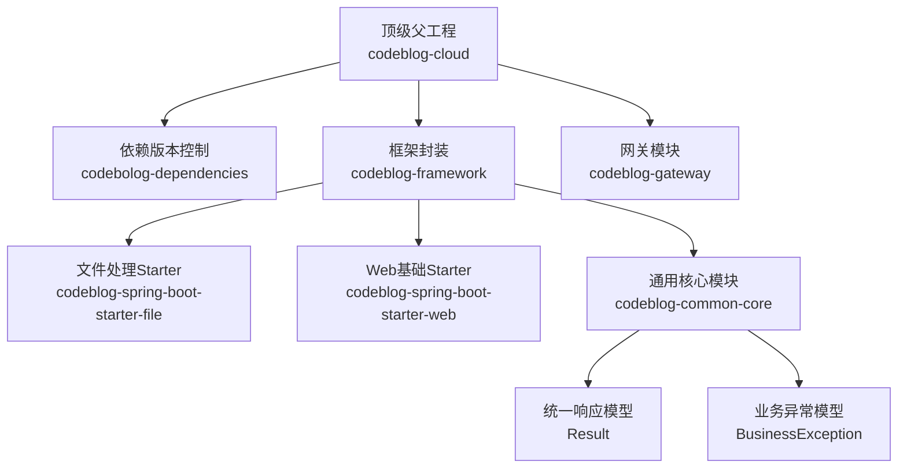
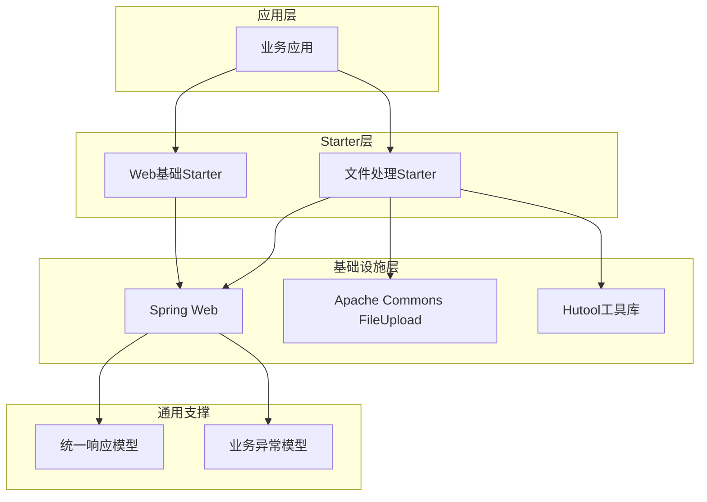
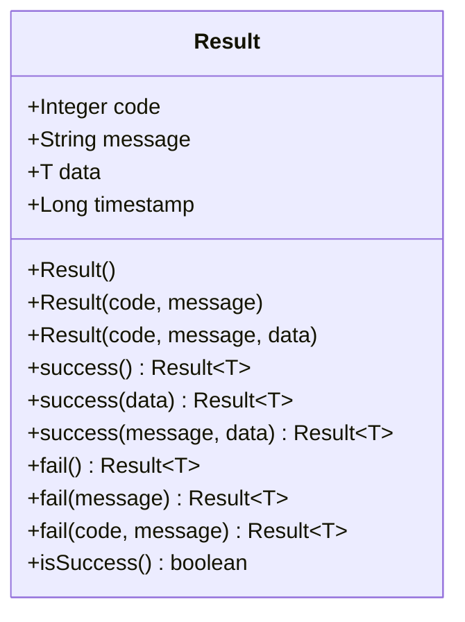
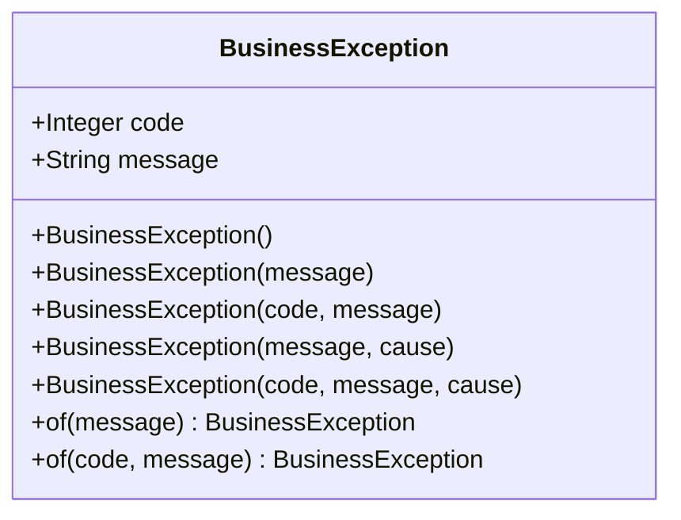
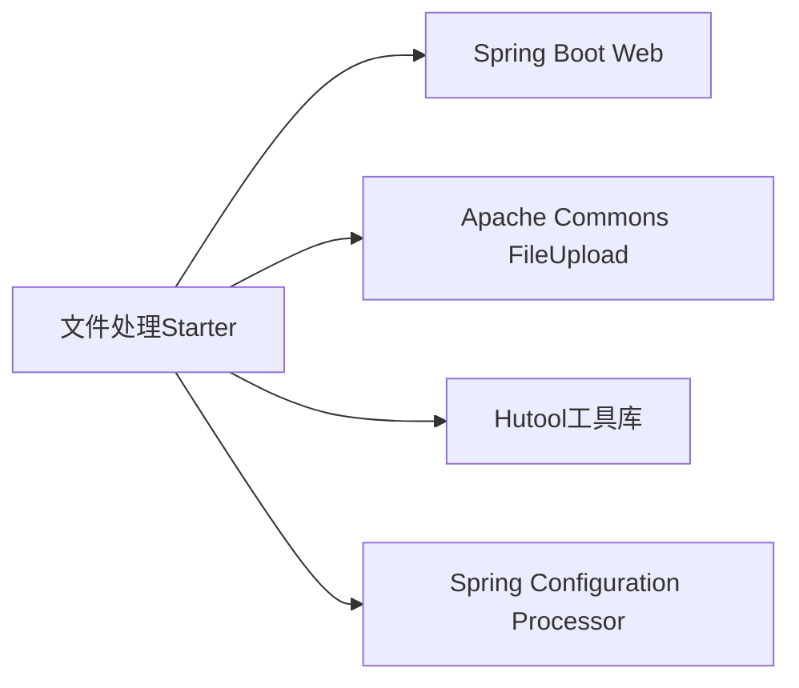
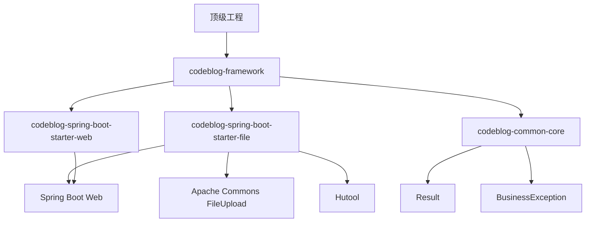

# 文件处理Starter

<cite>
**本文引用的文件**
- [pom.xml](file://pom.xml)
- [codeblog-framework/pom.xml](file://codeblog-framework/pom.xml)
- [codeblog-framework/codeblog-spring-boot-starter-file/pom.xml](file://codeblog-framework/codeblog-spring-boot-starter-file/pom.xml)
- [codeblog-framework/codeblog-spring-boot-starter-web/pom.xml](file://codeblog-framework/codeblog-spring-boot-starter-web/pom.xml)
- [codeblog-framework/codeblog-common/codeblog-common-core/src/main/java/site/codeblog/common/core/result/Result.java](file://codeblog-framework/codeblog-common/codeblog-common-core/src/main/java/site/codeblog/common/core/result/Result.java)
- [codeblog-framework/codeblog-common/codeblog-common-core/src/main/java/site/codeblog/common/core/exception/BusinessException.java](file://codeblog-framework/codeblog-common/codeblog-common-core/src/main/java/site/codeblog/common/core/exception/BusinessException.java)
</cite>

## 目录
1. [简介](#简介)
2. [项目结构](#项目结构)
3. [核心组件](#核心组件)
4. [架构总览](#架构总览)
5. [详细组件分析](#详细组件分析)
6. [依赖关系分析](#依赖关系分析)
7. [性能考虑](#性能考虑)
8. [故障排除指南](#故障排除指南)
9. [结论](#结论)
10. [附录](#附录)

## 简介
本文件处理Starter旨在为Spring Boot应用提供统一的文件上传下载能力，支持本地存储与云存储扩展、文件类型与大小校验、安全策略（如病毒扫描与敏感内容检测）以及可扩展的配置体系。当前仓库中已包含基础依赖与通用响应模型，便于快速集成与扩展。

## 项目结构
该仓库采用多模块Maven结构，文件处理Starter位于框架模块下的独立子模块中，并通过公共模块提供统一响应与异常模型。

图表来源
- [pom.xml](file://pom.xml#L16-L20)
- [codeblog-framework/pom.xml](file://codeblog-framework/pom.xml#L1-L20)
- [codeblog-framework/codeblog-spring-boot-starter-file/pom.xml](file://codeblog-framework/codeblog-spring-boot-starter-file/pom.xml#L1-L45)
- [codeblog-framework/codeblog-spring-boot-starter-web/pom.xml](file://codeblog-framework/codeblog-spring-boot-starter-web/pom.xml#L1-L45)
- [codeblog-framework/codeblog-common/codeblog-common-core/src/main/java/site/codeblog/common/core/result/Result.java](file://codeblog-framework/codeblog-common/codeblog-common-core/src/main/java/site/codeblog/common/core/result/Result.java#L1-L101)
- [codeblog-framework/codeblog-common/codeblog-common-core/src/main/java/site/codeblog/common/core/exception/BusinessException.java](file://codeblog-framework/codeblog-common/codeblog-common-core/src/main/java/site/codeblog/common/core/exception/BusinessException.java#L1-L68)

章节来源
- [pom.xml](file://pom.xml#L16-L20)
- [codeblog-framework/pom.xml](file://codeblog-framework/pom.xml#L1-L20)

## 核心组件
- 统一响应模型：提供标准的成功/失败响应格式，便于前端与调用方统一处理。
- 业务异常模型：封装错误码与消息，支持链式调用与静态工厂方法。
- 文件处理Starter：基于Spring Web与Apache Commons FileUpload构建，提供文件上传下载能力的基础依赖。
- Web基础Starter：提供Web环境与API文档等基础设施。

章节来源
- [codeblog-framework/codeblog-common/codeblog-common-core/src/main/java/site/codeblog/common/core/result/Result.java](file://codeblog-framework/codeblog-common/codeblog-common-core/src/main/java/site/codeblog/common/core/result/Result.java#L14-L101)
- [codeblog-framework/codeblog-common/codeblog-common-core/src/main/java/site/codeblog/common/core/exception/BusinessException.java](file://codeblog-framework/codeblog-common/codeblog-common-core/src/main/java/site/codeblog/common/core/exception/BusinessException.java#L13-L68)
- [codeblog-framework/codeblog-spring-boot-starter-file/pom.xml](file://codeblog-framework/codeblog-spring-boot-starter-file/pom.xml#L18-L42)
- [codeblog-framework/codeblog-spring-boot-starter-web/pom.xml](file://codeblog-framework/codeblog-spring-boot-starter-web/pom.xml#L18-L42)

## 架构总览
文件处理Starter作为框架模块的一部分，向上游应用提供统一的文件操作接口；其依赖于Web环境与文件上传组件，并通过通用响应与异常模型保证一致的交互体验。

图表来源
- [codeblog-framework/codeblog-spring-boot-starter-file/pom.xml](file://codeblog-framework/codeblog-spring-boot-starter-file/pom.xml#L18-L42)
- [codeblog-framework/codeblog-spring-boot-starter-web/pom.xml](file://codeblog-framework/codeblog-spring-boot-starter-web/pom.xml#L18-L42)
- [codeblog-framework/codeblog-common/codeblog-common-core/src/main/java/site/codeblog/common/core/result/Result.java](file://codeblog-framework/codeblog-common/codeblog-common-core/src/main/java/site/codeblog/common/core/result/Result.java#L14-L101)
- [codeblog-framework/codeblog-common/codeblog-common-core/src/main/java/site/codeblog/common/core/exception/BusinessException.java](file://codeblog-framework/codeblog-common/codeblog-common-core/src/main/java/site/codeblog/common/core/exception/BusinessException.java#L13-L68)

## 详细组件分析

### 统一响应模型（Result）
- 职责：标准化HTTP响应结构，包含状态码、消息、数据体与时间戳。
- 关键点：
  - 提供success/fail系列静态方法，支持无参、带数据与带消息的多种返回形式。
  - 支持泛型以承载任意数据类型。
  - 提供isSuccess便捷判断。

图表来源
- [codeblog-framework/codeblog-common/codeblog-common-core/src/main/java/site/codeblog/common/core/result/Result.java](file://codeblog-framework/codeblog-common/codeblog-common-core/src/main/java/site/codeblog/common/core/result/Result.java#L14-L101)

章节来源
- [codeblog-framework/codeblog-common/codeblog-common-core/src/main/java/site/codeblog/common/core/result/Result.java](file://codeblog-framework/codeblog-common/codeblog-common-core/src/main/java/site/codeblog/common/core/result/Result.java#L14-L101)

### 业务异常模型（BusinessException）
- 职责：封装业务异常的错误码与消息，支持多种构造方式与静态工厂方法。
- 关键点：
  - 支持默认错误码与自定义错误码。
  - 提供of静态工厂方法简化异常创建。
  - 与统一响应模型配合，便于上层捕获与转换。

图表来源
- [codeblog-framework/codeblog-common/codeblog-common-core/src/main/java/site/codeblog/common/core/exception/BusinessException.java](file://codeblog-framework/codeblog-common/codeblog-common-core/src/main/java/site/codeblog/common/core/exception/BusinessException.java#L13-L68)

章节来源
- [codeblog-framework/codeblog-common/codeblog-common-core/src/main/java/site/codeblog/common/core/exception/BusinessException.java](file://codeblog-framework/codeblog-common/codeblog-common-core/src/main/java/site/codeblog/common/core/exception/BusinessException.java#L13-L68)

### 文件处理Starter（依赖与能力边界）
- 依赖说明：
  - Spring Boot Web：提供Web运行时与MVC能力。
  - Apache Commons FileUpload：提供多部分文件上传解析能力。
  - Hutool工具库：提供常用工具方法，便于文件与IO操作。
  - Spring Configuration Processor：生成元数据，提升IDE开发体验。
- 能力边界：
  - 当前仅声明基础依赖，未包含具体实现类与自动配置。
  - 实际的文件上传下载逻辑、配置项与安全策略需在业务模块中扩展实现。

图表来源
- [codeblog-framework/codeblog-spring-boot-starter-file/pom.xml](file://codeblog-framework/codeblog-spring-boot-starter-file/pom.xml#L18-L42)

章节来源
- [codeblog-framework/codeblog-spring-boot-starter-file/pom.xml](file://codeblog-framework/codeblog-spring-boot-starter-file/pom.xml#L18-L42)

### Web基础Starter（支撑）
- 依赖说明：
  - Spring Boot Web：Web运行时。
  - Knife4j API文档：OpenAPI文档增强。
  - Validation：参数校验。
  - Spring Configuration Processor：元数据生成。
- 作用：为文件处理Starter提供Web环境与API文档能力。

章节来源
- [codeblog-framework/codeblog-spring-boot-starter-web/pom.xml](file://codeblog-framework/codeblog-spring-boot-starter-web/pom.xml#L18-L42)

## 依赖关系分析
- 模块耦合：
  - 文件处理Starter依赖Web与文件上传组件，属于基础设施层。
  - 通用响应与异常模型被Web层使用，形成横切关注点。
- 外部依赖：
  - Spring生态（Web、Configuration Processor）。
  - Apache Commons FileUpload（文件上传）。
  - Hutool（工具库）。
- 风险点：
  - 当前Starter未包含具体实现，集成时需自行补充处理器与配置类。
  - 需确保与Spring Boot版本兼容性。

图表来源
- [pom.xml](file://pom.xml#L16-L20)
- [codeblog-framework/pom.xml](file://codeblog-framework/pom.xml#L1-L20)
- [codeblog-framework/codeblog-spring-boot-starter-file/pom.xml](file://codeblog-framework/codeblog-spring-boot-starter-file/pom.xml#L18-L42)
- [codeblog-framework/codeblog-spring-boot-starter-web/pom.xml](file://codeblog-framework/codeblog-spring-boot-starter-web/pom.xml#L18-L42)
- [codeblog-framework/codeblog-common/codeblog-common-core/src/main/java/site/codeblog/common/core/result/Result.java](file://codeblog-framework/codeblog-common/codeblog-common-core/src/main/java/site/codeblog/common/core/result/Result.java#L14-L101)
- [codeblog-framework/codeblog-common/codeblog-common-core/src/main/java/site/codeblog/common/core/exception/BusinessException.java](file://codeblog-framework/codeblog-common/codeblog-common-core/src/main/java/site/codeblog/common/core/exception/BusinessException.java#L13-L68)

章节来源
- [pom.xml](file://pom.xml#L16-L20)
- [codeblog-framework/pom.xml](file://codeblog-framework/pom.xml#L1-L20)

## 性能考虑
- 上传性能
  - 使用流式处理避免大文件内存溢出。
  - 合理设置multipart临时目录与磁盘空间。
  - 并发上传时注意线程池与连接数限制。
- 下载性能
  - 对静态资源启用缓存与CDN。
  - 分块传输与Range请求支持以提升断点续传体验。
- 存储优化
  - 本地存储建议使用高性能磁盘与合理的目录层级。
  - 云存储建议开启分片上传与并发写入。
- 安全与合规
  - 上传前进行类型与大小校验，拒绝高风险文件。
  - 异步触发病毒扫描与敏感内容检测。
  - 访问鉴权与白名单策略，防止未授权访问。

## 故障排除指南
- 常见问题
  - 上传失败：检查文件大小限制、类型白名单与磁盘配额。
  - 解析异常：确认multipart配置与Content-Type正确。
  - 响应不一致：统一使用Result与BusinessException进行封装。
- 排查步骤
  - 查看日志定位异常栈，结合BusinessException错误码定位业务场景。
  - 使用Knife4j验证接口行为与参数约束。
  - 对比Starter依赖版本与Spring Boot版本兼容性。

章节来源
- [codeblog-framework/codeblog-common/codeblog-common-core/src/main/java/site/codeblog/common/core/exception/BusinessException.java](file://codeblog-framework/codeblog-common/codeblog-common-core/src/main/java/site/codeblog/common/core/exception/BusinessException.java#L13-L68)
- [codeblog-framework/codeblog-spring-boot-starter-web/pom.xml](file://codeblog-framework/codeblog-spring-boot-starter-web/pom.xml#L25-L29)

## 结论
文件处理Starter提供了文件上传下载的基础设施与统一响应模型，结合Web与文件上传组件，能够满足大多数文件操作场景。由于当前未包含具体实现，建议在业务模块中按需扩展处理器、配置类与安全策略，以实现本地存储、云存储集成、批量上传、断点续传与文件压缩等高级功能。

## 附录
- 配置建议（概念性）
  - 文件大小限制：在Web与文件上传组件层面分别设置上限。
  - 文件类型验证：维护白名单/黑名单，结合MIME类型与后缀名双重校验。
  - 存储路径配置：区分开发/测试/生产环境，支持本地与云存储路径映射。
- 安全策略（概念性）
  - 病毒扫描：对接第三方引擎，异步扫描与隔离策略。
  - 敏感文件检测：关键词匹配与内容识别。
  - 访问权限控制：基于角色与资源标识的细粒度授权。