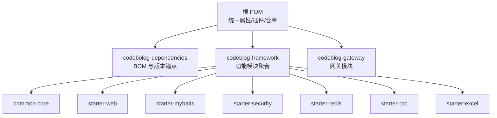
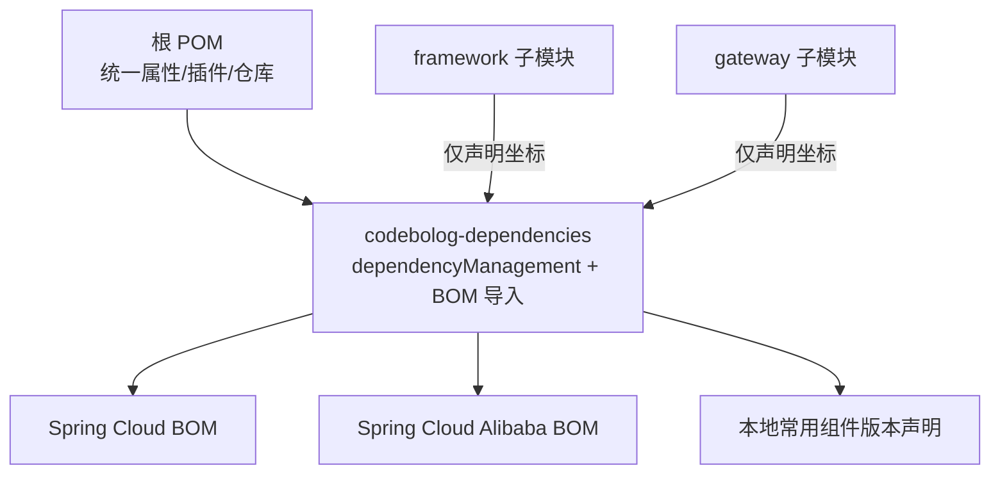
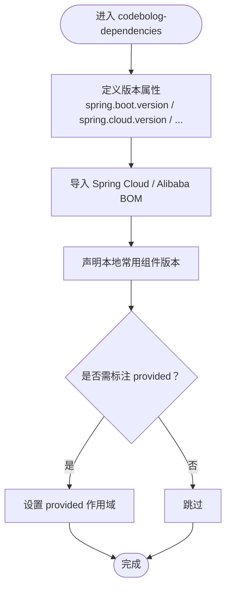
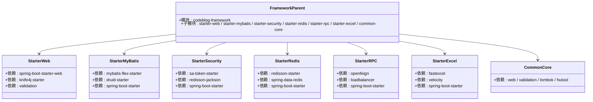
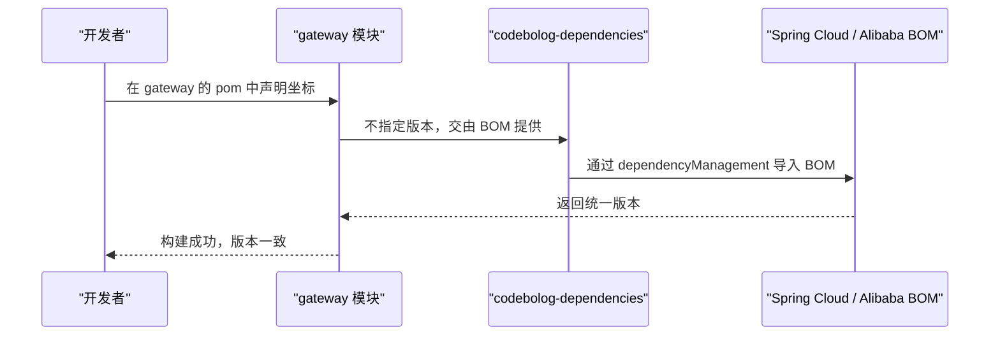
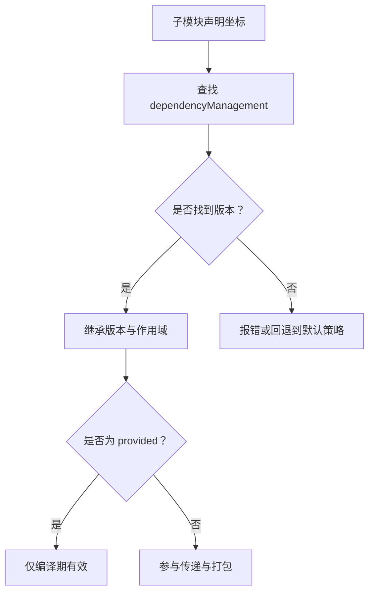

# 依赖管理

<cite>
**本文引用的文件**
- [根 POM（顶级父工程）](file://pom.xml)
- [依赖版本控制模块 POM](file://codebolog-dependencies/pom.xml)
- [框架聚合模块 POM](file://codeblog-framework/pom.xml)
- [通用核心组件 POM](file://codeblog-framework/codeblog-common/codeblog-common-core/pom.xml)
- [Web 启动器 POM](file://codeblog-framework/codeblog-spring-boot-starter-web/pom.xml)
- [MyBatis 启动器 POM](file://codeblog-framework/codeblog-spring-boot-starter-mybatis/pom.xml)
- [安全认证启动器 POM](file://codeblog-framework/codeblog-spring-boot-starter-security/pom.xml)
- [Redis 启动器 POM](file://codeblog-framework/codeblog-spring-boot-starter-redis/pom.xml)
- [RPC 启动器 POM](file://codeblog-framework/codeblog-spring-boot-starter-rpc/pom.xml)
- [Excel 启动器 POM](file://codeblog-framework/codeblog-spring-boot-starter-excel/pom.xml)
- [网关模块 POM](file://codeblog-gateway/pom.xml)
- [.gitignore（仓库忽略规则）](file://.gitignore)
- [.idea/.gitignore（IDE 忽略规则）](file://.idea/.gitignore)
</cite>

## 目录
1. [引言](#引言)
2. [项目结构](#项目结构)
3. [核心组件](#核心组件)
4. [架构总览](#架构总览)
5. [详细组件分析](#详细组件分析)
6. [依赖关系分析](#依赖关系分析)
7. [性能考虑](#性能考虑)
8. [故障排查指南](#故障排查指南)
9. [结论](#结论)
10. [附录：最佳实践与工具推荐](#附录最佳实践与工具推荐)

## 引言
本文件面向 codeblog-cloud 项目的依赖管理体系，系统化阐述 codebolog-dependencies 模块的版本控制策略与依赖管理机制，详解如何通过 BOM（Bill of Materials）统一管理各模块依赖版本，避免版本冲突与“依赖地狱”。同时，结合 Maven 多模块项目的依赖传递与作用域管理，给出依赖更新的最佳实践、版本升级指南，并说明 .gitignore 的作用与重要性，最后提供工具推荐与自动化脚本思路，帮助团队建立标准化的依赖管理流程，确保项目的稳定性与可维护性。

## 项目结构
codeblog-cloud 采用多模块聚合结构，顶层父工程负责统一属性、插件与仓库配置；codebolog-dependencies 作为“依赖版本控制”模块，集中声明并导入 Spring Cloud、Spring Cloud Alibaba 等生态的 BOM，形成统一的依赖版本锚点；其余模块（如 framework、gateway）按功能拆分，复用该 BOM 并仅声明所需坐标，不重复指定版本，从而实现“一处声明、全局生效”。

图表来源
- [根 POM（顶级父工程）](file://pom.xml#L16-L20)
- [依赖版本控制模块 POM](file://codebolog-dependencies/pom.xml#L1-L20)
- [框架聚合模块 POM](file://codeblog-framework/pom.xml#L32-L43)
- [网关模块 POM](file://codeblog-gateway/pom.xml#L1-L22)

章节来源
- [根 POM（顶级父工程）](file://pom.xml#L16-L20)
- [依赖版本控制模块 POM](file://codebolog-dependencies/pom.xml#L1-L20)
- [框架聚合模块 POM](file://codeblog-framework/pom.xml#L32-L43)
- [网关模块 POM](file://codeblog-gateway/pom.xml#L1-L22)

## 核心组件
- 顶级父工程（根 POM）
  - 统一 Java 版本、Maven 插件版本、编码等属性
  - 配置 pluginManagement 以约束插件行为（如 Surefire、Compiler），并启用 flatten-maven-plugin 进行 POM 规范化
  - 配置国内镜像仓库加速依赖下载
- codebolog-dependencies（依赖版本控制模块）
  - 定义统一的版本属性（如 spring.boot.version、spring.cloud.version、spring.cloud.alibaba.version 等）
  - 通过 dependencyManagement 导入 Spring Cloud、Spring Cloud Alibaba 等 BOM，并声明常用组件坐标，形成“版本锚点”
- 模块化子工程
  - framework 子模块：按功能拆分为多个 starter 与公共组件，均不直接声明版本，而是由父工程的 BOM 提供
  - gateway 子模块：声明网关、负载均衡、注册发现、配置中心、安全与缓存等依赖，同样不重复指定版本

章节来源
- [根 POM（顶级父工程）](file://pom.xml#L22-L36)
- [根 POM（顶级父工程）](file://pom.xml#L38-L117)
- [根 POM（顶级父工程）](file://pom.xml#L119-L148)
- [依赖版本控制模块 POM](file://codebolog-dependencies/pom.xml#L18-L94)
- [依赖版本控制模块 POM](file://codebolog-dependencies/pom.xml#L96-L207)
- [框架聚合模块 POM](file://codeblog-framework/pom.xml#L32-L43)
- [网关模块 POM](file://codeblog-gateway/pom.xml#L24-L79)

## 架构总览
下图展示了“版本锚点 + BOM 导入”的依赖管理架构：根 POM 负责统一属性与插件；codebolog-dependencies 通过 dependencyManagement 导入 Spring Cloud 与 Spring Cloud Alibaba 的 BOM，并在内部声明常用组件版本；framework 与 gateway 等子模块仅声明坐标，版本由 BOM 提供，从而实现全局一致性与可维护性。

图表来源
- [根 POM（顶级父工程）](file://pom.xml#L22-L36)
- [根 POM（顶级父工程）](file://pom.xml#L38-L117)
- [依赖版本控制模块 POM](file://codebolog-dependencies/pom.xml#L96-L207)
- [框架聚合模块 POM](file://codeblog-framework/pom.xml#L32-L43)
- [网关模块 POM](file://codeblog-gateway/pom.xml#L24-L79)

## 详细组件分析

### codebolog-dependencies：BOM 与版本锚点
- 版本属性集中管理：定义了 spring.boot.version、spring.cloud.version、spring.cloud.alibaba.version 等关键版本属性，便于统一升级与替换
- BOM 导入：通过 dependencyManagement 导入 Spring Cloud 与 Spring Cloud Alibaba 的 BOM，确保生态内组件版本一致
- 本地组件版本声明：对 Knife4j、Sa-Token、MyBatis-Flex、Redisson、OpenFeign、Spring Cloud Gateway 等常用组件进行版本声明，形成“补充锚点”
- provided 作用域：对某些处理器或注解绑定类使用 provided 作用域，避免污染运行时依赖树

图表来源
- [依赖版本控制模块 POM](file://codebolog-dependencies/pom.xml#L18-L94)
- [依赖版本控制模块 POM](file://codebolog-dependencies/pom.xml#L96-L207)

章节来源
- [依赖版本控制模块 POM](file://codebolog-dependencies/pom.xml#L18-L94)
- [依赖版本控制模块 POM](file://codebolog-dependencies/pom.xml#L96-L207)

### framework 子模块：按功能拆分的启动器
- starter-web：声明 Web、Knife4j、Validation 等依赖，不指定版本，由 BOM 提供
- starter-mybatis：声明 MyBatis-Flex、Druid、Spring Boot Starter 等依赖，不指定版本
- starter-security：声明 Sa-Token、Redisson-Jackson、Spring Boot Starter 等依赖，不指定版本
- starter-redis：声明 Redisson、Spring Data Redis、Spring Boot Starter 等依赖，不指定版本
- starter-rpc：声明 OpenFeign、LoadBalancer、Spring Boot Starter 等依赖，不指定版本
- starter-excel：声明 FastExcel、Velocity、Spring Boot Starter 等依赖，不指定版本
- common-core：声明 Web、Validation、Lombok、Hutool 等依赖，不指定版本

图表来源
- [框架聚合模块 POM](file://codeblog-framework/pom.xml#L32-L43)
- [Web 启动器 POM](file://codeblog-framework/codeblog-spring-boot-starter-web/pom.xml#L18-L43)
- [MyBatis 启动器 POM](file://codeblog-framework/codeblog-spring-boot-starter-mybatis/pom.xml#L18-L43)
- [安全认证启动器 POM](file://codeblog-framework/codeblog-spring-boot-starter-security/pom.xml#L18-L43)
- [Redis 启动器 POM](file://codeblog-framework/codeblog-spring-boot-starter-redis/pom.xml#L18-L43)
- [RPC 启动器 POM](file://codeblog-framework/codeblog-spring-boot-starter-rpc/pom.xml#L18-L43)
- [Excel 启动器 POM](file://codeblog-framework/codeblog-spring-boot-starter-excel/pom.xml#L18-L43)
- [通用核心组件 POM](file://codeblog-framework/codeblog-common/codeblog-common-core/pom.xml#L18-L49)

章节来源
- [框架聚合模块 POM](file://codeblog-framework/pom.xml#L32-L43)
- [Web 启动器 POM](file://codeblog-framework/codeblog-spring-boot-starter-web/pom.xml#L18-L43)
- [MyBatis 启动器 POM](file://codeblog-framework/codeblog-spring-boot-starter-mybatis/pom.xml#L18-L43)
- [安全认证启动器 POM](file://codeblog-framework/codeblog-spring-boot-starter-security/pom.xml#L18-L43)
- [Redis 启动器 POM](file://codeblog-framework/codeblog-spring-boot-starter-redis/pom.xml#L18-L43)
- [RPC 启动器 POM](file://codeblog-framework/codeblog-spring-boot-starter-rpc/pom.xml#L18-L43)
- [Excel 启动器 POM](file://codeblog-framework/codeblog-spring-boot-starter-excel/pom.xml#L18-L43)
- [通用核心组件 POM](file://codeblog-framework/codeblog-common/codeblog-common-core/pom.xml#L18-L49)

### gateway 模块：网关与生态依赖
- 依赖 Spring Cloud Gateway、LoadBalancer、Nacos Discovery/Config、Bootstrap
- 依赖 Sa-Token Reactor 与 Redisson-Jackson，以及 Lombok（标记 optional）
- 通过 spring-boot-maven-plugin 排除 Lombok，避免打包携带

图表来源
- [网关模块 POM](file://codeblog-gateway/pom.xml#L24-L79)
- [依赖版本控制模块 POM](file://codebolog-dependencies/pom.xml#L96-L207)

章节来源
- [网关模块 POM](file://codeblog-gateway/pom.xml#L24-L79)

## 依赖关系分析
- 依赖传递与作用域
  - framework 与 gateway 子模块仅声明坐标，不重复指定版本，版本由 codebolog-dependencies 的 dependencyManagement 提供
  - 对于注解处理器或仅在编译期使用的组件（如 mybatis-flex-processor），使用 provided 作用域，避免污染运行时依赖树
  - 对于 Lombok 等仅在编译期使用的工具，标记 optional，并在构建插件中排除，减少运行时负担
- 依赖冲突规避
  - 通过导入 Spring Cloud 与 Spring Cloud Alibaba 的 BOM，确保生态内组件版本一致
  - 通过统一的版本属性与 pluginManagement，减少手工配置差异导致的冲突
- 依赖可见性
  - dependencyManagement 仅提供版本与范围，不引入实际依赖；子模块需显式声明所需坐标

图表来源
- [依赖版本控制模块 POM](file://codebolog-dependencies/pom.xml#L96-L207)
- [通用核心组件 POM](file://codeblog-framework/codeblog-common/codeblog-common-core/pom.xml#L18-L49)
- [MyBatis 启动器 POM](file://codeblog-framework/codeblog-spring-boot-starter-mybatis/pom.xml#L18-L43)

章节来源
- [依赖版本控制模块 POM](file://codebolog-dependencies/pom.xml#L96-L207)
- [通用核心组件 POM](file://codeblog-framework/codeblog-common/codeblog-common-core/pom.xml#L18-L49)
- [MyBatis 启动器 POM](file://codeblog-framework/codeblog-spring-boot-starter-mybatis/pom.xml#L18-L43)

## 性能考虑
- 仓库镜像：根 POM 配置华为云与阿里云公共镜像，显著提升依赖下载速度
- 插件优化：统一使用较新版本的 maven-compiler-plugin 与 maven-surefire-plugin，并在 Compiler 插件中配置必要的注解处理器路径与编译参数，减少编译失败与重试成本
- POM 规范化：通过 flatten-maven-plugin 在构建时生成扁平化的 POM，有助于 CI/CD 与依赖解析的稳定性

章节来源
- [根 POM（顶级父工程）](file://pom.xml#L119-L148)
- [根 POM（顶级父工程）](file://pom.xml#L38-L117)

## 故障排查指南
- 版本不一致导致的类冲突
  - 症状：运行时报找不到类或方法签名不匹配
  - 排查：确认子模块是否仅声明坐标未指定版本；检查 codebolog-dependencies 是否导入了对应 BOM；核对版本属性是否一致
- provided 作用域误用
  - 症状：运行时报缺少依赖
  - 排查：确认该依赖是否应为 provided；若为运行时必需，请移除 provided 或在运行模块中显式声明
- optional 与注解处理器
  - 症状：MapStruct 或 Lombok 生成代码不可见
  - 排查：确认 Compiler 插件的 annotationProcessorPaths 是否包含 Lombok 与 MapStruct 的处理器；确认 Lombok 的 binding 版本与 Lombok 版本兼容
- 构建失败或插件版本不兼容
  - 症状：Surefire 插件版本过低导致 JUnit 5 不兼容
  - 排查：使用根 POM 的 pluginManagement 统一版本，避免子模块各自覆盖

章节来源
- [根 POM（顶级父工程）](file://pom.xml#L38-L117)
- [依赖版本控制模块 POM](file://codebolog-dependencies/pom.xml#L96-L207)
- [通用核心组件 POM](file://codeblog-framework/codeblog-common/codeblog-common-core/pom.xml#L18-L49)

## 结论
codeblog-cloud 通过“根 POM + codebolog-dependencies + BOM 导入”的模式，实现了对多模块项目的统一依赖治理。该模式具备以下优势：
- 明确的版本锚点：集中管理关键版本属性与常用组件版本
- 生态一致性：通过 Spring Cloud 与 Spring Cloud Alibaba 的 BOM，保证生态内组件版本统一
- 清晰的依赖边界：子模块仅声明坐标，避免重复与冲突
- 可维护性强：升级只需调整 BOM 与版本属性，影响面可控

建议团队在日常开发中遵循“只声明、不指定版本”的原则，并配合 .gitignore 与仓库镜像策略，持续提升构建效率与稳定性。

## 附录：最佳实践与工具推荐

### 依赖更新与版本升级指南
- 升级 Spring Cloud 与 Spring Cloud Alibaba
  - 修改 codebolog-dependencies 中的 spring.cloud.version 与 spring.cloud.alibaba.version 属性
  - 在根 POM 的 pluginManagement 中同步更新相关插件版本，确保兼容
- 升级 Spring Boot
  - 更新 spring.boot.version 与相关 starter 的版本
  - 检查 Lombok、MapStruct 等注解处理器版本是否兼容
- 升级其他组件
  - 在 codebolog-dependencies 的 properties 与 dependencyManagement 中逐项更新
  - 对于 provided 的处理器类，保持与主组件版本一致

### .gitignore 的作用与重要性
- 忽略构建产物：target/ 等目录不纳入版本控制，减少仓库膨胀
- 忽略 IDE 本地文件：.idea、.vscode、Eclipse 等本地配置文件，避免团队成员间差异
- 保留必要文件：保留 maven wrapper 的 jar 文件，确保 CI/CD 能稳定拉取构建工具

章节来源
- [.gitignore（仓库忽略规则）](file://.gitignore#L1-L38)
- [.idea/.gitignore（IDE 忽略规则）](file://.idea/.gitignore#L1-L9)

### 工具推荐与自动化脚本思路
- 依赖审计与可视化
  - 使用 Maven Dependency Plugin 生成依赖树与冲突报告
  - 使用第三方工具（如 Dependency-Check、Snyk）扫描漏洞与许可证风险
- 自动化升级脚本（思路）
  - 批量更新版本属性：编写脚本修改 codebolog-dependencies 的版本属性
  - 生成变更日志：对比旧/新版本，输出受影响的模块与依赖
  - 自动化测试：在 CI 中执行构建与测试，快速发现不兼容问题
- CI/CD 集成
  - 在流水线中启用仓库镜像与缓存策略，缩短构建时间
  - 在 PR 中增加“依赖变更检查”步骤，防止意外引入冲突版本