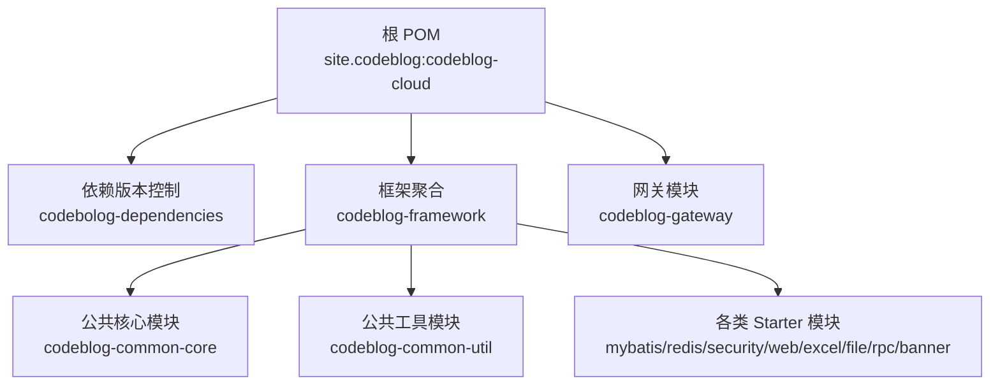
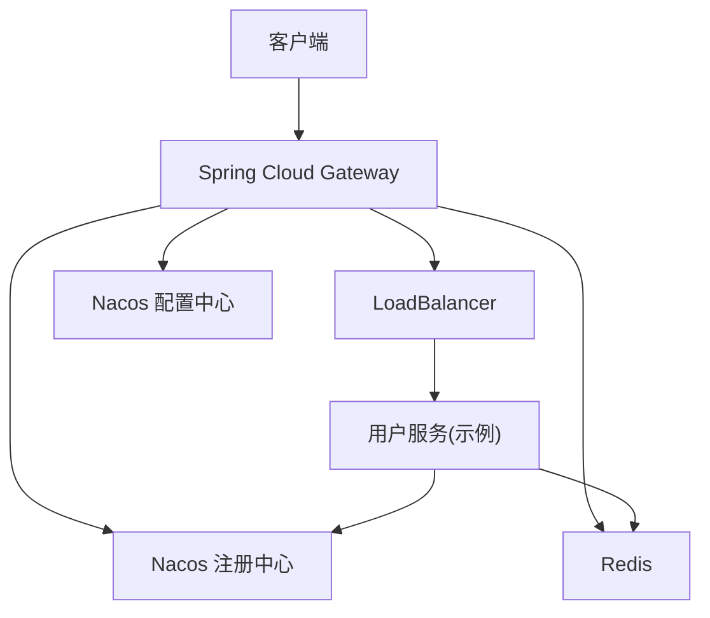
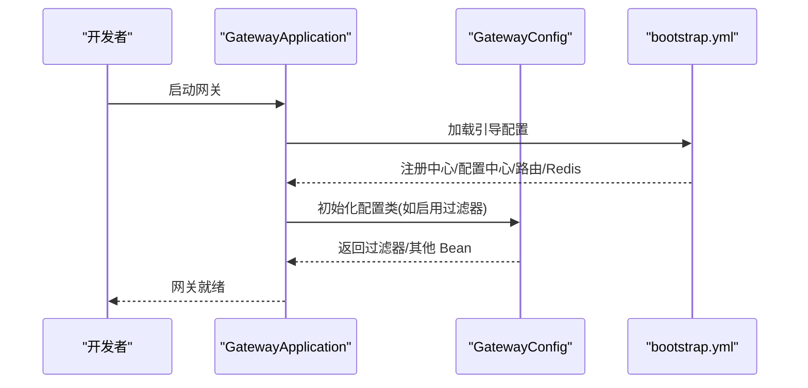
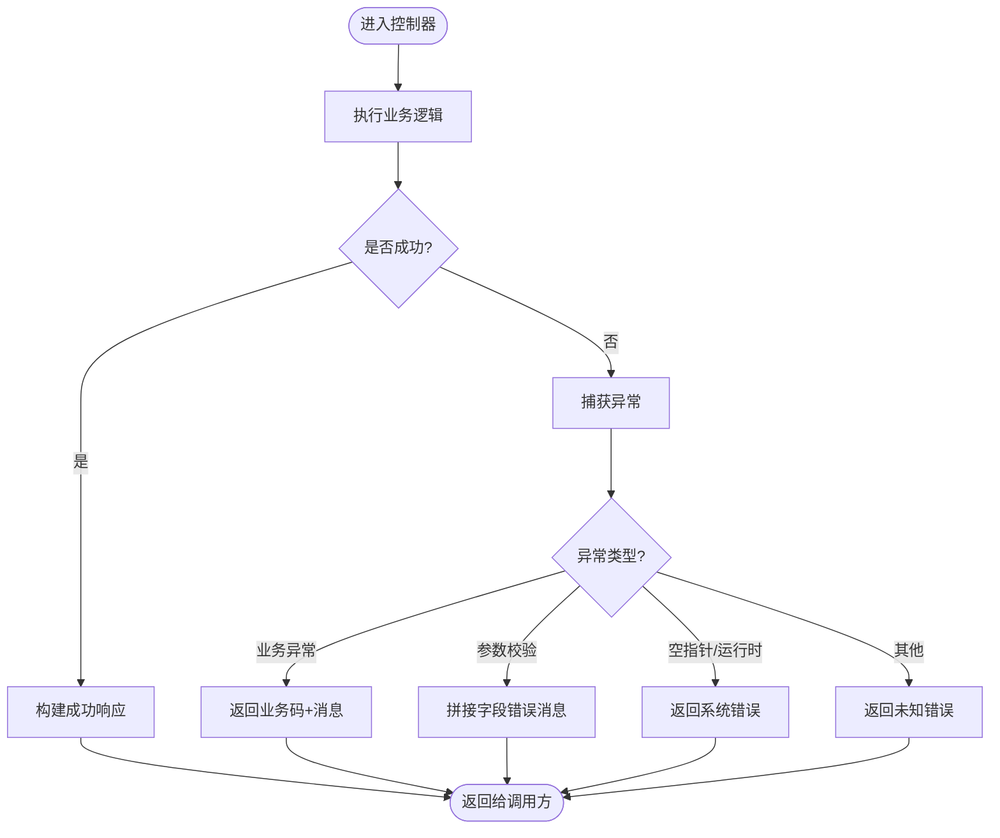
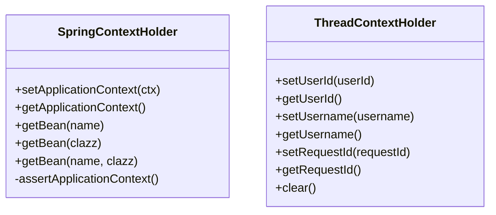
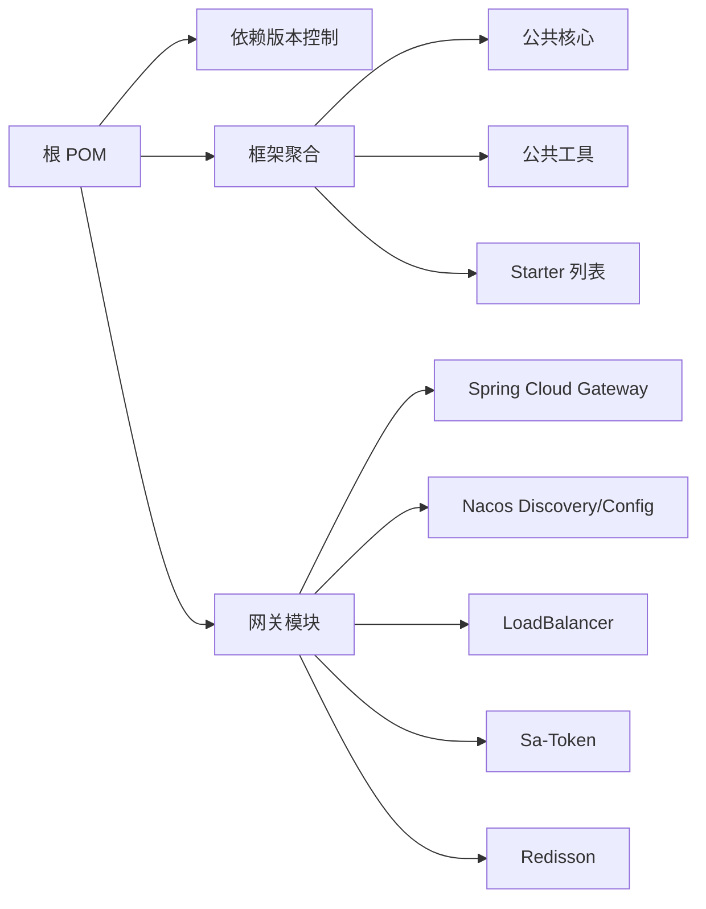

# 开发指南

<cite>
**本文引用的文件**
- [根 POM 文件](file://pom.xml)
- [依赖版本控制模块 POM](file://codebolog-dependencies/pom.xml)
- [框架聚合模块 POM](file://codeblog-framework/pom.xml)
- [网关模块 POM](file://codeblog-gateway/pom.xml)
- [网关应用入口](file://codeblog-gateway/src/main/java/site/codeblog/GatewayApplication.java)
- [网关配置类](file://codeblog-gateway/src/main/java/site/codeblog/gateway/config/GatewayConfig.java)
- [网关引导配置](file://codeblog-gateway/src/main/resources/bootstrap.yml)
- [统一响应模型](file://codeblog-framework/codeblog-common/codeblog-common-core/src/main/java/site/codeblog/common/core/result/Result.java)
- [全局异常处理器](file://codeblog-framework/codeblog-common/codeblog-common-core/src/main/java/site/codeblog/common/core/exception/GlobalExceptionHandler.java)
- [业务异常模型](file://codeblog-framework/codeblog-common/codeblog-common-core/src/main/java/site/codeblog/common/core/exception/BusinessException.java)
- [Spring 上下文工具类](file://codeblog-framework/codeblog-common/codeblog-common-util/src/main/java/site/codeblog/common/util/SpringContextHolder.java)
- [线程上下文工具类](file://codeblog-framework/codeblog-common/codeblog-common-util/src/main/java/site/codeblog/common/util/ThreadContextHolder.java)
</cite>

## 目录
1. [简介](#简介)
2. [项目结构](#项目结构)
3. [核心组件](#核心组件)
4. [架构总览](#架构总览)
5. [详细组件分析](#详细组件分析)
6. [依赖关系分析](#依赖关系分析)
7. [性能与可维护性建议](#性能与可维护性建议)
8. [测试策略](#测试策略)
9. [配置管理规范](#配置管理规范)
10. [代码风格与命名约定](#代码风格与命名约定)
11. [模块化开发最佳实践](#模块化开发最佳实践)
12. [代码审查标准](#代码审查标准)
13. [持续集成与发布管理](#持续集成与发布管理)
14. [故障排查指南](#故障排查指南)
15. [结语](#结语)

## 简介
本指南面向新加入团队的开发者，系统阐述 codeblog-cloud 项目的目录结构、模块划分、通用组件、配置管理、测试策略、代码风格、模块间接口与依赖管理、代码审查与 CI/CD 流程，并提供故障排查与发布管理建议，帮助快速融入并高质量交付。

## 项目结构
项目采用多模块 Maven 聚合结构，顶层父 POM 负责统一属性、插件与仓库配置；子模块按职责拆分：依赖版本控制、框架组件聚合、网关服务。

图表来源
- [根 POM 文件](file://pom.xml#L16-L20)
- [框架聚合模块 POM](file://codeblog-framework/pom.xml#L26-L37)
- [网关模块 POM](file://codeblog-gateway/pom.xml#L1-L22)

章节来源
- [根 POM 文件](file://pom.xml#L16-L20)
- [框架聚合模块 POM](file://codeblog-framework/pom.xml#L26-L37)
- [网关模块 POM](file://codeblog-gateway/pom.xml#L1-L22)

## 核心组件
- 统一响应模型：定义标准响应结构，便于前后端契约一致与前端统一处理。
- 全局异常处理器：集中捕获并转换常见异常为统一响应，减少重复逻辑。
- 业务异常模型：承载业务错误码与消息，配合全局处理器实现精确错误返回。
- Spring 上下文工具类：提供静态方式获取 ApplicationContext 与 Bean，便于工具类使用。
- 线程上下文工具类：基于 TransmittableThreadLocal 提供用户标识与请求追踪上下文。

章节来源
- [统一响应模型](file://codeblog-framework/codeblog-common/codeblog-common-core/src/main/java/site/codeblog/common/core/result/Result.java#L12-L101)
- [全局异常处理器](file://codeblog-framework/codeblog-common/codeblog-common-core/src/main/java/site/codeblog/common/core/exception/GlobalExceptionHandler.java#L20-L107)
- [业务异常模型](file://codeblog-framework/codeblog-common/codeblog-common-core/src/main/java/site/codeblog/common/core/exception/BusinessException.java#L11-L68)
- [Spring 上下文工具类](file://codeblog-framework/codeblog-common/codeblog-common-util/src/main/java/site/codeblog/common/util/SpringContextHolder.java#L14-L67)
- [线程上下文工具类](file://codeblog-framework/codeblog-common/codeblog-common-util/src/main/java/site/codeblog/common/util/ThreadContextHolder.java#L10-L77)

## 架构总览
整体采用微服务网关模式：网关负责路由、鉴权与负载均衡；服务通过注册中心发现；配置由配置中心下发；Redis 用于会话与缓存。

图表来源
- [网关引导配置](file://codeblog-gateway/src/main/resources/bootstrap.yml#L8-L13)
- [网关模块 POM](file://codeblog-gateway/pom.xml#L24-L78)

章节来源
- [网关引导配置](file://codeblog-gateway/src/main/resources/bootstrap.yml#L1-L44)
- [网关模块 POM](file://codeblog-gateway/pom.xml#L24-L78)

## 详细组件分析

### 网关模块
- 启动类：标准 Spring Boot 启动入口。
- 配置类：预留 Sa-Token 过滤器配置位置，当前注释以避免未完成集成导致的异常。
- 引导配置：定义端口、应用名、Nacos 地址、路由规则、Redis 连接与 Sa-Token 参数。

图表来源
- [网关应用入口](file://codeblog-gateway/src/main/java/site/codeblog/GatewayApplication.java#L11-L16)
- [网关配置类](file://codeblog-gateway/src/main/java/site/codeblog/gateway/config/GatewayConfig.java#L10-L28)
- [网关引导配置](file://codeblog-gateway/src/main/resources/bootstrap.yml#L1-L44)

章节来源
- [网关应用入口](file://codeblog-gateway/src/main/java/site/codeblog/GatewayApplication.java#L11-L16)
- [网关配置类](file://codeblog-gateway/src/main/java/site/codeblog/gateway/config/GatewayConfig.java#L10-L28)
- [网关引导配置](file://codeblog-gateway/src/main/resources/bootstrap.yml#L1-L44)

### 统一响应与异常处理
- 统一响应模型：包含状态码、消息、数据、时间戳，提供成功/失败工厂方法与成功判定。
- 全局异常处理器：覆盖业务异常、参数校验、空指针、非法参数、运行时异常与未知异常，统一转为 Result。
- 业务异常模型：支持多种构造方式，便于上层抛出带业务码的异常。

图表来源
- [统一响应模型](file://codeblog-framework/codeblog-common/codeblog-common-core/src/main/java/site/codeblog/common/core/result/Result.java#L56-L100)
- [全局异常处理器](file://codeblog-framework/codeblog-common/codeblog-common-core/src/main/java/site/codeblog/common/core/exception/GlobalExceptionHandler.java#L27-L106)
- [业务异常模型](file://codeblog-framework/codeblog-common/codeblog-common-core/src/main/java/site/codeblog/common/core/exception/BusinessException.java#L37-L53)

章节来源
- [统一响应模型](file://codeblog-framework/codeblog-common/codeblog-common-core/src/main/java/site/codeblog/common/core/result/Result.java#L12-L101)
- [全局异常处理器](file://codeblog-framework/codeblog-common/codeblog-common-core/src/main/java/site/codeblog/common/core/exception/GlobalExceptionHandler.java#L20-L107)
- [业务异常模型](file://codeblog-framework/codeblog-common/codeblog-common-core/src/main/java/site/codeblog/common/core/exception/BusinessException.java#L11-L68)

### Spring 与线程上下文工具
- Spring 上下文工具类：实现 ApplicationContextAware，在静态上下文中持有 ApplicationContext，提供按名称/类型获取 Bean 的能力。
- 线程上下文工具类：基于 TransmittableThreadLocal 提供用户 ID、用户名、请求 ID 的跨线程传递，便于日志与审计。

图表来源
- [Spring 上下文工具类](file://codeblog-framework/codeblog-common/codeblog-common-util/src/main/java/site/codeblog/common/util/SpringContextHolder.java#L14-L67)
- [线程上下文工具类](file://codeblog-framework/codeblog-common/codeblog-common-util/src/main/java/site/codeblog/common/util/ThreadContextHolder.java#L10-L77)

章节来源
- [Spring 上下文工具类](file://codeblog-framework/codeblog-common/codeblog-common-util/src/main/java/site/codeblog/common/util/SpringContextHolder.java#L14-L67)
- [线程上下文工具类](file://codeblog-framework/codeblog-common/codeblog-common-util/src/main/java/site/codeblog/common/util/ThreadContextHolder.java#L10-L77)

## 依赖关系分析
- 顶层父 POM 统一 Java 版本、插件版本、仓库源与 flatten 插件，确保各模块一致性。
- 依赖版本控制模块集中声明 Spring Cloud、Spring Cloud Alibaba 与 Spring Boot 版本，避免版本漂移。
- 网关模块引入 Spring Cloud Gateway、Nacos Discovery/Config、LoadBalancer、Sa-Token、Redisson 等依赖，支撑网关能力。
- 框架聚合模块聚合各类 Starter 与公共模块，形成可复用的组件库。

图表来源
- [根 POM 文件](file://pom.xml#L22-L36)
- [依赖版本控制模块 POM](file://codebolog-dependencies/pom.xml#L18-L24)
- [框架聚合模块 POM](file://codeblog-framework/pom.xml#L26-L37)
- [网关模块 POM](file://codeblog-gateway/pom.xml#L24-L78)

章节来源
- [根 POM 文件](file://pom.xml#L22-L36)
- [依赖版本控制模块 POM](file://codebolog-dependencies/pom.xml#L18-L24)
- [框架聚合模块 POM](file://codeblog-framework/pom.xml#L26-L37)
- [网关模块 POM](file://codeblog-gateway/pom.xml#L24-L78)

## 性能与可维护性建议
- 统一响应与异常处理：保持响应结构稳定，避免频繁变更字段，便于前端适配与缓存策略制定。
- 线程上下文：仅在必要场景使用，避免过度传递敏感信息；注意 clear 时机，防止内存泄漏。
- 网关路由：合理设置前缀剥离与路径匹配，避免过多正则导致性能下降。
- 配置中心：将热点配置外置，结合灰度发布与限流策略，降低变更风险。
- 依赖版本：通过依赖版本控制模块统一升级，避免模块间版本冲突。

## 测试策略
- 单元测试：针对工具类与纯函数，使用 JUnit 5 与 Mockito 进行断言验证；覆盖正常/异常分支。
- 集成测试：通过 @SpringBootTest 启动最小上下文，验证网关路由、异常处理链路与 Redis/数据库交互。
- 端到端测试：使用 Postman 或自研脚本，模拟真实用户路径，验证从网关到下游服务的完整链路。
- 建议：为每个模块编写 README 测试说明，明确测试入口与期望行为。

## 配置管理规范
- 环境配置：本地 dev、测试 test、预发 uat、生产 prod 分离，端口、注册中心地址、配置中心地址按环境区分。
- 动态配置：优先使用 Nacos Config，将可热更新项外置；对不支持热更新的配置，通过重启生效。
- 配置中心集成：网关引导配置中已包含 Nacos 地址与 file-extension；路由规则与 Sa-Token 参数可按需扩展。
- 安全：敏感配置放入加密存储或环境变量，避免明文写入配置文件。

章节来源
- [网关引导配置](file://codeblog-gateway/src/main/resources/bootstrap.yml#L8-L13)
- [网关模块 POM](file://codeblog-gateway/pom.xml#L43-L47)

## 代码风格与命名约定
- 包命名：采用反向域名 + 功能域，如 site.codeblog.gateway、site.codeblog.common.core。
- 类命名：采用帕斯卡命名法；异常类以 Exception 结尾；工具类以 Utils/Holder 结尾。
- 方法命名：动词短语，清晰表达意图；布尔方法以 is/has 开头。
- 常量：全部大写，单词以下划线分隔。
- 注释：类与公共方法必须有 Javadoc；复杂逻辑补充行内注释。
- Lombok：在实体类中谨慎使用，避免过度简化导致调试困难。

## 模块化开发最佳实践
- 接口设计：对外暴露的 API 通过接口与 DTO 解耦，避免直接依赖实现类。
- 依赖管理：通过依赖版本控制模块统一版本，模块间尽量通过接口通信，降低耦合。
- 通信协议：REST API 作为默认协议，RPC 可选；统一鉴权与限流策略。
- Starter 设计：遵循 Spring Boot 自动装配约定，提供条件装配与默认配置，允许外部覆盖。
- 日志与监控：统一日志格式与链路 ID，接入分布式追踪与指标采集。

## 代码审查标准
- 代码质量：无编译警告、无重复代码、无魔法数字；方法长度适中，单一职责。
- 安全：输入校验、权限控制、敏感信息脱敏；避免硬编码密钥与敏感路径。
- 可测试性：高内聚低耦合，便于单元测试；对外部依赖进行抽象与 Mock。
- 文档：新增功能附带设计说明与测试清单；重要变更更新接口文档。
- 回滚策略：重大变更需配套回滚方案与降级预案。

## 持续集成与发布管理
- CI 触发：push 与 PR 自动触发构建与测试；失败时阻塞合并。
- 构建：使用 Maven 插件统一编译与打包；开启 Surefire 插件支持 JUnit 5。
- 发布：版本号遵循语义化版本；发布前进行回归测试与安全扫描；灰度发布逐步放量。
- 配置：不同环境配置分离，发布前核对环境变量与配置中心参数。

## 故障排查指南
- 网关无法路由：检查 bootstrap.yml 中路由配置与服务名是否正确；确认 Nacos 注册中心可用。
- 认证失败：检查 Sa-Token 配置与 Redis 会话存储；确认 Token 名称与过期策略。
- 统一异常未生效：确认全局异常处理器是否被扫描；检查业务异常是否正确抛出。
- 线程上下文丢失：确认是否使用了正确的线程池与异步场景；必要时手动传递上下文。

章节来源
- [网关引导配置](file://codeblog-gateway/src/main/resources/bootstrap.yml#L14-L22)
- [全局异常处理器](file://codeblog-framework/codeblog-common/codeblog-common-core/src/main/java/site/codeblog/common/core/exception/GlobalExceptionHandler.java#L27-L106)
- [线程上下文工具类](file://codeblog-framework/codeblog-common/codeblog-common-util/src/main/java/site/codeblog/common/util/ThreadContextHolder.java#L30-L77)

## 结语
本指南提供了从项目结构、核心组件、配置管理到测试与发布的全流程开发规范。请在实际开发中严格遵循，持续优化流程与工具，保障系统的稳定性与可演进性。