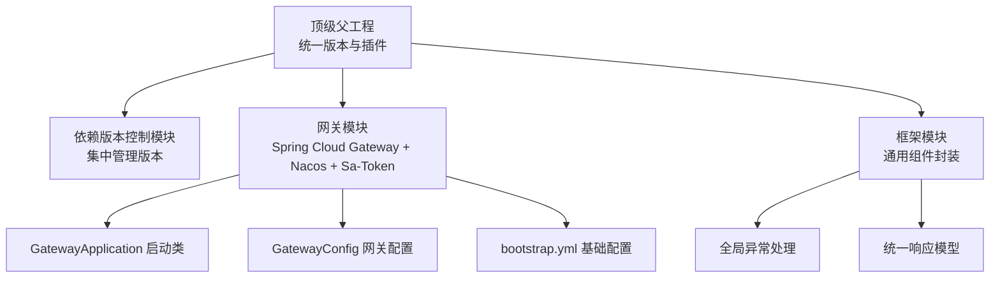
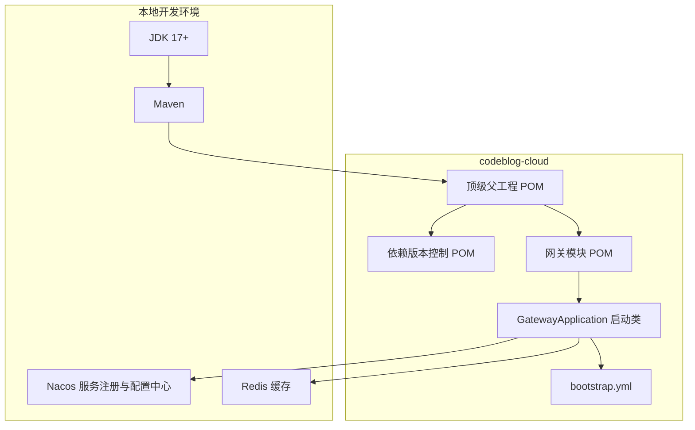
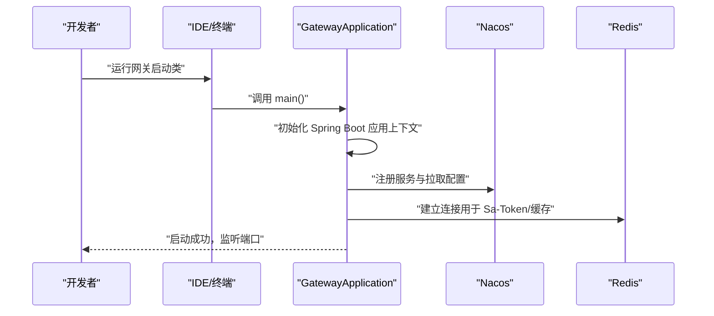
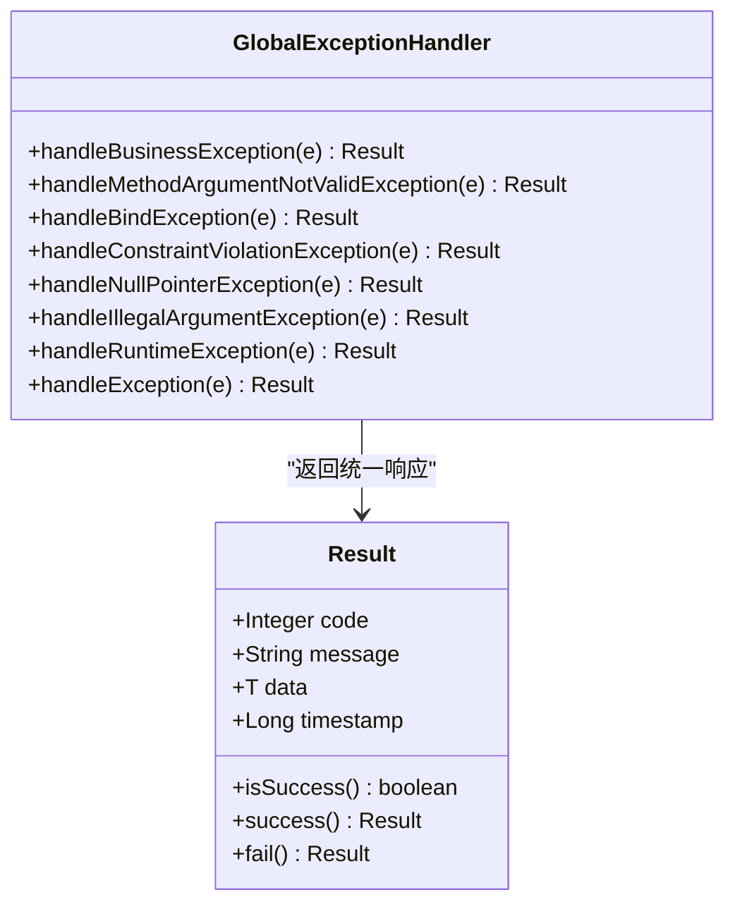
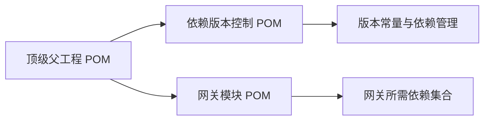

# 快速开始

<cite>
**本文引用的文件**
- [根 POM（顶级父工程）](file://pom.xml)
- [依赖版本控制模块 POM](file://codebolog-dependencies/pom.xml)
- [网关模块 POM](file://codeblog-gateway/pom.xml)
- [网关应用入口](file://codeblog-gateway/src/main/java/site/codeblog/GatewayApplication.java)
- [网关基础配置（bootstrap.yml）](file://codeblog-gateway/src/main/resources/bootstrap.yml)
- [网关配置类（GatewayConfig）](file://codeblog-gateway/src/main/java/site/codeblog/gateway/config/GatewayConfig.java)
- [全局异常处理（GlobalExceptionHandler）](file://codeblog-framework/codeblog-common/codeblog-common-core/src/main/java/site/codeblog/common/core/exception/GlobalExceptionHandler.java)
- [统一响应模型（Result）](file://codeblog-framework/codeblog-common/codeblog-common-core/src/main/java/site/codeblog/common/core/result/Result.java)
</cite>

## 目录
1. [简介](#简介)
2. [项目结构](#项目结构)
3. [核心组件](#核心组件)
4. [架构总览](#架构总览)
5. [详细组件分析](#详细组件分析)
6. [依赖分析](#依赖分析)
7. [性能考虑](#性能考虑)
8. [故障排查指南](#故障排查指南)
9. [结论](#结论)
10. [附录](#附录)

## 简介
本指南面向首次接触 codeblog-cloud 微服务框架的开发者，目标是帮助你在最短时间内完成环境准备、项目搭建与本地运行，快速启动网关模块并验证基本功能。你将学到：
- 环境准备要求（Java 17+、Maven 等）
- 从代码克隆到本地运行的全流程步骤
- 网关模块的启动方式与基础配置
- bootstrap.yml 的关键参数说明
- 常见启动问题的排查与解决方案
- 面向不同经验水平的循序渐进学习路径

## 项目结构
codeblog-cloud 采用多模块聚合工程组织，顶层父工程负责统一版本与插件配置，子模块按职责拆分：
- 顶级父工程：统一 Java 版本、Maven 插件、仓库源
- 依赖版本控制模块：集中管理 Spring Boot、Spring Cloud、Spring Cloud Alibaba 以及各类生态组件版本
- 网关模块：基于 Spring Cloud Gateway + Nacos + Sa-Token 的网关服务
- 框架模块：通用组件封装（如统一响应、异常处理、starter 等）

图表来源
- [根 POM（顶级父工程）](file://pom.xml#L16-L20)
- [依赖版本控制模块 POM](file://codebolog-dependencies/pom.xml#L18-L94)
- [网关模块 POM](file://codeblog-gateway/pom.xml#L24-L78)
- [网关应用入口](file://codeblog-gateway/src/main/java/site/codeblog/GatewayApplication.java#L11-L15)
- [网关基础配置（bootstrap.yml）](file://codeblog-gateway/src/main/resources/bootstrap.yml#L1-L44)
- [网关配置类（GatewayConfig）](file://codeblog-gateway/src/main/java/site/codeblog/gateway/config/GatewayConfig.java#L10-L27)
- [全局异常处理（GlobalExceptionHandler）](file://codeblog-framework/codeblog-common/codeblog-common-core/src/main/java/site/codeblog/common/core/exception/GlobalExceptionHandler.java#L20-L106)
- [统一响应模型（Result）](file://codeblog-framework/codeblog-common/codeblog-common-core/src/main/java/site/codeblog/common/core/result/Result.java#L12-L100)

章节来源
- [根 POM（顶级父工程）](file://pom.xml#L16-L36)
- [依赖版本控制模块 POM](file://codebolog-dependencies/pom.xml#L18-L94)
- [网关模块 POM](file://codeblog-gateway/pom.xml#L24-L78)

## 核心组件
- 网关应用入口：标准 Spring Boot 启动类，负责引导网关服务启动
- 网关配置类：预留 Sa-Token 网关过滤器扩展点（当前注释状态）
- 基础配置文件：定义端口、应用名、Nacos 注册与配置中心地址、路由规则、Redis 连接信息、Sa-Token 参数等
- 框架层通用能力：统一响应模型与全局异常处理，保证接口一致性与可观测性

章节来源
- [网关应用入口](file://codeblog-gateway/src/main/java/site/codeblog/GatewayApplication.java#L11-L15)
- [网关配置类（GatewayConfig）](file://codeblog-gateway/src/main/java/site/codeblog/gateway/config/GatewayConfig.java#L10-L27)
- [网关基础配置（bootstrap.yml）](file://codeblog-gateway/src/main/resources/bootstrap.yml#L1-L44)
- [统一响应模型（Result）](file://codeblog-framework/codeblog-common/codeblog-common-core/src/main/java/site/codeblog/common/core/result/Result.java#L12-L100)
- [全局异常处理（GlobalExceptionHandler）](file://codeblog-framework/codeblog-common/codeblog-common-core/src/main/java/site/codeblog/common/core/exception/GlobalExceptionHandler.java#L20-L106)

## 架构总览
下图展示了网关模块在整体中的位置与关键外部依赖关系。

图表来源
- [根 POM（顶级父工程）](file://pom.xml#L22-L36)
- [依赖版本控制模块 POM](file://codebolog-dependencies/pom.xml#L18-L94)
- [网关模块 POM](file://codeblog-gateway/pom.xml#L24-L78)
- [网关应用入口](file://codeblog-gateway/src/main/java/site/codeblog/GatewayApplication.java#L11-L15)
- [网关基础配置（bootstrap.yml）](file://codeblog-gateway/src/main/resources/bootstrap.yml#L1-L44)

## 详细组件分析

### 环境准备与前置条件
- JDK：Java 17 或以上版本
- Maven：建议使用较新版本以获得更好的插件支持与性能
- IDE：推荐 IntelliJ IDEA 或 VS Code（仓库中已包含对应配置）
- 网络：可访问 Maven 私有镜像源（项目已内置华为云与阿里云镜像）
- 服务依赖：
  - Nacos：服务注册与配置中心（默认地址见基础配置）
  - Redis：缓存与 Sa-Token 会话存储（默认地址见基础配置）

章节来源
- [根 POM（顶级父工程）](file://pom.xml#L22-L36)
- [网关基础配置（bootstrap.yml）](file://codeblog-gateway/src/main/resources/bootstrap.yml#L8-L27)

### 项目搭建步骤（从零到本地运行）
- 步骤 1：克隆仓库到本地
- 步骤 2：安装并配置 JDK 17+ 与 Maven
- 步骤 3：在 IDE 中导入根 POM，等待依赖解析完成
- 步骤 4：启动 Nacos 与 Redis（确保地址与端口与基础配置一致）
- 步骤 5：运行网关模块启动类
- 步骤 6：访问网关健康检查或路由地址，验证服务可用

提示
- 若使用 IDE 的 Maven 工具栏，请先执行“Reload project”确保依赖拉取完成
- 若网络较慢，可直接使用项目内配置的镜像源加速

章节来源
- [根 POM（顶级父工程）](file://pom.xml#L120-L148)
- [网关基础配置（bootstrap.yml）](file://codeblog-gateway/src/main/resources/bootstrap.yml#L8-L27)
- [网关应用入口](file://codeblog-gateway/src/main/java/site/codeblog/GatewayApplication.java#L11-L15)

### 网关模块启动方式与验证
- 启动方式
  - 在 IDE 中找到网关模块的启动类，直接运行其 main 方法
  - 使用命令行进入网关模块目录，执行打包并运行（可选）
- 启动验证
  - 观察控制台日志，确认 Nacos 与 Redis 连接成功
  - 访问网关健康检查端点或根据基础配置中的路由进行请求验证

图表来源
- [网关应用入口](file://codeblog-gateway/src/main/java/site/codeblog/GatewayApplication.java#L11-L15)
- [网关基础配置（bootstrap.yml）](file://codeblog-gateway/src/main/resources/bootstrap.yml#L1-L44)

章节来源
- [网关应用入口](file://codeblog-gateway/src/main/java/site/codeblog/GatewayApplication.java#L11-L15)

### bootstrap.yml 基础配置说明
- server.port：网关监听端口
- spring.application.name：应用名称（用于 Nacos 服务发现与配置分组）
- spring.cloud.nacos.discovery.server-addr：Nacos 服务注册地址
- spring.cloud.nacos.config.server-addr：Nacos 配置中心地址
- spring.cloud.nacos.config.file-extension：配置文件格式（yaml）
- spring.cloud.gateway.routes：路由规则示例（演示将 /user/** 路由至 user-service 服务）
- data.redis.*：Redis 连接参数（用于 Sa-Token 与缓存）
- sa-token.*：Sa-Token 参数（如 token 名称、有效期、并发策略等）

章节来源
- [网关基础配置（bootstrap.yml）](file://codeblog-gateway/src/main/resources/bootstrap.yml#L1-L44)

### 网关配置类（GatewayConfig）说明
- 当前处于预留扩展状态，注释了 Sa-Token Reactor 过滤器示例
- 启用后可用于实现网关层统一鉴权、限流、日志等横切能力
- 扩展时需结合实际业务与安全策略进行配置

章节来源
- [网关配置类（GatewayConfig）](file://codeblog-gateway/src/main/java/site/codeblog/gateway/config/GatewayConfig.java#L10-L27)

### 框架层通用能力（统一响应与异常处理）
- 统一响应模型：提供成功/失败响应结构与常用工厂方法
- 全局异常处理：对常见异常类型进行归一化处理，返回统一响应结构

图表来源
- [统一响应模型（Result）](file://codeblog-framework/codeblog-common/codeblog-common-core/src/main/java/site/codeblog/common/core/result/Result.java#L12-L100)
- [全局异常处理（GlobalExceptionHandler）](file://codeblog-framework/codeblog-common/codeblog-common-core/src/main/java/site/codeblog/common/core/exception/GlobalExceptionHandler.java#L20-L106)

章节来源
- [统一响应模型（Result）](file://codeblog-framework/codeblog-common/codeblog-common-core/src/main/java/site/codeblog/common/core/result/Result.java#L12-L100)
- [全局异常处理（GlobalExceptionHandler）](file://codeblog-framework/codeblog-common/codeblog-common-core/src/main/java/site/codeblog/common/core/exception/GlobalExceptionHandler.java#L20-L106)

## 依赖分析
- 顶级父工程统一 Java 版本与 Maven 插件，集中管理仓库源
- 依赖版本控制模块集中管理 Spring Boot、Spring Cloud、Spring Cloud Alibaba 与生态组件版本
- 网关模块引入 Spring Cloud Gateway、Nacos 发现与配置、LoadBalancer、Sa-Token、Redisson 等依赖

图表来源
- [根 POM（顶级父工程）](file://pom.xml#L22-L36)
- [依赖版本控制模块 POM](file://codebolog-dependencies/pom.xml#L18-L94)
- [网关模块 POM](file://codeblog-gateway/pom.xml#L24-L78)

章节来源
- [根 POM（顶级父工程）](file://pom.xml#L22-L36)
- [依赖版本控制模块 POM](file://codebolog-dependencies/pom.xml#L18-L94)
- [网关模块 POM](file://codeblog-gateway/pom.xml#L24-L78)

## 性能考虑
- 使用本地镜像源加速依赖下载，减少构建时间
- 合理设置 Redis 连接池与超时参数，避免网关层成为瓶颈
- 路由规则尽量简洁，避免过多谓词匹配带来的额外开销
- 生产部署建议开启网关层的健康检查与限流策略

## 故障排查指南
- 无法连接 Nacos
  - 检查基础配置中的 Nacos 地址与端口是否正确
  - 确认本地 Nacos 服务已启动且网络可达
- 无法连接 Redis
  - 检查基础配置中的 Redis 地址与端口
  - 确认本地 Redis 服务已启动
- 启动时报错找不到主类或缺少依赖
  - 在 IDE 中执行 Maven 刷新，确保依赖解析完成
  - 确认 JDK 版本与项目属性一致（Java 17+）
- 路由不生效
  - 检查基础配置中的路由规则与目标服务是否正确
  - 确认目标服务已在 Nacos 注册成功
- 启动后无日志或日志异常
  - 检查日志级别与输出路径配置
  - 确认未被 IDE 或终端过滤器屏蔽

章节来源
- [网关基础配置（bootstrap.yml）](file://codeblog-gateway/src/main/resources/bootstrap.yml#L8-L27)
- [根 POM（顶级父工程）](file://pom.xml#L120-L148)

## 结论
通过本指南，你已经完成了环境准备、项目导入与网关模块的本地启动验证。建议继续深入：
- 阅读并理解 bootstrap.yml 的各项配置含义
- 尝试添加自定义路由规则与网关过滤器
- 集成下游服务，验证网关转发与负载均衡效果
- 结合框架层的统一响应与异常处理，完善接口规范

## 附录

### 学习路径建议
- 入门级（1-2 天）
  - 完成环境准备与项目导入
  - 启动网关并验证基础配置
  - 修改端口与路由示例，观察效果
- 进阶级（3-5 天）
  - 配置 Nacos 与 Redis，理解服务发现与配置中心
  - 添加自定义路由与过滤器，体验网关能力
  - 集成下游服务，验证转发与负载均衡
- 专家级（1 周以上）
  - 深入理解 Sa-Token 在网关层的应用
  - 结合框架层统一响应与异常处理，完善接口设计
  - 探索监控、限流、熔断等高级特性

### 快速参考清单
- 环境：JDK 17+、Maven、Nacos、Redis
- 启动：运行网关启动类，检查控制台日志
- 配置：修改 bootstrap.yml 中的端口、Nacos 地址、路由规则
- 验证：访问网关端点，观察路由转发与响应格式