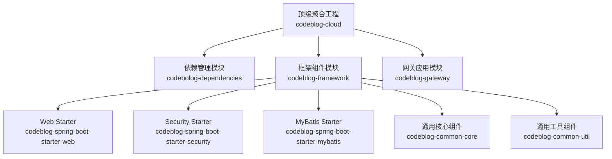
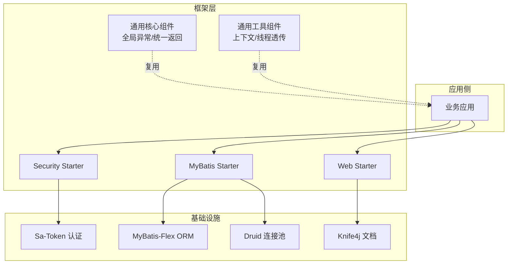
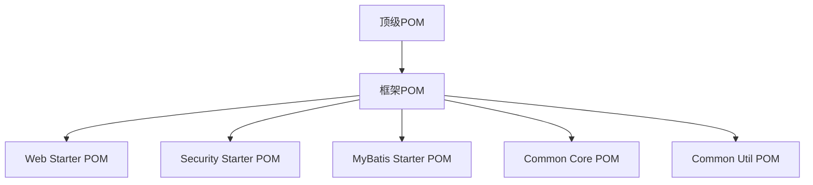

# 扩展开发

<cite>
**本文引用的文件**
- [pom.xml](file://pom.xml)
- [codeblog-framework/pom.xml](file://codeblog-framework/pom.xml)
- [codeblog-framework/codeblog-spring-boot-starter-web/pom.xml](file://codeblog-framework/codeblog-spring-boot-starter-web/pom.xml)
- [codeblog-framework/codeblog-spring-boot-starter-security/pom.xml](file://codeblog-framework/codeblog-spring-boot-starter-security/pom.xml)
- [codeblog-framework/codeblog-spring-boot-starter-mybatis/pom.xml](file://codeblog-framework/codeblog-spring-boot-starter-mybatis/pom.xml)
- [codeblog-framework/codeblog-common/codeblog-common-core/pom.xml](file://codeblog-framework/codeblog-common/codeblog-common-core/pom.xml)
- [codeblog-framework/codeblog-common/codeblog-common-core/src/main/java/site/codeblog/common/core/exception/GlobalExceptionHandler.java](file://codeblog-framework/codeblog-common/codeblog-common-core/src/main/java/site/codeblog/common/core/exception/GlobalExceptionHandler.java)
- [codeblog-framework/codeblog-common/codeblog-common-util/pom.xml](file://codeblog-framework/codeblog-common/codeblog-common-util/pom.xml)
- [codeblog-gateway/src/main/java/site/Codeblog/GatewayApplication.java](file://codeblog-gateway/src/main/java/site/Codeblog/GatewayApplication.java)
- [codeblog-gateway/src/main/java/site/codeblog/gateway/config/GatewayConfig.java](file://codeblog-gateway/src/main/java/site/codeblog/gateway/config/GatewayConfig.java)
</cite>

## 目录
1. [简介](#简介)
2. [项目结构](#项目结构)
3. [核心组件](#核心组件)
4. [架构总览](#架构总览)
5. [详细组件分析](#详细组件分析)
6. [依赖分析](#依赖分析)
7. [性能考虑](#性能考虑)
8. [故障排查指南](#故障排查指南)
9. [结论](#结论)
10. [附录](#附录)

## 简介
本技术文档面向“codeblog-cloud”扩展开发者，围绕如何基于现有框架开发自定义Starter模块、实现插件机制（过滤器/中间件/钩子）、设计与实现自定义组件、模块化架构与扩展点识别、第三方组件集成最佳实践以及贡献流程进行系统化阐述。文档以仓库中的实际模块为依据，结合Maven多模块结构与Spring Boot Starter模式，给出可操作的开发指南与参考路径。

## 项目结构
顶层采用Maven聚合工程，包含三大模块：依赖管理、框架组件与网关应用。框架组件进一步细分为多个Starter模块与通用组件，形成“基础Starter + 通用工具/核心”的分层结构；网关模块提供入口与配置占位，便于后续接入安全与路由过滤器。

图表来源
- [pom.xml](file://pom.xml#L16-L20)
- [codeblog-framework/pom.xml](file://codeblog-framework/pom.xml#L26-L36)

章节来源
- [pom.xml](file://pom.xml#L1-L150)
- [codeblog-framework/pom.xml](file://codeblog-framework/pom.xml#L1-L39)

## 核心组件
- 通用核心组件（全局异常处理、统一返回体）
  - 提供全局异常处理器，覆盖业务异常、参数校验异常、运行时异常等场景，并统一返回结构。
  - 适合在任何Starter或业务模块中复用，作为“横切关注点”引入。
- 通用工具组件（上下文持有、线程传递）
  - 提供Spring上下文持有器与线程本地传递能力，便于跨层访问与分布式链路透传。
- Web Starter（Web基础配置）
  - 引入Web Starter、Knife4j文档与参数校验，适合作为REST服务的基础依赖。
- Security Starter（权限认证）
  - 引入Sa-Token生态，提供登录鉴权、会话管理与Redis集成能力，便于快速接入认证体系。
- MyBatis Starter（数据库访问）
  - 引入MyBatis-Flex与Druid连接池，提供ORM与数据源配置能力，适合作为持久层基础依赖。

章节来源
- [codeblog-framework/codeblog-common/codeblog-common-core/pom.xml](file://codeblog-framework/codeblog-common/codeblog-common-core/pom.xml#L18-L49)
- [codeblog-framework/codeblog-common/codeblog-common-core/src/main/java/site/codeblog/common/core/exception/GlobalExceptionHandler.java](file://codeblog-framework/codeblog-common/codeblog-common-core/src/main/java/site/codeblog/common/core/exception/GlobalExceptionHandler.java#L1-L107)
- [codeblog-framework/codeblog-common/codeblog-common-util/pom.xml](file://codeblog-framework/codeblog-common/codeblog-common-util/pom.xml#L18-L49)
- [codeblog-framework/codeblog-spring-boot-starter-web/pom.xml](file://codeblog-framework/codeblog-spring-boot-starter-web/pom.xml#L18-L43)
- [codeblog-framework/codeblog-spring-boot-starter-security/pom.xml](file://codeblog-framework/codeblog-spring-boot-starter-security/pom.xml#L18-L43)
- [codeblog-framework/codeblog-spring-boot-starter-mybatis/pom.xml](file://codeblog-framework/codeblog-spring-boot-starter-mybatis/pom.xml#L18-L43)

## 架构总览
从整体看，框架采用“Starter + 通用组件”的模块化架构：
- Starter模块负责对外暴露自动装配与外部依赖整合；
- 通用组件提供横切能力（异常、工具），降低重复实现；
- 网关模块作为入口，预留安全过滤器扩展点。

图表来源
- [codeblog-framework/codeblog-spring-boot-starter-web/pom.xml](file://codeblog-framework/codeblog-spring-boot-starter-web/pom.xml#L18-L43)
- [codeblog-framework/codeblog-spring-boot-starter-security/pom.xml](file://codeblog-framework/codeblog-spring-boot-starter-security/pom.xml#L18-L43)
- [codeblog-framework/codeblog-spring-boot-starter-mybatis/pom.xml](file://codeblog-framework/codeblog-spring-boot-starter-mybatis/pom.xml#L18-L43)
- [codeblog-framework/codeblog-common/codeblog-common-core/pom.xml](file://codeblog-framework/codeblog-common/codeblog-common-core/pom.xml#L18-L49)
- [codeblog-framework/codeblog-common/codeblog-common-util/pom.xml](file://codeblog-framework/codeblog-common/codeblog-common-util/pom.xml#L18-L49)

## 详细组件分析

### Web Starter（自动配置与依赖管理）
- 设计要点
  - 仅声明Web、参数校验与文档依赖，避免侵入具体业务逻辑；
  - 通过Starter方式对外发布，简化使用者的Maven配置。
- 开发建议
  - 若需扩展自动配置，建议在独立Starter中引入Web Starter并添加自定义配置类；
  - 遵循“最小暴露、按需装配”的原则，避免默认开启复杂功能。

章节来源
- [codeblog-framework/codeblog-spring-boot-starter-web/pom.xml](file://codeblog-framework/codeblog-spring-boot-starter-web/pom.xml#L1-L45)

### Security Starter（认证与会话）
- 设计要点
  - 引入Sa-Token核心与Redisson集成，提供会话与缓存能力；
  - 通过Starter统一版本与配置项，便于升级与替换。
- 插件机制（过滤器/中间件）
  - 网关配置类预留了过滤器扩展位置（注释示例），可用于接入Sa-Token的认证过滤器；
  - 建议在业务应用中通过拦截器或WebFlux过滤器实现更细粒度的权限控制。
- 开发建议
  - 将认证策略抽象为可配置的策略接口，便于切换不同认证方案；
  - 对外暴露必要的开关与白名单配置，保证可运维性。

章节来源
- [codeblog-framework/codeblog-spring-boot-starter-security/pom.xml](file://codeblog-framework/codeblog-spring-boot-starter-security/pom.xml#L1-L45)
- [codeblog-gateway/src/main/java/site/codeblog/gateway/config/GatewayConfig.java](file://codeblog-gateway/src/main/java/site/codeblog/gateway/config/GatewayConfig.java#L1-L28)

### MyBatis Starter（数据访问）
- 设计要点
  - 引入MyBatis-Flex与Druid，提供ORM与连接池能力；
  - 通过Starter屏蔽底层差异，统一配置入口。
- 开发建议
  - 在Starter中提供默认配置与可覆盖属性，满足不同环境需求；
  - 提供只读/主写分离等扩展点，便于在业务模块中按需启用。

章节来源
- [codeblog-framework/codeblog-spring-boot-starter-mybatis/pom.xml](file://codeblog-framework/codeblog-spring-boot-starter-mybatis/pom.xml#L1-L45)

### 通用核心组件（全局异常与统一返回）
- 设计要点
  - 通过@RestControllerAdvice集中处理异常，统一返回结构；
  - 覆盖常见异常类型，保证前后端一致的错误语义。
- 开发建议
  - 在业务模块中抛出明确的业务异常，便于上层统一处理；
  - 对敏感信息进行脱敏，避免泄露。

章节来源
- [codeblog-framework/codeblog-common/codeblog-common-core/src/main/java/site/codeblog/common/core/exception/GlobalExceptionHandler.java](file://codeblog-framework/codeblog-common/codeblog-common-core/src/main/java/site/codeblog/common/core/exception/GlobalExceptionHandler.java#L1-L107)

### 通用工具组件（上下文与线程透传）
- 设计要点
  - 提供Spring上下文持有器，便于在静态场景获取Bean；
  - 提供线程本地传递能力，支持分布式链路透传。
- 开发建议
  - 仅在必要场景使用静态上下文，优先通过构造注入；
  - 对线程透传的键值进行命名规范与长度限制，避免污染。

章节来源
- [codeblog-framework/codeblog-common/codeblog-common-util/pom.xml](file://codeblog-framework/codeblog-common/codeblog-common-util/pom.xml#L1-L51)

### 网关模块（入口与扩展点）
- 设计要点
  - 启动类提供应用入口；
  - 配置类预留认证过滤器扩展位置（注释示例），便于接入Sa-Token等认证组件。
- 开发建议
  - 将网关过滤器拆分为责任链式组件，支持动态启停；
  - 对过滤器执行顺序与失败降级进行明确约定。

章节来源
- [codeblog-gateway/src/main/java/site/Codeblog/GatewayApplication.java](file://codeblog-gateway/src/main/java/site/Codeblog/GatewayApplication.java#L1-L16)
- [codeblog-gateway/src/main/java/site/codeblog/gateway/config/GatewayConfig.java](file://codeblog-gateway/src/main/java/site/codeblog/gateway/config/GatewayConfig.java#L1-L28)

## 依赖分析
- 顶层工程统一管理版本与插件，确保各模块依赖一致性；
- 框架模块通过聚合管理各Starter与通用组件，形成清晰的依赖边界；
- Starter模块之间低耦合，通过公共依赖（如Spring Boot Starter）实现松耦合集成。

图表来源
- [pom.xml](file://pom.xml#L22-L36)
- [codeblog-framework/pom.xml](file://codeblog-framework/pom.xml#L26-L36)

章节来源
- [pom.xml](file://pom.xml#L1-L150)
- [codeblog-framework/pom.xml](file://codeblog-framework/pom.xml#L1-L39)

## 性能考虑
- Starter选择与按需装配
  - 仅引入所需Starter，避免不必要的自动配置与Bean加载；
  - 对ORM与连接池进行合理参数调优，结合监控指标持续优化。
- 过滤器与中间件
  - 将高开销操作异步化或缓存化，避免阻塞请求链路；
  - 对认证与鉴权逻辑进行短路判断与快速失败。
- 线程与上下文
  - 控制线程透传范围，避免过度传递导致内存与序列化开销；
  - 对静态上下文的使用进行严格管控，防止内存泄漏。

## 故障排查指南
- 全局异常处理
  - 当业务异常未按预期返回时，检查异常处理器是否生效与返回体结构是否正确；
  - 对参数校验异常，确认前端传参与后端校验规则一致。
- 安全过滤器
  - 若认证不生效，检查过滤器注册顺序与匹配路径；
  - 对网关过滤器的错误回调进行日志追踪，定位具体失败原因。
- 数据访问
  - 若ORM或连接池异常，检查Starter版本与配置项是否匹配；
  - 关注慢查询与连接池耗尽问题，结合监控定位根因。

章节来源
- [codeblog-framework/codeblog-common/codeblog-common-core/src/main/java/site/codeblog/common/core/exception/GlobalExceptionHandler.java](file://codeblog-framework/codeblog-common/codeblog-common-core/src/main/java/site/codeblog/common/core/exception/GlobalExceptionHandler.java#L1-L107)
- [codeblog-gateway/src/main/java/site/codeblog/gateway/config/GatewayConfig.java](file://codeblog-gateway/src/main/java/site/codeblog/gateway/config/GatewayConfig.java#L1-L28)

## 结论
codeblog-cloud通过“Starter + 通用组件”的模块化设计，提供了可扩展、可维护的基础设施能力。开发者可基于现有Starter快速构建新模块，利用通用组件降低重复工作量，并通过网关与安全Starter预留的扩展点实现认证与路由控制。遵循本文的开发规范与最佳实践，可在保证兼容性的前提下高效完成扩展开发与框架贡献。

## 附录
- 开发流程建议
  - 新增Starter前先评估是否已有相近功能的Starter；
  - 明确依赖范围与对外暴露的配置项，保持最小可用；
  - 提供清晰的README与示例，便于他人使用。
- 测试方法
  - 单元测试覆盖关键异常分支与边界条件；
  - 集成测试验证自动配置生效与依赖装配正确性；
  - 性能测试关注高并发下的资源占用与延迟。
- 兼容性考虑
  - 严格遵循Spring Boot版本与Starter生态的兼容矩阵；
  - 对第三方组件的版本升级进行灰度验证，确保平滑过渡。