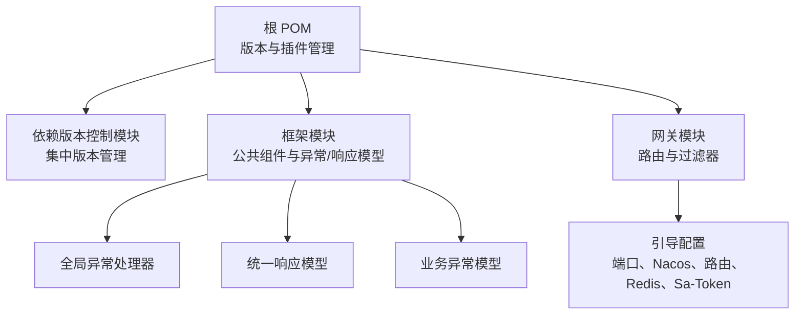
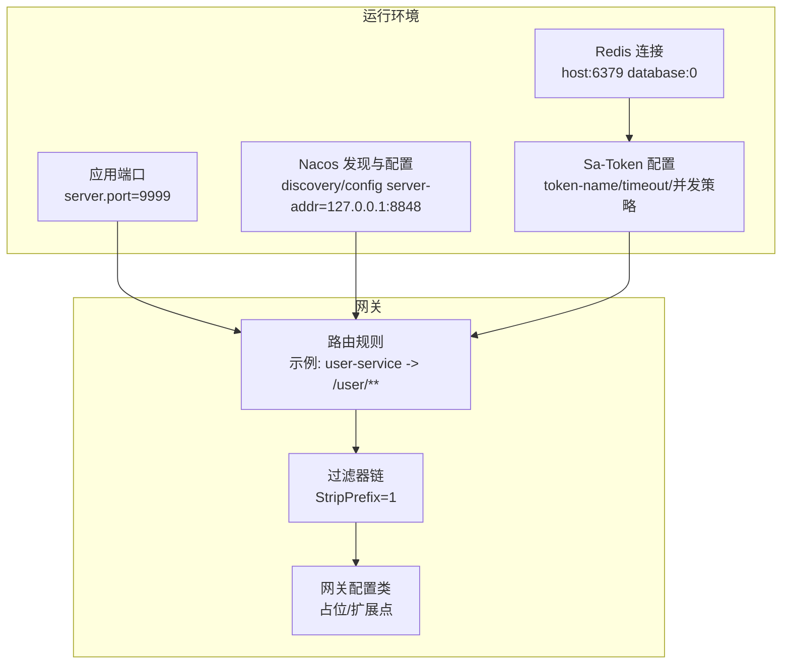
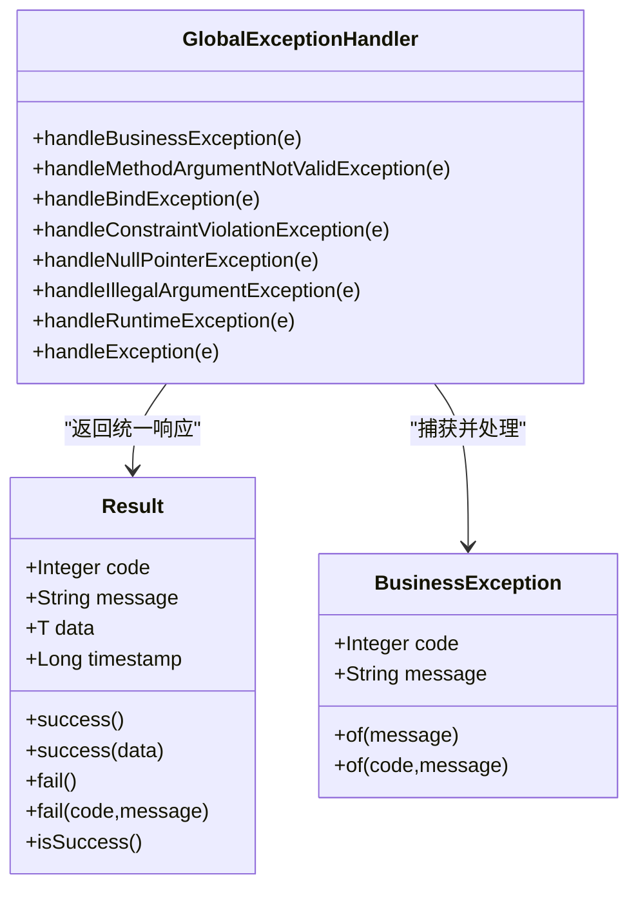
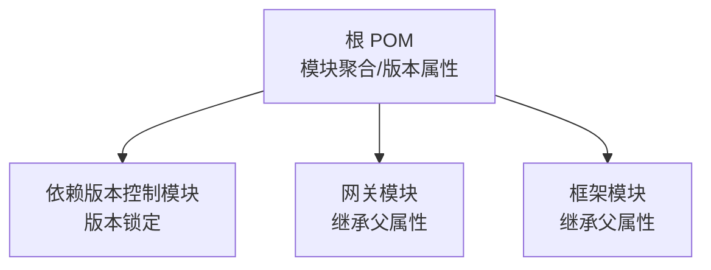
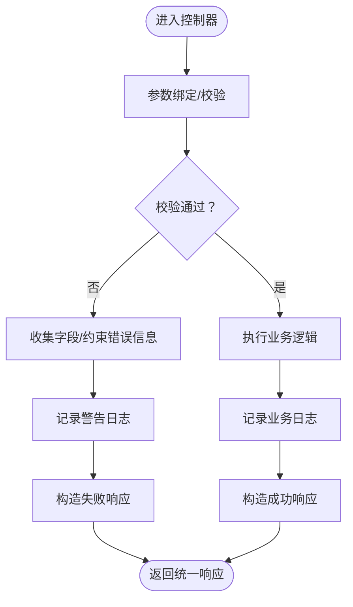

# 故障排查

<cite>
**本文引用的文件**
- [根 POM 文件](file://pom.xml)
- [依赖版本控制模块 POM](file://codebolog-dependencies/pom.xml)
- [网关模块 POM](file://codeblog-gateway/pom.xml)
- [框架模块 POM](file://codeblog-framework/pom.xml)
- [网关引导配置](file://codeblog-gateway/src/main/resources/bootstrap.yml)
- [网关配置类](file://codeblog-gateway/src/main/java/site/codeblog/gateway/config/GatewayConfig.java)
- [全局异常处理器](file://codeblog-framework/codeblog-common/codeblog-common-core/src/main/java/site/codeblog/common/core/exception/GlobalExceptionHandler.java)
- [统一响应模型](file://codeblog-framework/codeblog-common/codeblog-common-core/src/main/java/site/codeblog/common/core/result/Result.java)
- [业务异常模型](file://codeblog-framework/codeblog-common/codeblog-common-core/src/main/java/site/codeblog/common/core/exception/BusinessException.java)
</cite>

## 目录
1. [简介](#简介)
2. [项目结构](#项目结构)
3. [核心组件](#核心组件)
4. [架构总览](#架构总览)
5. [详细组件分析](#详细组件分析)
6. [依赖分析](#依赖分析)
7. [性能考虑](#性能考虑)
8. [故障排查指南](#故障排查指南)
9. [结论](#结论)
10. [附录](#附录)

## 简介
本故障排查文档面向运维与开发人员，围绕 codeblog-cloud 项目的启动、配置、网络、日志与性能等常见问题，提供系统化的诊断方法与解决路径。文档以实际源码为依据，结合模块化结构与通用异常处理机制，帮助快速定位并解决问题。

## 项目结构
项目采用多模块聚合结构，顶层 POM 负责版本与插件管理，子模块按功能拆分：
- 依赖版本控制模块：集中管理 Spring Boot、Spring Cloud、Spring Cloud Alibaba 等版本。
- 框架模块：提供通用组件与公共能力封装（含统一异常与响应模型）。
- 网关模块：基于 Spring Cloud Gateway 提供路由与过滤器能力，并集成 Nacos 作为注册与配置中心。

图表来源
- [根 POM 文件](file://pom.xml#L16-L20)
- [依赖版本控制模块 POM](file://codebolog-dependencies/pom.xml#L18-L24)
- [框架模块 POM](file://codeblog-framework/pom.xml#L12-L20)
- [网关模块 POM](file://codeblog-gateway/pom.xml#L12-L20)
- [网关引导配置](file://codeblog-gateway/src/main/resources/bootstrap.yml#L1-L44)
- [全局异常处理器](file://codeblog-framework/codeblog-common/codeblog-common-core/src/main/java/site/codeblog/common/core/exception/GlobalExceptionHandler.java#L20-L107)
- [统一响应模型](file://codeblog-framework/codeblog-common/codeblog-common-core/src/main/java/site/codeblog/common/core/result/Result.java#L12-L101)
- [业务异常模型](file://codeblog-framework/codeblog-common/codeblog-common-core/src/main/java/site/codeblog/common/core/exception/BusinessException.java#L11-L68)

章节来源
- [根 POM 文件](file://pom.xml#L16-L20)
- [依赖版本控制模块 POM](file://codebolog-dependencies/pom.xml#L18-L24)
- [框架模块 POM](file://codeblog-framework/pom.xml#L12-L20)
- [网关模块 POM](file://codeblog-gateway/pom.xml#L12-L20)

## 核心组件
- 异常与响应体系
  - 全局异常处理器对业务异常、参数校验异常、空指针、非法参数、运行时异常及未知异常进行分类处理，并返回统一响应模型。
  - 统一响应模型包含状态码、消息、数据与时间戳字段，便于前后端一致化处理。
  - 业务异常模型支持自定义错误码与消息，便于业务层抛出明确错误。

章节来源
- [全局异常处理器](file://codeblog-framework/codeblog-common/codeblog-common-core/src/main/java/site/codeblog/common/core/exception/GlobalExceptionHandler.java#L20-L107)
- [统一响应模型](file://codeblog-framework/codeblog-common/codeblog-common-core/src/main/java/site/codeblog/common/core/result/Result.java#L12-L101)
- [业务异常模型](file://codeblog-framework/codeblog-common/codeblog-common-core/src/main/java/site/codeblog/common/core/exception/BusinessException.java#L11-L68)

## 架构总览
下图展示网关模块的关键配置与组件交互关系，包括端口监听、Nacos 注册与配置、路由规则、Redis 连接以及 Sa-Token 认证开关。

图表来源
- [网关引导配置](file://codeblog-gateway/src/main/resources/bootstrap.yml#L1-L44)
- [网关配置类](file://codeblog-gateway/src/main/java/site/codeblog/gateway/config/GatewayConfig.java#L10-L28)

## 详细组件分析

### 网关引导配置分析
- 端口与应用名：server.port 与 spring.application.name。
- Nacos 集成：注册中心与配置中心地址、配置文件类型。
- 路由规则：示例路由指向下游服务并设置路径匹配与前缀剥离。
- Redis：本地连接参数。
- Sa-Token：认证相关参数（名称、有效期、并发策略、日志开关）。

章节来源
- [网关引导配置](file://codeblog-gateway/src/main/resources/bootstrap.yml#L1-L44)

### 网关配置类分析
- 当前为占位配置类，注释提示待启用 Sa-Token 过滤器，包含认证与错误处理的扩展点。
- 建议在依赖解析完成后启用认证过滤器，并根据业务调整 include/exclude 规则与鉴权逻辑。

章节来源
- [网关配置类](file://codeblog-gateway/src/main/java/site/codeblog/gateway/config/GatewayConfig.java#L10-L28)

### 全局异常处理与统一响应
- 异常分类与日志级别：业务异常、参数校验异常、空指针、非法参数、运行时异常、未知异常分别记录不同日志级别。
- 统一响应：success/fail 工厂方法与字段结构，便于前端统一处理。
- 业务异常：支持自定义错误码与消息，便于业务层精确反馈。

图表来源
- [全局异常处理器](file://codeblog-framework/codeblog-common/codeblog-common-core/src/main/java/site/codeblog/common/core/exception/GlobalExceptionHandler.java#L20-L107)
- [统一响应模型](file://codeblog-framework/codeblog-common/codeblog-common-core/src/main/java/site/codeblog/common/core/result/Result.java#L12-L101)
- [业务异常模型](file://codeblog-framework/codeblog-common/codeblog-common-core/src/main/java/site/codeblog/common/core/exception/BusinessException.java#L11-L68)

章节来源
- [全局异常处理器](file://codeblog-framework/codeblog-common/codeblog-common-core/src/main/java/site/codeblog/common/core/exception/GlobalExceptionHandler.java#L20-L107)
- [统一响应模型](file://codeblog-framework/codeblog-common/codeblog-common-core/src/main/java/site/codeblog/common/core/result/Result.java#L12-L101)
- [业务异常模型](file://codeblog-framework/codeblog-common/codeblog-common-core/src/main/java/site/codeblog/common/core/exception/BusinessException.java#L11-L68)

## 依赖分析
- 顶层 POM 定义了模块聚合与版本属性；依赖版本控制模块集中管理 Spring Boot、Spring Cloud、Spring Cloud Alibaba 版本。
- 网关模块与框架模块均继承父 POM 属性，确保版本一致性与构建行为统一。

图表来源
- [根 POM 文件](file://pom.xml#L16-L20)
- [依赖版本控制模块 POM](file://codebolog-dependencies/pom.xml#L18-L24)
- [网关模块 POM](file://codeblog-gateway/pom.xml#L18-L20)
- [框架模块 POM](file://codeblog-framework/pom.xml#L18-L20)

章节来源
- [根 POM 文件](file://pom.xml#L16-L20)
- [依赖版本控制模块 POM](file://codebolog-dependencies/pom.xml#L18-L24)
- [网关模块 POM](file://codeblog-gateway/pom.xml#L18-L20)
- [框架模块 POM](file://codeblog-framework/pom.xml#L18-L20)

## 性能考虑
- 异常处理与日志：全局异常处理器对不同异常记录不同日志级别，有助于快速定位问题类型与严重程度。
- 统一响应模型：前后端一致的响应结构，便于前端侧进行性能与错误统计。
- 业务异常模型：业务层可精确返回错误码与消息，减少无效重试与资源消耗。

章节来源
- [全局异常处理器](file://codeblog-framework/codeblog-common/codeblog-common-core/src/main/java/site/codeblog/common/core/exception/GlobalExceptionHandler.java#L20-L107)
- [统一响应模型](file://codeblog-framework/codeblog-common/codeblog-common-core/src/main/java/site/codeblog/common/core/result/Result.java#L12-L101)
- [业务异常模型](file://codeblog-framework/codeblog-common/codeblog-common-core/src/main/java/site/codeblog/common/core/exception/BusinessException.java#L11-L68)

## 故障排查指南

### 启动失败
- 端口冲突
  - 现象：应用无法启动或启动后立即退出。
  - 排查：确认 server.port 配置与系统占用情况。
  - 参考：[网关引导配置](file://codeblog-gateway/src/main/resources/bootstrap.yml#L1-L3)
- Nacos 不可达
  - 现象：注册/配置拉取失败，路由不可用。
  - 排查：确认 Nacos 地址与连通性；检查 discovery/config server-addr。
  - 参考：[网关引导配置](file://codeblog-gateway/src/main/resources/bootstrap.yml#L8-L13)
- 依赖缺失或版本不匹配
  - 现象：构建失败或运行时报错。
  - 排查：核对父 POM 与依赖版本控制模块的版本属性；确保本地仓库一致。
  - 参考：[根 POM 文件](file://pom.xml#L22-L36)，[依赖版本控制模块 POM](file://codebolog-dependencies/pom.xml#L18-L24)

章节来源
- [网关引导配置](file://codeblog-gateway/src/main/resources/bootstrap.yml#L1-L13)
- [根 POM 文件](file://pom.xml#L22-L36)
- [依赖版本控制模块 POM](file://codebolog-dependencies/pom.xml#L18-L24)

### 配置错误
- 路由配置不当
  - 现象：请求无法转发到下游服务。
  - 排查：核对路由 ID、URI、Path 断言与过滤器 StripPrefix 设置。
  - 参考：[网关引导配置](file://codeblog-gateway/src/main/resources/bootstrap.yml#L14-L22)
- Sa-Token 配置未生效
  - 现象：认证未生效或报错。
  - 排查：确认网关配置类中认证过滤器已启用并正确配置 include/exclude。
  - 参考：[网关配置类](file://codeblog-gateway/src/main/java/site/codeblog/gateway/config/GatewayConfig.java#L13-L27)

章节来源
- [网关引导配置](file://codeblog-gateway/src/main/resources/bootstrap.yml#L14-L22)
- [网关配置类](file://codeblog-gateway/src/main/java/site/codeblog/gateway/config/GatewayConfig.java#L13-L27)

### 网络连接问题
- DNS 解析失败
  - 现象：服务名无法解析为 IP。
  - 排查：检查 Nacos 地址与系统 DNS；必要时使用 IP 直连验证。
  - 参考：[网关引导配置](file://codeblog-gateway/src/main/resources/bootstrap.yml#L10-L12)
- 防火墙/端口阻断
  - 现象：本地可访问但外部不可达。
  - 排查：确认端口放行与安全组策略；验证 9999 与 Nacos/Redis 端口。
  - 参考：[网关引导配置](file://codeblog-gateway/src/main/resources/bootstrap.yml#L1-L3)，[网关引导配置](file://codeblog-gateway/src/main/resources/bootstrap.yml#L24-L27)
- 负载均衡问题
  - 现象：部分实例 503 或超时。
  - 排查：确认下游服务健康状态与实例数量；检查网关路由 URI 与服务名一致性。
  - 参考：[网关引导配置](file://codeblog-gateway/src/main/resources/bootstrap.yml#L17-L18)

章节来源
- [网关引导配置](file://codeblog-gateway/src/main/resources/bootstrap.yml#L1-L3)
- [网关引导配置](file://codeblog-gateway/src/main/resources/bootstrap.yml#L10-L12)
- [网关引导配置](file://codeblog-gateway/src/main/resources/bootstrap.yml#L17-L18)
- [网关引导配置](file://codeblog-gateway/src/main/resources/bootstrap.yml#L24-L27)

### 日志分析技巧
- 日志级别设置
  - 全局异常处理器对不同异常使用 warn/error 等级记录，便于区分一般业务异常与系统错误。
  - 参考：[全局异常处理器](file://codeblog-framework/codeblog-common/codeblog-common-core/src/main/java/site/codeblog/common/core/exception/GlobalExceptionHandler.java#L27-L106)
- 关键日志定位
  - 业务异常：关注 handleBusinessException 的日志输出，快速定位业务错误来源。
  - 参数校验异常：关注 handleMethodArgumentNotValidException/handleBindException 的合并消息。
  - 参考：[全局异常处理器](file://codeblog-framework/codeblog-common/codeblog-common-core/src/main/java/site/codeblog/common/core/exception/GlobalExceptionHandler.java#L36-L70)
- 错误信息解读
  - 统一响应模型包含 code/message/timestamp，前端与监控可据此进行错误统计与告警。
  - 参考：[统一响应模型](file://codeblog-framework/codeblog-common/codeblog-common-core/src/main/java/site/codeblog/common/core/result/Result.java#L12-L40)

章节来源
- [全局异常处理器](file://codeblog-framework/codeblog-common/codeblog-common-core/src/main/java/site/codeblog/common/core/exception/GlobalExceptionHandler.java#L27-L106)
- [统一响应模型](file://codeblog-framework/codeblog-common/codeblog-common-core/src/main/java/site/codeblog/common/core/result/Result.java#L12-L40)

### 性能问题排查流程
- API 响应时间分析
  - 利用统一响应模型中的 timestamp 字段进行端到端耗时统计。
  - 参考：[统一响应模型](file://codeblog-framework/codeblog-common/codeblog-common-core/src/main/java/site/codeblog/common/core/result/Result.java#L34-L40)
- 业务异常与重试
  - 业务异常模型支持自定义错误码，避免无效重试导致的资源浪费。
  - 参考：[业务异常模型](file://codeblog-framework/codeblog-common/codeblog-common-core/src/main/java/site/codeblog/common/core/exception/BusinessException.java#L17-L25)
- 数据库连接池与 Redis
  - 本项目未直接暴露数据库连接池配置；若业务模块使用 Redis，可结合 Redis 连接参数进行可用性检查。
  - 参考：[网关引导配置](file://codeblog-gateway/src/main/resources/bootstrap.yml#L24-L27)

章节来源
- [统一响应模型](file://codeblog-framework/codeblog-common/codeblog-common-core/src/main/java/site/codeblog/common/core/result/Result.java#L34-L40)
- [业务异常模型](file://codeblog-framework/codeblog-common/codeblog-common-core/src/main/java/site/codeblog/common/core/exception/BusinessException.java#L17-L25)
- [网关引导配置](file://codeblog-gateway/src/main/resources/bootstrap.yml#L24-L27)

### 调试工具使用
- IDE 调试
  - 在网关配置类启用 Sa-Token 过滤器后，可在认证拦截处设置断点，观察 include/exclude 与鉴权逻辑。
  - 参考：[网关配置类](file://codeblog-gateway/src/main/java/site/codeblog/gateway/config/GatewayConfig.java#L13-L27)
- 远程调试
  - 通过 JVM 参数开启远程调试端口，配合 IDE 远程连接进行断点调试。
- 性能分析
  - 结合统一响应模型的 timestamp 字段与业务异常模型的错误码，定位慢调用与失败热点。

章节来源
- [网关配置类](file://codeblog-gateway/src/main/java/site/codeblog/gateway/config/GatewayConfig.java#L13-L27)

### 典型流程图：参数校验异常处理

图表来源
- [全局异常处理器](file://codeblog-framework/codeblog-common/codeblog-common-core/src/main/java/site/codeblog/common/core/exception/GlobalExceptionHandler.java#L36-L70)
- [统一响应模型](file://codeblog-framework/codeblog-common/codeblog-common-core/src/main/java/site/codeblog/common/core/result/Result.java#L74-L93)

## 结论
通过对项目模块、配置与异常/响应体系的深入分析，可以建立从启动、配置、网络到日志与性能的完整排查路径。建议在生产环境中：
- 明确日志级别与统一响应字段的使用规范；
- 在网关侧启用认证过滤器并细化 include/exclude；
- 对关键依赖（Nacos、Redis）进行连通性与健康检查；
- 借助统一响应模型进行端到端性能与错误统计。

## 附录
- 快速检查清单
  - 端口：确认 server.port 未被占用。
  - Nacos：确认 discovery/config server-addr 可达。
  - 路由：确认路由 ID、URI、Path 与过滤器配置正确。
  - 认证：确认 Sa-Token 过滤器已启用且规则合理。
  - 日志：关注 warn/error 级别异常，结合统一响应字段进行统计。