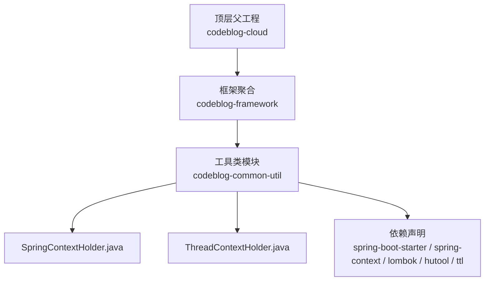
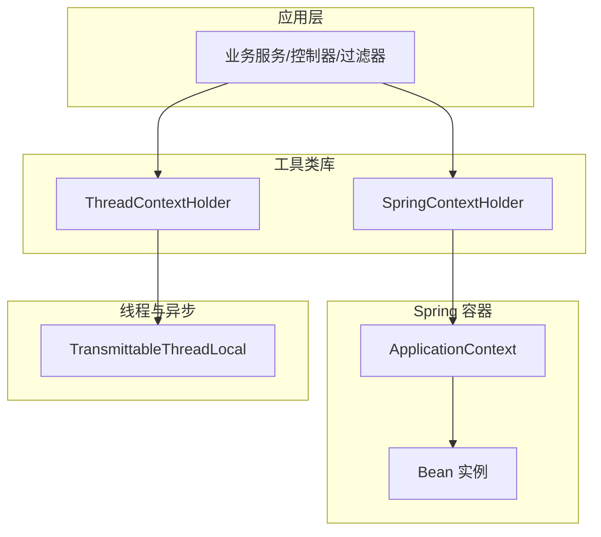
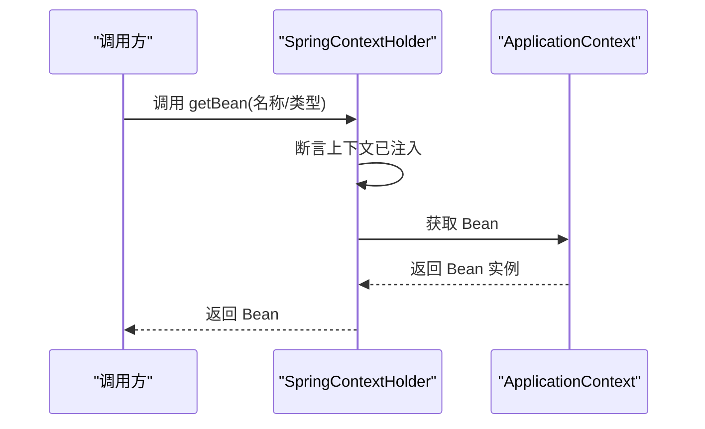
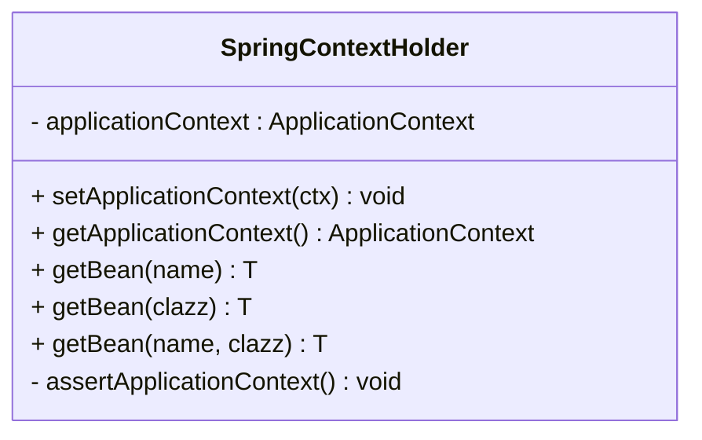
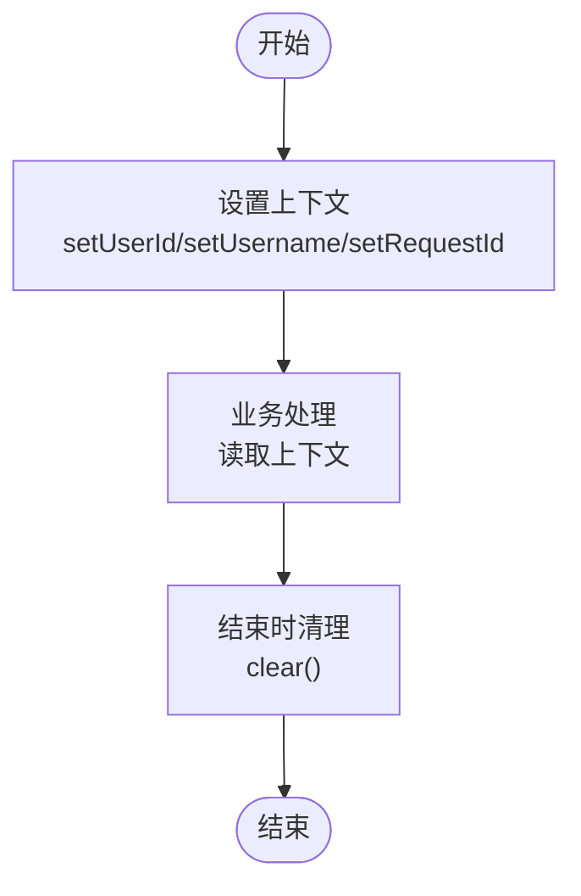
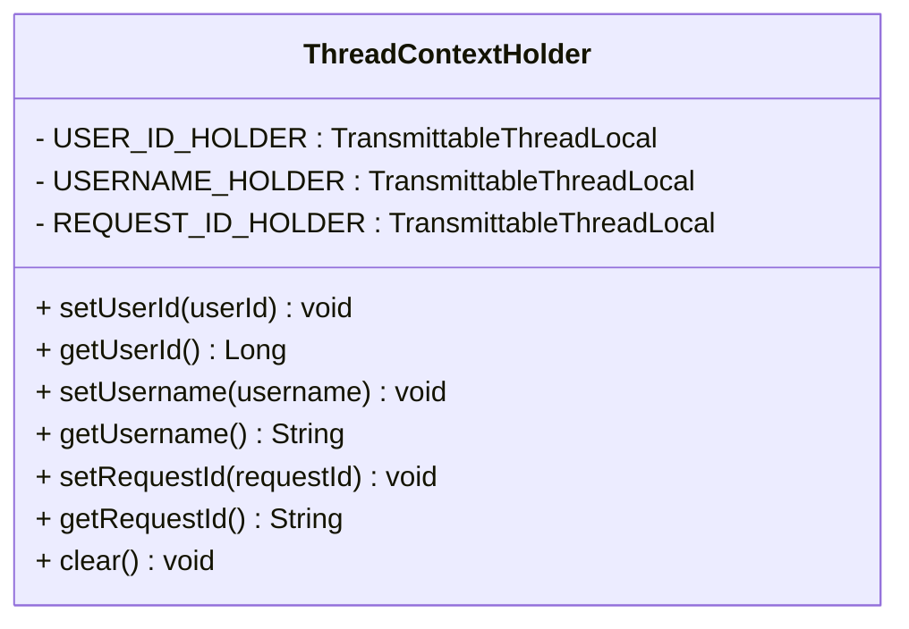
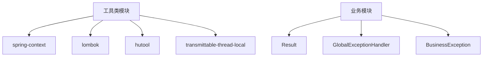

# 工具类库

<cite>
**本文引用的文件**
- [SpringContextHolder.java](file://codeblog-framework/codeblog-common/codeblog-common-util/src/main/java/site/codeblog/common/util/SpringContextHolder.java)
- [ThreadContextHolder.java](file://codeblog-framework/codeblog-common/codeblog-common-util/src/main/java/site/codeblog/common/util/ThreadContextHolder.java)
- [pom.xml（工具类模块）](file://codeblog-framework/codeblog-common/codeblog-common-util/pom.xml)
- [pom.xml（框架聚合）](file://codeblog-framework/pom.xml)
- [pom.xml（顶层父工程）](file://pom.xml)
- [BusinessException.java](file://codeblog-framework/codeblog-common/codeblog-common-core/src/main/java/site/codeblog/common/core/exception/BusinessException.java)
- [GlobalExceptionHandler.java](file://codeblog-framework/codeblog-common/codeblog-common-core/src/main/java/site/codeblog/common/core/exception/GlobalExceptionHandler.java)
- [Result.java](file://codeblog-framework/codeblog-common/codeblog-common-core/src/main/java/site/codeblog/common/core/result/Result.java)
</cite>

## 目录
1. [引言](#引言)
2. [项目结构](#项目结构)
3. [核心组件](#核心组件)
4. [架构总览](#架构总览)
5. [组件详解](#组件详解)
6. [依赖关系分析](#依赖关系分析)
7. [性能与内存考量](#性能与内存考量)
8. [故障排查指南](#故障排查指南)
9. [结论](#结论)
10. [附录：扩展与最佳实践](#附录扩展与最佳实践)

## 引言
本文件面向“工具类库”子模块，聚焦两个关键工具类：SpringContextHolder 与 ThreadContextHolder。前者提供静态入口以在非 Spring 管理的环境中获取 ApplicationContext 及 Bean 实例；后者通过可在线程池/异步任务间传播的线程本地存储，提供用户标识、用户名与请求 ID 的跨层传递能力。本文将从实现原理、使用场景、数据流、线程安全与内存隔离策略、性能优化、与其他组件的集成方式、扩展开发规范等方面进行系统化阐述。

## 项目结构
工具类库位于 codeblog-framework/codeblog-common/codeblog-common-util 模块，主要包含两个工具类文件，并通过 Maven 依赖引入 Spring、Lombok、Hutool 以及 Transmittable Thread Local（TTL）等支撑库。

图示来源
- [pom.xml（顶层父工程）](file://pom.xml#L1-L23)
- [pom.xml（框架聚合）](file://codeblog-framework/pom.xml#L1-L20)
- [pom.xml（工具类模块）](file://codeblog-framework/codeblog-common/codeblog-common-util/pom.xml#L1-L51)

章节来源
- [pom.xml（工具类模块）](file://codeblog-framework/codeblog-common/codeblog-common-util/pom.xml#L1-L51)
- [pom.xml（框架聚合）](file://codeblog-framework/pom.xml#L1-L20)
- [pom.xml（顶层父工程）](file://pom.xml#L1-L23)

## 核心组件
- SpringContextHolder：实现 ApplicationContextAware 接口，在 Spring 容器启动时注入 ApplicationContext，并提供静态方法获取上下文与 Bean 实例。该实现采用静态字段持有上下文，便于在非 Spring 管理的代码中直接访问容器资源。
- ThreadContextHolder：基于 TransmittableThreadLocal 提供用户 ID、用户名、请求 ID 的线程级存储与跨传播能力，支持在异步、线程池等场景下保持上下文一致性；提供 clear 方法进行显式清理，避免线程复用导致的数据残留。

章节来源
- [SpringContextHolder.java](file://codeblog-framework/codeblog-common/codeblog-common-util/src/main/java/site/codeblog/common/util/SpringContextHolder.java#L1-L67)
- [ThreadContextHolder.java](file://codeblog-framework/codeblog-common/codeblog-common-util/src/main/java/site/codeblog/common/util/ThreadContextHolder.java#L1-L77)

## 架构总览
工具类库在整体架构中的定位是“基础设施层”，向上为各业务模块提供通用能力：
- SpringContextHolder 作为“容器访问门面”，在需要在静态或工具方法中获取 Bean 的场景下提供便利。
- ThreadContextHolder 作为“上下文传播门面”，在微服务链路追踪、日志埋点、审计等场景下提供一致的用户与请求标识。

图示来源
- [SpringContextHolder.java](file://codeblog-framework/codeblog-common/codeblog-common-util/src/main/java/site/codeblog/common/util/SpringContextHolder.java#L1-L67)
- [ThreadContextHolder.java](file://codeblog-framework/codeblog-common/codeblog-common-util/src/main/java/site/codeblog/common/util/ThreadContextHolder.java#L1-L77)

## 组件详解

### SpringContextHolder 设计与实现
- 设计要点
  - 静态上下文持有：通过静态字段保存 ApplicationContext，避免每次获取都需要依赖注入。
  - 安全断言：在获取上下文或 Bean 前进行非空校验，未注入时抛出运行时异常，促使开发者在 Spring 环境中使用。
  - 多重 getBean 重载：支持按名称、按类型、按名称+类型的 Bean 获取，满足不同场景。
  - 日志提示：注入成功后输出日志，便于诊断。

- 使用场景
  - 在静态工具方法中获取 Bean，例如工具类的纯静态方法需要调用服务层 Bean。
  - 在监听器、定时任务、异步任务等非 Spring 管理对象中获取 Bean。
  - 在单元测试或独立工具中模拟 Spring 环境获取 Bean。

- 关键流程（获取 Bean 的序列图）

图示来源
- [SpringContextHolder.java](file://codeblog-framework/codeblog-common/codeblog-common-util/src/main/java/site/codeblog/common/util/SpringContextHolder.java#L36-L57)

- 类关系图

图示来源
- [SpringContextHolder.java](file://codeblog-framework/codeblog-common/codeblog-common-util/src/main/java/site/codeblog/common/util/SpringContextHolder.java#L1-L67)

章节来源
- [SpringContextHolder.java](file://codeblog-framework/codeblog-common/codeblog-common-util/src/main/java/site/codeblog/common/util/SpringContextHolder.java#L1-L67)

### ThreadContextHolder 设计与实现
- 设计要点
  - 使用 TransmittableThreadLocal：确保在线程池、ForkJoinPool、CompletableFuture 等异步场景下，上下文能正确传播到新线程。
  - 明确的上下文域：用户 ID、用户名、请求 ID 三类常用标识分别维护独立的 ThreadLocal，降低耦合与冲突风险。
  - 显式清理：提供 clear 方法移除当前线程持有的所有上下文，防止线程复用导致的脏数据。
  - 不可变常量持有：各上下文域以私有静态常量形式存在，避免外部修改。

- 使用场景
  - 日志埋点：在日志中统一打印请求 ID、用户 ID，便于链路追踪。
  - 审计与风控：在服务层、持久层记录操作人信息。
  - 异步任务：在异步执行时仍能携带用户与请求上下文。

- 数据流（设置与获取的流程图）

图示来源
- [ThreadContextHolder.java](file://codeblog-framework/codeblog-common/codeblog-common-util/src/main/java/site/codeblog/common/util/ThreadContextHolder.java#L28-L77)

- 类关系图

图示来源
- [ThreadContextHolder.java](file://codeblog-framework/codeblog-common/codeblog-common-util/src/main/java/site/codeblog/common/util/ThreadContextHolder.java#L1-L77)

章节来源
- [ThreadContextHolder.java](file://codeblog-framework/codeblog-common/codeblog-common-util/src/main/java/site/codeblog/common/util/ThreadContextHolder.java#L1-L77)

## 依赖关系分析
- 工具类模块依赖
  - spring-boot-starter / spring-context：提供 Spring 容器与注解能力。
  - lombok：简化日志与 POJO 代码。
  - hutool：提供常用工具方法（如日期、加密、IO 等，便于扩展）。
  - transmittable-thread-local：提供跨线程传播的 ThreadLocal。

- 与统一返回与异常体系的协作
  - Result：统一响应结构，便于在接口层包装返回值。
  - GlobalExceptionHandler：全局异常处理，结合 BusinessException 统一业务异常的返回格式。

图示来源
- [pom.xml（工具类模块）](file://codeblog-framework/codeblog-common/codeblog-common-util/pom.xml#L18-L48)
- [Result.java](file://codeblog-framework/codeblog-common/codeblog-common-core/src/main/java/site/codeblog/common/core/result/Result.java#L1-L101)
- [GlobalExceptionHandler.java](file://codeblog-framework/codeblog-common/codeblog-common-core/src/main/java/site/codeblog/common/core/exception/GlobalExceptionHandler.java#L1-L107)
- [BusinessException.java](file://codeblog-framework/codeblog-common/codeblog-common-core/src/main/java/site/codeblog/common/core/exception/BusinessException.java#L1-L68)

章节来源
- [pom.xml（工具类模块）](file://codeblog-framework/codeblog-common/codeblog-common-util/pom.xml#L18-L48)
- [Result.java](file://codeblog-framework/codeblog-common/codeblog-common-core/src/main/java/site/codeblog/common/core/result/Result.java#L1-L101)
- [GlobalExceptionHandler.java](file://codeblog-framework/codeblog-common/codeblog-common-core/src/main/java/site/codeblog/common/core/exception/GlobalExceptionHandler.java#L1-L107)
- [BusinessException.java](file://codeblog-framework/codeblog-common/codeblog-common-core/src/main/java/site/codeblog/common/core/exception/BusinessException.java#L1-L68)

## 性能与内存考量
- SpringContextHolder
  - 静态上下文持有：仅在容器启动时赋值一次，后续调用为 O(1) 字段访问，开销极低。
  - Bean 获取：通过 ApplicationContext.getBean 进行反射查找，建议在热点路径上避免频繁调用；可缓存常用 Bean 引用。
  - 线程安全：静态字段读取本身无锁，但需确保在 Spring 环境初始化完成后使用，否则断言会失败。

- ThreadContextHolder
  - TTL 传播：在异步场景下减少手动传递上下文的成本，提升可观测性与一致性。
  - 内存泄漏防范：必须在请求/任务结束时调用 clear，避免线程池复用导致的上下文残留。
  - 建议：对高频写入的上下文域（如请求 ID）采用短生命周期管理策略，及时清理。

章节来源
- [SpringContextHolder.java](file://codeblog-framework/codeblog-common/codeblog-common-util/src/main/java/site/codeblog/common/util/SpringContextHolder.java#L28-L66)
- [ThreadContextHolder.java](file://codeblog-framework/codeblog-common/codeblog-common-util/src/main/java/site/codeblog/common/util/ThreadContextHolder.java#L69-L77)

## 故障排查指南
- SpringContextHolder
  - 症状：调用 getBean 或 getApplicationContext 抛出运行时异常，提示 ApplicationContext 未注入。
  - 原因：在非 Spring 环境或容器尚未完成初始化时调用。
  - 处理：确认调用发生在 Spring 容器启动之后；若确需在静态环境使用，考虑改为通过构造注入或 @PostConstruct 初始化后缓存引用。

- ThreadContextHolder
  - 症状：异步任务中读取不到用户 ID/请求 ID。
  - 原因：未使用 TTL 传播或未在任务提交前设置上下文。
  - 处理：确保使用 TTL 包装的任务提交方式；在任务开始处读取上下文；在 finally 中调用 clear。

- 统一异常与返回
  - 症状：业务异常未按预期返回统一格式。
  - 原因：未抛出 BusinessException 或未被全局异常处理器捕获。
  - 处理：在业务层抛出 BusinessException；确保全局异常处理器生效；返回体使用 Result 封装。

章节来源
- [SpringContextHolder.java](file://codeblog-framework/codeblog-common/codeblog-common-util/src/main/java/site/codeblog/common/util/SpringContextHolder.java#L60-L66)
- [ThreadContextHolder.java](file://codeblog-framework/codeblog-common/codeblog-common-util/src/main/java/site/codeblog/common/util/ThreadContextHolder.java#L69-L77)
- [BusinessException.java](file://codeblog-framework/codeblog-common/codeblog-common-core/src/main/java/site/codeblog/common/core/exception/BusinessException.java#L55-L68)
- [GlobalExceptionHandler.java](file://codeblog-framework/codeblog-common/codeblog-common-core/src/main/java/site/codeblog/common/core/exception/GlobalExceptionHandler.java#L20-L107)
- [Result.java](file://codeblog-framework/codeblog-common/codeblog-common-core/src/main/java/site/codeblog/common/core/result/Result.java#L54-L101)

## 结论
- SpringContextHolder 通过静态上下文持有与断言机制，为非容器管理对象提供了便捷的 Bean 访问能力，适合在工具类、监听器、定时任务等场景使用。
- ThreadContextHolder 借助 TTL 实现跨线程传播的上下文管理，有效解决异步链路中的用户与请求标识丢失问题，配合 clear 方法可避免内存泄漏。
- 与统一返回与异常处理体系协同，可显著提升接口的一致性与可观测性。

## 附录：扩展与最佳实践

### 使用示例（场景化）
- 服务调用
  - 在服务方法中通过 SpringContextHolder 获取业务 Bean 并执行逻辑。
  - 在异步任务中设置用户 ID/请求 ID，执行完成后清理。
- 配置读取
  - 使用 SpringContextHolder 获取配置类 Bean，读取属性值。
- 日志记录
  - 在日志中统一输出请求 ID 与用户 ID，便于链路追踪。

### 设计原则与最佳实践
- 单例与静态访问
  - 工具类应尽量避免状态，必要时采用静态方法与静态上下文持有，但需确保线程安全与生命周期可控。
- 内存泄漏防范
  - 对 ThreadContextHolder 的 clear 调用要形成“进入即设置、退出即清理”的闭环。
- 性能优化
  - 避免在热点路径频繁调用 getBean；对常用 Bean 进行缓存。
  - 合理使用 TTL，减少手动传递上下文的样板代码。
- 与框架集成
  - SpringContextHolder 仅适用于 Spring 环境；在非 Spring 工具类中应避免使用。
  - 全局异常处理器与统一返回体应覆盖所有对外接口，保证一致性。

### 扩展开发指南
- 新增工具类
  - 优先评估是否已有工具类可复用；若确需新增，遵循“无状态、可测试、可替换”的设计。
  - 如需访问容器 Bean，优先通过构造注入；仅在绝对必要时使用 SpringContextHolder。
- 上下文扩展
  - 若需新增上下文域，建议以新的工具类形式提供，避免 ThreadContextHolder 过度膨胀。
  - 新增上下文域时，务必提供 clear 的对应清理方法。
- 依赖管理
  - 在工具类模块的 pom 中声明所需依赖，避免在业务模块重复引入。

章节来源
- [SpringContextHolder.java](file://codeblog-framework/codeblog-common/codeblog-common-util/src/main/java/site/codeblog/common/util/SpringContextHolder.java#L1-L67)
- [ThreadContextHolder.java](file://codeblog-framework/codeblog-common/codeblog-common-util/src/main/java/site/codeblog/common/util/ThreadContextHolder.java#L1-L77)
- [pom.xml（工具类模块）](file://codeblog-framework/codeblog-common/codeblog-common-util/pom.xml#L18-L48)
- [BusinessException.java](file://codeblog-framework/codeblog-common/codeblog-common-core/src/main/java/site/codeblog/common/core/exception/BusinessException.java#L1-L68)
- [GlobalExceptionHandler.java](file://codeblog-framework/codeblog-common/codeblog-common-core/src/main/java/site/codeblog/common/core/exception/GlobalExceptionHandler.java#L1-L107)
- [Result.java](file://codeblog-framework/codeblog-common/codeblog-common-core/src/main/java/site/codeblog/common/core/result/Result.java#L1-L101)