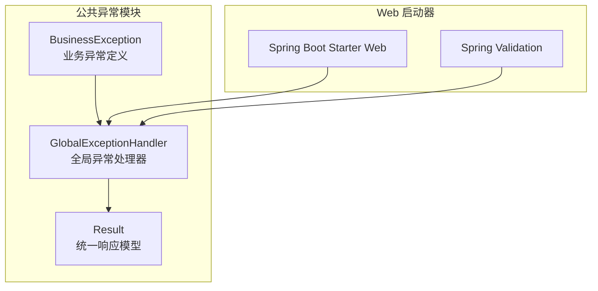
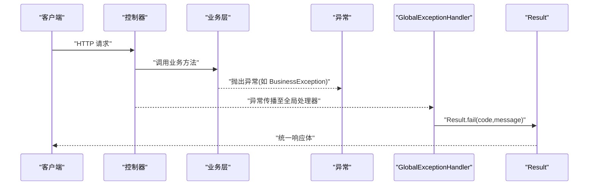
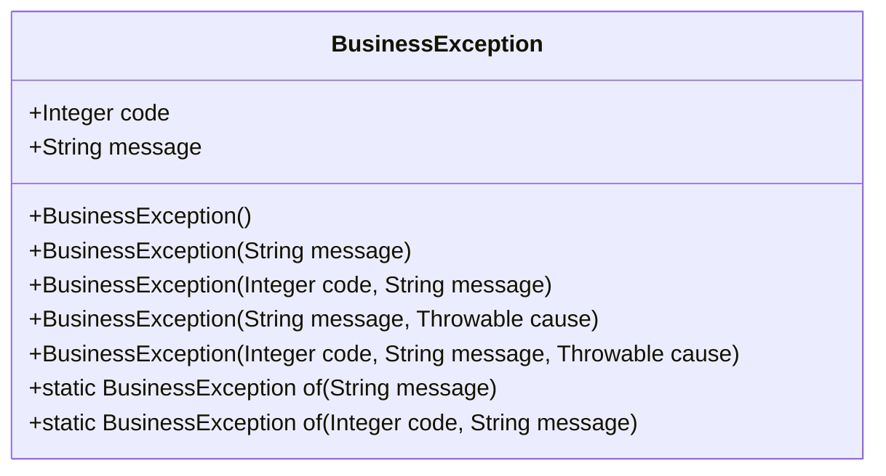
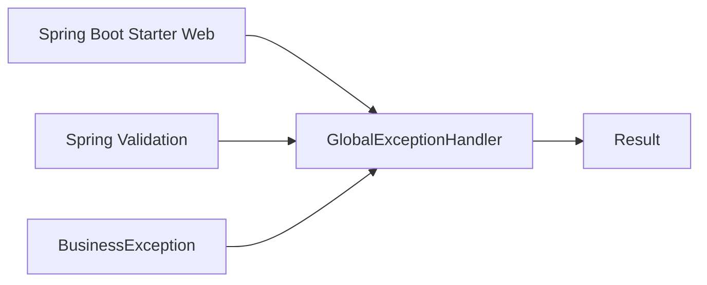

# 异常管理系统

<cite>
**本文引用的文件**
- [BusinessException.java](file://codeblog-framework/codeblog-common/codeblog-common-core/src/main/java/site/codeblog/common/core/exception/BusinessException.java)
- [GlobalExceptionHandler.java](file://codeblog-framework/codeblog-common/codeblog-common-core/src/main/java/site/codeblog/common/core/exception/GlobalExceptionHandler.java)
- [Result.java](file://codeblog-framework/codeblog-common/codeblog-common-core/src/main/java/site/codeblog/common/core/result/Result.java)
- [pom.xml](file://codeblog-framework/codeblog-spring-boot-starter-web/pom.xml)
</cite>

## 目录
1. [简介](#简介)
2. [项目结构](#项目结构)
3. [核心组件](#核心组件)
4. [架构总览](#架构总览)
5. [详细组件分析](#详细组件分析)
6. [依赖关系分析](#依赖关系分析)
7. [性能考虑](#性能考虑)
8. [故障排查指南](#故障排查指南)
9. [结论](#结论)
10. [附录](#附录)

## 简介
本技术文档围绕异常管理系统展开，重点覆盖以下内容：
- BusinessException 的定义规范、构造函数设计与使用场景
- GlobalExceptionHandler 的实现原理：异常类型处理策略与统一响应封装
- 参数校验异常（BindException、ConstraintViolationException、MethodArgumentNotValidException）的处理机制
- 自定义异常处理的最佳实践与扩展方法
- 完整的异常处理流程图与代码示例路径
- 异常分类、错误码设计与国际化支持的高级主题
- 故障排查指南与性能优化建议

## 项目结构
异常管理系统位于公共模块 codeblog-common-core 中，核心文件如下：
- 异常定义：BusinessException
- 全局异常处理器：GlobalExceptionHandler
- 统一响应模型：Result
- Web 启动器依赖：codeblog-spring-boot-starter-web（包含 Spring Web 与 Validation）



图表来源
- [BusinessException.java](file://codeblog-framework/codeblog-common/codeblog-common-core/src/main/java/site/codeblog/common/core/exception/BusinessException.java#L1-L68)
- [GlobalExceptionHandler.java](file://codeblog-framework/codeblog-common/codeblog-common-core/src/main/java/site/codeblog/common/core/exception/GlobalExceptionHandler.java#L1-L107)
- [Result.java](file://codeblog-framework/codeblog-common/codeblog-common-core/src/main/java/site/codeblog/common/core/result/Result.java#L1-L101)
- [pom.xml](file://codeblog-framework/codeblog-spring-boot-starter-web/pom.xml#L18-L35)

章节来源
- [BusinessException.java](file://codeblog-framework/codeblog-common/codeblog-common-core/src/main/java/site/codeblog/common/core/exception/BusinessException.java#L1-L68)
- [GlobalExceptionHandler.java](file://codeblog-framework/codeblog-common/codeblog-common-core/src/main/java/site/codeblog/common/core/exception/GlobalExceptionHandler.java#L1-L107)
- [Result.java](file://codeblog-framework/codeblog-common/codeblog-common-core/src/main/java/site/codeblog/common/core/result/Result.java#L1-L101)
- [pom.xml](file://codeblog-framework/codeblog-spring-boot-starter-web/pom.xml#L18-L35)

## 核心组件
- BusinessException：业务异常基类，提供多构造函数与静态工厂方法，便于在业务层快速抛出带错误码与消息的异常。
- GlobalExceptionHandler：基于 Spring @RestControllerAdvice 的全局异常处理器，针对不同异常类型进行分类处理并统一返回 Result 结构。
- Result：统一响应模型，包含 code、message、data、timestamp 字段及成功/失败静态工厂方法，用于标准化接口响应。

章节来源
- [BusinessException.java](file://codeblog-framework/codeblog-common/codeblog-common-core/src/main/java/site/codeblog/common/core/exception/BusinessException.java#L11-L68)
- [GlobalExceptionHandler.java](file://codeblog-framework/codeblog-common/codeblog-common-core/src/main/java/site/codeblog/common/core/exception/GlobalExceptionHandler.java#L20-L107)
- [Result.java](file://codeblog-framework/codeblog-common/codeblog-common-core/src/main/java/site/codeblog/common/core/result/Result.java#L12-L101)

## 架构总览
异常处理的整体流程如下：
- 应用层抛出异常（业务异常或运行时异常）
- Spring MVC 捕获异常并根据异常类型匹配到 GlobalExceptionHandler 对应的 @ExceptionHandler 方法
- 处理器记录日志并调用 Result 工厂方法生成统一响应体
- 返回给客户端统一格式的响应



图表来源
- [GlobalExceptionHandler.java](file://codeblog-framework/codeblog-common/codeblog-common-core/src/main/java/site/codeblog/common/core/exception/GlobalExceptionHandler.java#L26-L31)
- [Result.java](file://codeblog-framework/codeblog-common/codeblog-common-core/src/main/java/site/codeblog/common/core/result/Result.java#L76-L93)

## 详细组件分析

### BusinessException 分析
- 设计目标：在业务层以统一方式表达“可预期”的错误，便于前端与调用方识别与处理。
- 关键字段与行为：
  - code：错误码，用于区分不同业务错误类型
  - message：错误描述，支持本地化
  - 提供多种构造函数，覆盖无参、仅消息、带错误码、带 cause 等场景
  - 提供静态工厂方法 of(...)，简化异常创建
- 使用场景：
  - 业务规则不满足时抛出（如参数非法、权限不足、资源不存在等）
  - 需要向调用方传递明确错误码与消息时



图表来源
- [BusinessException.java](file://codeblog-framework/codeblog-common/codeblog-common-core/src/main/java/site/codeblog/common/core/exception/BusinessException.java#L11-L68)

章节来源
- [BusinessException.java](file://codeblog-framework/codeblog-common/codeblog-common-core/src/main/java/site/codeblog/common/core/exception/BusinessException.java#L11-L68)

### GlobalExceptionHandler 分析
- 职责：作为@RestControllerAdvice，集中捕获各类异常并转换为统一响应。
- 处理策略概览：
  - 业务异常 BusinessException：记录警告日志，返回 Result.fail(code,message)
  - 参数校验异常：
    - MethodArgumentNotValidException：聚合所有字段错误消息，返回 400
    - BindException：聚合字段错误消息，返回 400
    - ConstraintViolationException：聚合约束违反消息，返回 400
  - 运行时异常：记录错误日志，返回 500
  - 空指针异常：记录错误日志，返回 500
  - 非法参数异常：记录警告日志，返回 400
  - 未知异常：记录错误日志，返回 500
- 日志记录：对每类异常进行 warn/error 记录，便于问题追踪
- 响应封装：统一通过 Result.fail(...) 生成响应体

```mermaid
flowchart TD
Start(["异常发生"]) --> Type{"异常类型"}
Type --> |BusinessException| Biz["记录警告日志<br/>Result.fail(code,message)"]
Type --> |MethodArgumentNotValidException| Arg["提取字段错误消息<br/>Result.fail(400,message)"]
Type --> |BindException| Bind["提取字段错误消息<br/>Result.fail(400,message)"]
Type --> |ConstraintViolationException| Con["提取约束违反消息<br/>Result.fail(400,message)"]
Type --> |NullPointerException| NPE["记录错误日志<br/>Result.fail(500,\"系统内部错误\")"]
Type --> |IllegalArgumentException| IAE["记录警告日志<br/>Result.fail(400,message)"]
Type --> |RuntimeException| RE["记录错误日志<br/>Result.fail(500,\"系统内部错误\")"]
Type --> |Exception| UE["记录错误日志<br/>Result.fail(500,\"系统内部错误\")"]
Biz --> End(["返回统一响应"])
Arg --> End
Bind --> End
Con --> End
NPE --> End
IAE --> End
RE --> End
UE --> End
```

图表来源
- [GlobalExceptionHandler.java](file://codeblog-framework/codeblog-common/codeblog-common-core/src/main/java/site/codeblog/common/core/exception/GlobalExceptionHandler.java#L26-L106)

章节来源
- [GlobalExceptionHandler.java](file://codeblog-framework/codeblog-common/codeblog-common-core/src/main/java/site/codeblog/common/core/exception/GlobalExceptionHandler.java#L20-L107)

### 参数校验异常处理机制
- MethodArgumentNotValidException：由 @Validated 或 @Valid 触发，处理器提取 BindingResult 中的 FieldError，默认消息拼接后返回 400。
- BindException：参数绑定阶段的异常，同样聚合 FieldError 默认消息返回 400。
- ConstraintViolationException：Bean Validation 级别的约束违反，处理器提取 ConstraintViolation 的 message 并返回 400。
- 处理共同点：均通过日志记录 warn 级别信息，统一返回 400 状态码与错误消息。

章节来源
- [GlobalExceptionHandler.java](file://codeblog-framework/codeblog-common/codeblog-common-core/src/main/java/site/codeblog/common/core/exception/GlobalExceptionHandler.java#L35-L70)

### Result 统一响应模型
- 字段：code、message、data、timestamp
- 成功响应：success()、success(data)、success(message,data)
- 失败响应：fail()、fail(message)、fail(code,message)
- 判定逻辑：isSuccess() 基于 code==200
- 作用：保证所有接口响应格式一致，便于前端统一处理与前端国际化

章节来源
- [Result.java](file://codeblog-framework/codeblog-common/codeblog-common-core/src/main/java/site/codeblog/common/core/result/Result.java#L12-L101)

## 依赖关系分析
- GlobalExceptionHandler 依赖 Spring Web 与 Validation：
  - @RestControllerAdvice、@ExceptionHandler 注解来自 Spring Web
  - BindException、MethodArgumentNotValidException、ConstraintViolationException 来自 Spring Validation
- 异常与响应的耦合关系：
  - BusinessException 与 GlobalExceptionHandler 解耦，通过异常类型匹配实现分发
  - GlobalExceptionHandler 与 Result 强耦合，统一输出格式



图表来源
- [pom.xml](file://codeblog-framework/codeblog-spring-boot-starter-web/pom.xml#L18-L35)
- [GlobalExceptionHandler.java](file://codeblog-framework/codeblog-common/codeblog-common-core/src/main/java/site/codeblog/common/core/exception/GlobalExceptionHandler.java#L4-L13)
- [BusinessException.java](file://codeblog-framework/codeblog-common/codeblog-common-core/src/main/java/site/codeblog/common/core/exception/BusinessException.java#L1-L13)
- [Result.java](file://codeblog-framework/codeblog-common/codeblog-common-core/src/main/java/site/codeblog/common/core/result/Result.java#L1-L14)

章节来源
- [pom.xml](file://codeblog-framework/codeblog-spring-boot-starter-web/pom.xml#L18-L35)
- [GlobalExceptionHandler.java](file://codeblog-framework/codeblog-common/codeblog-common-core/src/main/java/site/codeblog/common/core/exception/GlobalExceptionHandler.java#L4-L13)
- [BusinessException.java](file://codeblog-framework/codeblog-common/codeblog-common-core/src/main/java/site/codeblog/common/core/exception/BusinessException.java#L1-L13)
- [Result.java](file://codeblog-framework/codeblog-common/codeblog-common-core/src/main/java/site/codeblog/common/core/result/Result.java#L1-L14)

## 性能考虑
- 日志级别选择：业务异常与非法参数异常使用 warn，运行时异常与未知异常使用 error，避免过多 error 日志影响性能
- 异常聚合：参数校验异常的消息聚合采用流式收集，注意大量字段时的字符串拼接开销
- 建议：
  - 在高并发场景下，对频繁触发的业务异常进行限流或熔断
  - 对异常日志进行采样或分级，避免日志风暴
  - 将错误码与消息映射到缓存，减少重复计算

## 故障排查指南
- 业务异常未被正确拦截
  - 检查是否在 @RestControllerAdvice 扫描范围内
  - 确认 BusinessException 是否被正确抛出且未被上层 catch
- 参数校验异常未返回 400
  - 确认请求是否携带了 @Valid/@Validated 注解
  - 检查是否使用了正确的异常类型（MethodArgumentNotValidException vs BindException vs ConstraintViolationException）
- 统一响应格式不符合预期
  - 检查 Result.fail(...) 的调用参数与 code/message 设置
  - 确认 Result.isSuccess() 的判定逻辑是否符合期望
- 日志缺失或不完整
  - 检查日志级别配置与异常处理器中的日志记录语句
  - 确认异常链中 cause 是否被正确传递

章节来源
- [GlobalExceptionHandler.java](file://codeblog-framework/codeblog-common/codeblog-common-core/src/main/java/site/codeblog/common/core/exception/GlobalExceptionHandler.java#L26-L106)
- [Result.java](file://codeblog-framework/codeblog-common/codeblog-common-core/src/main/java/site/codeblog/common/core/result/Result.java#L76-L101)

## 结论
该异常管理系统通过 BusinessException、GlobalExceptionHandler 与 Result 形成清晰的异常定义、处理与响应三段式架构。其优势在于：
- 统一的错误码与消息格式，便于前后端协作
- 针对不同异常类型的差异化处理策略
- 易于扩展与维护的全局异常处理机制

建议在实际项目中结合业务需求完善错误码体系与国际化支持，并持续优化日志与性能表现。

## 附录

### 异常分类与错误码设计建议
- 分类维度：业务异常、参数校验异常、运行时异常、未知异常
- 错误码范围建议：
  - 2xx：成功
  - 400：客户端错误（参数非法、校验失败）
  - 500：服务器错误（运行时异常、未知异常）
  - 业务异常：自定义业务错误码区间（如 10000~19999），便于前端与监控系统识别
- 命名规范：错误码与消息应具备可读性与可维护性，避免使用过于宽泛的 500

### 国际化支持建议
- 消息来源：从消息源（如 MessageSource）获取本地化消息，避免硬编码
- 参数校验：在 Bean Validation 中使用本地化消息模板
- 统一响应：Result 中 message 字段应支持多语言渲染

### 最佳实践与扩展方法
- 最佳实践：
  - 在业务层优先使用 BusinessException.of(...) 快速创建异常
  - 对高频业务异常定义专用异常类，提升可读性
  - 在 GlobalExceptionHandler 中增加自定义异常的专门处理分支
- 扩展方法：
  - 新增异常类型：在 GlobalExceptionHandler 中添加新的 @ExceptionHandler
  - 新增错误码：在 BusinessException 中新增构造函数或静态工厂方法
  - 新增响应字段：在 Result 中扩展字段并在处理器中填充