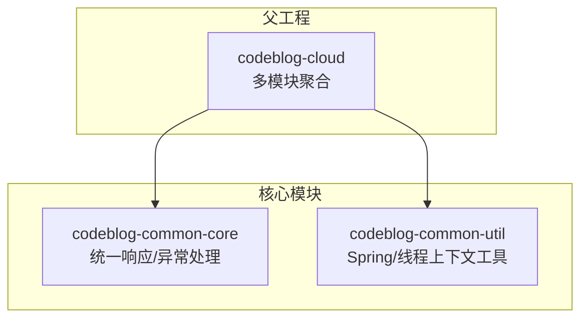
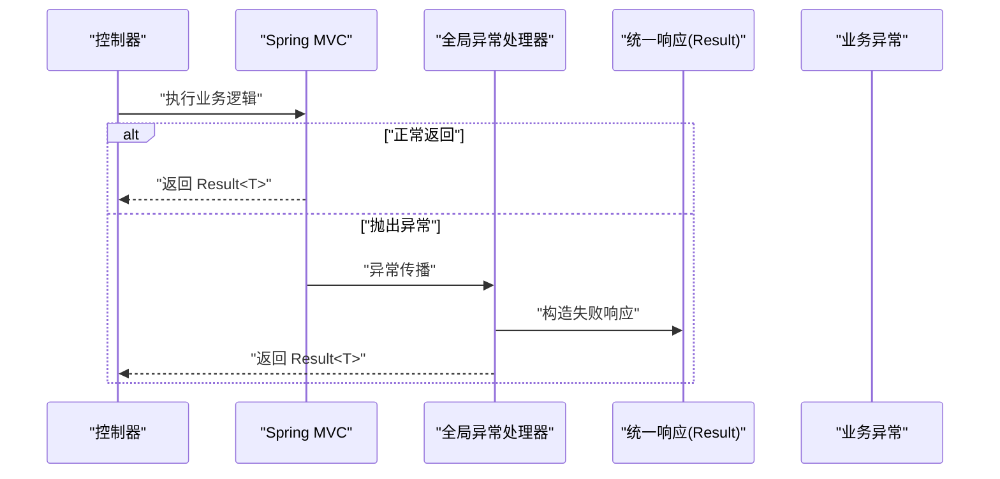
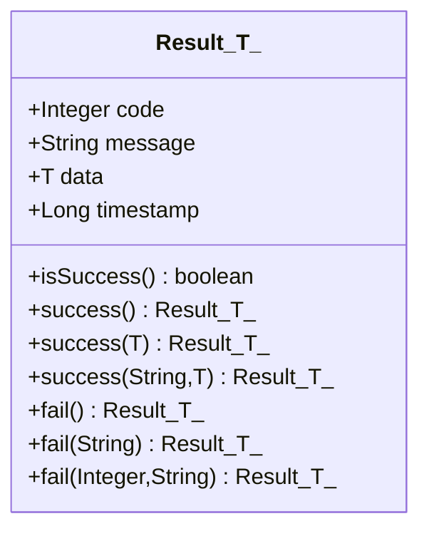
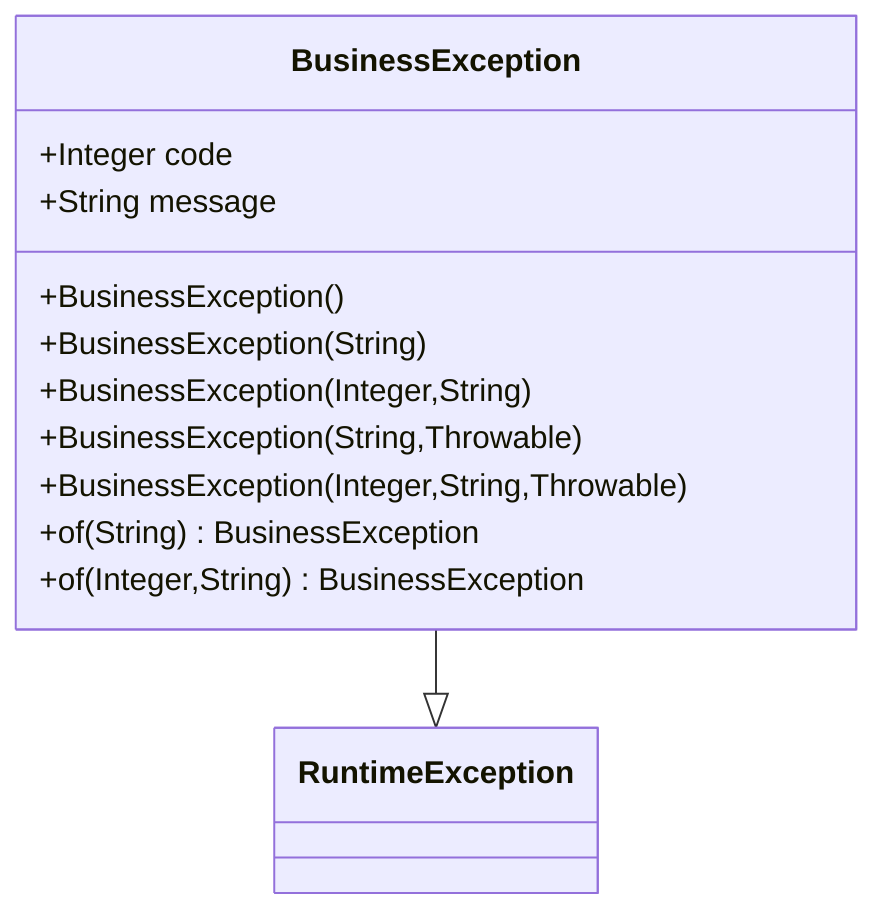
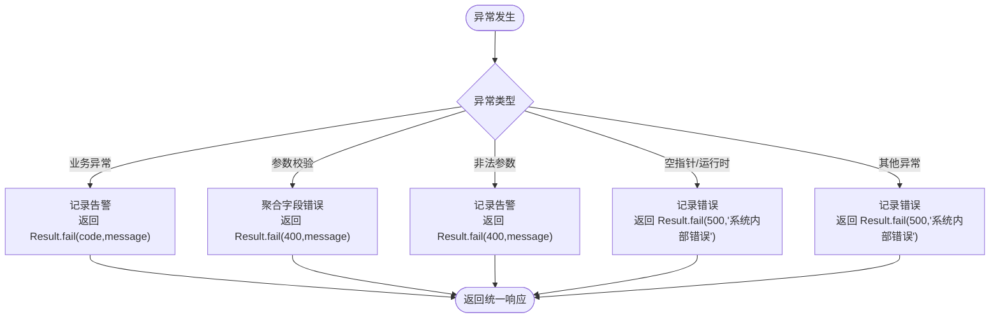
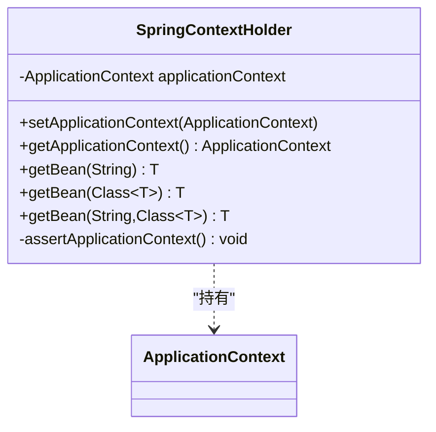
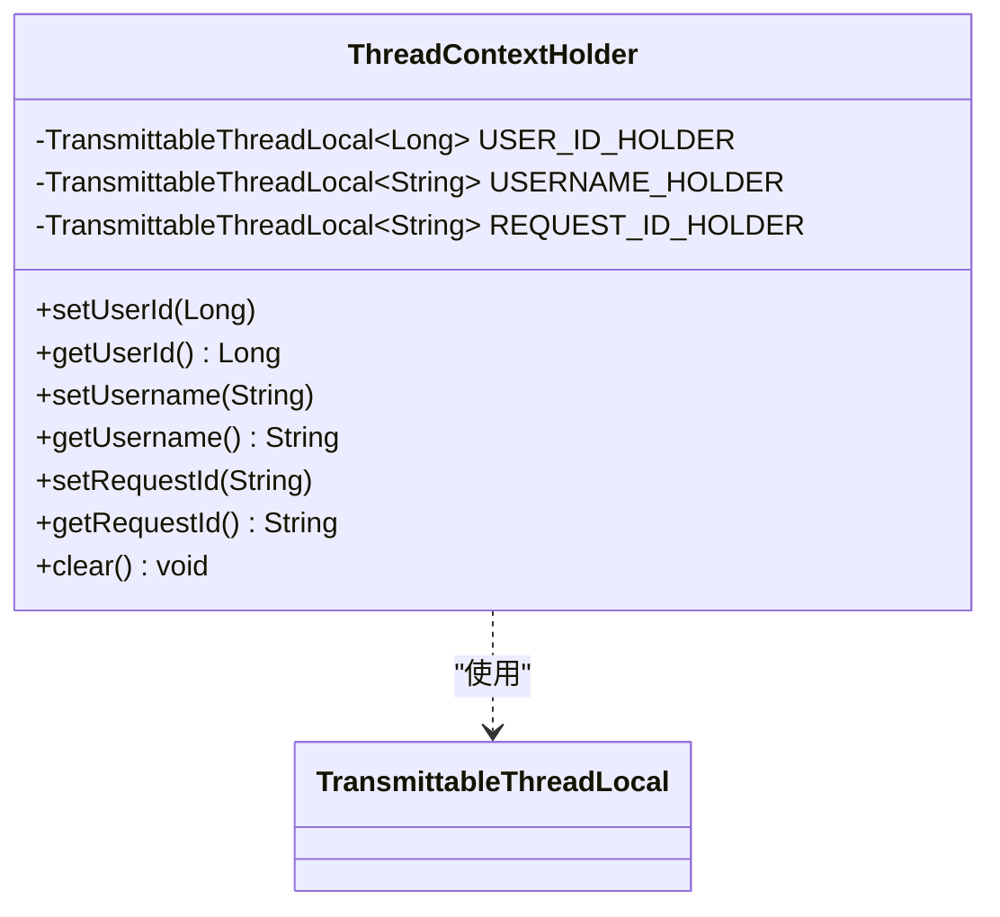
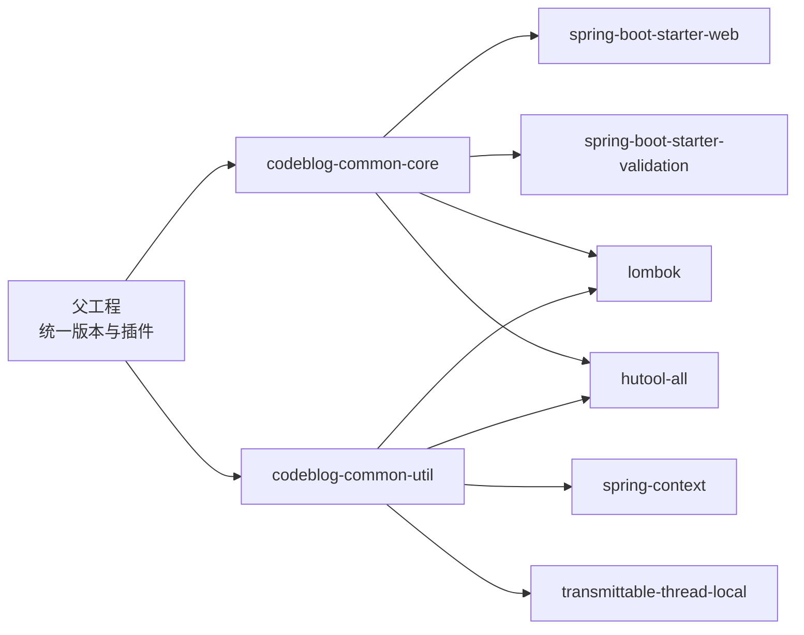

# 核心框架模块

<cite>
**本文引用的文件**
- [Result.java](file://codeblog-framework/codeblog-common/codeblog-common-core/src/main/java/site/codeblog/common/core/result/Result.java)
- [BusinessException.java](file://codeblog-framework/codeblog-common/codeblog-common-core/src/main/java/site/codeblog/common/core/exception/BusinessException.java)
- [GlobalExceptionHandler.java](file://codeblog-framework/codeblog-common/codeblog-common-core/src/main/java/site/codeblog/common/core/exception/GlobalExceptionHandler.java)
- [SpringContextHolder.java](file://codeblog-framework/codeblog-common/codeblog-common-util/src/main/java/site/codeblog/common/util/SpringContextHolder.java)
- [ThreadContextHolder.java](file://codeblog-framework/codeblog-common/codeblog-common-util/src/main/java/site/codeblog/common/util/ThreadContextHolder.java)
- [codeblog-common-core/pom.xml](file://codeblog-framework/codeblog-common/codeblog-common-core/pom.xml)
- [codeblog-common-util/pom.xml](file://codeblog-framework/codeblog-common/codeblog-common-util/pom.xml)
- [pom.xml](file://pom.xml)
</cite>

## 目录
1. [简介](#简介)
2. [项目结构](#项目结构)
3. [核心组件](#核心组件)
4. [架构总览](#架构总览)
5. [详细组件分析](#详细组件分析)
6. [依赖分析](#依赖分析)
7. [性能考虑](#性能考虑)
8. [故障排查指南](#故障排查指南)
9. [结论](#结论)
10. [附录](#附录)

## 简介
本文件面向 codeblog-cloud 核心框架模块，聚焦以下主题：
- 统一响应处理机制：Result<T> 类的设计理念、使用方法与最佳实践
- 异常管理体系：BusinessException 定义规范、GlobalExceptionHandler 配置与自定义策略
- 工具类库：SpringContextHolder 与 ThreadContextHolder 的实现原理与应用场景
- 组件协作关系与数据流转过程
- 性能优化建议与常见问题解决方案

## 项目结构
核心框架由两个子模块组成：
- codeblog-common-core：提供统一响应、全局异常处理等核心能力
- codeblog-common-util：提供 Spring 与线程上下文工具类

图表来源
- [pom.xml](file://pom.xml#L16-L20)
- [codeblog-common-core/pom.xml](file://codeblog-framework/codeblog-common/codeblog-common-core/pom.xml#L1-L51)
- [codeblog-common-util/pom.xml](file://codeblog-framework/codeblog-common/codeblog-common-util/pom.xml#L1-L51)

章节来源
- [pom.xml](file://pom.xml#L16-L20)
- [codeblog-common-core/pom.xml](file://codeblog-framework/codeblog-common/codeblog-common-core/pom.xml#L1-L51)
- [codeblog-common-util/pom.xml](file://codeblog-framework/codeblog-common/codeblog-common-util/pom.xml#L1-L51)

## 核心组件
- 统一响应模型 Result<T>：标准化接口返回结构，支持链式调用与泛型数据承载
- 业务异常 BusinessException：继承运行时异常，携带业务错误码与消息
- 全局异常处理器 GlobalExceptionHandler：集中捕获各类异常并转换为统一响应
- Spring 上下文工具 SpringContextHolder：静态访问 ApplicationContext 与 Bean
- 线程上下文工具 ThreadContextHolder：基于 TransmittableThreadLocal 的跨线程传递上下文

章节来源
- [Result.java](file://codeblog-framework/codeblog-common/codeblog-common-core/src/main/java/site/codeblog/common/core/result/Result.java#L1-L101)
- [BusinessException.java](file://codeblog-framework/codeblog-common/codeblog-common-core/src/main/java/site/codeblog/common/core/exception/BusinessException.java#L1-L68)
- [GlobalExceptionHandler.java](file://codeblog-framework/codeblog-common/codeblog-common-core/src/main/java/site/codeblog/common/core/exception/GlobalExceptionHandler.java#L1-L107)
- [SpringContextHolder.java](file://codeblog-framework/codeblog-common/codeblog-common-util/src/main/java/site/codeblog/common/util/SpringContextHolder.java#L1-L67)
- [ThreadContextHolder.java](file://codeblog-framework/codeblog-common/codeblog-common-util/src/main/java/site/codeblog/common/util/ThreadContextHolder.java#L1-L77)

## 架构总览
统一响应与异常处理的整体流程如下：
- 控制器层返回 Result<T> 或抛出异常
- 全局异常处理器捕获异常并转换为 Result<T>
- SpringContextHolder 提供静态访问 Spring 容器的能力
- ThreadContextHolder 提供跨线程传递用户标识与请求标识

图表来源
- [GlobalExceptionHandler.java](file://codeblog-framework/codeblog-common/codeblog-common-core/src/main/java/site/codeblog/common/core/exception/GlobalExceptionHandler.java#L27-L31)
- [Result.java](file://codeblog-framework/codeblog-common/codeblog-common-core/src/main/java/site/codeblog/common/core/result/Result.java#L77-L93)

## 详细组件分析

### 统一响应模型 Result<T>
- 设计理念
  - 固定结构：code、message、data、timestamp
  - 泛型承载任意数据类型
  - 链式调用风格，便于构建与扩展
- 关键方法
  - success()/success(data)/success(message,data)：成功响应工厂方法
  - fail()/fail(message)/fail(code,message)：失败响应工厂方法
  - isSuccess()：判断响应状态
- 最佳实践
  - 所有对外接口统一返回 Result<T>
  - 成功时仅携带必要 data；失败时提供明确 message
  - 使用链式调用简化构建

图表来源
- [Result.java](file://codeblog-framework/codeblog-common/codeblog-common-core/src/main/java/site/codeblog/common/core/result/Result.java#L14-L101)

章节来源
- [Result.java](file://codeblog-framework/codeblog-common/codeblog-common-core/src/main/java/site/codeblog/common/core/result/Result.java#L1-L101)

### 业务异常 BusinessException
- 设计要点
  - 继承 RuntimeException，支持快速抛出
  - 支持多种构造：默认错误码、指定错误码、带 cause
  - 提供 of(...) 工厂方法，便于快速创建
- 使用场景
  - 参数校验失败、权限不足、业务规则不满足等
  - 与全局异常处理器配合，自动映射为统一响应

图表来源
- [BusinessException.java](file://codeblog-framework/codeblog-common/codeblog-common-core/src/main/java/site/codeblog/common/core/exception/BusinessException.java#L13-L67)

章节来源
- [BusinessException.java](file://codeblog-framework/codeblog-common/codeblog-common-core/src/main/java/site/codeblog/common/core/exception/BusinessException.java#L1-L68)

### 全局异常处理器 GlobalExceptionHandler
- 职责
  - 捕获并处理各类异常，统一输出 Result<T>
  - 对业务异常、参数校验异常、非法参数、空指针、运行时异常、未知异常进行分类处理
- 处理策略
  - 业务异常：保留业务错误码与消息
  - 参数校验异常：聚合字段错误消息
  - 运行时异常与未知异常：统一返回系统内部错误
- 自定义策略
  - 新增异常类型只需添加 @ExceptionHandler 并返回 Result<T>

图表来源
- [GlobalExceptionHandler.java](file://codeblog-framework/codeblog-common/codeblog-common-core/src/main/java/site/codeblog/common/core/exception/GlobalExceptionHandler.java#L27-L106)

章节来源
- [GlobalExceptionHandler.java](file://codeblog-framework/codeblog-common/codeblog-common-core/src/main/java/site/codeblog/common/core/exception/GlobalExceptionHandler.java#L1-L107)

### Spring 上下文工具 SpringContextHolder
- 实现原理
  - 实现 ApplicationContextAware，在容器初始化时缓存 ApplicationContext
  - 提供静态方法按名称或类型获取 Bean
  - 在非 Spring 环境下提供断言提示
- 应用场景
  - 在工具类、静态方法中获取 Spring Bean
  - 在异步任务、定时任务中访问上下文资源

图表来源
- [SpringContextHolder.java](file://codeblog-framework/codeblog-common/codeblog-common-util/src/main/java/site/codeblog/common/util/SpringContextHolder.java#L16-L66)

章节来源
- [SpringContextHolder.java](file://codeblog-framework/codeblog-common/codeblog-common-util/src/main/java/site/codeblog/common/util/SpringContextHolder.java#L1-L67)

### 线程上下文工具 ThreadContextHolder
- 实现原理
  - 基于 TransmittableThreadLocal，支持在线程池、异步任务中透传上下文
  - 提供用户 ID、用户名、请求 ID 三类上下文
- 应用场景
  - 日志埋点、审计追踪、限流统计、分布式链路追踪
  - 在多线程环境下保持用户身份与请求标识一致

图表来源
- [ThreadContextHolder.java](file://codeblog-framework/codeblog-common/codeblog-common-util/src/main/java/site/codeblog/common/util/ThreadContextHolder.java#L10-L76)

章节来源
- [ThreadContextHolder.java](file://codeblog-framework/codeblog-common/codeblog-common-util/src/main/java/site/codeblog/common/util/ThreadContextHolder.java#L1-L77)

## 依赖分析
- Spring Boot 依赖
  - codeblog-common-core：starter-web、starter-validation、lombok、hutool
  - codeblog-common-util：starter、spring-context、lombok、hutool、transmittable-thread-local
- 版本与构建
  - 父工程统一管理 Java 版本、Spring Boot 版本、插件版本
  - 使用 flatten-maven-plugin 规范化 POM

图表来源
- [pom.xml](file://pom.xml#L22-L36)
- [codeblog-common-core/pom.xml](file://codeblog-framework/codeblog-common/codeblog-common-core/pom.xml#L18-L48)
- [codeblog-common-util/pom.xml](file://codeblog-framework/codeblog-common/codeblog-common-util/pom.xml#L18-L48)

章节来源
- [pom.xml](file://pom.xml#L22-L36)
- [codeblog-common-core/pom.xml](file://codeblog-framework/codeblog-common/codeblog-common-core/pom.xml#L18-L48)
- [codeblog-common-util/pom.xml](file://codeblog-framework/codeblog-common/codeblog-common-util/pom.xml#L18-L48)

## 性能考虑
- 统一响应
  - Result<T> 采用固定字段与链式调用，序列化开销低，适合高频接口
  - 建议避免在 data 中返回超大对象，必要时分页或懒加载
- 异常处理
  - 全局异常处理器对常见异常进行快速映射，减少重复判断
  - 对参数校验异常聚合错误消息，避免多次 IO
- 线程上下文
  - 使用 TransmittableThreadLocal 保证跨线程上下文一致性，避免额外参数传递
  - clear() 在任务结束时调用，防止内存泄漏
- Spring 上下文
  - SpringContextHolder 仅缓存 ApplicationContext，避免频繁查找

## 故障排查指南
- 统一响应
  - 若返回结构不符合预期，检查控制器是否直接返回业务对象而非 Result<T>
  - 若 isSuccess() 判断异常，确认 code 字段是否被覆盖为非 200
- 业务异常
  - BusinessException 未被捕获：确认是否在业务层正确抛出并被全局异常处理器拦截
  - 错误码不一致：核对 BusinessException 构造参数与 GlobalExceptionHandler 映射
- 全局异常处理器
  - 未生效：确认类上是否标注 @RestControllerAdvice
  - 参数校验异常未聚合：检查是否使用了 MethodArgumentNotValidException 或 BindException
- SpringContextHolder
  - 抛出未注入异常：确认在 Spring 环境中运行且 ApplicationContext 已初始化
- ThreadContextHolder
  - 上下文丢失：确认在异步任务中使用了正确的线程池或框架支持 TTL
  - 内存泄漏：确保在任务结束时调用 clear()

章节来源
- [GlobalExceptionHandler.java](file://codeblog-framework/codeblog-common/codeblog-common-core/src/main/java/site/codeblog/common/core/exception/GlobalExceptionHandler.java#L27-L106)
- [SpringContextHolder.java](file://codeblog-framework/codeblog-common/codeblog-common-util/src/main/java/site/codeblog/common/util/SpringContextHolder.java#L62-L66)
- [ThreadContextHolder.java](file://codeblog-framework/codeblog-common/codeblog-common-util/src/main/java/site/codeblog/common/util/ThreadContextHolder.java#L72-L76)

## 结论
本核心框架模块通过统一响应模型、完善的异常处理体系与实用的工具类，为上层应用提供了稳定、一致、易用的基础能力。遵循本文的最佳实践与排错建议，可显著提升开发效率与系统稳定性。

## 附录
- 使用建议
  - 控制器层统一返回 Result<T>，业务异常使用 BusinessException 抛出
  - 在需要跨线程传递上下文的场景使用 ThreadContextHolder
  - 在工具类中通过 SpringContextHolder 获取 Bean
- 扩展方向
  - 自定义异常类型：新增 @ExceptionHandler 并返回 Result<T>
  - 自定义响应字段：在 Result<T> 中扩展字段并在 GlobalExceptionHandler 中映射
  - 自定义日志与监控：在 GlobalExceptionHandler 中接入日志与监控系统