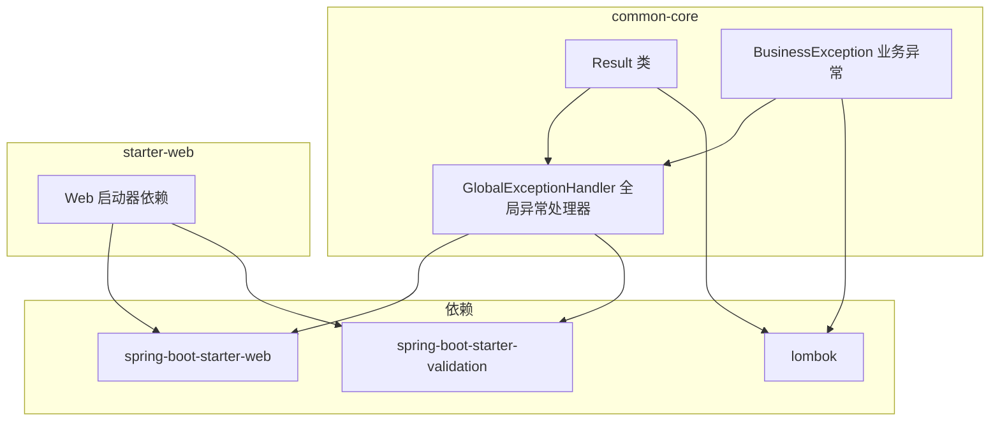
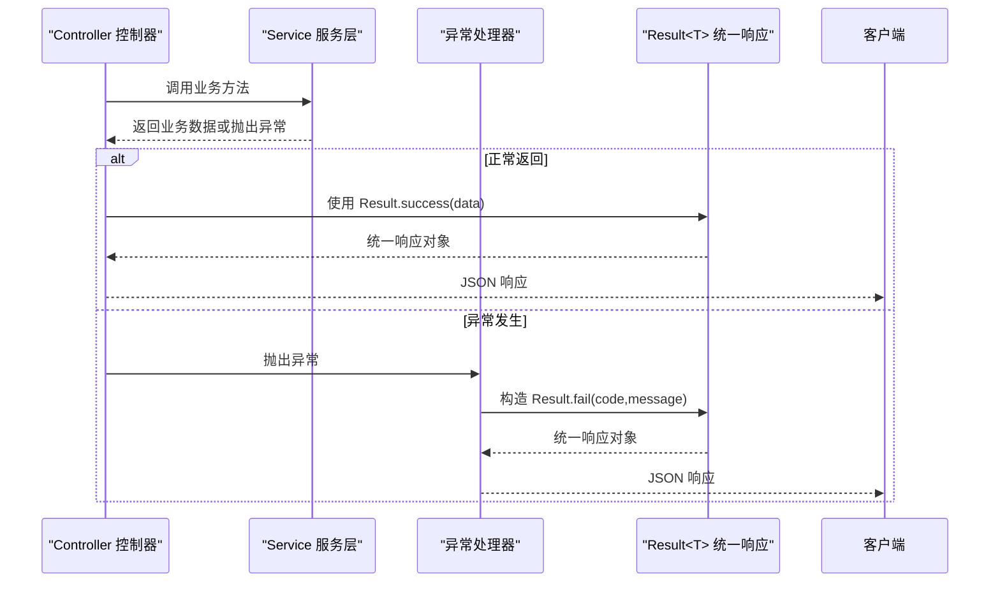
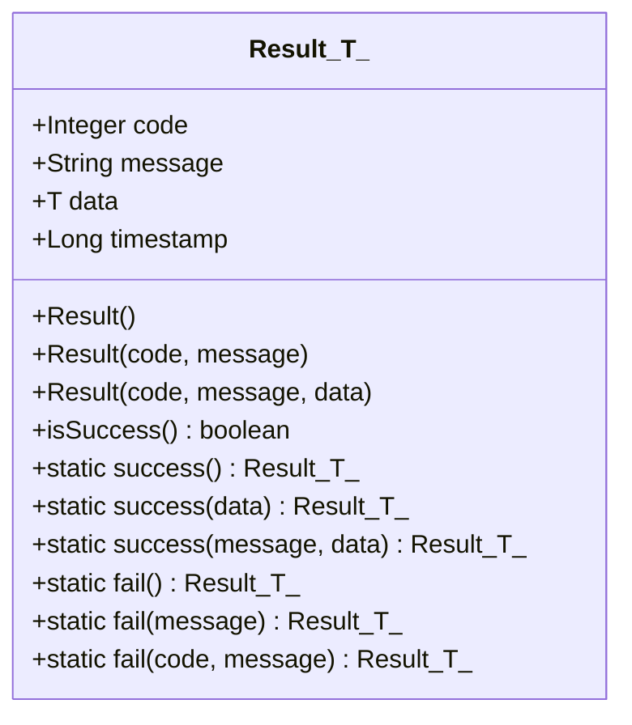
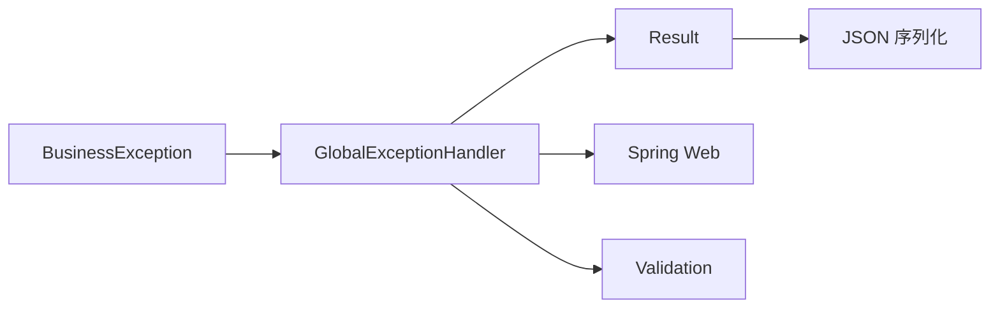

# 统一响应处理

<cite>
**本文引用的文件列表**
- [Result.java](file://codeblog-framework/codeblog-common/codeblog-common-core/src/main/java/site/codeblog/common/core/result/Result.java)
- [BusinessException.java](file://codeblog-framework/codeblog-common/codeblog-common-core/src/main/java/site/codeblog/common/core/exception/BusinessException.java)
- [GlobalExceptionHandler.java](file://codeblog-framework/codeblog-common/codeblog-common-core/src/main/java/site/codeblog/common/core/exception/GlobalExceptionHandler.java)
- [codeblog-common-core/pom.xml](file://codeblog-framework/codeblog-common/codeblog-common-core/pom.xml)
- [codeblog-spring-boot-starter-web/pom.xml](file://codeblog-framework/codeblog-spring-boot-starter-web/pom.xml)
</cite>

## 目录
1. [简介](#简介)
2. [项目结构](#项目结构)
3. [核心组件](#核心组件)
4. [架构总览](#架构总览)
5. [详细组件分析](#详细组件分析)
6. [依赖关系分析](#依赖关系分析)
7. [性能考量](#性能考量)
8. [故障排查指南](#故障排查指南)
9. [结论](#结论)
10. [附录：最佳实践与示例路径](#附录最佳实践与示例路径)

## 简介
本文件围绕统一响应处理机制展开，重点解析 Result<T> 类的设计理念与实现原理，阐述响应码定义、消息格式规范与数据封装策略；全面介绍 success() 与 fail() 静态方法的多种重载形式及适用场景；解释 Result 类字段（code、message、data、timestamp）的业务含义；给出在不同业务场景下的响应封装示例路径；说明响应格式标准化的优势以及在微服务架构中的作用，并提供最佳实践与性能优化建议。

## 项目结构
该模块位于 codeblog-framework 的 codeblog-common 子模块中，核心统一响应与全局异常处理均在此模块内实现，便于在各业务服务中复用。



图表来源
- [codeblog-common-core/pom.xml](file://codeblog-framework/codeblog-common/codeblog-common-core/pom.xml#L18-L48)
- [codeblog-spring-boot-starter-web/pom.xml](file://codeblog-framework/codeblog-spring-boot-starter-web/pom.xml#L18-L42)

章节来源
- [codeblog-common-core/pom.xml](file://codeblog-framework/codeblog-common/codeblog-common-core/pom.xml#L1-L51)
- [codeblog-spring-boot-starter-web/pom.xml](file://codeblog-framework/codeblog-spring-boot-starter-web/pom.xml#L1-L45)

## 核心组件
- Result<T>：统一响应载体，封装 code、message、data、timestamp 四个字段，提供 success()/fail() 静态工厂方法与 isSuccess() 判定逻辑。
- BusinessException：业务异常类型，携带 code/message 字段，用于语义化表达业务错误。
- GlobalExceptionHandler：基于 Spring MVC 的全局异常处理器，将各类异常转换为统一的 Result<T> 响应。

章节来源
- [Result.java](file://codeblog-framework/codeblog-common/codeblog-common-core/src/main/java/site/codeblog/common/core/result/Result.java#L14-L101)
- [BusinessException.java](file://codeblog-framework/codeblog-common/codeblog-common-core/src/main/java/site/codeblog/common/core/exception/BusinessException.java#L13-L68)
- [GlobalExceptionHandler.java](file://codeblog-framework/codeblog-common/codeblog-common-core/src/main/java/site/codeblog/common/core/exception/GlobalExceptionHandler.java#L20-L107)

## 架构总览
统一响应处理在微服务中的工作流如下：控制器返回 Result<T>，全局异常处理器捕获异常并将其转换为统一 Result<T> 响应，最终通过 Spring Web 序列化为标准 JSON。



图表来源
- [GlobalExceptionHandler.java](file://codeblog-framework/codeblog-common/codeblog-common-core/src/main/java/site/codeblog/common/core/exception/GlobalExceptionHandler.java#L27-L31)
- [Result.java](file://codeblog-framework/codeblog-common/codeblog-common-core/src/main/java/site/codeblog/common/core/result/Result.java#L56-L93)

## 详细组件分析

### Result<T> 类设计与字段语义
- 字段设计
  - code：整型响应码，用于标识请求处理状态（如 200 表示成功，500 表示失败，400 表示参数错误等）。
  - message：字符串消息，描述响应的具体内容或错误原因。
  - data：泛型数据体，承载业务返回的数据对象。
  - timestamp：长整型时间戳，默认构造时填充当前毫秒时间，便于日志与审计追踪。
- 设计要点
  - 使用 Lombok 注解简化 getter/setter/toString 等样板代码。
  - 提供链式调用支持（Accessors(chain=true)），便于构建响应对象。
  - isSuccess() 方法以 code==200 作为成功判定条件，便于上层逻辑快速判断。



图表来源
- [Result.java](file://codeblog-framework/codeblog-common/codeblog-common-core/src/main/java/site/codeblog/common/core/result/Result.java#L14-L101)

章节来源
- [Result.java](file://codeblog-framework/codeblog-common/codeblog-common-core/src/main/java/site/codeblog/common/core/result/Result.java#L14-L101)

### success() 与 fail() 静态方法重载详解
- success()：无参成功响应，code=200，message 默认“操作成功”。
- success(T data)：成功响应并携带数据，其余字段同上。
- success(String message, T data)：成功响应并自定义消息与数据。
- fail()：无参失败响应，code=500，message 默认“操作失败”。
- fail(String message)：失败响应并自定义消息。
- fail(Integer code, String message)：失败响应并自定义响应码与消息。

这些重载覆盖了从“仅成功/失败”到“带数据/带消息”的常见业务场景，便于在不同上下文中快速封装统一响应。

章节来源
- [Result.java](file://codeblog-framework/codeblog-common/codeblog-common-core/src/main/java/site/codeblog/common/core/result/Result.java#L56-L93)

### BusinessException 与异常到响应的映射
- BusinessException：继承 RuntimeException，携带 code/message 字段，提供 of(...) 工厂方法，便于快速构造业务异常。
- GlobalExceptionHandler：对各类异常进行捕获并转换为 Result<T> 响应：
  - 业务异常：使用异常的 code/message 构造 Result.fail(code,message)。
  - 参数校验异常：提取字段错误信息拼接为 message，统一返回 400。
  - 运行时异常与未知异常：记录错误日志并返回 500。

```mermaid
flowchart TD
Start(["异常发生"]) --> Type{"异常类型"}
Type --> |业务异常| Biz["BusinessException<br/>取 code/message"]
Type --> |参数校验| Valid["校验异常<br/>拼接字段错误"]
Type --> |运行时/未知| Sys["系统异常<br/>记录错误日志"]
Biz --> BuildBiz["Result.fail(code,message)"]
Valid --> Build400["Result.fail(400,message)"]
Sys --> Build500["Result.fail(500,\"系统内部错误\")"]
BuildBiz --> End(["返回统一响应"])
Build400 --> End
Build500 --> End
```

图表来源
- [BusinessException.java](file://codeblog-framework/codeblog-common/codeblog-common-core/src/main/java/site/codeblog/common/core/exception/BusinessException.java#L37-L53)
- [GlobalExceptionHandler.java](file://codeblog-framework/codeblog-common/codeblog-common-core/src/main/java/site/codeblog/common/core/exception/GlobalExceptionHandler.java#L27-L106)

章节来源
- [BusinessException.java](file://codeblog-framework/codeblog-common/codeblog-common-core/src/main/java/site/codeblog/common/core/exception/BusinessException.java#L13-L68)
- [GlobalExceptionHandler.java](file://codeblog-framework/codeblog-common/codeblog-common-core/src/main/java/site/codeblog/common/core/exception/GlobalExceptionHandler.java#L20-L107)

### 响应码与消息规范
- 成功响应：code=200，message 通常为“操作成功”，可按需自定义。
- 失败响应：默认 code=500，message 为“操作失败”，也可传入自定义 code/message。
- 参数校验失败：统一返回 400，并将字段级错误拼接为 message。
- 空指针与非法参数：分别返回 500 或 400，并记录相应日志。
- 未捕获异常：统一返回 500 并记录错误日志。

章节来源
- [GlobalExceptionHandler.java](file://codeblog-framework/codeblog-common/codeblog-common-core/src/main/java/site/codeblog/common/core/exception/GlobalExceptionHandler.java#L36-L106)
- [Result.java](file://codeblog-framework/codeblog-common/codeblog-common-core/src/main/java/site/codeblog/common/core/result/Result.java#L56-L93)

## 依赖关系分析
- Result<T> 与 BusinessException：前者负责输出统一响应，后者负责输入异常语义；二者通过 GlobalExceptionHandler 协作完成异常到响应的转换。
- GlobalExceptionHandler：依赖 Spring Web 与 Validation Starter，负责拦截异常并返回 Result<T>。
- 依赖注入与序列化：Result<T> 实现 Serializable，便于跨服务传输与序列化；结合 Spring Web 自动序列化为 JSON。



图表来源
- [codeblog-common-core/pom.xml](file://codeblog-framework/codeblog-common/codeblog-common-core/pom.xml#L18-L48)
- [codeblog-spring-boot-starter-web/pom.xml](file://codeblog-framework/codeblog-spring-boot-starter-web/pom.xml#L18-L42)

章节来源
- [codeblog-common-core/pom.xml](file://codeblog-framework/codeblog-common/codeblog-common-core/pom.xml#L18-L48)
- [codeblog-spring-boot-starter-web/pom.xml](file://codeblog-framework/codeblog-spring-boot-starter-web/pom.xml#L18-L42)

## 性能考量
- 对象创建成本：Result<T> 结构简单，字段数量少，创建开销极低。
- 序列化开销：Result<T> 实现 Serializable，JSON 序列化成本可控；建议避免在 data 中传递超大对象。
- 日志与异常处理：GlobalExceptionHandler 在捕获异常时会记录日志，注意在高并发场景下避免日志风暴，必要时引入采样或异步日志。
- 时间戳字段：timestamp 默认每次构造时生成，属于轻量操作；若对性能敏感，可在上层统一设置，减少重复计算。

## 故障排查指南
- 响应码不一致：检查 isSuccess() 判定是否依赖 code==200；确保上游调用方遵循统一约定。
- 异常未被转换：确认控制器或服务层未吞掉异常；确保 GlobalExceptionHandler 生效（@RestControllerAdvice）。
- 参数校验失败但未返回 400：检查是否使用了正确的校验注解与异常类型，确保异常被 GlobalExceptionHandler 捕获。
- 业务异常未返回正确 code/message：确认 BusinessException 的 code/message 设置是否正确，或在调用处显式传入自定义值。

章节来源
- [Result.java](file://codeblog-framework/codeblog-common/codeblog-common-core/src/main/java/site/codeblog/common/core/result/Result.java#L98-L100)
- [GlobalExceptionHandler.java](file://codeblog-framework/codeblog-common/codeblog-common-core/src/main/java/site/codeblog/common/core/exception/GlobalExceptionHandler.java#L27-L106)
- [BusinessException.java](file://codeblog-framework/codeblog-common/codeblog-common-core/src/main/java/site/codeblog/common/core/exception/BusinessException.java#L37-L53)

## 结论
统一响应处理通过 Result<T> 将所有业务响应与异常转换为结构化的 JSON，显著提升了接口一致性与可观测性。配合 BusinessException 与 GlobalExceptionHandler，实现了从异常到响应的自动化映射，降低了重复代码与沟通成本。在微服务架构中，这种标准化响应有助于网关聚合、监控告警与跨服务协作。

## 附录：最佳实践与示例路径
- 最佳实践
  - 明确响应码语义：约定 2xx 成功、4xx 客户端错误、5xx 服务器错误；避免滥用 200 与 500。
  - 统一消息风格：保持 message 清晰、简洁、可读性强；必要时提供国际化支持。
  - 数据最小化：仅返回必要字段，避免在 data 中传递冗余数据。
  - 异常分类：区分业务异常与系统异常，分别使用 BusinessException 与默认异常处理。
  - 日志分级：对 4xx 与 5xx 分别采用 warn/error 记录，便于问题定位。
- 示例路径（不直接展示代码）
  - 成功响应（无数据）：参考 [Result.java](file://codeblog-framework/codeblog-common/codeblog-common-core/src/main/java/site/codeblog/common/core/result/Result.java#L56-L58)
  - 成功响应（带数据）：参考 [Result.java](file://codeblog-framework/codeblog-common/codeblog-common-core/src/main/java/site/codeblog/common/core/result/Result.java#L63-L65)
  - 成功响应（自定义消息与数据）：参考 [Result.java](file://codeblog-framework/codeblog-common/codeblog-common-core/src/main/java/site/codeblog/common/core/result/Result.java#L70-L72)
  - 失败响应（无参）：参考 [Result.java](file://codeblog-framework/codeblog-common/codeblog-common-core/src/main/java/site/codeblog/common/core/result/Result.java#L77-L79)
  - 失败响应（自定义消息）：参考 [Result.java](file://codeblog-framework/codeblog-common/codeblog-common-core/src/main/java/site/codeblog/common/core/result/Result.java#L84-L86)
  - 失败响应（自定义响应码与消息）：参考 [Result.java](file://codeblog-framework/codeblog-common/codeblog-common-core/src/main/java/site/codeblog/common/core/result/Result.java#L91-L93)
  - 业务异常转换：参考 [GlobalExceptionHandler.java](file://codeblog-framework/codeblog-common/codeblog-common-core/src/main/java/site/codeblog/common/core/exception/GlobalExceptionHandler.java#L27-L31)
  - 参数校验异常转换：参考 [GlobalExceptionHandler.java](file://codeblog-framework/codeblog-common/codeblog-common-core/src/main/java/site/codeblog/common/core/exception/GlobalExceptionHandler.java#L36-L44)
  - 运行时异常转换：参考 [GlobalExceptionHandler.java](file://codeblog-framework/codeblog-common/codeblog-common-core/src/main/java/site/codeblog/common/core/exception/GlobalExceptionHandler.java#L93-L97)