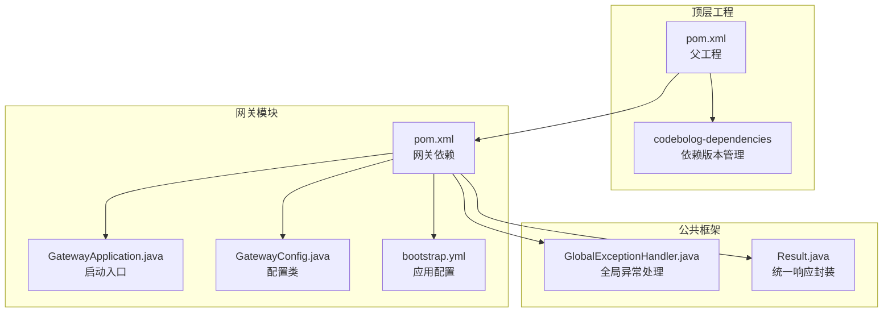
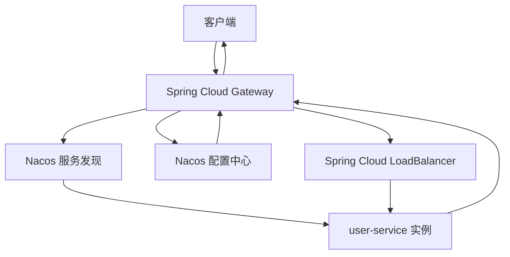
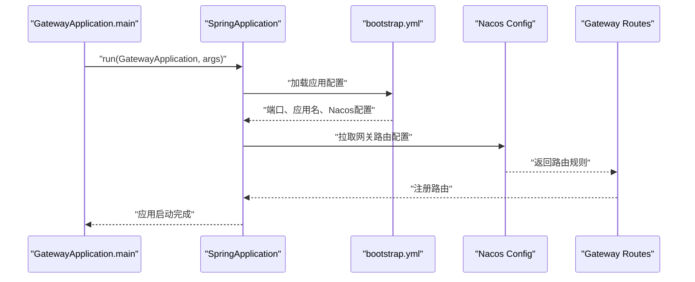
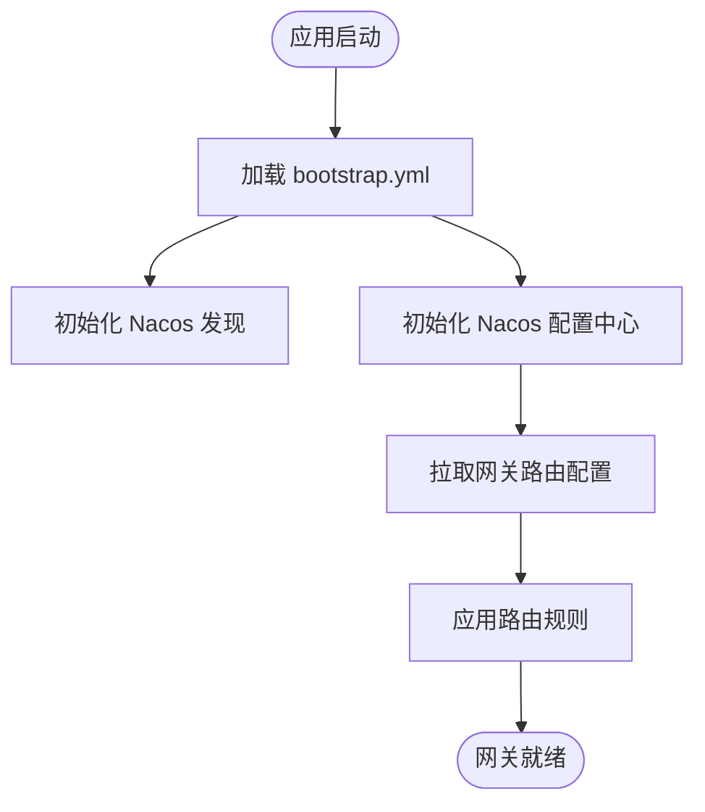
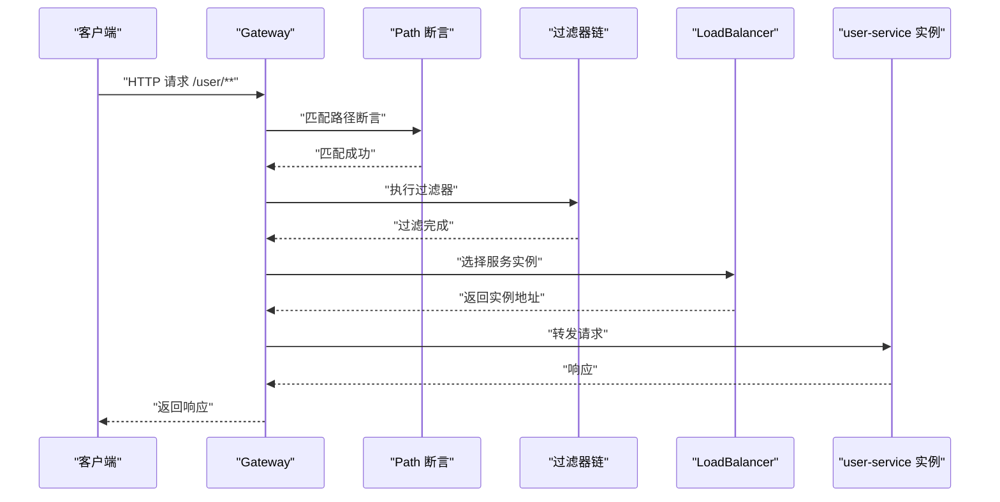
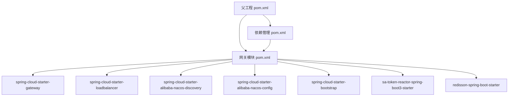

# 网关架构设计

<cite>
**本文档引用的文件**
- [GatewayApplication.java](file://codeblog-gateway/src/main/java/site/codeblog/GatewayApplication.java)
- [GatewayConfig.java](file://codeblog-gateway/src/main/java/site/codeblog/gateway/config/GatewayConfig.java)
- [bootstrap.yml](file://codeblog-gateway/src/main/resources/bootstrap.yml)
- [pom.xml](file://codeblog-gateway/pom.xml)
- [pom.xml](file://pom.xml)
- [pom.xml](file://codebolog-dependencies/pom.xml)
- [GlobalExceptionHandler.java](file://codeblog-framework/codeblog-common/codeblog-common-core/src/main/java/site/codeblog/common/core/exception/GlobalExceptionHandler.java)
- [Result.java](file://codeblog-framework/codeblog-common/codeblog-common-core/src/main/java/site/codeblog/common/core/result/Result.java)
</cite>

## 目录
1. [引言](#引言)
2. [项目结构](#项目结构)
3. [核心组件](#核心组件)
4. [架构总览](#架构总览)
5. [详细组件分析](#详细组件分析)
6. [依赖关系分析](#依赖关系分析)
7. [性能考虑](#性能考虑)
8. [故障排查指南](#故障排查指南)
9. [结论](#结论)
10. [附录](#附录)

## 引言
本文件面向codeblog-cloud项目的网关架构设计，围绕Spring Cloud Gateway的启动流程、组件初始化与配置加载机制进行深入解析，并结合当前代码库现状，给出路由匹配、负载均衡与请求转发流程的实现要点，以及集群部署、高可用、性能优化与监控指标的实践建议。由于当前仓库中网关模块的路由与过滤器配置主要通过外部配置中心（Nacos）加载，本文将重点阐述基于Nacos的动态路由与配置加载机制，以及如何在此基础上扩展自定义过滤器与安全策略。

## 项目结构
项目采用多模块聚合结构，网关模块位于codeblog-gateway，顶层父工程负责统一版本与插件管理，依赖版本由独立的依赖管理模块集中维护。网关模块引入了Spring Cloud Gateway、Nacos发现与配置、负载均衡、Sa-Token认证等关键依赖。

图表来源
- [pom.xml](file://pom.xml#L1-L150)
- [pom.xml](file://codebolog-dependencies/pom.xml#L1-L209)
- [GatewayApplication.java](file://codeblog-gateway/src/main/java/site/codeblog/GatewayApplication.java#L1-L16)
- [GatewayConfig.java](file://codeblog-gateway/src/main/java/site/codeblog/gateway/config/GatewayConfig.java#L1-L28)
- [bootstrap.yml](file://codeblog-gateway/src/main/resources/bootstrap.yml#L1-L44)

章节来源
- [pom.xml](file://pom.xml#L1-L150)
- [codeblog-gateway/pom.xml](file://codeblog-gateway/pom.xml#L1-L98)
- [codebolog-dependencies/pom.xml](file://codebolog-dependencies/pom.xml#L1-L209)

## 核心组件
- 启动入口：GatewayApplication作为Spring Boot应用入口，负责应用上下文的初始化与启动。
- 配置类：GatewayConfig预留了扩展点，当前注释掉了Sa-Token认证过滤器示例，便于后续按需启用。
- 配置文件：bootstrap.yml定义了端口、应用名、Nacos服务发现与配置中心地址、网关路由示例、Redis连接信息以及Sa-Token相关配置。
- 依赖管理：通过父工程与依赖管理模块统一版本，确保Spring Cloud、Spring Cloud Alibaba、Sa-Token、Redisson等组件版本一致。

章节来源
- [GatewayApplication.java](file://codeblog-gateway/src/main/java/site/codeblog/GatewayApplication.java#L1-L16)
- [GatewayConfig.java](file://codeblog-gateway/src/main/java/site/codeblog/gateway/config/GatewayConfig.java#L1-L28)
- [bootstrap.yml](file://codeblog-gateway/src/main/resources/bootstrap.yml#L1-L44)
- [pom.xml](file://codeblog-gateway/pom.xml#L1-L98)
- [pom.xml](file://pom.xml#L1-L150)
- [codebolog-dependencies/pom.xml](file://codebolog-dependencies/pom.xml#L1-L209)

## 架构总览
下图展示了基于Nacos的服务发现与配置中心的网关架构，以及路由到下游服务的转发链路。网关通过Nacos注册与发现服务实例，动态加载路由规则；请求进入网关后，根据路由断言与过滤器链进行处理，最终将请求转发至负载均衡后的下游服务。

图表来源
- [bootstrap.yml](file://codeblog-gateway/src/main/resources/bootstrap.yml#L8-L13)
- [pom.xml](file://codeblog-gateway/pom.xml#L37-L47)
- [pom.xml](file://codeblog-gateway/pom.xml#L31-L35)

## 详细组件分析

### 启动入口与应用初始化
- GatewayApplication使用Spring Boot注解声明应用类型，主方法调用SpringApplication.run完成启动。
- 应用启动后，会加载bootstrap.yml中的配置，包括端口、应用名、Nacos服务发现与配置中心地址等。
- 由于当前路由配置示例位于bootstrap.yml中，网关会在启动时从Nacos配置中心拉取路由配置并生效。

图表来源
- [GatewayApplication.java](file://codeblog-gateway/src/main/java/site/codeblog/GatewayApplication.java#L11-L15)
- [bootstrap.yml](file://codeblog-gateway/src/main/resources/bootstrap.yml#L1-L44)

章节来源
- [GatewayApplication.java](file://codeblog-gateway/src/main/java/site/codeblog/GatewayApplication.java#L1-L16)
- [bootstrap.yml](file://codeblog-gateway/src/main/resources/bootstrap.yml#L1-L44)

### 配置策略与加载机制
- 应用配置：bootstrap.yml定义了服务端口、应用名、Nacos服务发现与配置中心地址、示例路由、Redis连接信息以及Sa-Token配置。
- 动态路由：示例路由将/user/**路径映射到lb://user-service，并使用StripPrefix过滤器剥离前缀。
- 认证配置：Sa-Token相关配置已定义，但认证过滤器在GatewayConfig中被注释，可按需启用。

图表来源
- [bootstrap.yml](file://codeblog-gateway/src/main/resources/bootstrap.yml#L1-L44)
- [GatewayConfig.java](file://codeblog-gateway/src/main/java/site/codeblog/gateway/config/GatewayConfig.java#L13-L27)

章节来源
- [bootstrap.yml](file://codeblog-gateway/src/main/resources/bootstrap.yml#L1-L44)
- [GatewayConfig.java](file://codeblog-gateway/src/main/java/site/codeblog/gateway/config/GatewayConfig.java#L1-L28)

### 路由匹配算法与请求转发
- 路由匹配：基于Path断言匹配/user/**，命中后执行过滤器链。
- 负载均衡：URI使用lb://user-service，表示通过Spring Cloud LoadBalancer进行服务发现与负载均衡。
- 请求转发：经过过滤器处理后，请求被转发至user-service的实例，实例列表来自Nacos服务发现。

图表来源
- [bootstrap.yml](file://codeblog-gateway/src/main/resources/bootstrap.yml#L17-L22)
- [pom.xml](file://codeblog-gateway/pom.xml#L31-L35)

章节来源
- [bootstrap.yml](file://codeblog-gateway/src/main/resources/bootstrap.yml#L17-L22)
- [pom.xml](file://codeblog-gateway/pom.xml#L31-L35)

### 过滤器与安全策略扩展
- 当前GatewayConfig预留了Sa-Token认证过滤器的启用位置，可通过取消注释并实现认证逻辑来增强网关的安全能力。
- 建议在过滤器链中加入鉴权、限流、熔断、跨域等通用能力，以满足生产环境需求。

章节来源
- [GatewayConfig.java](file://codeblog-gateway/src/main/java/site/codeblog/gateway/config/GatewayConfig.java#L13-L27)

### 统一异常处理与响应封装
- 公共框架提供了统一的异常处理与响应封装，网关作为API入口，可复用该机制保证对外响应的一致性。
- GlobalExceptionHandler对多种异常类型进行处理并返回Result格式的响应体。

章节来源
- [GlobalExceptionHandler.java](file://codeblog-framework/codeblog-common/codeblog-common-core/src/main/java/site/codeblog/common/core/exception/GlobalExceptionHandler.java#L1-L107)
- [Result.java](file://codeblog-framework/codeblog-common/codeblog-common-core/src/main/java/site/codeblog/common/core/result/Result.java#L1-L101)

## 依赖关系分析
- 父工程与依赖管理：父工程统一管理构建插件与Maven仓库源；依赖管理模块集中定义Spring Cloud、Spring Cloud Alibaba、Sa-Token、Redisson等版本，确保各模块依赖一致性。
- 网关模块：引入Spring Cloud Gateway、Nacos发现与配置、LoadBalancer、Bootstrap、Sa-Token Reactor Starter、Redisson等依赖，支撑网关功能与生态集成。

图表来源
- [pom.xml](file://pom.xml#L1-L150)
- [codebolog-dependencies/pom.xml](file://codebolog-dependencies/pom.xml#L96-L206)
- [pom.xml](file://codeblog-gateway/pom.xml#L24-L78)

章节来源
- [pom.xml](file://pom.xml#L1-L150)
- [codebolog-dependencies/pom.xml](file://codebolog-dependencies/pom.xml#L1-L209)
- [pom.xml](file://codeblog-gateway/pom.xml#L1-L98)

## 性能考虑
- 资源管理
  - 线程模型：Spring Cloud Gateway基于WebFlux，采用事件驱动与非阻塞I/O，建议合理设置Netty线程数与连接池大小，避免过度并发导致资源争用。
  - 连接池：对下游服务的HTTP客户端连接池进行合理配置，避免频繁建立/销毁连接带来的开销。
  - 缓存：利用Redis缓存热点数据与令牌信息，降低认证与查询压力。
- 路由与过滤器
  - 路由断言与过滤器顺序：将高频断言放在前面，减少不必要的过滤器执行；避免在过滤器中进行重IO操作。
  - 负载均衡策略：根据业务场景选择合适的负载均衡策略（轮询、权重、最少连接等），并结合健康检查与熔断降级。
- 监控与可观测性
  - 指标采集：结合Spring Boot Actuator与SkyWalking等工具，采集请求延迟、吞吐量、错误率等关键指标。
  - 日志：统一接入日志收集系统，对认证、鉴权、路由命中、异常等关键路径进行日志记录与告警。
- 集群与高可用
  - 部署：至少部署两个及以上网关实例，结合Nginx/LVS等反向代理实现流量分发与健康检查。
  - 配置：将路由与安全策略统一收敛到Nacos，实现灰度发布与快速回滚。
  - 限流与熔断：在网关层实施限流与熔断，保护下游服务；对上游依赖进行超时与重试策略配置。

[本节为通用性能指导，不直接分析具体文件]

## 故障排查指南
- 启动与配置
  - 确认Nacos服务发现与配置中心地址正确，且网关能够正常连接。
  - 检查bootstrap.yml中的路由配置是否符合预期，确认lb://服务名与实际注册的服务一致。
- 路由与转发
  - 若请求无法命中路由，优先检查Path断言与URI配置；确认下游服务已注册到Nacos且处于健康状态。
  - 观察负载均衡是否正确选择实例，必要时调整负载均衡策略或实例权重。
- 安全与认证
  - 若启用Sa-Token认证，检查认证过滤器是否正确加载，Token格式与有效期是否符合预期。
- 统一响应与异常
  - 利用公共框架的统一异常处理机制，确保对外响应格式一致；对异常进行分级处理与日志记录。

章节来源
- [bootstrap.yml](file://codeblog-gateway/src/main/resources/bootstrap.yml#L8-L13)
- [GlobalExceptionHandler.java](file://codeblog-framework/codeblog-common/codeblog-common-core/src/main/java/site/codeblog/common/core/exception/GlobalExceptionHandler.java#L27-L31)

## 结论
本项目基于Spring Cloud Gateway与Nacos实现了动态路由与服务治理能力，具备良好的扩展性与生态集成性。通过合理的配置加载、路由匹配与负载均衡策略，以及统一的异常处理与响应封装，能够在保证性能的同时满足生产环境的高可用与可观测性要求。建议后续在GatewayConfig中按需启用认证过滤器，并结合限流、熔断与监控体系完善网关能力。

[本节为总结性内容，不直接分析具体文件]

## 附录
- 开发最佳实践
  - 将路由与安全策略集中管理于Nacos，实现配置即代码化与灰度发布。
  - 在过滤器链中遵循“先鉴权、后限流、再转发”的原则，确保安全与稳定性。
  - 对关键路径进行压测与容量评估，持续优化线程模型与连接池参数。
- 扩展指南
  - 自定义过滤器：在GatewayConfig中注册自定义过滤器Bean，实现业务所需的横切能力。
  - 认证扩展：参考GatewayConfig中的注释示例，实现Sa-Token或其他认证方案的集成。
  - 监控集成：接入SkyWalking、Prometheus/Grafana等监控体系，完善指标与告警。

[本节为概念性内容，不直接分析具体文件]