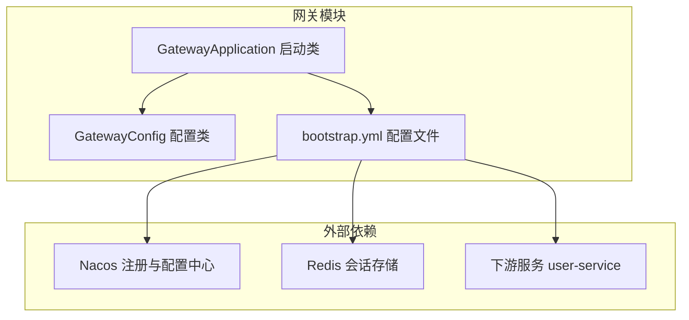
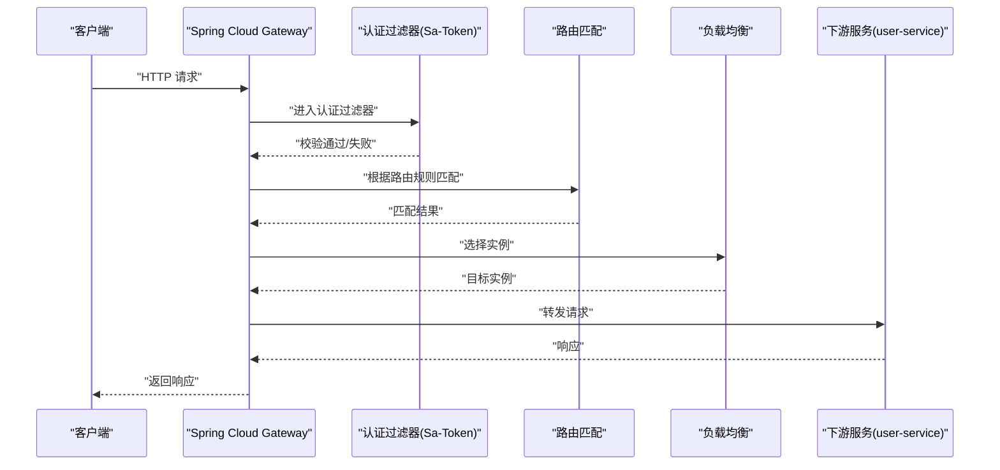
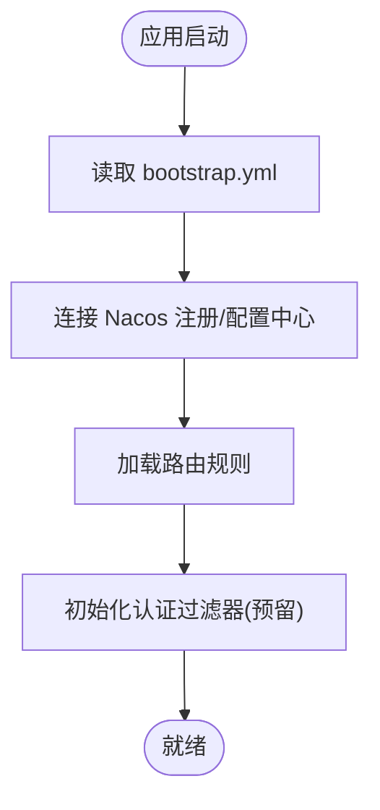
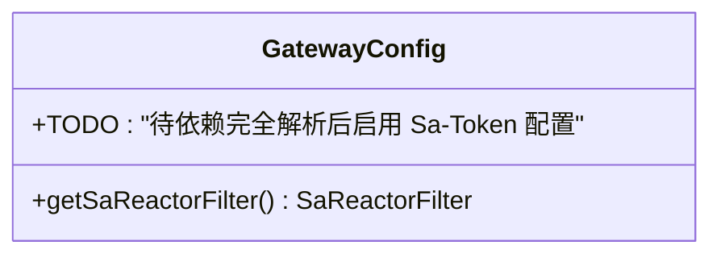

# 网关模块

<cite>
**本文引用的文件**
- [GatewayApplication.java](file://codeblog-gateway/src/main/java/site/codeblog/GatewayApplication.java)
- [bootstrap.yml](file://codeblog-gateway/src/main/resources/bootstrap.yml)
- [GatewayConfig.java](file://codeblog-gateway/src/main/java/site/codeblog/gateway/config/GatewayConfig.java)
- [pom.xml（网关模块）](file://codeblog-gateway/pom.xml)
- [pom.xml（根项目）](file://pom.xml)
- [pom.xml（依赖版本控制）](file://codebolog-dependencies/pom.xml)
- [pom.xml（框架模块）](file://codeblog-framework/pom.xml)
</cite>

## 目录
1. [简介](#简介)
2. [项目结构](#项目结构)
3. [核心组件](#核心组件)
4. [架构总览](#架构总览)
5. [详细组件分析](#详细组件分析)
6. [依赖关系分析](#依赖关系分析)
7. [性能考虑](#性能考虑)
8. [故障排查指南](#故障排查指南)
9. [结论](#结论)
10. [附录](#附录)

## 简介
本文件面向开发者与运维人员，系统化梳理 codeblog-cloud 网关模块的架构设计、启动流程、路由与过滤器机制、认证授权集成（尤其是 Sa-Token 在网关层的认证授权）、配置策略与最佳实践，并提供性能优化、安全加固与监控建议。文档严格基于仓库中现有源码进行分析与总结，避免臆测。

## 项目结构
网关模块采用 Spring Boot + Spring Cloud Gateway 架构，结合 Nacos 作为注册与配置中心，使用 Sa-Token 实现网关层认证授权，Redis 作为会话存储与共享。模块内包含启动入口、基础配置与示例路由，以及预留的认证过滤器配置位置。

图表来源
- [GatewayApplication.java](file://codeblog-gateway/src/main/java/site/codeblog/GatewayApplication.java#L1-L16)
- [bootstrap.yml](file://codeblog-gateway/src/main/resources/bootstrap.yml#L1-L44)
- [GatewayConfig.java](file://codeblog-gateway/src/main/java/site/codeblog/gateway/config/GatewayConfig.java#L1-L28)

章节来源
- [GatewayApplication.java](file://codeblog-gateway/src/main/java/site/codeblog/GatewayApplication.java#L1-L16)
- [bootstrap.yml](file://codeblog-gateway/src/main/resources/bootstrap.yml#L1-L44)
- [GatewayConfig.java](file://codeblog-gateway/src/main/java/site/codeblog/gateway/config/GatewayConfig.java#L1-L28)

## 核心组件
- 启动类：负责应用引导与上下文加载。
- 配置类：预留认证过滤器 Bean 的声明位置，当前处于注释状态，待依赖完善后启用。
- 配置文件：集中管理端口、应用名、Nacos 注册与配置中心地址、示例路由、Redis 连接信息以及 Sa-Token 参数。

章节来源
- [GatewayApplication.java](file://codeblog-gateway/src/main/java/site/codeblog/GatewayApplication.java#L1-L16)
- [GatewayConfig.java](file://codeblog-gateway/src/main/java/site/codeblog/gateway/config/GatewayConfig.java#L1-L28)
- [bootstrap.yml](file://codeblog-gateway/src/main/resources/bootstrap.yml#L1-L44)

## 架构总览
网关作为统一入口，负责请求接入、路由分发、负载均衡、认证授权与可观测性。下图展示了从客户端到下游服务的典型调用链路，以及认证拦截点的位置。

图表来源
- [bootstrap.yml](file://codeblog-gateway/src/main/resources/bootstrap.yml#L14-L22)
- [GatewayConfig.java](file://codeblog-gateway/src/main/java/site/codeblog/gateway/config/GatewayConfig.java#L13-L27)

## 详细组件分析

### 启动类与引导流程
- 启动类标注为 Spring Boot 应用入口，负责加载自动配置与扫描组件。
- 引导阶段会读取 bootstrap.yml 中的配置，连接 Nacos 注册与配置中心，完成网关路由与认证等配置的拉取与初始化。

图表来源
- [GatewayApplication.java](file://codeblog-gateway/src/main/java/site/codeblog/GatewayApplication.java#L11-L15)
- [bootstrap.yml](file://codeblog-gateway/src/main/resources/bootstrap.yml#L1-L44)
- [GatewayConfig.java](file://codeblog-gateway/src/main/java/site/codeblog/gateway/config/GatewayConfig.java#L13-L27)

章节来源
- [GatewayApplication.java](file://codeblog-gateway/src/main/java/site/codeblog/GatewayApplication.java#L1-L16)
- [bootstrap.yml](file://codeblog-gateway/src/main/resources/bootstrap.yml#L1-L44)

### 配置文件结构与路由机制
- 基础配置：server.port、spring.application.name。
- Nacos 集成：注册中心与配置中心地址、配置文件扩展名。
- 路由规则：示例路由 user-service，目标 URI 使用负载均衡前缀，路径谓词匹配 /user/**，过滤器 StripPrefix 去除前缀。
- Redis 连接：用于 Sa-Token 会话存储与共享。
- Sa-Token 参数：token 名称、有效期、并发登录策略、日志开关等。

章节来源
- [bootstrap.yml](file://codeblog-gateway/src/main/resources/bootstrap.yml#L1-L44)

### 认证授权与 Sa-Token 集成
- 依赖引入：sa-token-reactor-spring-boot3-starter、sa-token-dao-redisson-jackson、redisson-spring-boot-starter。
- 配置项：token 名称、有效期、并发策略、风格、日志等。
- 过滤器预留：GatewayConfig 中保留了 Sa-Token Reactor 过滤器的 Bean 声明位置，当前为注释状态，待依赖完善后启用。

图表来源
- [GatewayConfig.java](file://codeblog-gateway/src/main/java/site/codeblog/gateway/config/GatewayConfig.java#L13-L27)

章节来源
- [pom.xml（网关模块）](file://codeblog-gateway/pom.xml#L55-L71)
- [bootstrap.yml](file://codeblog-gateway/src/main/resources/bootstrap.yml#L29-L44)
- [GatewayConfig.java](file://codeblog-gateway/src/main/java/site/codeblog/gateway/config/GatewayConfig.java#L1-L28)

### 负载均衡与下游服务发现
- 依赖引入：spring-cloud-starter-loadbalancer。
- 路由 URI 使用 lb:// 前缀，结合 Nacos 注册中心实现服务发现与轮询负载均衡。

章节来源
- [pom.xml（网关模块）](file://codeblog-gateway/pom.xml#L31-L35)
- [bootstrap.yml](file://codeblog-gateway/src/main/resources/bootstrap.yml#L17-L18)

### 过滤器扩展与自定义中间件
- 当前示例路由包含 StripPrefix 过滤器，用于去除请求路径中的前缀以适配下游服务。
- 网关支持在路由级别或全局级别添加过滤器，可扩展限流、鉴权、熔断、头处理等能力。

章节来源
- [bootstrap.yml](file://codeblog-gateway/src/main/resources/bootstrap.yml#L21-L22)

## 依赖关系分析
- 父工程统一版本与插件管理，网关模块继承父工程属性。
- 依赖版本控制模块集中管理 Spring Cloud、Spring Cloud Alibaba、Sa-Token、Redisson、Gateway 等版本。
- 网关模块直接依赖 Spring Cloud Gateway、LoadBalancer、Nacos Discovery/Config、Bootstrap、Sa-Token Reactor、Redisson 与 Lombok。

```mermaid
graph LR
ROOT["根项目 pom.xml"] --> DEPS["依赖版本控制 pom.xml"]
ROOT --> FW["框架模块 pom.xml"]
ROOT --> GW["网关模块 pom.xml"]
DEPS --> SC["Spring Cloud 版本"]
DEPS --> SCA["Spring Cloud Alibaba 版本"]
DEPS --> ST["Sa-Token 版本"]
DEPS --> RS["Redisson 版本"]
DEPS --> GWG["Spring Cloud Gateway 版本"]
GW --> GWG
GW --> SCA
GW --> ST
GW --> RS
```

图表来源
- [pom.xml（根项目）](file://pom.xml#L1-L150)
- [pom.xml（依赖版本控制）](file://codebolog-dependencies/pom.xml#L96-L206)
- [pom.xml（网关模块）](file://codeblog-gateway/pom.xml#L24-L78)

章节来源
- [pom.xml（根项目）](file://pom.xml#L1-L150)
- [pom.xml（依赖版本控制）](file://codebolog-dependencies/pom.xml#L1-L209)
- [pom.xml（网关模块）](file://codeblog-gateway/pom.xml#L1-L98)

## 性能考虑
- 路由与过滤器：仅在必要处添加过滤器，避免对所有请求执行昂贵操作；合理设置 StripPrefix 等轻量过滤器。
- 负载均衡：结合 Nacos 与 LoadBalancer，确保实例健康与流量均匀分布。
- 认证缓存：利用 Redis 存储 Sa-Token 会话，减少重复校验开销。
- 并发策略：根据业务场景调整 Sa-Token 的并发登录与共享策略，平衡安全与性能。
- 监控与追踪：建议接入 SkyWalking 或 Spring Boot Admin，结合网关日志定位性能瓶颈。

[本节为通用指导，不直接分析具体文件]

## 故障排查指南
- 启动失败
  - 检查 Nacos 地址连通性与配置中心可用性。
  - 核对 bootstrap.yml 中的 server.port 与 spring.application.name。
- 路由不生效
  - 确认路由 id、URI、谓词与过滤器配置正确。
  - 检查下游服务是否已注册至 Nacos。
- 认证异常
  - 确认 Sa-Token 配置项与 Redis 连接正常。
  - 若认证过滤器未启用，请检查 GatewayConfig 中的 Bean 声明是否解除注释并满足依赖条件。
- 性能问题
  - 关注过滤器链路与认证耗时，结合监控工具定位热点。

章节来源
- [bootstrap.yml](file://codeblog-gateway/src/main/resources/bootstrap.yml#L1-L44)
- [GatewayConfig.java](file://codeblog-gateway/src/main/java/site/codeblog/gateway/config/GatewayConfig.java#L13-L27)

## 结论
codeblog-cloud 网关模块以 Spring Cloud Gateway 为核心，结合 Nacos 与 Sa-Token，提供了可扩展的路由与认证授权能力。当前示例路由与 Sa-Token 配置已具备基础能力，后续可通过完善认证过滤器 Bean 与扩展过滤器链路，进一步增强安全性与性能表现。

[本节为总结性内容，不直接分析具体文件]

## 附录

### 配置项速查
- 基础
  - server.port
  - spring.application.name
- Nacos
  - spring.cloud.nacos.discovery.server-addr
  - spring.cloud.nacos.config.server-addr
  - spring.cloud.nacos.config.file-extension
- 路由
  - spring.cloud.gateway.routes[*].id
  - spring.cloud.gateway.routes[*].uri
  - spring.cloud.gateway.routes[*].predicates[*]
  - spring.cloud.gateway.routes[*].filters[*]
- Redis
  - spring.data.redis.host
  - spring.data.redis.port
  - spring.data.redis.database
- Sa-Token
  - sa-token.token-name
  - sa-token.timeout
  - sa-token.active-timeout
  - sa-token.is-concurrent
  - sa-token.is-share
  - sa-token.token-style
  - sa-token.is-log

章节来源
- [bootstrap.yml](file://codeblog-gateway/src/main/resources/bootstrap.yml#L1-L44)