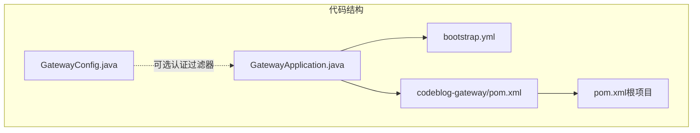
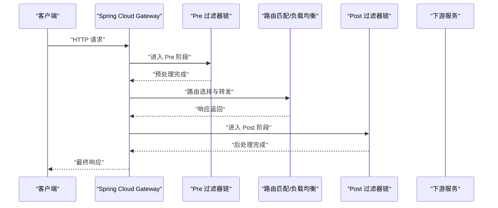
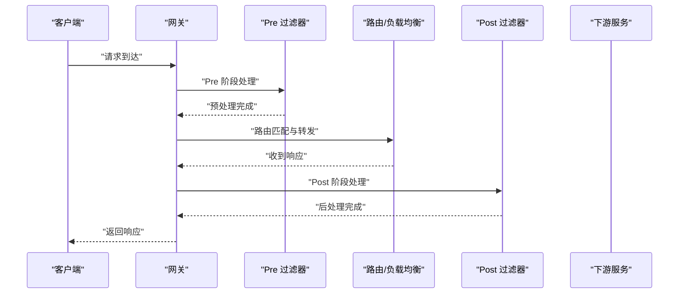
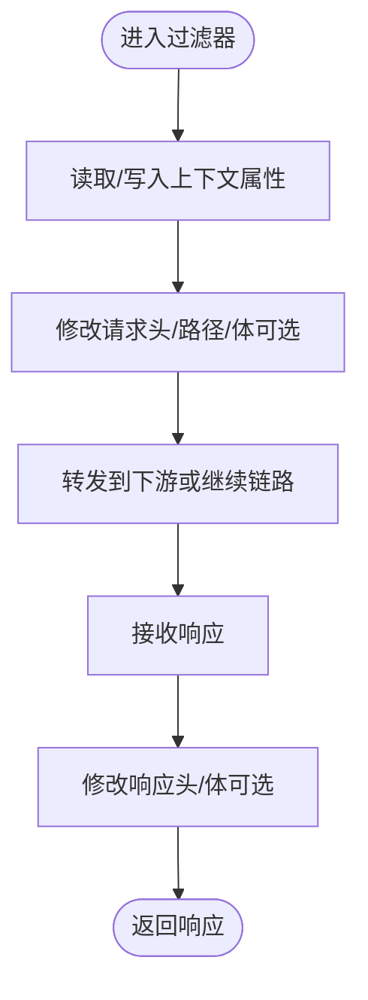
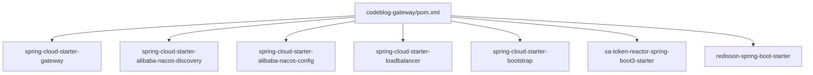

# 网关过滤器机制

<cite>
**本文引用的文件**
- [GatewayApplication.java](file://codeblog-gateway/src/main/java/site/Codeblog/GatewayApplication.java)
- [GatewayConfig.java](file://codeblog-gateway/src/main/java/site/codeblog/gateway/config/GatewayConfig.java)
- [bootstrap.yml](file://codeblog-gateway/src/main/resources/bootstrap.yml)
- [pom.xml](file://codeblog-gateway/pom.xml)
- [pom.xml（根项目）](file://pom.xml)
</cite>

## 目录
1. [引言](#引言)
2. [项目结构](#项目结构)
3. [核心组件](#核心组件)
4. [架构总览](#架构总览)
5. [详细组件分析](#详细组件分析)
6. [依赖分析](#依赖分析)
7. [性能考虑](#性能考虑)
8. [故障排查指南](#故障排查指南)
9. [结论](#结论)
10. [附录](#附录)

## 引言
本文件围绕 codeblog-cloud 项目的网关过滤器机制展开，重点解析 Spring Cloud Gateway 的过滤器链执行模型（pre-filter 与 post-filter 的顺序与作用域）、自定义过滤器的开发与注册方式、执行上下文与请求/响应修改、异常处理策略，以及在实际场景中的应用（如请求日志、响应转换、安全拦截）。同时给出性能优化、并发处理与错误恢复建议，并提供调试与扩展的最佳实践。

## 项目结构
该仓库采用多模块组织，其中网关模块位于 codeblog-gateway，核心入口为 GatewayApplication 启动类；配置集中在 bootstrap.yml 中；依赖通过 Maven 管理，引入了 Spring Cloud Gateway、Nacos、Sa-Token Reactor 等能力。

图表来源
- [GatewayApplication.java](file://codeblog-gateway/src/main/java/site/Codeblog/GatewayApplication.java#L1-L16)
- [GatewayConfig.java](file://codeblog-gateway/src/main/java/site/codeblog/gateway/config/GatewayConfig.java#L1-L28)
- [bootstrap.yml](file://codeblog-gateway/src/main/resources/bootstrap.yml#L1-L44)
- [pom.xml](file://codeblog-gateway/pom.xml#L1-L98)
- [pom.xml（根项目）](file://pom.xml#L1-L23)

章节来源
- [GatewayApplication.java](file://codeblog-gateway/src/main/java/site/Codeblog/GatewayApplication.java#L1-L16)
- [pom.xml](file://codeblog-gateway/pom.xml#L1-L98)
- [pom.xml（根项目）](file://pom.xml#L1-L23)

## 核心组件
- 网关启动类：负责引导 Spring Boot 应用与网关运行。
- 网关配置类：预留了基于 Sa-Token 的全局过滤器集成点（注释状态），可用于统一鉴权与错误返回。
- 网关路由配置：通过 bootstrap.yml 定义路由规则与内置过滤器（如 StripPrefix）。
- 依赖管理：引入 Spring Cloud Gateway、Nacos、LoadBalancer、Sa-Token Reactor 等。

章节来源
- [GatewayApplication.java](file://codeblog-gateway/src/main/java/site/Codeblog/GatewayApplication.java#L1-L16)
- [GatewayConfig.java](file://codeblog-gateway/src/main/java/site/codeblog/gateway/config/GatewayConfig.java#L1-L28)
- [bootstrap.yml](file://codeblog-gateway/src/main/resources/bootstrap.yml#L14-L22)
- [pom.xml](file://codeblog-gateway/pom.xml#L24-L78)

## 架构总览
下图展示了从客户端到下游服务的典型请求路径，以及过滤器链在 pre/post 阶段的参与位置。该图为概念性示意，帮助理解过滤器链在请求生命周期中的职责划分。

## 详细组件分析

### 过滤器链执行模型与作用域
- 执行顺序
  - Pre 阶段：在路由匹配与请求转发之前执行，常用于日志、限流、鉴权、参数校验等。
  - Route 阶段：根据路由规则选择下游服务，可能包含负载均衡与协议转换。
  - Post 阶段：在收到下游响应后执行，常用于响应聚合、脱敏、统计等。
- 作用范围
  - 全局过滤器：对所有路由生效。
  - 路由级过滤器：仅对该路由生效（见 bootstrap.yml 中 user-service 路由的 filters 字段）。
- 内置过滤器示例
  - StripPrefix：移除请求路径前缀，便于将前端路径映射到微服务内部路径。

章节来源
- [bootstrap.yml](file://codeblog-gateway/src/main/resources/bootstrap.yml#L14-L22)

### 自定义过滤器开发与注册
- 开发要点
  - 实现过滤器接口（通常为 WebFilter 或 GatewayFilter），在 doFilter 中编写 pre/post 逻辑。
  - 使用 Exchange 增强/替换请求体、头信息；使用 Exchange mutate 生成新的响应。
  - 注意非阻塞与背压，避免阻塞线程池。
- 注册方式
  - 全局注册：通过 @Bean 定义过滤器 Bean，自动被网关注入。
  - 路由级注册：在 bootstrap.yml 的对应路由 filters 中声明（如 StripPrefix）。
- 上下文与请求/响应修改
  - 通过 ServerWebExchange 获取请求属性、设置属性以传递给后续过滤器。
  - 通过 mutate 修改响应状态码、头信息、体内容，或直接返回响应。
- 异常处理策略
  - 在过滤器中捕获异常并设置合适的响应状态与错误体。
  - 对上游快速失败，避免阻塞链路。
  - 结合全局异常处理器统一格式化错误响应。

（本节为通用实现指导，不直接引用具体源码）

### 过滤器执行流程（序列图）
以下序列图展示了一个典型的请求在过滤器链中的流转过程，涵盖预处理、路由转发与后处理阶段。

（本图为概念性流程示意，不附带图表来源）

### 过滤器执行上下文与请求/响应修改（流程图）

（本图为概念性流程示意，不附带图表来源）

### 安全拦截与统一认证（基于 Sa-Token 的集成点）
- 当前在 GatewayConfig 中预留了 Sa-Token 的全局过滤器集成点（注释状态），可用于：
  - 统一鉴权：对特定路径进行登录态校验。
  - 统一错误处理：将认证失败统一为标准错误响应。
- 使用建议
  - 将鉴权逻辑放在 Pre 阶段，尽早拒绝无效请求。
  - 错误返回格式应与全局异常处理一致，便于前端统一处理。

章节来源
- [GatewayConfig.java](file://codeblog-gateway/src/main/java/site/codeblog/gateway/config/GatewayConfig.java#L13-L26)

### 常见过滤器场景与实现思路
- 请求日志记录
  - 在 Pre 阶段记录请求开始时间、URI、参数摘要；在 Post 阶段记录耗时与状态码。
- 响应数据转换
  - 在 Post 阶段对响应体进行统一封装、脱敏或格式转换。
- 安全拦截
  - 在 Pre 阶段进行权限校验与黑名单检查；失败时直接返回错误响应。

（本节为通用实现指导，不直接引用具体源码）

## 依赖分析
网关模块的关键依赖包括 Spring Cloud Gateway、Nacos 发现与配置、LoadBalancer、Bootstrap、Sa-Token Reactor 与 Redisson 等。这些依赖共同支撑了网关的路由、注册发现、配置中心、认证授权与缓存等功能。

图表来源
- [pom.xml](file://codeblog-gateway/pom.xml#L24-L78)

章节来源
- [pom.xml](file://codeblog-gateway/pom.xml#L24-L78)

## 性能考虑
- 非阻塞与背压
  - 过滤器应避免阻塞式 IO，优先使用响应式 API 与异步处理。
- 资源复用
  - 复用编解码器、缓冲区与连接池，减少对象分配与 GC 压力。
- 缓存与短路
  - 对静态资源与热点数据使用缓存；对已知失败路径进行短路。
- 并发控制
  - 合理设置线程池大小与队列长度，避免过载。
- 监控与可观测性
  - 记录关键指标（QPS、P95/P99、错误率、链路耗时），结合分布式追踪定位瓶颈。

（本节为通用性能指导，不直接引用具体源码）

## 故障排查指南
- 路由不生效
  - 检查 bootstrap.yml 中路由 id、predicates 与 filters 配置是否正确。
- 过滤器未执行
  - 确认过滤器 Bean 已注册且作用域匹配（全局或路由级）。
- 认证失败
  - 若使用 Sa-Token，确认过滤器已启用且错误处理逻辑正常返回。
- 响应异常
  - 在 Post 阶段检查响应体修改逻辑，确保状态码与头信息正确。
- 性能问题
  - 关注阻塞调用、频繁对象分配与外部依赖延迟。

章节来源
- [bootstrap.yml](file://codeblog-gateway/src/main/resources/bootstrap.yml#L14-L22)
- [GatewayConfig.java](file://codeblog-gateway/src/main/java/site/codeblog/gateway/config/GatewayConfig.java#L13-L26)

## 结论
本项目基于 Spring Cloud Gateway 提供了网关层的基础能力，结合 Nacos 与 Sa-Token 实现了服务治理与统一认证的扩展点。通过合理设计过滤器链（Pre/Post 阶段）、规范注册与上下文传递、完善异常处理与性能优化，可在保证高可用的同时满足多样化的业务需求。建议在生产环境中持续完善监控与灰度发布策略，确保变更可控与可回滚。

## 附录
- 启动与配置
  - 启动类：GatewayApplication
  - 配置文件：bootstrap.yml
  - 依赖管理：codeblog-gateway/pom.xml 与根 pom.xml

章节来源
- [GatewayApplication.java](file://codeblog-gateway/src/main/java/site/Codeblog/GatewayApplication.java#L1-L16)
- [bootstrap.yml](file://codeblog-gateway/src/main/resources/bootstrap.yml#L1-L44)
- [pom.xml](file://codeblog-gateway/pom.xml#L1-L98)
- [pom.xml（根项目）](file://pom.xml#L1-L23)