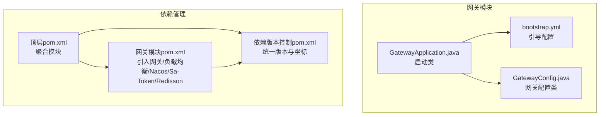
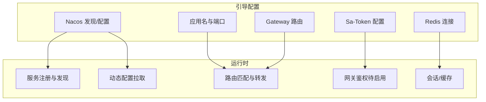
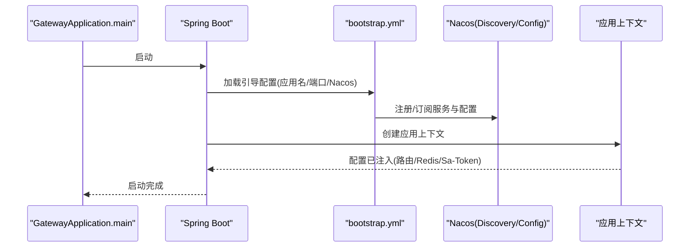
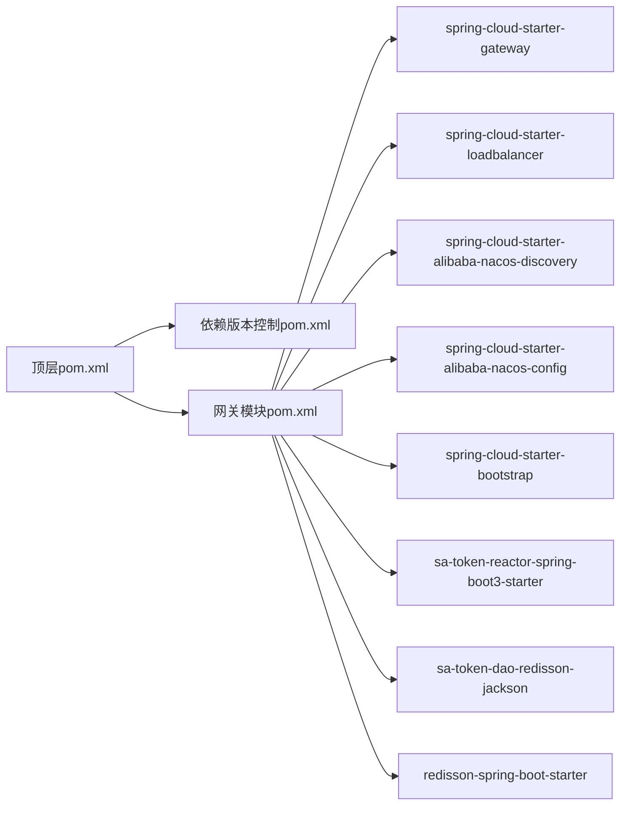

# 网关配置管理

<cite>
**本文引用的文件**
- [bootstrap.yml](file://codeblog-gateway/src/main/resources/bootstrap.yml)
- [GatewayApplication.java](file://codeblog-gateway/src/main/java/site/codeblog/GatewayApplication.java)
- [GatewayConfig.java](file://codeblog-gateway/src/main/java/site/codeblog/gateway/config/GatewayConfig.java)
- [pom.xml（网关模块）](file://codeblog-gateway/pom.xml)
- [pom.xml（顶层工程）](file://pom.xml)
- [pom.xml（依赖版本控制）](file://codebolog-dependencies/pom.xml)
</cite>

## 目录
1. [简介](#简介)
2. [项目结构](#项目结构)
3. [核心组件](#核心组件)
4. [架构总览](#架构总览)
5. [详细组件分析](#详细组件分析)
6. [依赖分析](#依赖分析)
7. [性能考量](#性能考量)
8. [故障排查指南](#故障排查指南)
9. [结论](#结论)
10. [附录](#附录)

## 简介
本文件面向codeblog-cloud项目的网关配置管理，围绕bootstrap.yml配置文件展开，系统性解析其结构与参数作用机制，涵盖路由规则、服务发现与动态配置管理；阐述环境配置策略、配置优先级与覆盖机制；给出生产环境最佳实践（含Nacos配置中心集成与热更新）、安全性与敏感信息保护、配置审计建议，并提供故障排查与优化建议。

## 项目结构
网关模块采用Spring Cloud Gateway + Spring Cloud Alibaba Nacos的组合，通过bootstrap.yml完成引导期配置（应用名、端口、Nacos地址、路由、Redis等），并通过Maven模块化管理依赖与版本。

图表来源
- [bootstrap.yml](file://codeblog-gateway/src/main/resources/bootstrap.yml#L1-L44)
- [GatewayApplication.java](file://codeblog-gateway/src/main/java/site/codeblog/GatewayApplication.java#L1-L16)
- [GatewayConfig.java](file://codeblog-gateway/src/main/java/site/codeblog/gateway/config/GatewayConfig.java#L1-L28)
- [pom.xml（顶层工程）](file://pom.xml#L16-L20)
- [pom.xml（依赖版本控制）](file://codebolog-dependencies/pom.xml#L96-L114)
- [pom.xml（网关模块）](file://codeblog-gateway/pom.xml#L24-L71)

章节来源
- [pom.xml（顶层工程）](file://pom.xml#L16-L20)
- [pom.xml（依赖版本控制）](file://codebolog-dependencies/pom.xml#L96-L114)
- [pom.xml（网关模块）](file://codeblog-gateway/pom.xml#L24-L71)

## 核心组件
- 引导配置文件：负责应用名、端口、Nacos服务地址、网关路由、Redis连接等初始化配置。
- 启动类：标准Spring Boot启动入口。
- 网关配置类：预留扩展点，当前注释掉认证过滤器，后续可启用Sa-Token网关认证。

章节来源
- [bootstrap.yml](file://codeblog-gateway/src/main/resources/bootstrap.yml#L1-L44)
- [GatewayApplication.java](file://codeblog-gateway/src/main/java/site/codeblog/GatewayApplication.java#L1-L16)
- [GatewayConfig.java](file://codeblog-gateway/src/main/java/site/codeblog/gateway/config/GatewayConfig.java#L1-L28)

## 架构总览
下图展示bootstrap.yml中关键配置项如何驱动网关行为：应用名与端口决定进程标识与监听；Nacos作为服务发现与配置中心；Gateway路由定义请求转发规则；Redis用于会话或缓存；Sa-Token用于网关层鉴权（当前未启用）。

图表来源
- [bootstrap.yml](file://codeblog-gateway/src/main/resources/bootstrap.yml#L1-L44)

## 详细组件分析

### 引导配置文件bootstrap.yml结构与参数解析
- 服务器端口：定义网关监听端口。
- 应用名称：用于Nacos服务发现与配置分组标识。
- Nacos配置：
  - 服务发现：指定Nacos地址，使网关能从Nacos订阅服务实例。
  - 动态配置：指定Nacos地址与配置文件扩展名，实现配置中心拉取与热更新。
- 网关路由：
  - 路由ID：唯一标识一条路由。
  - 目标URI：lb://服务名表示通过Spring Cloud LoadBalancer进行客户端负载均衡。
  - 断言：Path断言匹配请求路径前缀。
  - 过滤器：StripPrefix移除指定前缀长度，便于将用户请求映射到下游服务路径。
- Redis连接：用于会话存储或缓存（结合Sa-Token/Redisson）。
- Sa-Token配置：令牌名称、有效期、并发登录策略、风格与日志开关等。

章节来源
- [bootstrap.yml](file://codeblog-gateway/src/main/resources/bootstrap.yml#L1-L44)

### 路由规则配置
- 路由示例：将/user/**前缀的请求转发至user-service服务，并移除第一个路径段前缀。
- 负载均衡：URI使用lb://协议，结合spring-cloud-starter-loadbalancer实现客户端LB。
- 扩展建议：可按业务域拆分多条路由，分别指向不同服务；为每条路由配置超时、重试、熔断等过滤器。

章节来源
- [bootstrap.yml](file://codeblog-gateway/src/main/resources/bootstrap.yml#L14-L22)
- [pom.xml（网关模块）](file://codeblog-gateway/pom.xml#L31-L35)

### 服务发现配置
- Nacos服务发现：通过spring.cloud.nacos.discovery.server-addr配置Nacos地址，使网关自动注册与订阅服务。
- 依赖支撑：spring-cloud-starter-alibaba-nacos-discovery提供服务发现能力。
- 建议：在生产环境使用域名或内网IP+高可用Nacos集群地址；开启健康检查与权重配置。

章节来源
- [bootstrap.yml](file://codeblog-gateway/src/main/resources/bootstrap.yml#L8-L11)
- [pom.xml（网关模块）](file://codeblog-gateway/pom.xml#L37-L41)

### 动态配置管理
- Nacos配置中心：spring.cloud.nacos.config.server-addr与file-extension=yaml实现配置拉取与热更新。
- 配置命名与分组：通常使用“应用名+文件扩展名”的格式；可配合namespace、group实现环境隔离。
- 热更新机制：当Nacos配置变更时，Spring Cloud Alibaba Nacos Config会推送刷新事件，触发配置刷新（需确保@EnableRefreshScope或相应自动刷新机制生效）。

章节来源
- [bootstrap.yml](file://codeblog-gateway/src/main/resources/bootstrap.yml#L11-L13)
- [pom.xml（网关模块）](file://codeblog-gateway/pom.xml#L43-L47)

### 环境配置策略、优先级与覆盖机制
- 配置来源优先级（从高到低，常见顺序）：
  1) 命令行参数
  2) SPRING_APPLICATION_JSON
  3) 操作系统环境变量
  4) application-{profile}.yml
  5) application.yml
  6) bootstrap-{profile}.yml
  7) bootstrap.yml
- bootstrap.yml在应用上下文创建前加载，适合放置应用名、Nacos地址等引导期配置；application.yml用于应用级配置。
- 覆盖策略：后加载的配置会覆盖先前同名键值；可通过profiles激活不同环境配置文件实现差异化覆盖。

章节来源
- [bootstrap.yml](file://codeblog-gateway/src/main/resources/bootstrap.yml#L1-L44)

### 生产环境配置最佳实践
- Nacos集成
  - 使用内网域名或高可用地址；开启TLS与鉴权（如需）。
  - 为不同环境划分namespace与group；配置命名规范统一。
  - 开启配置发布审核与灰度发布流程。
- 网关路由
  - 明确路由前缀与下游服务映射；为关键路由配置超时、重试、熔断与限流。
  - 对外部暴露的路由开启必要的安全过滤与校验。
- 会话与缓存
  - Redis使用哨兵/集群模式；开启密码与网络隔离；合理设置TTL。
- 安全与审计
  - 敏感信息放入Nacos密文或KMS；避免明文存储。
  - 记录配置变更审计日志；对关键配置变更执行审批与回滚预案。

（本节为通用实践说明，不直接分析具体文件）

### 安全性考虑、敏感信息保护与配置审计
- 敏感信息保护
  - 将数据库密码、Nacos用户名/密码、第三方密钥等放入加密配置源或KMS。
  - 使用只读权限的Nacos账号；限制配置发布范围。
- 配置审计
  - 记录配置变更人、时间、内容摘要；建立变更审批与回滚流程。
- 网关安全
  - 当前网关配置类中保留了Sa-Token网关认证的扩展注释，建议在生产启用并结合Redisson实现分布式会话。

章节来源
- [GatewayConfig.java](file://codeblog-gateway/src/main/java/site/codeblog/gateway/config/GatewayConfig.java#L13-L26)

### 启动类与配置加载流程

图表来源
- [GatewayApplication.java](file://codeblog-gateway/src/main/java/site/codeblog/GatewayApplication.java#L13-L15)
- [bootstrap.yml](file://codeblog-gateway/src/main/resources/bootstrap.yml#L1-L44)

## 依赖分析
- 顶层聚合：定义模块与版本属性。
- 依赖版本控制：集中管理Spring Cloud、Spring Cloud Alibaba、Sa-Token、Redisson等版本。
- 网关模块依赖：
  - Spring Cloud Gateway：网关核心能力。
  - Spring Cloud LoadBalancer：客户端负载均衡。
  - Nacos Discovery/Config：服务发现与配置中心。
  - Sa-Token（Reactor Starter/Redisson支持）：网关层认证与会话。
  - Redisson：分布式能力支撑。

图表来源
- [pom.xml（顶层工程）](file://pom.xml#L16-L20)
- [pom.xml（依赖版本控制）](file://codebolog-dependencies/pom.xml#L96-L114)
- [pom.xml（网关模块）](file://codeblog-gateway/pom.xml#L24-L71)

章节来源
- [pom.xml（顶层工程）](file://pom.xml#L16-L20)
- [pom.xml（依赖版本控制）](file://codebolog-dependencies/pom.xml#L96-L114)
- [pom.xml（网关模块）](file://codeblog-gateway/pom.xml#L24-L71)

## 性能考量
- 路由匹配复杂度：尽量减少断言数量与通配符层级，降低匹配开销。
- 负载均衡策略：结合服务实例健康状态与权重，避免热点实例。
- 过滤器链路：仅启用必要过滤器，避免重复处理与额外序列化。
- Redis性能：使用连接池、合理的超时与重连策略；对高频Key设置TTL。
- 网关线程模型：合理设置Netty线程数与队列大小，避免阻塞。

（本节为通用指导，不直接分析具体文件）

## 故障排查指南
- 无法连接Nacos
  - 检查server-addr是否可达；确认网络策略与DNS解析。
  - 核对命名空间、分组与配置名是否一致。
- 路由不生效
  - 核对Path断言与请求路径前缀；确认StripPrefix参数是否正确。
  - 检查下游服务是否注册成功且健康。
- 配置不热更新
  - 确认Nacos配置中心已推送变更；检查应用是否具备自动刷新能力。
- 认证相关
  - 若计划启用Sa-Token网关认证，检查配置类中的过滤器Bean是否启用及排除路径是否合理。

章节来源
- [bootstrap.yml](file://codeblog-gateway/src/main/resources/bootstrap.yml#L8-L13)
- [bootstrap.yml](file://codeblog-gateway/src/main/resources/bootstrap.yml#L14-L22)
- [GatewayConfig.java](file://codeblog-gateway/src/main/java/site/codeblog/gateway/config/GatewayConfig.java#L13-L26)

## 结论
bootstrap.yml是网关引导期的关键配置载体，涵盖应用元数据、服务发现、动态配置、路由与基础中间件连接等。结合Nacos的配置中心与服务发现能力，可实现灵活的环境隔离与热更新。生产环境应强化安全与审计，完善路由与过滤器策略，并通过合理的依赖与版本管理确保系统稳定演进。

## 附录
- 配置项速查
  - 服务器端口：用于监听请求。
  - 应用名称：用于服务发现与配置分组。
  - Nacos服务发现地址：用于注册与订阅。
  - Nacos配置地址与文件扩展名：用于拉取配置与热更新。
  - 网关路由：定义请求转发规则。
  - Redis连接：用于会话或缓存。
  - Sa-Token：令牌策略与日志开关。

章节来源
- [bootstrap.yml](file://codeblog-gateway/src/main/resources/bootstrap.yml#L1-L44)