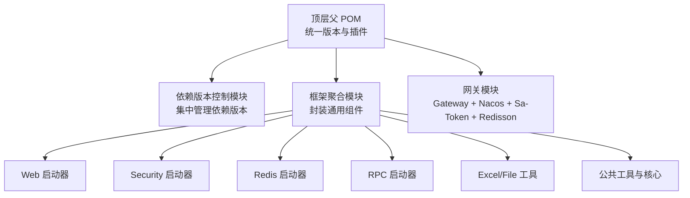
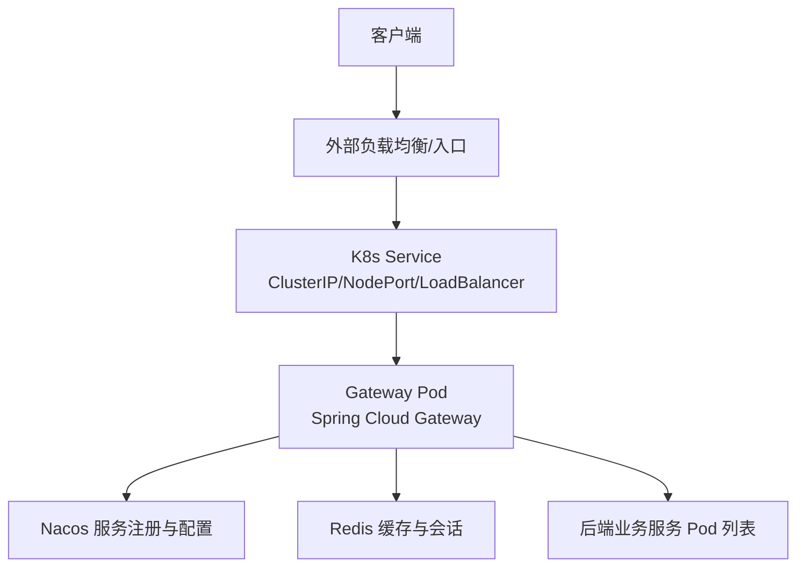
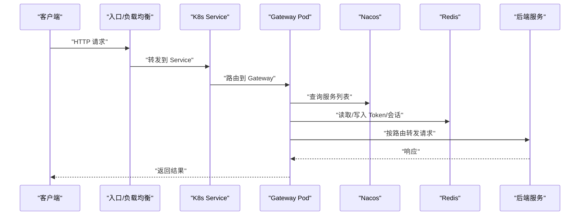
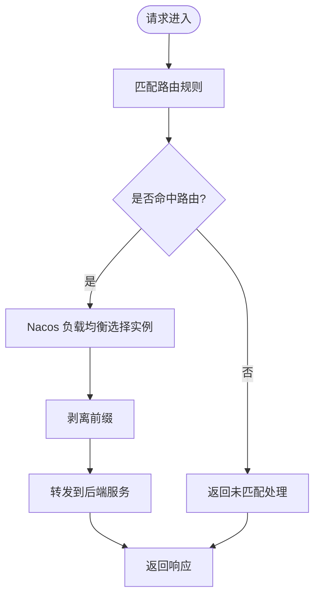
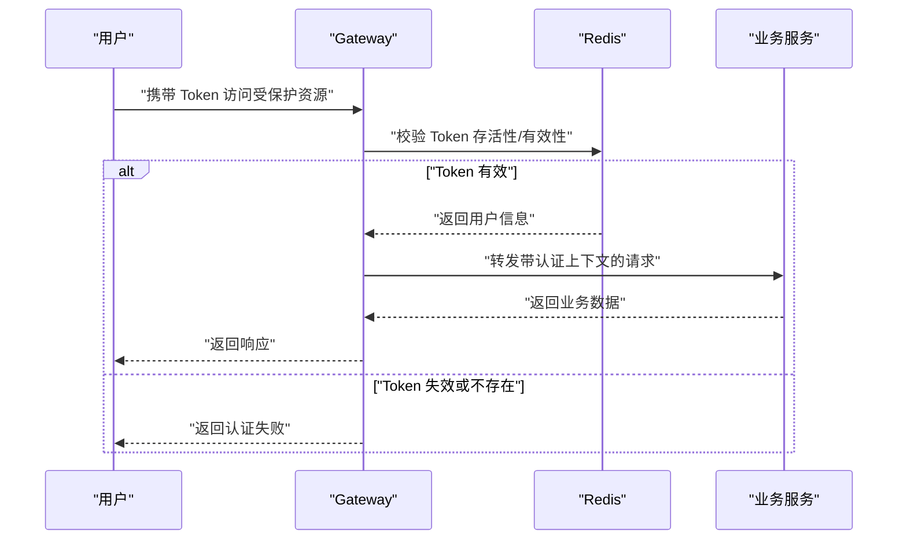
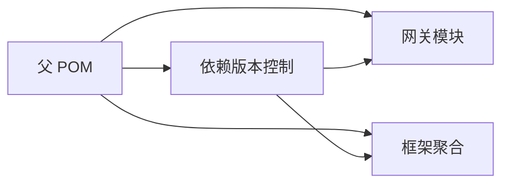

# 容器化部署

<cite>
**本文引用的文件**
- [pom.xml](file://pom.xml)
- [codeblog-gateway/pom.xml](file://codeblog-gateway/pom.xml)
- [codeblog-gateway/src/main/resources/bootstrap.yml](file://codeblog-gateway/src/main/resources/bootstrap.yml)
- [codeblog-gateway/src/main/java/site/codeblog/GatewayApplication.java](file://codeblog-gateway/src/main/java/site/codeblog/GatewayApplication.java)
- [codeblog-framework/pom.xml](file://codeblog-framework/pom.xml)
- [codebolog-dependencies/pom.xml](file://codebolog-dependencies/pom.xml)
</cite>

## 目录
1. [简介](#简介)
2. [项目结构](#项目结构)
3. [核心组件](#核心组件)
4. [架构总览](#架构总览)
5. [详细组件分析](#详细组件分析)
6. [依赖分析](#依赖分析)
7. [性能考虑](#性能考虑)
8. [故障排查指南](#故障排查指南)
9. [结论](#结论)
10. [附录](#附录)

## 简介
本指南面向 codeblog-cloud 项目，提供从 Docker 镜像构建到 Kubernetes 部署的完整容器化方案。内容涵盖：
- 基于 Maven 构建的镜像制作与多阶段优化
- 镜像标签管理策略
- Kubernetes 部署清单（Deployment、Service、ConfigMap、Secret）
- 容器编排策略（副本、滚动更新、回滚）
- 容器网络配置（服务发现、负载均衡、端口映射）
- 可观测性（监控与日志）
- 安全与资源限制最佳实践

## 项目结构
codeblog-cloud 采用多模块 Maven 结构，核心模块包括：
- 顶层父 POM：统一版本与插件管理
- 依赖版本控制模块：集中管理 Spring Cloud、Spring Cloud Alibaba、Sa-Token、Redisson、MyBatis-Flex 等版本
- 框架聚合模块：封装通用组件（Web、Security、Redis、RPC、Excel、File 等）
- 网关模块：基于 Spring Cloud Gateway + Nacos Discovery/Config + Sa-Token + Redisson

图表来源
- [pom.xml](file://pom.xml#L16-L20)
- [codeblog-framework/pom.xml](file://codeblog-framework/pom.xml#L26-L37)
- [codebolog-dependencies/pom.xml](file://codebolog-dependencies/pom.xml#L97-L208)

章节来源
- [pom.xml](file://pom.xml#L16-L20)
- [codeblog-framework/pom.xml](file://codeblog-framework/pom.xml#L12-L37)
- [codebolog-dependencies/pom.xml](file://codebolog-dependencies/pom.xml#L19-L95)

## 核心组件
- 网关应用：负责路由转发、鉴权过滤、与下游服务通信
- 配置中心：Nacos Config 提供动态配置拉取
- 服务注册：Nacos Discovery 提供服务注册与发现
- 认证授权：Sa-Token + Redisson 实现 Token 管理与共享会话
- 网关路由：基于路径的路由规则与前缀剥离

章节来源
- [codeblog-gateway/pom.xml](file://codeblog-gateway/pom.xml#L24-L78)
- [codeblog-gateway/src/main/resources/bootstrap.yml](file://codeblog-gateway/src/main/resources/bootstrap.yml#L14-L22)
- [codeblog-gateway/src/main/java/site/codeblog/GatewayApplication.java](file://codeblog-gateway/src/main/java/site/codeblog/GatewayApplication.java#L11-L15)

## 架构总览
下图展示容器化后的整体拓扑：客户端请求经由 Ingress/LoadBalancer 到达 Gateway Pod；Gateway 通过 Nacos 进行服务发现，调用后端服务；认证与缓存通过 Redisson 与 Redis 协同。

图表来源
- [codeblog-gateway/src/main/resources/bootstrap.yml](file://codeblog-gateway/src/main/resources/bootstrap.yml#L8-L13)
- [codeblog-gateway/src/main/resources/bootstrap.yml](file://codeblog-gateway/src/main/resources/bootstrap.yml#L24-L27)
- [codeblog-gateway/pom.xml](file://codeblog-gateway/pom.xml#L26-L71)

## 详细组件分析

### 网关应用与配置
- 应用入口：Spring Boot 启动类负责应用上下文初始化
- 网关配置：包含 Nacos 注册与配置地址、路由规则、Redis 连接信息、Sa-Token 参数等
- 路由示例：以 Path 作为匹配条件，目标 URI 使用 Nacos 负载均衡地址，StripPrefix 前缀剥离

图表来源
- [codeblog-gateway/src/main/resources/bootstrap.yml](file://codeblog-gateway/src/main/resources/bootstrap.yml#L14-L22)
- [codeblog-gateway/src/main/resources/bootstrap.yml](file://codeblog-gateway/src/main/resources/bootstrap.yml#L8-L13)
- [codeblog-gateway/src/main/resources/bootstrap.yml](file://codeblog-gateway/src/main/resources/bootstrap.yml#L24-L27)
- [codeblog-gateway/src/main/java/site/codeblog/GatewayApplication.java](file://codeblog-gateway/src/main/java/site/codeblog/GatewayApplication.java#L11-L15)

章节来源
- [codeblog-gateway/src/main/java/site/codeblog/GatewayApplication.java](file://codeblog-gateway/src/main/java/site/codeblog/GatewayApplication.java#L11-L15)
- [codeblog-gateway/src/main/resources/bootstrap.yml](file://codeblog-gateway/src/main/resources/bootstrap.yml#L1-L44)

### 路由与负载均衡流程

图表来源
- [codeblog-gateway/src/main/resources/bootstrap.yml](file://codeblog-gateway/src/main/resources/bootstrap.yml#L14-L22)

章节来源
- [codeblog-gateway/src/main/resources/bootstrap.yml](file://codeblog-gateway/src/main/resources/bootstrap.yml#L14-L22)

### 认证与会话流程

图表来源
- [codeblog-gateway/src/main/resources/bootstrap.yml](file://codeblog-gateway/src/main/resources/bootstrap.yml#L29-L44)
- [codeblog-gateway/src/main/resources/bootstrap.yml](file://codeblog-gateway/src/main/resources/bootstrap.yml#L24-L27)

章节来源
- [codeblog-gateway/src/main/resources/bootstrap.yml](file://codeblog-gateway/src/main/resources/bootstrap.yml#L29-L44)
- [codeblog-gateway/src/main/resources/bootstrap.yml](file://codeblog-gateway/src/main/resources/bootstrap.yml#L24-L27)

## 依赖分析
- 顶层父 POM 管理 Java 版本、Maven 插件、仓库源与模块聚合
- 依赖版本控制模块集中管理 Spring Cloud、Spring Cloud Alibaba、Sa-Token、Redisson、MyBatis-Flex 等版本
- 网关模块引入 Gateway、LoadBalancer、Nacos Discovery/Config、Sa-Token、Redisson 等依赖，并通过 Spring Boot Maven 插件打包

图表来源
- [pom.xml](file://pom.xml#L16-L20)
- [codebolog-dependencies/pom.xml](file://codebolog-dependencies/pom.xml#L97-L208)
- [codeblog-framework/pom.xml](file://codeblog-framework/pom.xml#L26-L37)
- [codeblog-gateway/pom.xml](file://codeblog-gateway/pom.xml#L24-L78)

章节来源
- [pom.xml](file://pom.xml#L22-L36)
- [codebolog-dependencies/pom.xml](file://codebolog-dependencies/pom.xml#L19-L95)
- [codeblog-gateway/pom.xml](file://codeblog-gateway/pom.xml#L24-L78)

## 性能考虑
- JVM 参数与容器内存限制协同：建议设置容器内存上限与 JVM 堆大小，避免 OOM
- 线程池与连接池：根据 CPU 核心数与 QPS 设置线程池大小；数据库与 Redis 连接池应与副本数匹配
- 网关路由与过滤链：减少不必要的过滤器，避免链路过长导致延迟增加
- 缓存命中率：合理设置 Token 有效期与并发策略，降低认证开销

## 故障排查指南
- 网关无法路由：检查路由规则与目标服务是否在 Nacos 注册
- 认证失败：确认 Sa-Token 配置与 Redis 连通性
- 配置不生效：核对 Nacos Config 地址与命名空间、分组、文件扩展名
- 启动异常：查看容器日志，定位依赖冲突或端口占用

章节来源
- [codeblog-gateway/src/main/resources/bootstrap.yml](file://codeblog-gateway/src/main/resources/bootstrap.yml#L8-L13)
- [codeblog-gateway/src/main/resources/bootstrap.yml](file://codeblog-gateway/src/main/resources/bootstrap.yml#L24-L27)
- [codeblog-gateway/src/main/resources/bootstrap.yml](file://codeblog-gateway/src/main/resources/bootstrap.yml#L29-L44)

## 结论
通过本指南，可在 Kubernetes 上完成 codeblog-cloud 的容器化部署。建议优先采用多阶段构建优化镜像体积，结合 ConfigMap/Secret 管理配置与密钥，利用 Deployment 的滚动更新实现零停机升级，并通过 Service 与 Nacos 实现服务发现与负载均衡。配合监控与日志采集，可获得良好的可观测性与安全性。

## 附录

### Docker 镜像构建与多阶段优化
- 基础镜像：建议使用官方 OpenJDK 17 运行时镜像
- 多阶段构建：第一阶段使用完整 JDK 执行 Maven 构建，第二阶段仅复制运行时产物至最小化运行时镜像
- 产物选择：仅复制 spring-boot-maven-plugin 生成的可执行归档（含依赖）
- 层优化：将依赖层与源码层分离，提升缓存命中率
- 入口命令：设置 JAVA_OPTS 与主类，暴露容器端口（如 9999）

章节来源
- [codeblog-gateway/pom.xml](file://codeblog-gateway/pom.xml#L82-L96)
- [codeblog-gateway/src/main/resources/bootstrap.yml](file://codeblog-gateway/src/main/resources/bootstrap.yml#L1-L2)

### 镜像标签管理
- 版本号：使用语义化版本（如 2026.02）与构建号组合
- 环境标签：dev/stage/prod 三套标签区分环境
- 最新标签：latest 仅用于开发环境，生产禁用

### Kubernetes 部署清单要点
- Deployment
  - 副本数：生产建议至少 2 个副本
  - 滚动更新：maxUnavailable=25%，maxSurge=25%
  - 就绪探针/存活探针：基于健康检查端点
  - 资源限制：CPU/内存设置 requests/limits
- Service
  - ClusterIP：内部服务间访问
  - NodePort/LoadBalancer：对外暴露
- ConfigMap
  - bootstrap.yml：Nacos 地址、路由、Redis 连接等
- Secret
  - 用户名/密码、密钥等敏感信息

### 容器网络配置
- 服务发现：Gateway 通过 Nacos Discovery 获取服务列表
- 负载均衡：Gateway 使用 Spring Cloud LoadBalancer 或 Nacos 负载均衡
- 端口映射：容器端口 9999 映射到 Service 端口，再由入口控制器暴露

章节来源
- [codeblog-gateway/src/main/resources/bootstrap.yml](file://codeblog-gateway/src/main/resources/bootstrap.yml#L8-L13)
- [codeblog-gateway/src/main/resources/bootstrap.yml](file://codeblog-gateway/src/main/resources/bootstrap.yml#L14-L22)

### 监控与日志
- 监控：集成 SkyWalking/Spring Boot Admin/OpenTelemetry
- 日志：容器标准输出采集，结合日志聚合平台（如 ELK/Fluent Bit）

### 安全与资源限制
- 安全基线：只读根文件系统、非 root 用户、最小权限 RBAC
- 资源配额：为每个 Pod 设置合理的 requests/limits，避免资源争抢
- 网络策略：限制入站/出站流量，仅开放必要端口