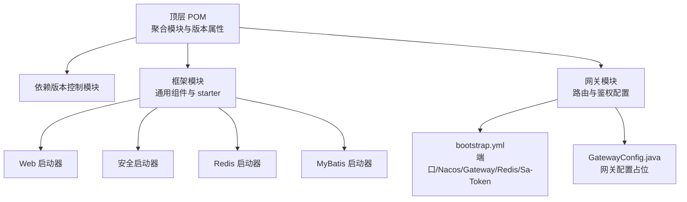
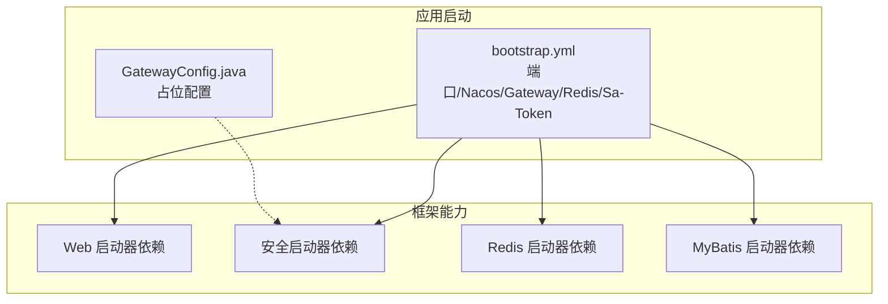
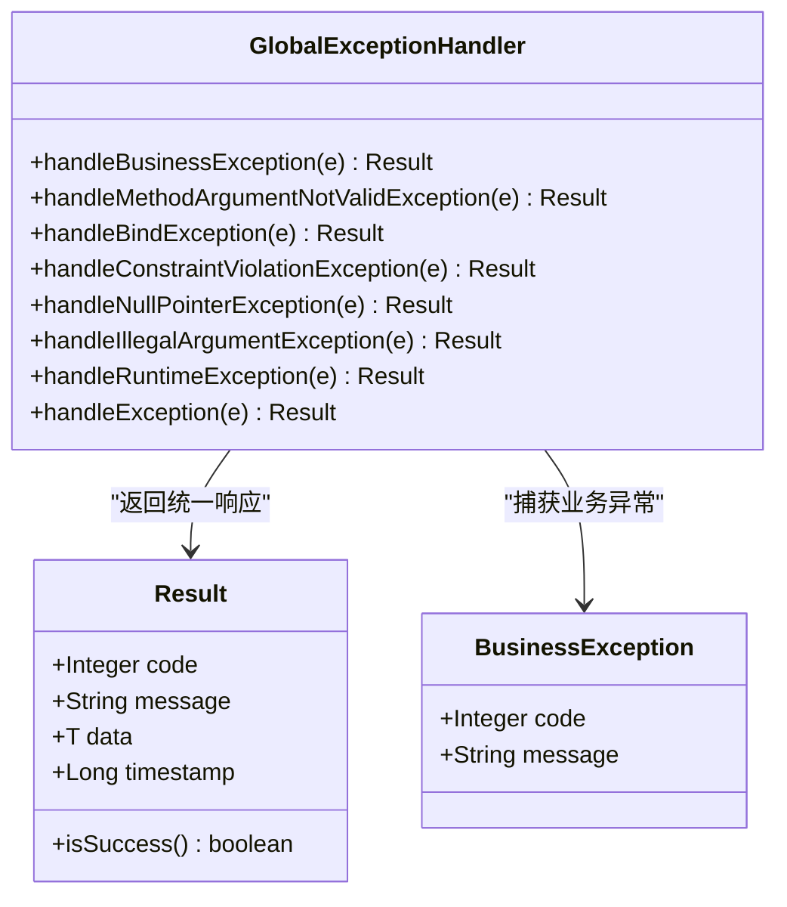
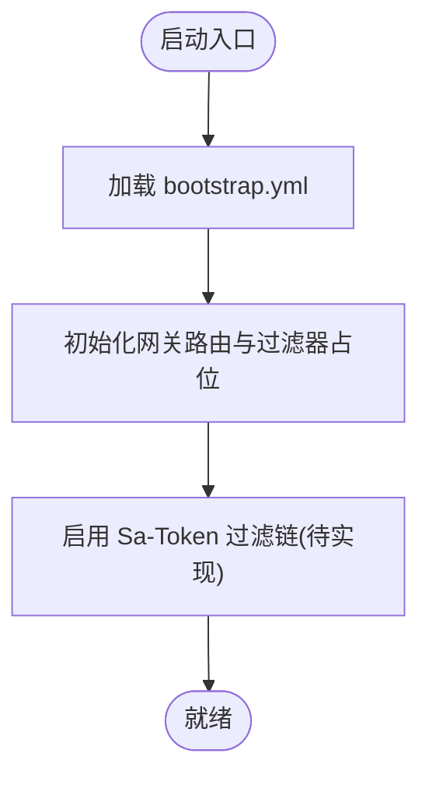
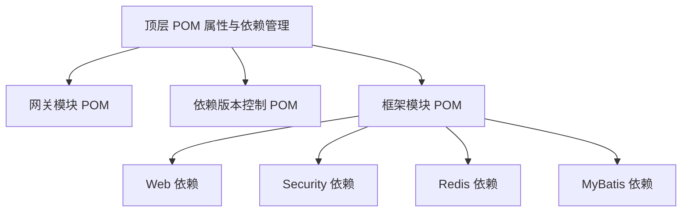
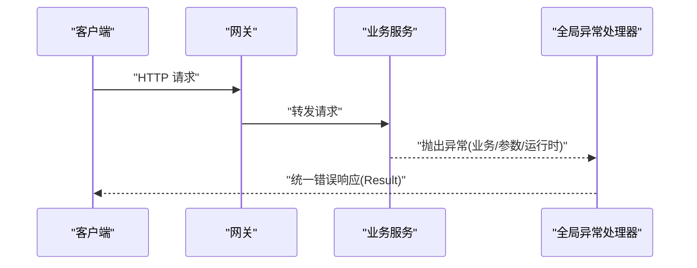

# 故障排查

<cite>
**本文引用的文件**
- [pom.xml](file://pom.xml)
- [codeblog-gateway/pom.xml](file://codeblog-gateway/pom.xml)
- [codeblog-gateway/src/main/resources/bootstrap.yml](file://codeblog-gateway/src/main/resources/bootstrap.yml)
- [codeblog-gateway/src/main/java/site/codeblog/gateway/config/GatewayConfig.java](file://codeblog-gateway/src/main/java/site/codeblog/gateway/config/GatewayConfig.java)
- [codeblog-framework/codeblog-common/codeblog-common-core/src/main/java/site/codeblog/common/core/result/Result.java](file://codeblog-framework/codeblog-common/codeblog-common-core/src/main/java/site/codeblog/common/core/result/Result.java)
- [codeblog-framework/codeblog-common/codeblog-common-core/src/main/java/site/codeblog/common/core/exception/BusinessException.java](file://codeblog-framework/codeblog-common/codeblog-common-core/src/main/java/site/codeblog/common/core/exception/BusinessException.java)
- [codeblog-framework/codeblog-common/codeblog-common-core/src/main/java/site/codeblog/common/core/exception/GlobalExceptionHandler.java](file://codeblog-framework/codeblog-common/codeblog-common-core/src/main/java/site/codeblog/common/core/exception/GlobalExceptionHandler.java)
- [codeblog-framework/codeblog-spring-boot-starter-web/pom.xml](file://codeblog-framework/codeblog-spring-boot-starter-web/pom.xml)
- [codeblog-framework/codeblog-spring-boot-starter-security/pom.xml](file://codeblog-framework/codeblog-spring-boot-starter-security/pom.xml)
- [codeblog-framework/codeblog-spring-boot-starter-redis/pom.xml](file://codeblog-framework/codeblog-spring-boot-starter-redis/pom.xml)
- [codeblog-framework/codeblog-spring-boot-starter-mybatis/pom.xml](file://codeblog-framework/codeblog-spring-boot-starter-mybatis/pom.xml)
- [codebolog-dependencies/pom.xml](file://codebolog-dependencies/pom.xml)
</cite>

## 目录
1. [简介](#简介)
2. [项目结构](#项目结构)
3. [核心组件](#核心组件)
4. [架构总览](#架构总览)
5. [详细组件分析](#详细组件分析)
6. [依赖分析](#依赖分析)
7. [性能考虑](#性能考虑)
8. [故障排查指南](#故障排查指南)
9. [结论](#结论)
10. [附录](#附录)

## 简介
本手册面向 codeblog-cloud 云原生项目，提供系统性的故障排查流程与方法，覆盖启动阶段、运行时、网络通信与性能问题，并给出应急响应与恢复流程建议。文档基于仓库中实际存在的模块与配置进行分析，帮助研发与运维人员快速定位与解决问题。

## 项目结构
项目采用多模块聚合结构，顶层 POM 管理版本与插件，子模块包含依赖版本控制、通用框架与网关模块。网关模块负责路由与鉴权相关配置，通用框架提供统一响应体与全局异常处理能力；各功能模块通过 starter 组合引入 Web、安全、Redis、MyBatis 等能力。

图表来源
- [pom.xml](file://pom.xml#L16-L20)
- [codeblog-gateway/pom.xml](file://codeblog-gateway/pom.xml#L1-L20)
- [codeblog-gateway/src/main/resources/bootstrap.yml](file://codeblog-gateway/src/main/resources/bootstrap.yml#L1-L44)
- [codeblog-gateway/src/main/java/site/codeblog/gateway/config/GatewayConfig.java](file://codeblog-gateway/src/main/java/site/codeblog/gateway/config/GatewayConfig.java#L1-L28)
- [codeblog-framework/codeblog-spring-boot-starter-web/pom.xml](file://codeblog-framework/codeblog-spring-boot-starter-web/pom.xml#L18-L43)
- [codeblog-framework/codeblog-spring-boot-starter-security/pom.xml](file://codeblog-framework/codeblog-spring-boot-starter-security/pom.xml#L18-L43)
- [codeblog-framework/codeblog-spring-boot-starter-redis/pom.xml](file://codeblog-framework/codeblog-spring-boot-starter-redis/pom.xml#L18-L43)
- [codeblog-framework/codeblog-spring-boot-starter-mybatis/pom.xml](file://codeblog-framework/codeblog-spring-boot-starter-mybatis/pom.xml#L18-L43)

章节来源
- [pom.xml](file://pom.xml#L16-L20)
- [codeblog-gateway/pom.xml](file://codeblog-gateway/pom.xml#L1-L20)

## 核心组件
- 统一响应体与异常处理：提供统一的响应结构与全局异常兜底，便于前端与监控系统标准化处理。
- 网关配置：当前处于占位状态，预留 Sa-Token 过滤链接入点，便于后续扩展鉴权与路由策略。
- 基础设施 starter：分别提供 Web、安全、Redis、MyBatis 能力，支撑服务层开发与集成。

章节来源
- [codeblog-framework/codeblog-common/codeblog-common-core/src/main/java/site/codeblog/common/core/result/Result.java](file://codeblog-framework/codeblog-common/codeblog-common-core/src/main/java/site/codeblog/common/core/result/Result.java#L1-L101)
- [codeblog-framework/codeblog-common/codeblog-common-core/src/main/java/site/codeblog/common/core/exception/BusinessException.java](file://codeblog-framework/codeblog-common/codeblog-common-core/src/main/java/site/codeblog/common/core/exception/BusinessException.java#L1-L68)
- [codeblog-framework/codeblog-common/codeblog-common-core/src/main/java/site/codeblog/common/core/exception/GlobalExceptionHandler.java](file://codeblog-framework/codeblog-common/codeblog-common-core/src/main/java/site/codeblog/common/core/exception/GlobalExceptionHandler.java#L1-L107)
- [codeblog-gateway/src/main/java/site/codeblog/gateway/config/GatewayConfig.java](file://codeblog-gateway/src/main/java/site/codeblog/gateway/config/GatewayConfig.java#L1-L28)

## 架构总览
下图展示启动与运行阶段的关键交互：应用通过 bootstrap.yml 初始化端口、注册中心地址、网关路由、Redis 与 Sa-Token 参数；随后加载框架模块提供的 Web、安全、缓存与持久化能力。

图表来源
- [codeblog-gateway/src/main/resources/bootstrap.yml](file://codeblog-gateway/src/main/resources/bootstrap.yml#L1-L44)
- [codeblog-gateway/src/main/java/site/codeblog/gateway/config/GatewayConfig.java](file://codeblog-gateway/src/main/java/site/codeblog/gateway/config/GatewayConfig.java#L1-L28)
- [codeblog-framework/codeblog-spring-boot-starter-web/pom.xml](file://codeblog-framework/codeblog-spring-boot-starter-web/pom.xml#L18-L43)
- [codeblog-framework/codeblog-spring-boot-starter-security/pom.xml](file://codeblog-framework/codeblog-spring-boot-starter-security/pom.xml#L18-L43)
- [codeblog-framework/codeblog-spring-boot-starter-redis/pom.xml](file://codeblog-framework/codeblog-spring-boot-starter-redis/pom.xml#L18-L43)
- [codeblog-framework/codeblog-spring-boot-starter-mybatis/pom.xml](file://codeblog-framework/codeblog-spring-boot-starter-mybatis/pom.xml#L18-L43)

## 详细组件分析

### 统一响应与异常处理
- 统一响应体封装了状态码、消息、数据与时间戳，便于前后端约定与监控采集。
- 全局异常处理器对业务异常、参数校验异常、空指针、非法参数、运行时异常与未知异常进行分类处理，返回统一格式的错误响应。

图表来源
- [codeblog-framework/codeblog-common/codeblog-common-core/src/main/java/site/codeblog/common/core/result/Result.java](file://codeblog-framework/codeblog-common/codeblog-common-core/src/main/java/site/codeblog/common/core/result/Result.java#L14-L51)
- [codeblog-framework/codeblog-common/codeblog-common-core/src/main/java/site/codeblog/common/core/exception/BusinessException.java](file://codeblog-framework/codeblog-common/codeblog-common-core/src/main/java/site/codeblog/common/core/exception/BusinessException.java#L13-L53)
- [codeblog-framework/codeblog-common/codeblog-common-core/src/main/java/site/codeblog/common/core/exception/GlobalExceptionHandler.java](file://codeblog-framework/codeblog-common/codeblog-common-core/src/main/java/site/codeblog/common/core/exception/GlobalExceptionHandler.java#L22-L106)

章节来源
- [codeblog-framework/codeblog-common/codeblog-common-core/src/main/java/site/codeblog/common/core/result/Result.java](file://codeblog-framework/codeblog-common/codeblog-common-core/src/main/java/site/codeblog/common/core/result/Result.java#L1-L101)
- [codeblog-framework/codeblog-common/codeblog-common-core/src/main/java/site/codeblog/common/core/exception/BusinessException.java](file://codeblog-framework/codeblog-common/codeblog-common-core/src/main/java/site/codeblog/common/core/exception/BusinessException.java#L1-L68)
- [codeblog-framework/codeblog-common/codeblog-common-core/src/main/java/site/codeblog/common/core/exception/GlobalExceptionHandler.java](file://codeblog-framework/codeblog-common/codeblog-common-core/src/main/java/site/codeblog/common/core/exception/GlobalExceptionHandler.java#L1-L107)

### 网关配置与鉴权占位
- 当前网关配置类为占位实现，预留 Sa-Token 过滤链接入点，便于后续扩展鉴权逻辑与路由规则。
- bootstrap.yml 中定义了服务端口、Nacos 注册中心地址、网关路由示例、Redis 连接参数以及 Sa-Token 相关配置项。

图表来源
- [codeblog-gateway/src/main/resources/bootstrap.yml](file://codeblog-gateway/src/main/resources/bootstrap.yml#L1-L44)
- [codeblog-gateway/src/main/java/site/codeblog/gateway/config/GatewayConfig.java](file://codeblog-gateway/src/main/java/site/codeblog/gateway/config/GatewayConfig.java#L13-L27)

章节来源
- [codeblog-gateway/src/main/resources/bootstrap.yml](file://codeblog-gateway/src/main/resources/bootstrap.yml#L1-L44)
- [codeblog-gateway/src/main/java/site/codeblog/gateway/config/GatewayConfig.java](file://codeblog-gateway/src/main/java/site/codeblog/gateway/config/GatewayConfig.java#L1-L28)

## 依赖分析
- 顶层 POM 定义了 Java 版本、Spring Boot 与 Spring Cloud 版本属性，并通过依赖管理导入依赖版本控制模块。
- 网关模块继承父级版本属性，使用 Java 17。
- 各 starter 模块声明了 Web、安全、Redis、MyBatis 相关依赖，用于快速构建服务能力。

图表来源
- [pom.xml](file://pom.xml#L22-L48)
- [codeblog-gateway/pom.xml](file://codeblog-gateway/pom.xml#L18-L20)
- [codeblog-framework/codeblog-spring-boot-starter-web/pom.xml](file://codeblog-framework/codeblog-spring-boot-starter-web/pom.xml#L18-L43)
- [codeblog-framework/codeblog-spring-boot-starter-security/pom.xml](file://codeblog-framework/codeblog-spring-boot-starter-security/pom.xml#L18-L43)
- [codeblog-framework/codeblog-spring-boot-starter-redis/pom.xml](file://codeblog-framework/codeblog-spring-boot-starter-redis/pom.xml#L18-L43)
- [codeblog-framework/codeblog-spring-boot-starter-mybatis/pom.xml](file://codeblog-framework/codeblog-spring-boot-starter-mybatis/pom.xml#L18-L43)
- [codebolog-dependencies/pom.xml](file://codebolog-dependencies/pom.xml#L16-L24)

章节来源
- [pom.xml](file://pom.xml#L22-L48)
- [codeblog-gateway/pom.xml](file://codeblog-gateway/pom.xml#L18-L20)
- [codeblog-framework/codeblog-spring-boot-starter-web/pom.xml](file://codeblog-framework/codeblog-spring-boot-starter-web/pom.xml#L18-L43)
- [codeblog-framework/codeblog-spring-boot-starter-security/pom.xml](file://codeblog-framework/codeblog-spring-boot-starter-security/pom.xml#L18-L43)
- [codeblog-framework/codeblog-spring-boot-starter-redis/pom.xml](file://codeblog-framework/codeblog-spring-boot-starter-redis/pom.xml#L18-L43)
- [codeblog-framework/codeblog-spring-boot-starter-mybatis/pom.xml](file://codeblog-framework/codeblog-spring-boot-starter-mybatis/pom.xml#L18-L43)
- [codebolog-dependencies/pom.xml](file://codebolog-dependencies/pom.xml#L16-L24)

## 性能考虑
- CPU 占用过高：检查是否存在未释放的线程池或阻塞操作，结合线程转储定位热点方法。
- 内存不足：关注对象生命周期与大对象持有，结合堆转储分析 GC 行为与内存泄漏点。
- I/O 瓶颈：数据库连接池与 Redis 连接池需合理配置，避免连接数耗尽导致排队与超时。
- 网络延迟：验证 Nacos 与下游服务可达性，检查路由规则与负载均衡策略。

## 故障排查指南

### 一、启动阶段问题
- 端口冲突
  - 现象：启动时报端口占用错误。
  - 排查：确认 bootstrap.yml 中 server.port 设置，检查进程占用并修改端口或终止占用进程。
  - 参考路径：[bootstrap.yml](file://codeblog-gateway/src/main/resources/bootstrap.yml#L1-L4)
- 配置错误
  - 现象：应用无法正常启动或路由不生效。
  - 排查：核对 Nacos 地址、网关路由配置、Redis 地址与端口、Sa-Token 参数是否正确。
  - 参考路径：[bootstrap.yml](file://codeblog-gateway/src/main/resources/bootstrap.yml#L8-L44)
- 依赖缺失
  - 现象：启动时报缺少依赖或类找不到。
  - 排查：确认父级 POM 的依赖管理与版本属性是否生效，检查各 starter 模块依赖是否齐全。
  - 参考路径：[pom.xml](file://pom.xml#L38-L48)，[codeblog-framework/* starter/pom.xml](file://codeblog-framework/codeblog-spring-boot-starter-web/pom.xml#L18-L43)

### 二、运行时问题
- 异常统一处理
  - 现象：接口返回非预期错误码或格式。
  - 排查：确认全局异常处理器是否生效，区分业务异常与系统异常，查看日志定位具体异常类型。
  - 参考路径：[GlobalExceptionHandler.java](file://codeblog-framework/codeblog-common/codeblog-common-core/src/main/java/site/codeblog/common/core/exception/GlobalExceptionHandler.java#L22-L106)
- 参数校验与业务异常
  - 现象：请求参数错误或业务断言失败。
  - 排查：检查参数校验注解与业务异常抛出点，确认错误码与消息是否符合预期。
  - 参考路径：[BusinessException.java](file://codeblog-framework/codeblog-common/codeblog-common-core/src/main/java/site/codeblog/common/core/exception/BusinessException.java#L13-L53)
- 统一响应格式
  - 现象：前端收到响应结构不一致。
  - 排查：确认返回体字段与状态码规范，保证前后端一致消费。
  - 参考路径：[Result.java](file://codeblog-framework/codeblog-common/codeblog-common-core/src/main/java/site/codeblog/common/core/result/Result.java#L14-L51)

图表来源
- [codeblog-framework/codeblog-common/codeblog-common-core/src/main/java/site/codeblog/common/core/exception/GlobalExceptionHandler.java](file://codeblog-framework/codeblog-common/codeblog-common-core/src/main/java/site/codeblog/common/core/exception/GlobalExceptionHandler.java#L22-L106)
- [codeblog-framework/codeblog-common/codeblog-common-core/src/main/java/site/codeblog/common/core/result/Result.java](file://codeblog-framework/codeblog-common/codeblog-common-core/src/main/java/site/codeblog/common/core/result/Result.java#L14-L51)

### 三、网络通信问题
- 服务注册失败
  - 现象：服务启动但未注册到注册中心。
  - 排查：确认 Nacos 地址与端口，检查网络连通性与防火墙策略。
  - 参考路径：[bootstrap.yml](file://codeblog-gateway/src/main/resources/bootstrap.yml#L8-L13)
- 路由配置错误
  - 现象：请求无法命中目标服务或路径匹配失败。
  - 排查：核对 Path 断言与 URI 规则，确认下游服务名与负载均衡配置。
  - 参考路径：[bootstrap.yml](file://codeblog-gateway/src/main/resources/bootstrap.yml#L14-L22)
- 跨域问题
  - 现象：浏览器报跨域错误。
  - 排查：确认 Web 启动器中的 CORS 配置是否启用与放行策略是否正确。
  - 参考路径：[codeblog-framework/codeblog-spring-boot-starter-web/pom.xml](file://codeblog-framework/codeblog-spring-boot-starter-web/pom.xml#L18-L43)

### 四、性能问题定位
- CPU 占用过高
  - 排查：采集线程转储，定位热点线程与调用栈，优化阻塞与循环逻辑。
- 内存不足
  - 排查：采集堆转储，分析对象存活与 GC 行为，定位泄漏点与大对象持有。
- I/O 瓶颈
  - 排查：检查数据库连接池与 Redis 连接池配置，确认连接数上限与等待队列长度，避免资源争用。

### 五、应急响应与恢复流程
- 快速隔离
  - 将故障实例从注册中心摘除，避免流量继续进入。
- 降级与熔断
  - 对外暴露降级响应，保护下游系统；对下游接口实施熔断策略。
- 回滚与修复
  - 回滚至上一个稳定版本，修复配置或代码缺陷后重新发布。
- 监控与告警
  - 检查关键指标（QPS、错误率、RT、连接数、GC 次数）与日志，持续观察恢复情况。

## 结论
本手册基于仓库现有模块与配置，提供了从启动、运行、网络到性能的系统化排查思路与方法。建议在生产环境中配合完善的监控体系与自动化运维工具，以缩短故障定位与恢复时间。

## 附录
- 关键配置参考
  - 网关与注册中心：[bootstrap.yml](file://codeblog-gateway/src/main/resources/bootstrap.yml#L1-L44)
  - 网关配置占位：[GatewayConfig.java](file://codeblog-gateway/src/main/java/site/codeblog/gateway/config/GatewayConfig.java#L1-L28)
  - 统一响应与异常：[Result.java](file://codeblog-framework/codeblog-common/codeblog-common-core/src/main/java/site/codeblog/common/core/result/Result.java#L1-L101)，[GlobalExceptionHandler.java](file://codeblog-framework/codeblog-common/codeblog-common-core/src/main/java/site/codeblog/common/core/exception/GlobalExceptionHandler.java#L1-L107)
  - 基础设施依赖：[Web 启动器](file://codeblog-framework/codeblog-spring-boot-starter-web/pom.xml#L18-L43)，[安全启动器](file://codeblog-framework/codeblog-spring-boot-starter-security/pom.xml#L18-L43)，[Redis 启动器](file://codeblog-framework/codeblog-spring-boot-starter-redis/pom.xml#L18-L43)，[MyBatis 启动器](file://codeblog-framework/codeblog-spring-boot-starter-mybatis/pom.xml#L18-L43)
  - 顶层与依赖版本：[pom.xml](file://pom.xml#L22-L48)，[codebolog-dependencies/pom.xml](file://codebolog-dependencies/pom.xml#L16-L24)