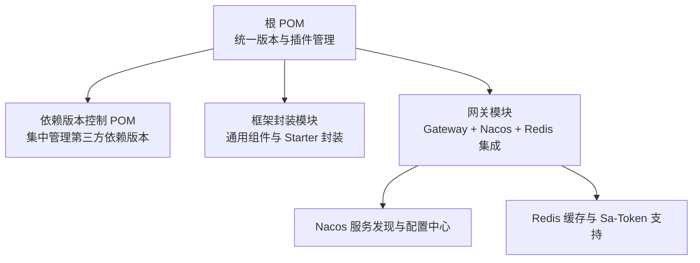
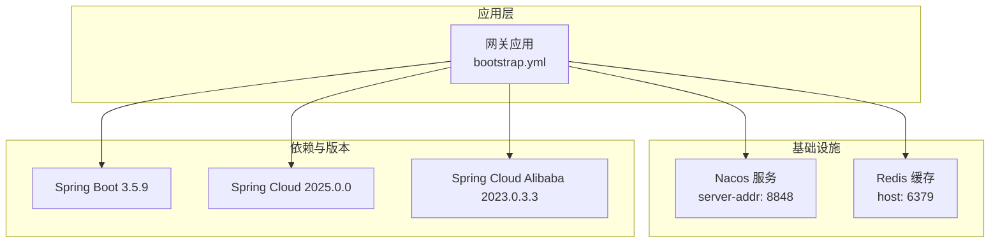
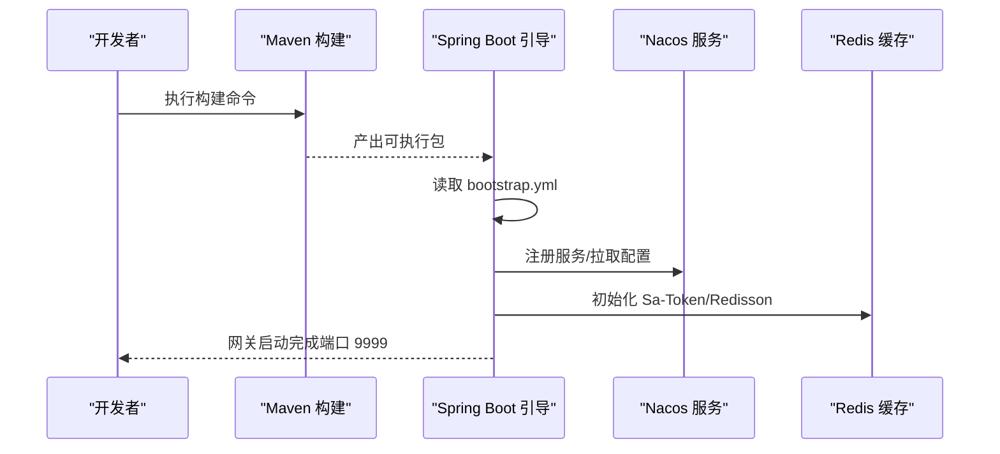
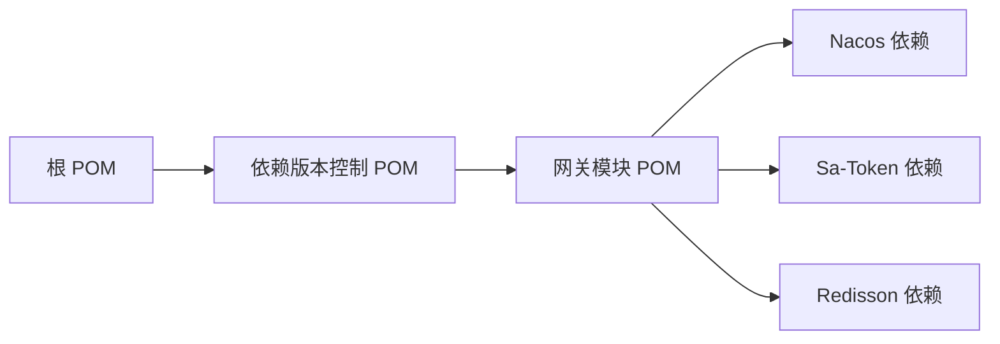

# 环境准备

<cite>
**本文引用的文件**
- [根 POM 文件](file://pom.xml)
- [依赖版本控制 POM](file://codebolog-dependencies/pom.xml)
- [网关模块 POM](file://codeblog-gateway/pom.xml)
- [网关引导配置](file://codeblog-gateway/src/main/resources/bootstrap.yml)
</cite>

## 目录
1. [简介](#简介)
2. [项目结构](#项目结构)
3. [核心组件](#核心组件)
4. [架构总览](#架构总览)
5. [详细组件分析](#详细组件分析)
6. [依赖分析](#依赖分析)
7. [性能考虑](#性能考虑)
8. [故障排查指南](#故障排查指南)
9. [结论](#结论)
10. [附录](#附录)

## 简介
本文件面向开发与运维团队，提供 codeblog-cloud 项目的完整环境准备指南。内容涵盖：
- 系统运行所需的硬件与软件要求（含 Java 17+、内存与磁盘建议）
- 依赖服务的安装与配置（Nacos、Redis、数据库等）
- 环境变量与 JVM 参数配置要点
- 开发、测试、生产三类环境的差异化配置策略
- 常见环境问题排查与解决方案

## 项目结构
该项目采用多模块 Maven 结构，顶层父 POM 负责统一版本与插件管理；子模块包括依赖版本控制、框架封装与网关模块。

图表来源
- [根 POM 文件](file://pom.xml#L1-L162)
- [依赖版本控制 POM](file://codebolog-dependencies/pom.xml#L1-L209)
- [网关模块 POM](file://codeblog-gateway/pom.xml#L1-L98)

章节来源
- [根 POM 文件](file://pom.xml#L1-L162)
- [依赖版本控制 POM](file://codebolog-dependencies/pom.xml#L1-L209)
- [网关模块 POM](file://codeblog-gateway/pom.xml#L1-L98)

## 核心组件
- 运行时与构建工具
  - Java 版本：17（源码与目标编译级别均为 17）
  - Maven：用于构建与依赖管理
  - Spring Boot：3.5.9（由依赖版本控制统一管理）
  - Spring Cloud：2025.0.0（由依赖版本控制统一管理）
  - Spring Cloud Alibaba：2023.0.3.3（由依赖版本控制统一管理）

- 网关与服务治理
  - Spring Cloud Gateway：路由与网关能力
  - Nacos：服务注册与配置中心（默认地址 127.0.0.1:8848）
  - Sa-Token：网关认证与会话管理（结合 Redis）
  - Redisson：Redis 客户端与分布式能力

- 典型端口
  - 网关默认监听端口：9999
  - Nacos 默认端口：8848
  - Redis 默认端口：6379

章节来源
- [根 POM 文件](file://pom.xml#L22-L36)
- [依赖版本控制 POM](file://codebolog-dependencies/pom.xml#L22-L24)
- [网关模块 POM](file://codeblog-gateway/pom.xml#L24-L78)
- [网关引导配置](file://codeblog-gateway/src/main/resources/bootstrap.yml#L1-L44)

## 架构总览
下图展示代码库中已实现的运行时依赖关系与配置入口：

图表来源
- [网关引导配置](file://codeblog-gateway/src/main/resources/bootstrap.yml#L8-L27)
- [依赖版本控制 POM](file://codebolog-dependencies/pom.xml#L96-L114)
- [网关模块 POM](file://codeblog-gateway/pom.xml#L24-L78)

## 详细组件分析

### 网关模块与运行配置
- 启动端口与应用名
  - 端口：9999
  - 应用名：codeblog-gateway
- 服务发现与配置中心
  - Nacos 地址：127.0.0.1:8848
  - 配置文件扩展名：yaml
- 路由示例
  - ID：user-service
  - 目标 URI：lb://user-service
  - 路径前缀：/user/**
  - 过滤器：StripPrefix=1
- 缓存配置
  - Redis 主机：127.0.0.1
  - 端口：6379
  - 数据库索引：0
- 认证与会话
  - Sa-Token 配置项：token 名称、有效期、并发策略、风格与日志开关

章节来源
- [网关引导配置](file://codeblog-gateway/src/main/resources/bootstrap.yml#L1-L44)

### 依赖版本与技术栈
- Spring 生态
  - Spring Boot：3.5.9
  - Spring Cloud：2025.0.0
  - Spring Cloud Alibaba：2023.0.3.3
- 认证与缓存
  - Sa-Token：1.38.0（包含 Reactor 与 Redisson 支持）
  - Redisson：3.52.0
- 网关与 RPC
  - Spring Cloud Gateway：4.2.0
  - OpenFeign：4.2.0

章节来源
- [依赖版本控制 POM](file://codebolog-dependencies/pom.xml#L22-L24)
- [依赖版本控制 POM](file://codebolog-dependencies/pom.xml#L116-L131)
- [依赖版本控制 POM](file://codebolog-dependencies/pom.xml#L158-L163)
- [依赖版本控制 POM](file://codebolog-dependencies/pom.xml#L146-L156)

### 网关启动流程（序列图）

图表来源
- [网关引导配置](file://codeblog-gateway/src/main/resources/bootstrap.yml#L1-L44)
- [网关模块 POM](file://codeblog-gateway/pom.xml#L24-L78)

## 依赖分析
- 版本统一与继承
  - 顶层 POM 定义了 Java 17 的编译级别，并通过依赖版本控制 POM 集中管理 Spring Boot、Spring Cloud 与 Spring Cloud Alibaba 的版本。
  - 网关模块直接引入 Spring Cloud Gateway、Nacos Discovery/Config、Sa-Token、Redisson 等依赖。
- 运行时耦合
  - 网关对 Nacos 与 Redis 的强依赖体现在引导配置中；若未正确部署或连通性异常，将导致启动失败或功能不可用。

图表来源
- [根 POM 文件](file://pom.xml#L38-L48)
- [依赖版本控制 POM](file://codebolog-dependencies/pom.xml#L96-L114)
- [网关模块 POM](file://codeblog-gateway/pom.xml#L24-L78)

章节来源
- [根 POM 文件](file://pom.xml#L38-L48)
- [依赖版本控制 POM](file://codebolog-dependencies/pom.xml#L96-L114)
- [网关模块 POM](file://codeblog-gateway/pom.xml#L24-L78)

## 性能考虑
- JVM 参数建议
  - 堆大小：根据业务负载与 GC 行为调整，建议预留足够元空间与直接内存
  - GC 策略：优先选择 G1 或 ZGC（取决于 JDK 版本），并结合容器资源限制进行调优
  - 参数传递：通过 JAVA_OPTS 或容器环境变量注入
- 网关与缓存
  - Redis 连接池与超时需按 QPS 与延迟目标优化
  - Nacos 配置拉取频率与本地缓存策略应结合变更频度评估
- 数据库与 ORM
  - 若业务模块引入数据库，建议配合连接池与慢查询监控，避免阻塞与抖动

## 故障排查指南
- 启动失败（端口占用）
  - 现象：进程无法绑定 9999 端口
  - 排查：检查是否存在其他进程占用；修改 bootstrap.yml 中的 server.port
- 无法连接 Nacos
  - 现象：启动时报 Nacos 连接异常或配置拉取失败
  - 排查：确认 Nacos 服务可达、防火墙放行、server-addr 配置正确；核对命名空间与分组
- Redis 连接异常
  - 现象：启动时报 Redis 连接失败或 Sa-Token 初始化异常
  - 排查：确认 Redis 服务状态、认证、网络连通与数据库索引配置
- 路由不生效
  - 现象：访问 /user/** 无响应或 404
  - 排查：确认目标服务已在 Nacos 注册、lb://user-service 可解析、路由过滤器 StripPrefix 配置正确
- 认证失败或会话异常
  - 现象：登录后接口鉴权失败或 Token 失效
  - 排查：核对 Sa-Token 配置项（token 名称、有效期、并发策略）、Redis 连通性与键空间

章节来源
- [网关引导配置](file://codeblog-gateway/src/main/resources/bootstrap.yml#L1-L44)

## 结论
本环境准备文档基于仓库中的配置与依赖定义，明确了运行所需的 Java 17、Spring 生态版本、网关端口与关键依赖（Nacos、Redis）。建议在开发、测试、生产三类环境中分别维护独立的配置文件与环境变量，确保端口、地址与凭据的安全隔离。遇到问题时，可依据“故障排查指南”逐项验证网络、服务与配置项。

## 附录

### 硬件与软件要求
- 操作系统
  - Linux/Windows/macOS（建议使用 Linux 服务器）
- CPU 与内存
  - 开发环境：建议至少 2 核 4GB
  - 测试/生产环境：根据流量与并发评估，建议不低于 4 核 8GB
- 存储
  - 留足日志与临时目录空间，建议至少 50GB 可用空间
- Java
  - 必须使用 Java 17（源码与目标编译级别一致）

章节来源
- [根 POM 文件](file://pom.xml#L22-L36)

### 依赖服务安装与配置
- Nacos
  - 下载与安装：参考官方发行版与部署指南
  - 默认端口：8848
  - 配置项：server-addr 与配置文件扩展名在 bootstrap.yml 中已配置
- Redis
  - 下载与安装：推荐使用官方或云厂商托管实例
  - 默认端口：6379
  - 配置项：host、port、database 在 bootstrap.yml 中已配置
- 数据库（如业务模块引入）
  - 建议使用 MySQL/PostgreSQL 等主流数据库
  - 连接参数与连接池配置需结合实际业务压力评估

章节来源
- [网关引导配置](file://codeblog-gateway/src/main/resources/bootstrap.yml#L8-L27)

### 环境变量与 JVM 参数配置
- 环境变量
  - JAVA_OPTS：用于传入 JVM 参数（如堆大小、GC、安全参数）
  - SPRING_PROFILES_ACTIVE：切换开发/测试/生产配置文件
  - NACOS_SERVER_ADDR/REDIS_HOST/REDIS_PORT：覆盖 bootstrap.yml 中的服务地址与端口
- JVM 参数示例（请按实际环境调整）
  - 堆大小：-Xms4g -Xmx8g
  - GC：-XX:+UseG1GC
  - 元空间：-XX:MetaspaceSize=256m
  - 参数注入：通过容器环境变量或启动脚本传入

### 开发/测试/生产差异化配置
- 开发环境
  - 端口：9999（网关）
  - 依赖：本地 Nacos 与 Redis
  - 日志：开启详细日志与调试信息
- 测试环境
  - 端口：自定义（避免冲突）
  - 依赖：独立的 Nacos 与 Redis 实例
  - 配置：启用必要的健康检查与监控
- 生产环境
  - 端口：固定对外端口
  - 依赖：高可用 Nacos 与 Redis 集群
  - 安全：启用 TLS、访问控制与审计日志

### 网络端口规划
- 网关：9999
- Nacos：8848
- Redis：6379
- 如需多实例部署，请为每个实例分配独立端口并做好负载均衡

章节来源
- [网关引导配置](file://codeblog-gateway/src/main/resources/bootstrap.yml#L1-L44)