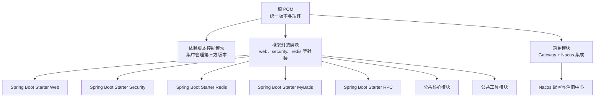
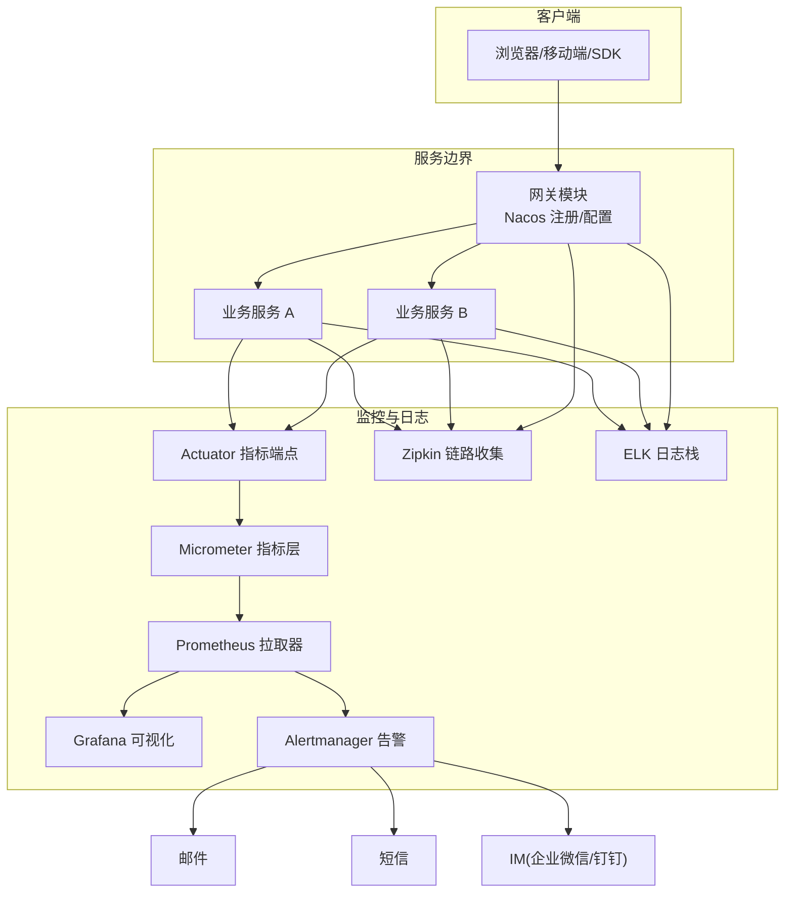
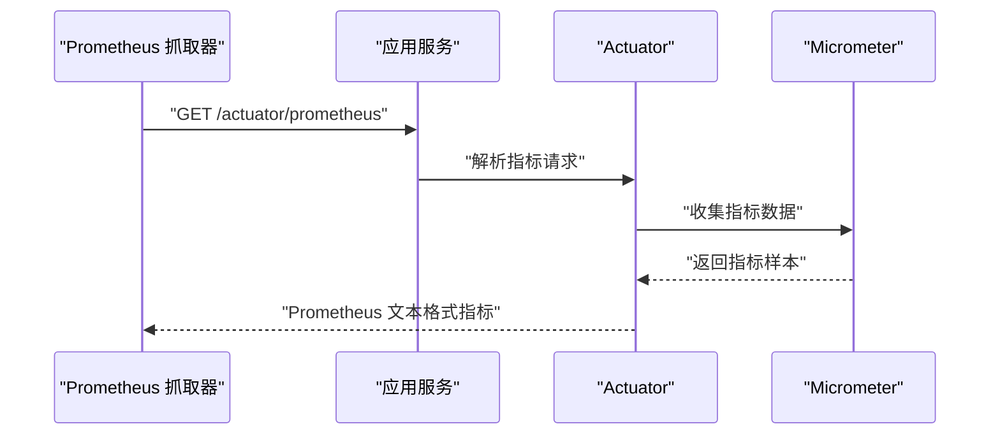
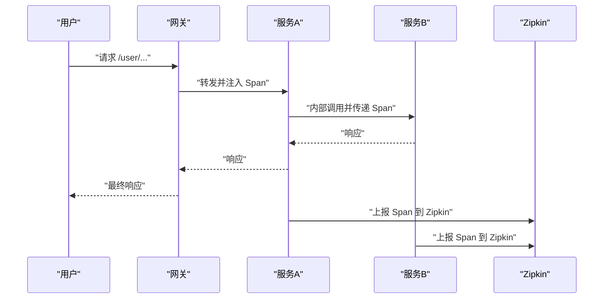
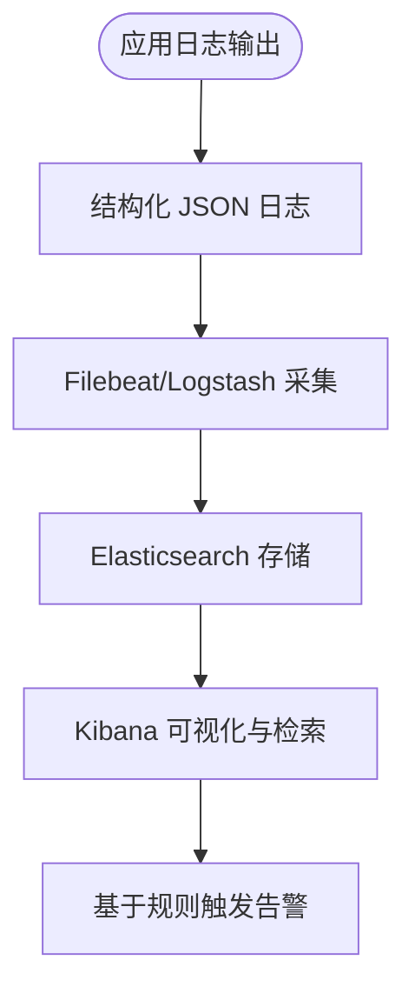
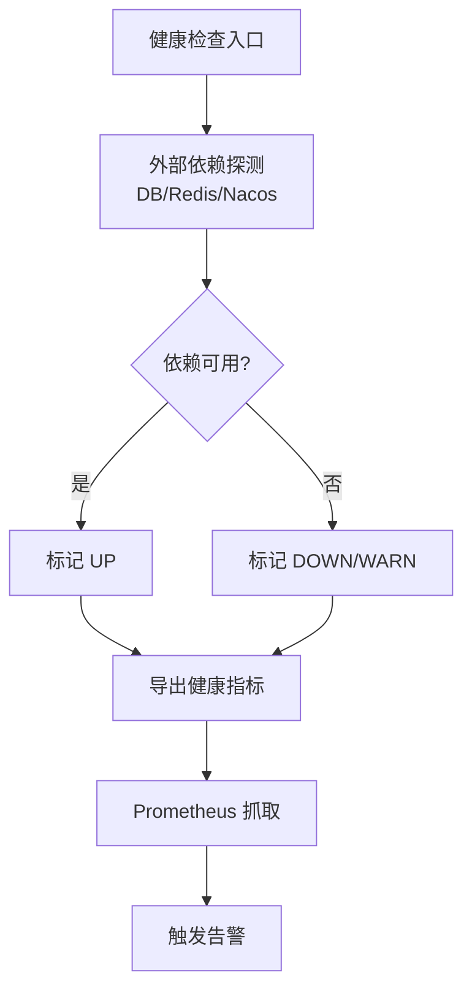
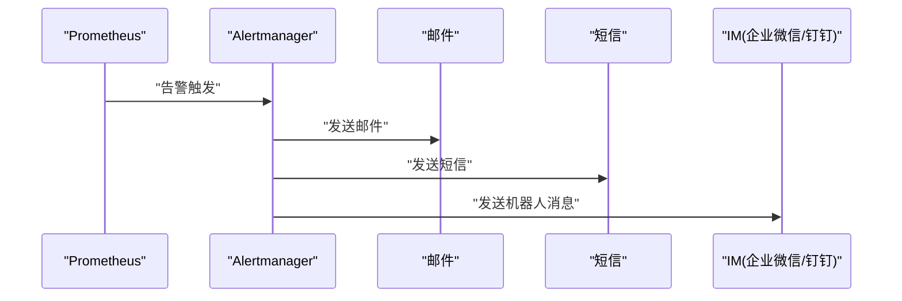
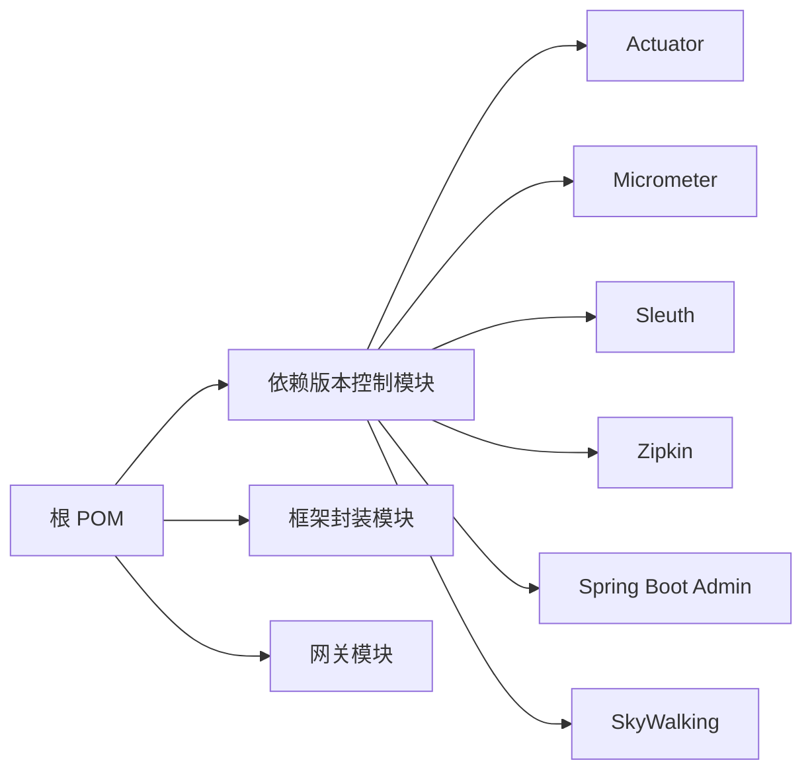

# 监控告警

<cite>
**本文引用的文件**
- [pom.xml](file://pom.xml)
- [codebolog-dependencies/pom.xml](file://codebolog-dependencies/pom.xml)
- [codeblog-gateway/src/main/resources/bootstrap.yml](file://codeblog-gateway/src/main/resources/bootstrap.yml)
- [codeblog-gateway/pom.xml](file://codeblog-gateway/pom.xml)
- [codeblog-framework/pom.xml](file://codeblog-framework/pom.xml)
</cite>

## 目录
1. [引言](#引言)
2. [项目结构](#项目结构)
3. [核心组件](#核心组件)
4. [架构总览](#架构总览)
5. [详细组件分析](#详细组件分析)
6. [依赖分析](#依赖分析)
7. [性能考虑](#性能考虑)
8. [故障排查指南](#故障排查指南)
9. [结论](#结论)
10. [附录](#附录)

## 引言
本文件面向运维与开发团队，围绕 codeblog-cloud 项目的监控与告警体系建设，提供从应用性能监控、分布式链路追踪、日志采集分析到健康检查与告警规则的完整实践指南。当前仓库中未包含 Spring Boot Actuator、Micrometer、Prometheus、Sleuth/Zipkin、ELK Stack、告警通知等具体配置文件，因此本文件以“现有工程结构”为基础，结合通用最佳实践，给出可落地的实施建议与配置模板路径，帮助团队快速搭建完善的监控体系。

## 项目结构
codeblog-cloud 采用多模块聚合结构，顶层 POM 管理版本与插件；子模块包括依赖版本控制模块、框架封装模块与网关模块。网关模块已包含 Nacos 配置与发现的基本配置，为后续接入监控与链路追踪提供基础。

图表来源
- [pom.xml](file://pom.xml#L1-L162)
- [codeblog-framework/pom.xml](file://codeblog-framework/pom.xml#L1-L39)
- [codeblog-gateway/pom.xml](file://codeblog-gateway/pom.xml#L1-L20)

章节来源
- [pom.xml](file://pom.xml#L1-L162)
- [codeblog-gateway/src/main/resources/bootstrap.yml](file://codeblog-gateway/src/main/resources/bootstrap.yml#L1-L44)
- [codeblog-framework/pom.xml](file://codeblog-framework/pom.xml#L1-L39)
- [codeblog-gateway/pom.xml](file://codeblog-gateway/pom.xml#L1-L20)

## 核心组件
- 应用性能监控（APM）
  - Spring Boot Actuator：暴露运行时指标与健康状态，便于 Prometheus 抓取。
  - Micrometer：作为指标抽象层，支持多种 registry（如 Prometheus）。
  - Prometheus：拉取指标并存储，配合 Grafana 做可视化。
- 分布式链路追踪
  - Sleuth/Zipkin：在网关与下游服务间注入与上报 Trace/Span。
- 日志采集与分析
  - ELK Stack：Logstash/Beats 收集、Elasticsearch 存储、Kibana 展示。
- 健康检查
  - 自定义健康指示器与外部依赖（数据库、缓存、注册中心）检查。
- 告警与通知
  - Prometheus Alertmanager：基于规则触发告警。
  - 邮件、短信、IM（企业微信/钉钉机器人）：通过通知渠道集成。

章节来源
- [codeblog-gateway/src/main/resources/bootstrap.yml](file://codeblog-gateway/src/main/resources/bootstrap.yml#L1-L44)

## 架构总览
下图展示监控体系在 codeblog-cloud 中的部署位置与交互关系。网关模块承载外部流量入口，接入 Nacos 进行服务治理；应用侧通过 Actuator/Micrometer 对外暴露指标；Prometheus 拉取指标；Zipkin 接收链路数据；ELK 负责日志采集与检索；Alertmanager 基于规则推送告警。

图表来源
- [codeblog-gateway/src/main/resources/bootstrap.yml](file://codeblog-gateway/src/main/resources/bootstrap.yml#L1-L44)
- [codebolog-dependencies/pom.xml](file://codebolog-dependencies/pom.xml#L94-L204)

## 详细组件分析

### 应用性能监控（Actuator + Micrometer + Prometheus）
- 目标
  - 暴露 JVM、HTTP 请求、线程池、数据库连接池等指标。
  - 将指标标准化并导出给 Prometheus。
- 实施要点
  - 在应用模块引入 Actuator 与 Micrometer Prometheus 依赖，并在配置中启用所需端点与指标。
  - Prometheus 服务器配置 job，抓取各实例的 /actuator/prometheus。
  - 在 Grafana 中添加 Prometheus 数据源并创建仪表盘。
- 关键配置路径参考
  - Actuator 指标端点与安全策略：[application.yml 或 bootstrap.yml 中的 actuator 配置项](file://codeblog-gateway/src/main/resources/bootstrap.yml#L1-L44)
  - Micrometer Prometheus Registry：在应用模块的依赖管理中引入对应 starter
  - Prometheus 抓取配置：在 Prometheus 配置文件中添加 job，目标为各服务实例的 /actuator/prometheus
  - Grafana 仪表盘：基于常用指标（请求耗时、错误率、并发、GC、堆内存、线程数、数据库连接池等）构建

图表来源
- [codebolog-dependencies/pom.xml](file://codebolog-dependencies/pom.xml#L94-L204)
- [codeblog-gateway/src/main/resources/bootstrap.yml](file://codeblog-gateway/src/main/resources/bootstrap.yml#L1-L44)

章节来源
- [codebolog-dependencies/pom.xml](file://codebolog-dependencies/pom.xml#L94-L204)
- [codeblog-gateway/src/main/resources/bootstrap.yml](file://codeblog-gateway/src/main/resources/bootstrap.yml#L1-L44)

### 分布式链路追踪（Sleuth + Zipkin）
- 目标
  - 在网关与下游服务之间传播 Trace/Span，形成完整的调用链。
- 实施要点
  - 在网关与业务服务模块引入 Spring Cloud Sleuth 依赖。
  - 配置 Zipkin Server 地址或使用 Zipkin 自带存储（开发环境）。
  - 在生产环境建议使用持久化存储与分片策略，避免内存压力。
- 关键配置路径参考
  - Sleuth 依赖：在应用模块的依赖管理中引入 spring-cloud-starter-sleuth
  - Zipkin 地址配置：在应用配置中指定 zipkin.base-url 或使用 spring.zipkin.base-url
  - 网关路由与过滤器：确保请求在网关层正确透传 Trace 上下文

图表来源
- [codebolog-dependencies/pom.xml](file://codebolog-dependencies/pom.xml#L94-L204)
- [codeblog-gateway/src/main/resources/bootstrap.yml](file://codeblog-gateway/src/main/resources/bootstrap.yml#L1-L44)

章节来源
- [codebolog-dependencies/pom.xml](file://codebolog-dependencies/pom.xml#L94-L204)
- [codeblog-gateway/src/main/resources/bootstrap.yml](file://codeblog-gateway/src/main/resources/bootstrap.yml#L1-L44)

### 日志收集与分析（ELK Stack）
- 目标
  - 统一采集应用日志，进行结构化解析、存储与检索。
- 实施要点
  - 在应用中输出结构化 JSON 日志（字段包含 traceId、spanId、服务名、模块、级别、时间戳、消息体等）。
  - 使用 Filebeat/Logstash 将日志采集至 Elasticsearch。
  - 在 Kibana 中创建索引模式与仪表盘，支持按服务、接口、异常类型等维度检索。
  - 建议开启日志轮转（按大小/时间），避免磁盘占用过高。
- 关键配置路径参考
  - 日志格式与输出：在应用日志配置中启用 JSON 输出
  - Filebeat/Logstash 配置：定义输入、过滤与输出到 ES
  - Kibana 索引与仪表盘：基于 traceId、异常、接口、耗时等字段构建

图表来源
- [codeblog-gateway/src/main/resources/bootstrap.yml](file://codeblog-gateway/src/main/resources/bootstrap.yml#L1-L44)

章节来源
- [codeblog-gateway/src/main/resources/bootstrap.yml](file://codeblog-gateway/src/main/resources/bootstrap.yml#L1-L44)

### 健康检查机制（自定义健康指示器与外部依赖检查）
- 目标
  - 提供应用与外部依赖（数据库、缓存、注册中心、配置中心）的健康状态。
- 实施要点
  - 使用 Spring Boot Actuator 的 health 端点，扩展自定义健康指示器。
  - 对关键外部依赖执行轻量探测（如数据库连通性、Redis ping、Nacos 可达性）。
  - 将健康状态纳入 Prometheus 监控与告警范围。
- 关键配置路径参考
  - Actuator 健康端点：在应用配置中启用 health 端点与指示器
  - 自定义健康指示器：在应用中实现 HealthIndicator 并注册为 Bean

图表来源
- [codeblog-gateway/src/main/resources/bootstrap.yml](file://codeblog-gateway/src/main/resources/bootstrap.yml#L1-L44)

章节来源
- [codeblog-gateway/src/main/resources/bootstrap.yml](file://codeblog-gateway/src/main/resources/bootstrap.yml#L1-L44)

### 告警规则与通知机制（邮件、短信、IM）
- 目标
  - 基于 Prometheus 规则触发告警，并通过邮件、短信、IM（企业微信/钉钉）通知。
- 实施要点
  - 在 Alertmanager 中配置接收器（email、webhook、机器人 URL）。
  - 定义规则组（如请求错误率、P95/P99 延迟、线程池饱和、GC 压力、健康 DOWN 等）。
  - 与 CMDB/值班排班系统联动，实现自动升级与闭环。
- 关键配置路径参考
  - Alertmanager 接收器与路由：在 Alertmanager 配置中定义 receivers 与 route
  - Prometheus Rule：在 Prometheus 配置中加载规则文件
  - 通知模板：在 Alertmanager 中配置模板，包含标题、正文与跳转链接

图表来源
- [codeblog-gateway/src/main/resources/bootstrap.yml](file://codeblog-gateway/src/main/resources/bootstrap.yml#L1-L44)

章节来源
- [codeblog-gateway/src/main/resources/bootstrap.yml](file://codeblog-gateway/src/main/resources/bootstrap.yml#L1-L44)

## 依赖分析
- 版本与依赖管理
  - 顶层 POM 管理模块与插件版本，子模块通过依赖版本控制模块集中管理第三方依赖。
  - 框架模块包含多个 Spring Boot Starter 封装，便于在业务服务中复用。
- 监控相关依赖
  - 依赖版本控制模块中包含 SkyWalking、Spring Boot Admin、OpenTracing 等监控相关依赖，可用于链路追踪与管理界面。
- 建议
  - 在应用模块中显式引入 Actuator、Micrometer Prometheus、Sleuth/Zipkin、Logback/JSON 等依赖，确保监控能力可配置、可观察。

图表来源
- [pom.xml](file://pom.xml#L1-L162)
- [codebolog-dependencies/pom.xml](file://codebolog-dependencies/pom.xml#L94-L204)
- [codeblog-framework/pom.xml](file://codeblog-framework/pom.xml#L1-L39)
- [codeblog-gateway/pom.xml](file://codeblog-gateway/pom.xml#L1-L20)

章节来源
- [pom.xml](file://pom.xml#L1-L162)
- [codebolog-dependencies/pom.xml](file://codebolog-dependencies/pom.xml#L94-L204)
- [codeblog-framework/pom.xml](file://codeblog-framework/pom.xml#L1-L39)
- [codeblog-gateway/pom.xml](file://codeblog-gateway/pom.xml#L1-L20)

## 性能考虑
- 指标采样与粒度
  - 合理设置指标采样率与标签基数，避免高基数导致的内存与存储压力。
- 链路追踪
  - 控制采样率，优先保留关键路径与异常场景的链路数据。
- 日志
  - 采用结构化日志与异步落盘，避免阻塞业务线程；开启滚动与压缩，控制磁盘占用。
- 健康检查
  - 健康探测应轻量且幂等，避免对上游造成额外压力。
- 告警
  - 设置静默窗口与告警抑制，避免风暴与误报；区分严重级别与升级策略。

## 故障排查指南
- Actuator 无法访问
  - 检查端点是否启用、安全策略是否放行、网络连通性与防火墙。
- 指标缺失
  - 确认 Micrometer 与 Prometheus 配置正确，抓取间隔与超时设置合理。
- 链路不完整
  - 核对 Sleuth/Zipkin 配置、上下文传播、过滤器顺序与 Zipkin 存储可用性。
- 日志未入库
  - 检查 Filebeat/Logstash 配置、ES 连接与索引权限、Kibana 索引模式。
- 健康检查异常
  - 手动验证外部依赖连通性，确认探测逻辑与超时阈值。
- 告警未触发
  - 校验 Prometheus 规则表达式、Alertmanager 路由与接收器配置。

章节来源
- [codeblog-gateway/src/main/resources/bootstrap.yml](file://codeblog-gateway/src/main/resources/bootstrap.yml#L1-L44)

## 结论
本文件基于 codeblog-cloud 当前工程结构，给出了监控与告警体系的完整实施路线：以 Actuator/Micrometer/Prometheus 为核心，结合 Sleuth/Zipkin 实现链路追踪，以 ELK 完成日志采集与检索，并通过自定义健康检查与告警规则实现自动化运维闭环。建议尽快补充各模块的监控依赖与配置文件，按阶段落地并持续优化指标与规则，逐步完善可观测性能力。

## 附录
- 配置文件路径参考
  - 应用配置（Actuator、Micrometer、Sleuth、Zipkin、日志等）：[application.yml 或 bootstrap.yml](file://codeblog-gateway/src/main/resources/bootstrap.yml#L1-L44)
  - 依赖版本管理：[依赖版本控制模块 POM](file://codebolog-dependencies/pom.xml#L94-L204)
  - 模块聚合与版本：[根 POM](file://pom.xml#L1-L162)