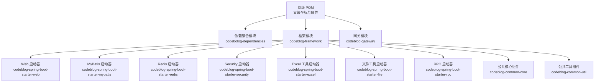
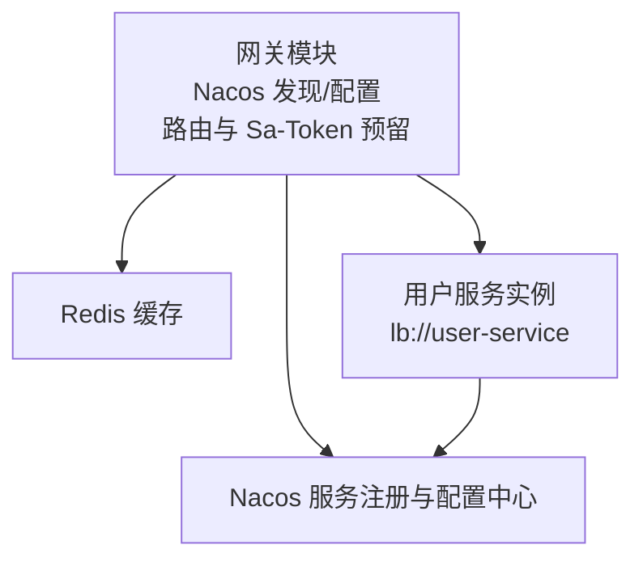
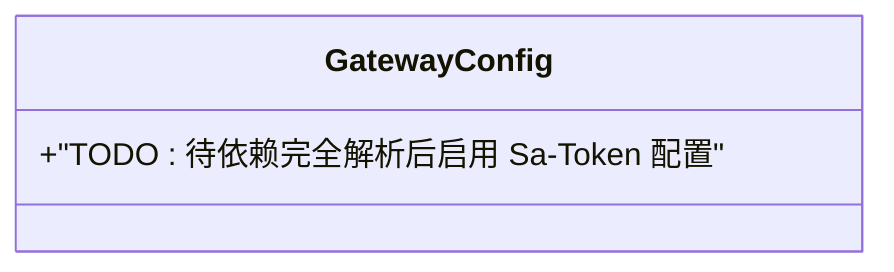
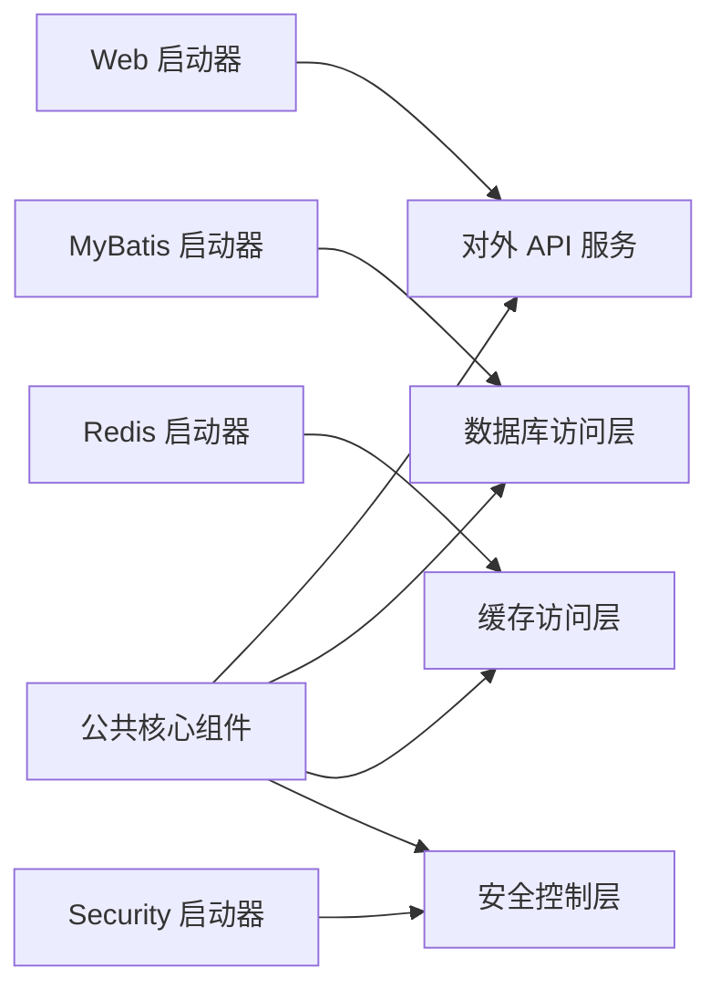
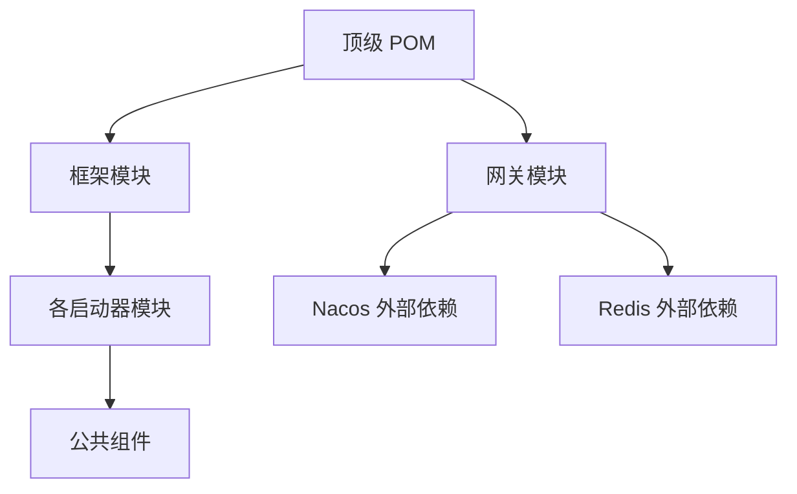

# 部署运维

<cite>
**本文引用的文件**
- [pom.xml](file://pom.xml)
- [codeblog-gateway/src/main/resources/bootstrap.yml](file://codeblog-gateway/src/main/resources/bootstrap.yml)
- [codeblog-gateway/src/main/java/site/codeblog/gateway/config/GatewayConfig.java](file://codeblog-gateway/src/main/java/site/codeblog/gateway/config/GatewayConfig.java)
- [codeblog-framework/pom.xml](file://codeblog-framework/pom.xml)
- [codeblog-framework/codeblog-common/codeblog-common-core/pom.xml](file://codeblog-framework/codeblog-common/codeblog-common-core/pom.xml)
- [codeblog-framework/codeblog-spring-boot-starter-web/pom.xml](file://codeblog-framework/codeblog-spring-boot-starter-web/pom.xml)
</cite>

## 目录
1. [简介](#简介)
2. [项目结构](#项目结构)
3. [核心组件](#核心组件)
4. [架构总览](#架构总览)
5. [详细组件分析](#详细组件分析)
6. [依赖分析](#依赖分析)
7. [性能考虑](#性能考虑)
8. [故障排查指南](#故障排查指南)
9. [结论](#结论)
10. [附录](#附录)

## 简介
本文件面向 DevOps 团队与运维人员，提供 codeblog-cloud 项目的部署与运维指南。内容涵盖环境准备、生产配置策略、容器化与 Kubernetes 部署思路、CI/CD 流水线建议、监控告警与故障排查，以及运维最佳实践。由于仓库中未包含 Dockerfile、Kubernetes YAML、CI/CD 配置与生产密钥管理文件，本文在相应章节提供通用的工程化落地建议与参考路径。

## 项目结构
项目采用多模块 Maven 结构，顶层 POM 管理版本与插件；子模块包括依赖聚合模块、框架模块与网关模块。框架模块进一步拆分为多个 Spring Boot Starter 与公共组件，便于按需复用与扩展。

图表来源
- [pom.xml](file://pom.xml#L16-L20)
- [codeblog-framework/pom.xml](file://codeblog-framework/pom.xml#L26-L37)

章节来源
- [pom.xml](file://pom.xml#L1-L150)
- [codeblog-framework/pom.xml](file://codeblog-framework/pom.xml#L1-L39)

## 核心组件
- 网关模块（codeblog-gateway）
  - 提供基于 Nacos 的服务发现与配置中心接入，定义路由规则与 Redis 连接参数。
  - Sa-Token 配置项已预留，当前未启用认证过滤器。
- 框架模块（codeblog-framework）
  - Web 启动器：集成 Web、Knife4j 文档与校验组件。
  - MyBatis/Redis/Security 等启动器：提供 ORM、缓存与安全能力封装。
  - 公共核心组件：全局异常处理与统一响应模型。

章节来源
- [codeblog-gateway/src/main/resources/bootstrap.yml](file://codeblog-gateway/src/main/resources/bootstrap.yml#L1-L44)
- [codeblog-gateway/src/main/java/site/codeblog/gateway/config/GatewayConfig.java](file://codeblog-gateway/src/main/java/site/codeblog/gateway/config/GatewayConfig.java#L1-L28)
- [codeblog-framework/codeblog-spring-boot-starter-web/pom.xml](file://codeblog-framework/codeblog-spring-boot-starter-web/pom.xml#L1-L45)
- [codeblog-framework/codeblog-common/codeblog-common-core/pom.xml](file://codeblog-framework/codeblog-common/codeblog-common-core/pom.xml#L1-L51)

## 架构总览
下图展示代码库中可见的运行时组件关系与外部依赖方向（Nacos、Redis）。实际服务实例由业务模块承载，网关负责路由与鉴权扩展点。

图表来源
- [codeblog-gateway/src/main/resources/bootstrap.yml](file://codeblog-gateway/src/main/resources/bootstrap.yml#L8-L22)

## 详细组件分析

### 网关组件分析
- 配置要点
  - 服务端口、应用名、Nacos 地址与配置格式、路由规则示例、Redis 连接参数。
  - Sa-Token 参数已配置，但认证过滤器处于注释状态，需在依赖完善后启用。
- 安全与鉴权
  - 当前未启用 Sa-Token 过滤器，建议在依赖齐全后启用以实现全局鉴权。
- 路由与负载均衡
  - 示例路由指向 lb://user-service，结合 Nacos 实现服务发现与动态路由。

图表来源
- [codeblog-gateway/src/main/java/site/codeblog/gateway/config/GatewayConfig.java](file://codeblog-gateway/src/main/java/site/codeblog/gateway/config/GatewayConfig.java#L13-L27)

章节来源
- [codeblog-gateway/src/main/resources/bootstrap.yml](file://codeblog-gateway/src/main/resources/bootstrap.yml#L1-L44)
- [codeblog-gateway/src/main/java/site/codeblog/gateway/config/GatewayConfig.java](file://codeblog-gateway/src/main/java/site/codeblog/gateway/config/GatewayConfig.java#L1-L28)

### 框架模块组件分析
- Web 启动器
  - 集成 Web、Knife4j 文档与校验组件，适合对外 API 服务。
- MyBatis/Redis/Security 启动器
  - 提供 ORM、缓存与安全能力封装，便于业务模块快速集成。
- 公共核心组件
  - 提供全局异常处理与统一响应模型，降低重复开发成本。

图表来源
- [codeblog-framework/codeblog-spring-boot-starter-web/pom.xml](file://codeblog-framework/codeblog-spring-boot-starter-web/pom.xml#L18-L42)
- [codeblog-framework/codeblog-common/codeblog-common-core/pom.xml](file://codeblog-framework/codeblog-common/codeblog-common-core/pom.xml#L18-L48)

章节来源
- [codeblog-framework/pom.xml](file://codeblog-framework/pom.xml#L26-L37)
- [codeblog-framework/codeblog-spring-boot-starter-web/pom.xml](file://codeblog-framework/codeblog-spring-boot-starter-web/pom.xml#L1-L45)
- [codeblog-framework/codeblog-common/codeblog-common-core/pom.xml](file://codeblog-framework/codeblog-common/codeblog-common-core/pom.xml#L1-L51)

## 依赖分析
- 顶层 POM
  - 统一 Java 版本、Spring Boot 版本、插件版本与仓库源。
  - 管理模块清单与插件配置（Surefire、Compiler、Flatten）。
- 模块依赖
  - 框架模块聚合多个 Starter 与公共组件，形成可复用的基础能力层。
  - 网关模块依赖 Nacos 与 Redis，作为运行时外部依赖。

图表来源
- [pom.xml](file://pom.xml#L22-L36)
- [codeblog-framework/pom.xml](file://codeblog-framework/pom.xml#L26-L37)
- [codeblog-gateway/src/main/resources/bootstrap.yml](file://codeblog-gateway/src/main/resources/bootstrap.yml#L8-L27)

章节来源
- [pom.xml](file://pom.xml#L1-L150)
- [codeblog-framework/pom.xml](file://codeblog-framework/pom.xml#L1-L39)
- [codeblog-gateway/src/main/resources/bootstrap.yml](file://codeblog-gateway/src/main/resources/bootstrap.yml#L1-L44)

## 性能考虑
- JVM 与编译参数
  - 使用 Java 17，确保与 Spring Boot 3.x 兼容；编译参数包含参数名发现开关，有助于运行时元数据解析。
- 测试与构建
  - Surefire 插件版本与编译器插件版本已在顶层 POM 中统一管理，保证 CI/CD 一致性。
- 运行时优化建议
  - 生产环境建议开启 JVM 参数调优与 GC 日志采集；对网关路由与鉴权逻辑进行压测与限流配置。

章节来源
- [pom.xml](file://pom.xml#L22-L36)
- [pom.xml](file://pom.xml#L38-L117)

## 故障排查指南
- 网关鉴权未生效
  - 现象：请求未触发鉴权。
  - 排查：确认 Sa-Token 过滤器已启用且依赖齐全；检查路由匹配规则与排除路径。
  - 参考路径：[GatewayConfig.java](file://codeblog-gateway/src/main/java/site/codeblog/gateway/config/GatewayConfig.java#L13-L27)
- 服务发现失败
  - 现象：网关无法路由到下游服务。
  - 排查：确认 Nacos 地址与配置中心地址可达；检查服务实例是否注册成功。
  - 参考路径：[bootstrap.yml](file://codeblog-gateway/src/main/resources/bootstrap.yml#L8-L13)
- 缓存连接异常
  - 现象：Redis 连接失败或超时。
  - 排查：核对 Redis 主机、端口与数据库索引；检查网络连通性与防火墙策略。
  - 参考路径：[bootstrap.yml](file://codeblog-gateway/src/main/resources/bootstrap.yml#L24-L27)
- 构建失败或测试异常
  - 现象：本地或 CI 构建失败。
  - 排查：确认 Java 版本与 Maven 插件版本一致；检查仓库源可用性与网络代理设置。
  - 参考路径：[pom.xml](file://pom.xml#L22-L36)

章节来源
- [codeblog-gateway/src/main/java/site/codeblog/gateway/config/GatewayConfig.java](file://codeblog-gateway/src/main/java/site/codeblog/gateway/config/GatewayConfig.java#L1-L28)
- [codeblog-gateway/src/main/resources/bootstrap.yml](file://codeblog-gateway/src/main/resources/bootstrap.yml#L1-L44)
- [pom.xml](file://pom.xml#L119-L148)

## 结论
本项目以多模块 Maven 结构组织，具备清晰的框架能力封装与网关路由基础。生产部署建议优先完成以下事项：补齐容器化与 K8s 配置、完善密钥与配置管理、建立 CI/CD 流水线、实施监控与告警，并制定故障排查与应急响应流程。本文提供了可直接落地的工程化建议与参考路径，便于 DevOps 团队快速推进。

## 附录

### 环境准备与系统要求
- JDK 与构建工具
  - 使用 Java 17；Maven 插件版本已在顶层 POM 中统一管理。
- 依赖服务
  - Nacos：用于服务注册与配置中心；Redis：用于缓存。
- 环境变量与配置
  - 建议通过 Spring Cloud Alibaba Nacos Config 将敏感配置外置，避免硬编码。

章节来源
- [pom.xml](file://pom.xml#L22-L36)
- [codeblog-gateway/src/main/resources/bootstrap.yml](file://codeblog-gateway/src/main/resources/bootstrap.yml#L8-L13)

### 生产环境配置策略
- 配置文件管理
  - 使用 Nacos Config 管理不同环境配置；按环境拆分命名空间或 Group。
- 密钥与敏感信息
  - 将密钥、数据库密码等放入密管系统或 KMS；通过环境变量注入。
- 网关鉴权
  - 在依赖齐全后启用 Sa-Token 过滤器，统一处理登录与权限校验。

章节来源
- [codeblog-gateway/src/main/resources/bootstrap.yml](file://codeblog-gateway/src/main/resources/bootstrap.yml#L29-L44)
- [codeblog-gateway/src/main/java/site/codeblog/gateway/config/GatewayConfig.java](file://codeblog-gateway/src/main/java/site/codeblog/gateway/config/GatewayConfig.java#L13-L27)

### 容器化与 Kubernetes 部署（工程化建议）
- Docker 镜像
  - 基于官方 OpenJDK 17 镜像；复制构建产物并设置 JAVA_OPTS 与入口命令。
- Kubernetes
  - 使用 Deployment/Service/ConfigMap/Secret 管理应用与配置；为网关暴露 9999 端口。
  - 为 Nacos 与 Redis 准备独立服务或托管实例。
- 参考路径
  - [bootstrap.yml](file://codeblog-gateway/src/main/resources/bootstrap.yml#L1-L2)
  - [pom.xml](file://pom.xml#L1-L150)

### CI/CD 流水线（工程化建议）
- 触发条件
  - 分支保护与 PR 校验；主分支推送触发构建与发布。
- 步骤建议
  - 依赖缓存、编译、单元测试、打包、镜像构建、推送、K8s 部署与健康检查。
- 质量门禁
  - 单元测试覆盖率阈值、静态扫描与依赖漏洞扫描。

章节来源
- [pom.xml](file://pom.xml#L38-L117)

### 监控告警（工程化建议）
- 日志
  - 统一输出 JSON 格式日志；集中采集至 ELK 或 Loki；区分业务日志与访问日志。
- 指标
  - 暴露 JVM 与业务指标；Prometheus 抓取；Grafana 可视化。
- 健康检查
  - 对网关与业务服务实现 /actuator/health；K8s readiness/liveness 探针。
- 告警
  - 基于阈值与趋势的告警策略；分级响应与通知渠道。

章节来源
- [codeblog-framework/codeblog-spring-boot-starter-web/pom.xml](file://codeblog-framework/codeblog-spring-boot-starter-web/pom.xml#L25-L29)