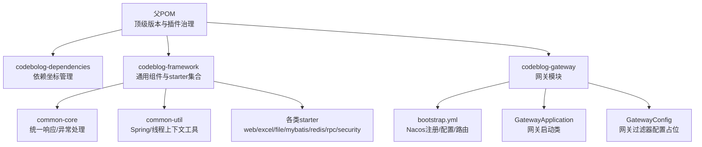
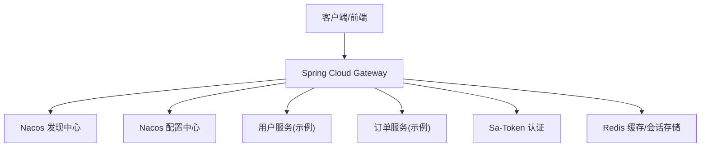
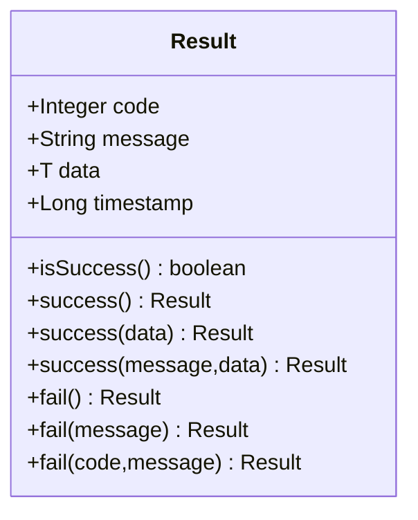
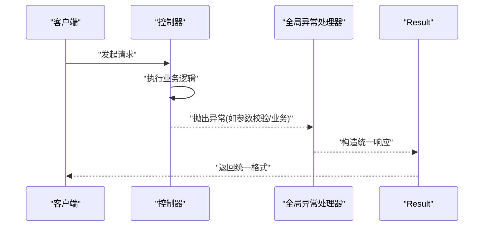
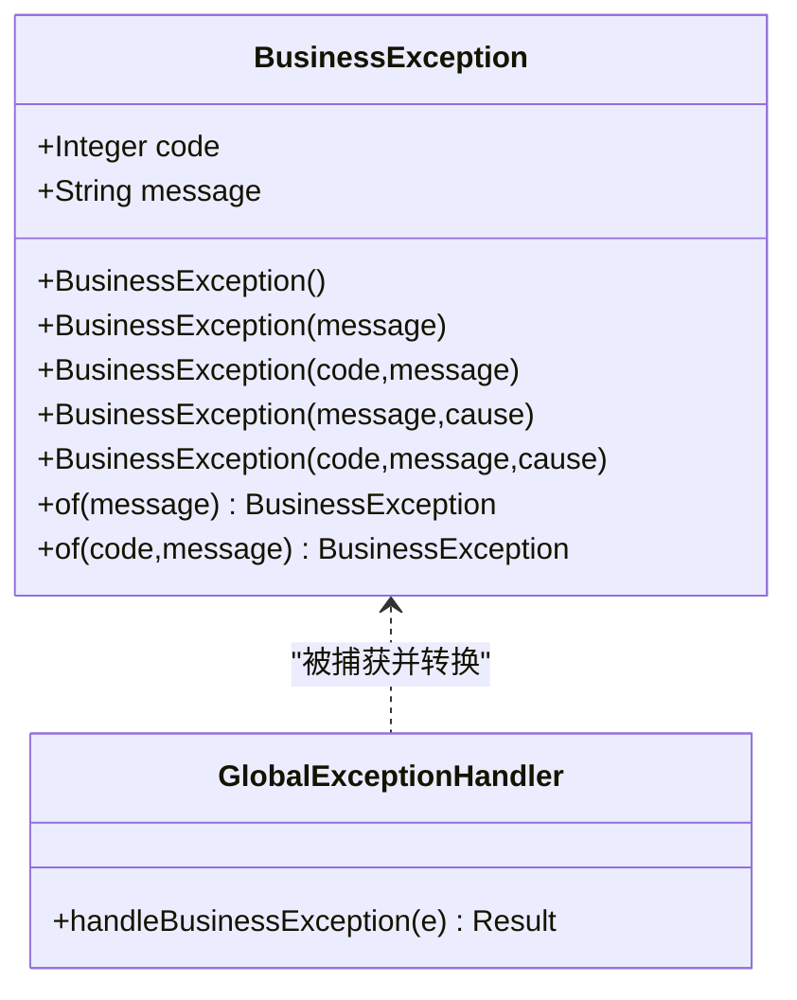
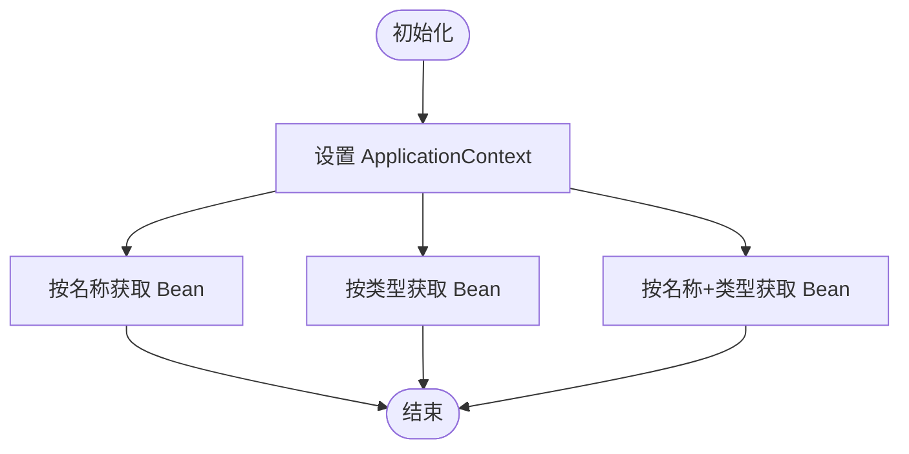
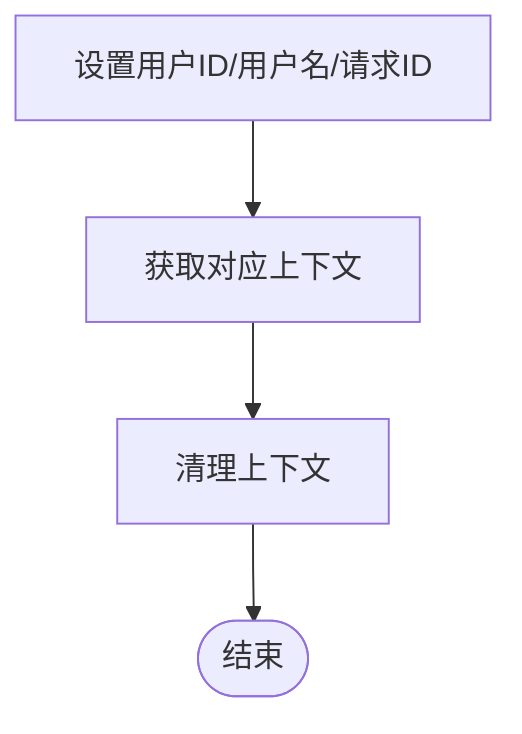
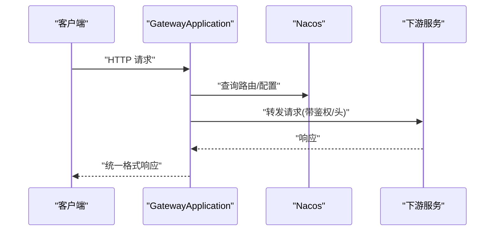
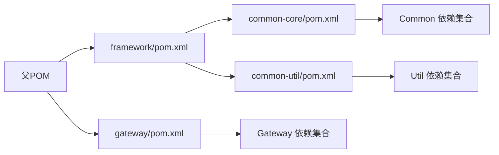

# 项目概述

<cite>
**本文引用的文件**
- [pom.xml](file://pom.xml)
- [codeblog-framework/pom.xml](file://codeblog-framework/pom.xml)
- [codeblog-gateway/pom.xml](file://codeblog-gateway/pom.xml)
- [codeblog-framework/codeblog-common/codeblog-common-core/pom.xml](file://codeblog-framework/codeblog-common/codeblog-common-core/pom.xml)
- [codeblog-framework/codeblog-common/codeblog-common-util/pom.xml](file://codeblog-framework/codeblog-common/codeblog-common-util/pom.xml)
- [codeblog-framework/codeblog-common/codeblog-common-core/src/main/java/site/codeblog/common/core/result/Result.java](file://codeblog-framework/codeblog-common/codeblog-common-core/src/main/java/site/codeblog/common/core/result/Result.java)
- [codeblog-framework/codeblog-common/codeblog-common-core/src/main/java/site/codeblog/common/core/exception/GlobalExceptionHandler.java](file://codeblog-framework/codeblog-common/codeblog-common-core/src/main/java/site/codeblog/common/core/exception/GlobalExceptionHandler.java)
- [codeblog-framework/codeblog-common/codeblog-common-core/src/main/java/site/codeblog/common/core/exception/BusinessException.java](file://codeblog-framework/codeblog-common/codeblog-common-core/src/main/java/site/codeblog/common/core/exception/BusinessException.java)
- [codeblog-framework/codeblog-common/codeblog-common-util/src/main/java/site/codeblog/common/util/SpringContextHolder.java](file://codeblog-framework/codeblog-common/codeblog-common-util/src/main/java/site/codeblog/common/util/SpringContextHolder.java)
- [codeblog-framework/codeblog-common/codeblog-common-util/src/main/java/site/codeblog/common/util/ThreadContextHolder.java](file://codeblog-framework/codeblog-common/codeblog-common-util/src/main/java/site/codeblog/common/util/ThreadContextHolder.java)
- [codeblog-gateway/src/main/java/site/Codeblog/GatewayApplication.java](file://codeblog-gateway/src/main/java/site/Codeblog/GatewayApplication.java)
- [codeblog-gateway/src/main/java/site/Codeblog/gateway/config/GatewayConfig.java](file://codeblog-gateway/src/main/java/site/Codeblog/gateway/config/GatewayConfig.java)
- [codeblog-gateway/src/main/resources/bootstrap.yml](file://codeblog-gateway/src/main/resources/bootstrap.yml)
</cite>

## 目录
1. [引言](#引言)
2. [项目结构](#项目结构)
3. [核心组件](#核心组件)
4. [架构总览](#架构总览)
5. [详细组件分析](#详细组件分析)
6. [依赖关系分析](#依赖关系分析)
7. [性能与可维护性](#性能与可维护性)
8. [故障排查指南](#故障排查指南)
9. [结论](#结论)
10. [附录](#附录)

## 引言
本项目“codeblog-cloud”是一个基于 Spring Boot 3.5.9 与 Spring Cloud 2025.0.0 的现代化微服务基础设施框架。其核心目标是提供一套高内聚、低耦合、可扩展且易于复用的服务组件与通用能力，覆盖统一响应格式、全局异常处理、线程上下文传递、安全认证、RPC/ORM/Redis/Web 等常用能力封装，并通过网关实现统一入口与路由转发。

项目采用多模块分层设计：顶层父 POM 负责版本与插件治理；framework 子模块聚合通用组件与 starter；gateway 子模块承载流量入口与鉴权；通过 Nacos 实现注册发现与配置中心，结合 Sa-Token 提供网关级认证能力。

## 项目结构
项目采用 Maven 多模块结构，顶层父 POM 聚合三个一级模块：
- codebolog-dependencies：集中式依赖版本与坐标管理（当前目录存在但内容为空，建议后续补充）
- codeblog-framework：服务组件封装与通用能力（含 common 核心与各类 starter）
- codeblog-gateway：Spring Cloud Gateway 网关模块

图表来源
- [pom.xml](file://pom.xml#L16-L20)
- [codeblog-framework/pom.xml](file://codeblog-framework/pom.xml#L32-L43)
- [codeblog-gateway/pom.xml](file://codeblog-gateway/pom.xml#L24-L79)

章节来源
- [pom.xml](file://pom.xml#L1-L150)
- [codeblog-framework/pom.xml](file://codeblog-framework/pom.xml#L1-L45)
- [codeblog-gateway/pom.xml](file://codeblog-gateway/pom.xml#L1-L98)

## 核心组件
- 统一响应模型：提供标准的 code/message/data/timestamp 结构，内置 success/fail 多种静态工厂方法，便于前后端一致的数据契约。
- 全局异常处理：通过@RestControllerAdvice 统一封装业务异常、参数校验异常、空指针、非法参数、运行时异常及未知异常，确保对外返回格式一致。
- 业务异常模型：自定义 BusinessException，支持携带业务码与消息，配合全局异常处理器快速返回。
- Spring 上下文工具：提供静态方法获取 ApplicationContext 与 Bean，简化非 Spring 管理对象中获取 Bean 的场景。
- 线程上下文工具：基于 TransmittableThreadLocal 提供用户ID/用户名/请求ID的跨线程传递能力，便于链路追踪与审计。
- 网关与认证：基于 Spring Cloud Gateway + Nacos + Sa-Token，提供路由转发、负载均衡与网关级认证能力。

章节来源
- [codeblog-framework/codeblog-common/codeblog-common-core/src/main/java/site/codeblog/common/core/result/Result.java](file://codeblog-framework/codeblog-common/codeblog-common-core/src/main/java/site/codeblog/common/core/result/Result.java#L1-L101)
- [codeblog-framework/codeblog-common/codeblog-common-core/src/main/java/site/codeblog/common/core/exception/GlobalExceptionHandler.java](file://codeblog-framework/codeblog-common/codeblog-common-core/src/main/java/site/codeblog/common/core/exception/GlobalExceptionHandler.java#L1-L107)
- [codeblog-framework/codeblog-common/codeblog-common-core/src/main/java/site/codeblog/common/core/exception/BusinessException.java](file://codeblog-framework/codeblog-common/codeblog-common-core/src/main/java/site/codeblog/common/core/exception/BusinessException.java#L1-L68)
- [codeblog-framework/codeblog-common/codeblog-common-util/src/main/java/site/codeblog/common/util/SpringContextHolder.java](file://codeblog-framework/codeblog-common/codeblog-common-util/src/main/java/site/codeblog/common/util/SpringContextHolder.java#L1-L67)
- [codeblog-framework/codeblog-common/codeblog-common-util/src/main/java/site/codeblog/common/util/ThreadContextHolder.java](file://codeblog-framework/codeblog-common/codeblog-common-util/src/main/java/site/codeblog/common/util/ThreadContextHolder.java#L1-L77)

## 架构总览
整体采用“网关 + 注册发现 + 配置中心 + 微服务”的经典微服务架构。网关负责统一入口、路由与鉴权；服务通过 Nacos 完成注册与配置拉取；Sa-Token 提供网关级认证；common-core 与 common-util 为各服务提供统一的响应与异常处理、线程上下文传递等基础能力。

图表来源
- [codeblog-gateway/pom.xml](file://codeblog-gateway/pom.xml#L24-L79)
- [codeblog-gateway/src/main/resources/bootstrap.yml](file://codeblog-gateway/src/main/resources/bootstrap.yml#L1-L44)

章节来源
- [codeblog-gateway/pom.xml](file://codeblog-gateway/pom.xml#L1-L98)
- [codeblog-gateway/src/main/resources/bootstrap.yml](file://codeblog-gateway/src/main/resources/bootstrap.yml#L1-L44)

## 详细组件分析

### 统一响应模型（Result）
- 设计要点：统一 code/message/data/timestamp 字段，提供 success()/fail() 多态工厂方法，isSuccess() 判断逻辑清晰。
- 使用场景：控制器直接返回 Result<T>，屏蔽底层异常细节，前端按约定解析。

图表来源
- [codeblog-framework/codeblog-common/codeblog-common-core/src/main/java/site/codeblog/common/core/result/Result.java](file://codeblog-framework/codeblog-common/codeblog-common-core/src/main/java/site/codeblog/common/core/result/Result.java#L14-L101)

章节来源
- [codeblog-framework/codeblog-common/codeblog-common-core/src/main/java/site/codeblog/common/core/result/Result.java](file://codeblog-framework/codeblog-common/codeblog-common-core/src/main/java/site/codeblog/common/core/result/Result.java#L1-L101)

### 全局异常处理（GlobalExceptionHandler）
- 设计要点：基于@RestControllerAdvice，覆盖业务异常、参数校验、空指针、非法参数、运行时异常与未知异常，统一映射到 Result。
- 返回策略：业务异常保留业务码与消息；参数校验异常拼接字段错误；未知异常统一返回系统内部错误。

图表来源
- [codeblog-framework/codeblog-common/codeblog-common-core/src/main/java/site/codeblog/common/core/exception/GlobalExceptionHandler.java](file://codeblog-framework/codeblog-common/codeblog-common-core/src/main/java/site/codeblog/common/core/exception/GlobalExceptionHandler.java#L27-L106)

章节来源
- [codeblog-framework/codeblog-common/codeblog-common-core/src/main/java/site/codeblog/common/core/exception/GlobalExceptionHandler.java](file://codeblog-framework/codeblog-common/codeblog-common-core/src/main/java/site/codeblog/common/core/exception/GlobalExceptionHandler.java#L1-L107)

### 业务异常模型（BusinessException）
- 设计要点：继承 RuntimeException，支持多种构造方式（含业务码与消息），提供 of() 工厂方法，便于快速抛出业务异常。
- 协同机制：与 GlobalExceptionHandler 配合，将业务异常映射为 Result 并保留业务码。

图表来源
- [codeblog-framework/codeblog-common/codeblog-common-core/src/main/java/site/codeblog/common/core/exception/BusinessException.java](file://codeblog-framework/codeblog-common/codeblog-common-core/src/main/java/site/codeblog/common/core/exception/BusinessException.java#L13-L68)
- [codeblog-framework/codeblog-common/codeblog-common-core/src/main/java/site/codeblog/common/core/exception/GlobalExceptionHandler.java](file://codeblog-framework/codeblog-common/codeblog-common-core/src/main/java/site/codeblog/common/core/exception/GlobalExceptionHandler.java#L27-L31)

章节来源
- [codeblog-framework/codeblog-common/codeblog-common-core/src/main/java/site/codeblog/common/core/exception/BusinessException.java](file://codeblog-framework/codeblog-common/codeblog-common-core/src/main/java/site/codeblog/common/core/exception/BusinessException.java#L1-L68)
- [codeblog-framework/codeblog-common/codeblog-common-core/src/main/java/site/codeblog/common/core/exception/GlobalExceptionHandler.java](file://codeblog-framework/codeblog-common/codeblog-common-core/src/main/java/site/codeblog/common/core/exception/GlobalExceptionHandler.java#L27-L31)

### Spring 上下文工具（SpringContextHolder）
- 设计要点：实现 ApplicationContextAware，在容器启动时注入 ApplicationContext，提供静态方法按名称或类型获取 Bean。
- 使用场景：在工具类、拦截器、监听器等非 Spring 管理对象中获取 Bean。

图表来源
- [codeblog-framework/codeblog-common/codeblog-common-util/src/main/java/site/codeblog/common/util/SpringContextHolder.java](file://codeblog-framework/codeblog-common/codeblog-common-util/src/main/java/site/codeblog/common/util/SpringContextHolder.java#L21-L57)

章节来源
- [codeblog-framework/codeblog-common/codeblog-common-util/src/main/java/site/codeblog/common/util/SpringContextHolder.java](file://codeblog-framework/codeblog-common/codeblog-common-util/src/main/java/site/codeblog/common/util/SpringContextHolder.java#L1-L67)

### 线程上下文工具（ThreadContextHolder）
- 设计要点：基于 TransmittableThreadLocal 提供用户ID、用户名、请求ID的线程本地存储与跨线程传递，避免显式参数传递。
- 使用场景：链路追踪、审计日志、多线程任务上下文透传。

图表来源
- [codeblog-framework/codeblog-common/codeblog-common-util/src/main/java/site/codeblog/common/util/ThreadContextHolder.java](file://codeblog-framework/codeblog-common/codeblog-common-util/src/main/java/site/codeblog/common/util/ThreadContextHolder.java#L30-L77)

章节来源
- [codeblog-framework/codeblog-common/codeblog-common-util/src/main/java/site/codeblog/common/util/ThreadContextHolder.java](file://codeblog-framework/codeblog-common/codeblog-common-util/src/main/java/site/codeblog/common/util/ThreadContextHolder.java#L1-L77)

### 网关与认证（Gateway + Sa-Token + Nacos）
- 启动类：GatewayApplication 负责启动 Spring Boot 应用。
- 配置：bootstrap.yml 指定 Nacos 地址、应用名、路由规则、Redis 连接与 Sa-Token 参数。
- 功能：网关路由到下游服务、负载均衡、认证过滤（占位待启用）。

图表来源
- [codeblog-gateway/src/main/java/site/Codeblog/GatewayApplication.java](file://codeblog-gateway/src/main/java/site/Codeblog/GatewayApplication.java#L11-L16)
- [codeblog-gateway/src/main/resources/bootstrap.yml](file://codeblog-gateway/src/main/resources/bootstrap.yml#L14-L28)
- [codeblog-gateway/src/main/java/site/Codeblog/gateway/config/GatewayConfig.java](file://codeblog-gateway/src/main/java/site/Codeblog/gateway/config/GatewayConfig.java#L13-L27)

章节来源
- [codeblog-gateway/src/main/java/site/Codeblog/GatewayApplication.java](file://codeblog-gateway/src/main/java/site/Codeblog/GatewayApplication.java#L1-L16)
- [codeblog-gateway/src/main/java/site/Codeblog/gateway/config/GatewayConfig.java](file://codeblog-gateway/src/main/java/site/Codeblog/gateway/config/GatewayConfig.java#L1-L28)
- [codeblog-gateway/src/main/resources/bootstrap.yml](file://codeblog-gateway/src/main/resources/bootstrap.yml#L1-L44)

## 依赖关系分析
- 父 POM：统一 Java 版本、Maven 插件、仓库镜像与 flatten 版本管理。
- framework：聚合 common-core、common-util 与各类 starter，形成通用能力矩阵。
- gateway：引入 Spring Cloud Gateway、LoadBalancer、Nacos Discovery/Config、Bootstrap、Sa-Token 与 Redisson，构建网关生态。

图表来源
- [pom.xml](file://pom.xml#L22-L36)
- [codeblog-framework/pom.xml](file://codeblog-framework/pom.xml#L26-L30)
- [codeblog-gateway/pom.xml](file://codeblog-gateway/pom.xml#L24-L79)
- [codeblog-framework/codeblog-common/codeblog-common-core/pom.xml](file://codeblog-framework/codeblog-common/codeblog-common-core/pom.xml#L18-L49)
- [codeblog-framework/codeblog-common/codeblog-common-util/pom.xml](file://codeblog-framework/codeblog-common/codeblog-common-util/pom.xml#L18-L49)

章节来源
- [pom.xml](file://pom.xml#L1-L150)
- [codeblog-framework/pom.xml](file://codeblog-framework/pom.xml#L1-L45)
- [codeblog-gateway/pom.xml](file://codeblog-gateway/pom.xml#L1-L98)
- [codeblog-framework/codeblog-common/codeblog-common-core/pom.xml](file://codeblog-framework/codeblog-common/codeblog-common-core/pom.xml#L1-L51)
- [codeblog-framework/codeblog-common/codeblog-common-util/pom.xml](file://codeblog-framework/codeblog-common/codeblog-common-util/pom.xml#L1-L51)

## 性能与可维护性
- 性能特性
  - 统一响应与异常处理减少重复序列化与异常分支判断，降低控制器复杂度。
  - 线程上下文工具基于 TransmittableThreadLocal，避免参数层层传递带来的性能损耗。
  - 网关侧使用负载均衡与 Nacos 配置，便于动态扩缩容与灰度发布。
- 可维护性
  - 父 POM 统一插件与版本，减少环境差异导致的问题。
  - common-core 与 common-util 将横切能力下沉，降低各服务重复实现成本。
  - 网关配置集中在 bootstrap.yml，便于集中治理。

[本节为通用指导，无需列出具体文件来源]

## 故障排查指南
- 统一异常处理
  - 参数校验失败：检查接口参数注解与 GlobalExceptionHandler 对应处理器，确认返回消息是否正确拼接。
  - 业务异常：确认 BusinessException 的业务码与消息是否符合预期，查看全局异常处理器是否捕获。
  - 未知异常：关注日志 ERROR 级别输出，确认是否落入未知异常分支并返回系统内部错误。
- 网关与认证
  - 路由不生效：核对 bootstrap.yml 中路由 ID、URI 与断言配置，确认下游服务是否注册到 Nacos。
  - 认证未生效：确认 Sa-Token 配置项与网关过滤器是否启用，检查 Redis 连接与 Token 名称。
- 环境与依赖
  - 插件编译问题：确认 Lombok 与 MapStruct 注解处理器路径配置，避免编译期找不到 getter/setter。
  - 依赖冲突：优先使用父 POM 统一版本，必要时通过 dependencyManagement 明确版本。

章节来源
- [codeblog-framework/codeblog-common/codeblog-common-core/src/main/java/site/codeblog/common/core/exception/GlobalExceptionHandler.java](file://codeblog-framework/codeblog-common/codeblog-common-core/src/main/java/site/codeblog/common/core/exception/GlobalExceptionHandler.java#L36-L106)
- [codeblog-gateway/src/main/resources/bootstrap.yml](file://codeblog-gateway/src/main/resources/bootstrap.yml#L14-L44)

## 结论
codeblog-cloud 通过“父POM + framework + gateway”的分层设计，提供了从基础设施到流量入口的一体化微服务体系。统一响应与异常处理、线程上下文传递、网关认证与路由等核心能力，既满足初学者快速上手，也为资深开发者提供了可扩展、可演进的工程基座。建议在实际落地中完善 codebolog-dependencies 的依赖坐标管理，并逐步启用网关认证过滤器与更多 starter 组件。

[本节为总结性内容，无需列出具体文件来源]

## 附录
- 技术栈选择说明
  - Spring Boot 3.5.9：稳定版本，支持 JDK 17，具备良好的生态与性能表现。
  - Spring Cloud 2025.0.0：面向云原生的微服务解决方案，与 Nacos、Gateway、LoadBalancer 等组件协同良好。
  - Lombok + MapStruct：提升开发效率，需注意注解处理器顺序与参数名发现。
- 最佳实践建议
  - 统一使用 Result 作为接口返回体，前后端约定一致的数据结构。
  - 所有业务异常统一抛出 BusinessException，交由全局异常处理器处理。
  - 在工具类中通过 SpringContextHolder 获取 Bean，避免硬编码。
  - 使用 ThreadContextHolder 传递用户与请求上下文，便于日志与审计。
  - 网关路由与认证策略集中配置，定期审查与优化。

[本节为通用指导，无需列出具体文件来源]